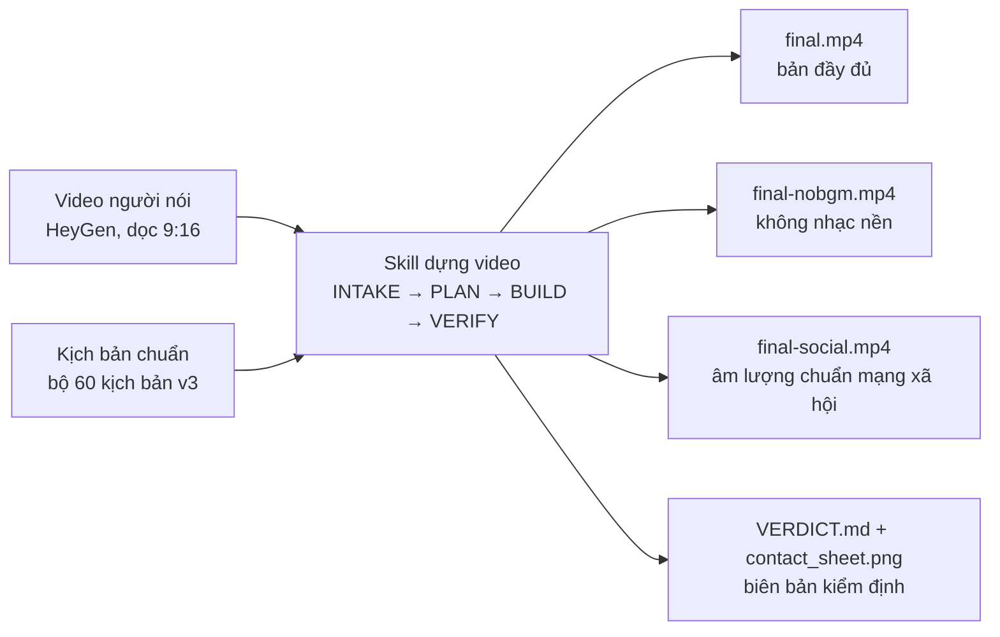
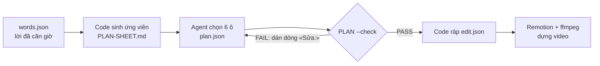
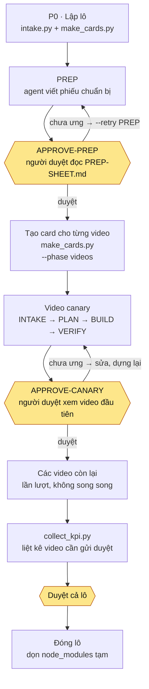
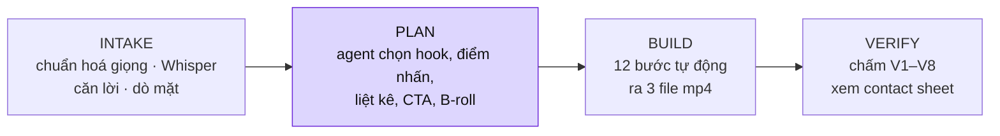
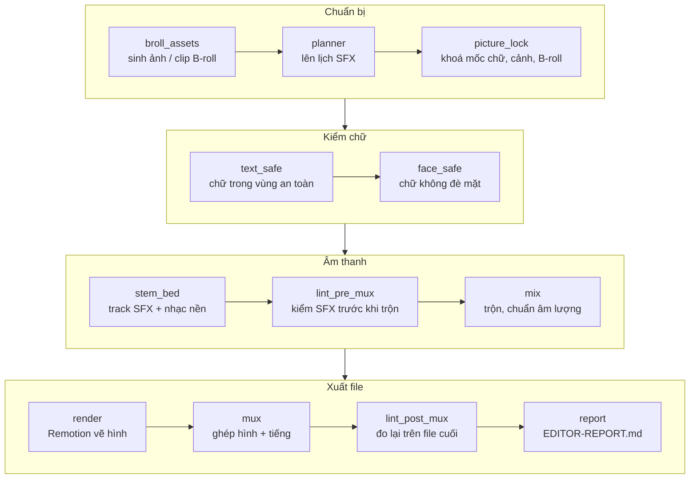

# kb-dung-video-talking-head — toàn văn tài liệu của nguồn `dung-video-talking-head`

> Trong `opa-video-studio`: mọi chỗ nhắc tới skill/mô-đun khác ("nạp X", "dùng skill X", `modules/X/MODULE.md`) = đọc `references/kb-X.md` trong chính skill này. Code / dữ liệu của nguồn này (nếu có) nằm ở `scripts/apps/dung-video-talking-head/` (riêng nguồn lõi `master-video-edit`: `scripts/`, `assets/`, `tests/`). Nội dung dưới đây giữ NGUYÊN VĂN bản gốc; luật hiện hành và cách giải mâu thuẫn nằm ở `references/rules-full.md` + `rules.json`.

<!-- ===== file: dung-video-talking-head/SKILL.md ===== -->

---
name: dung-video-talking-head
description: Use when có sẵn một video người nói quay dọc 9:16 (HeyGen, avatar AI, quay điện thoại, talking-head) và cần dựng thành video ngắn TikTok/Reels/Shorts có phụ đề động tiếng Việt, chữ hiệu ứng, cắt cỡ cảnh và sound effect — kể cả khi user đưa kèm video mẫu muốn "làm giống", hoặc nói "thêm sub", "dựng video", "kinetic subtitle", "add subtitles and text effects".
triggers:
  - "dựng video talking head"
  - "dung video talking head"
  - "thêm sub vào video"
  - "them sub video"
  - "phụ đề động"
  - "phu de dong"
  - "hiệu ứng chữ"
  - "hieu ung chu video"
  - "edit video HeyGen"
  - "làm giống video mẫu"
  - "kinetic subtitle"
metadata:
  version: 1.2.3
  category: video
  requires: "ffmpeg, node 18+, python 3.10+ (faster-whisper, numpy), font pack D:/MMO/Font/Cinematic fonts pack"
---

# Dựng video talking-head (1.1.1 — router)

`${HERMES_SKILL_DIR}` = thư mục chứa file này. Bản 1.1.1 chạy qua Hermes kanban: mọi việc đi qua **card con trỏ** (P0 → PREP → APPROVE-PREP → INTAKE → PLAN → BUILD → VERIFY → APPROVE-CANARY); operator làm theo `releases/1.2.3/stages/OPERATOR.md`.

## Việc của agent nhận card

1. Lệnh đầu tiên luôn là `python "${HERMES_SKILL_DIR}/releases/1.2.3/scripts/stage.py" STAGE --task ID` — thay `STAGE` bằng chữ sau `STAGE:` của card (card `STAGE: PREP-1` ⇒ `PREP`), `ID` bằng id trong câu "work kanban task t_…", `1.1.1` bằng số sau `RULES: dung-video-talking-head@` của card; không gõ dấu `<` `>`. Ví dụ: `python "${HERMES_SKILL_DIR}/releases/1.2.3/scripts/stage.py" PREP --task t_1a2b3c4d`. Sau đó chỉ chạy đúng lệnh in ở dòng `NEXT`.
2. Chép **nguyên văn** `SUMMARY`/`NEXT` mà script in ra vào comment card bằng tool `kanban_comment`.
3. Không sửa `rules.json`, component hay bất cứ script nào trong `releases/<ver>/`; không tự viết script mới; không dùng `python -c`; không sửa `edit.json` — chỉ ghi `plan.json`.
4. Chỉ **PREP** (`releases/<ver>/stages/PREP.md`) và **PLAN** (`releases/<ver>/stages/PLAN.md`) cần agent phán đoán; các stage khác chỉ chạy `stage.py` (riêng VERIFY: xem contact sheet theo dòng `NEXT` — V7).
5. Lỗi hay xong: làm đúng theo dòng `NEXT` — block bằng tool `kanban_block`, complete bằng tool `kanban_complete` chỉ khi `NEXT` bảo; không dùng lệnh `hermes kanban` trong terminal. Card đã bị block thì **không tự unblock**.

## Bản 1.0.0

Card 1.1.1 **không** đọc `legacy/1.0.0/` (quy trình cũ: agent tự viết `edit.json`, tự build/render), không chép gì từ đó.

<!-- ===== /file: dung-video-talking-head/SKILL.md ===== -->

<!-- ===== file: dung-video-talking-head/CHANGELOG.md ===== -->

# Changelog

Định dạng tự do (không theo Keep a Changelog), mốc theo `metadata.version` của `SKILL.md`.

## [1.2.3] — 2026-09-26

Sửa sau lô b05 (spec `docs/specs/2026-09-26-talking-head-1.2.3-design.md`).

- F1 (R221, lô b05 video 30/40/45/46): BUILD tự áp hero thì ghi dòng PLAN vào STATE.md rồi dừng sớm, agent chạy lại đúng lệnh BUILD — hết bị terminal cắt ở 420 s và _require_rows chặn lần chạy lại; giới hạn 2 vòng tính qua các lần chạy lại.
- F2: BANNED thêm từ sinh chữ trên giấy ghi chú / checklist / màn hình chat (note, checklist, checkbox, written, bullet, handwritten, chat, message, texting…).

## [1.2.2] — 2026-09-26

Sửa sau lô b04 (spec `docs/specs/2026-09-26-talking-head-1.2.2-design.md`).

- F1: FACE_ROOM mà mọi lớp đều có hero một hàng qua PLAN --check ⇒ BUILD tự gộp vào plan.json (bản cũ ở out/safe/plan_before_autohero.json), ghi lại edit.json và dựng lại từ planner (tối đa 2 vòng); còn lại FAIL như cũ (b04: 8/10 video phải mở lại PLAN chỉ để dán dòng GỘP SẴN).
- F2: BANNED thêm từ sinh nhãn/chữ, số liệu giả, logo, nhân vật có bản quyền (side-by-side, split screen, graph, metrics, youtube, game character…); «Sửa:» của BROLL_PROMPT chỉ cách viết thay; §B/PLAN.md: cùng sản phẩm tả cả dáng + màu.
- F3: ảnh B-roll có viền đều (trắng/đen, chuyển đột ngột) được cắt trước khi phủ khung (b04 v12 B4).
- F4: render_video.py in GỢI Ý thiếu RAM khi Remotion báo «No frame found at position».

## [1.2.1] — 2026-09-24

Sửa sau lô b03 (spec `docs/specs/2026-09-24-talking-head-1.2.1-design.md`).

- F1: face_safe dùng ảnh dò không hook (`face_png`) cho lớp hiện lúc tít hook còn trên hình — trước đây tít hook bị tính là chữ của thẻ đầu ⇒ FACE_ROOM giả; b03 video 6/12/13 phải bỏ hook (R208/R210).
- F2: `broll_plan.recommend` dưới sàn độ phủ ⇒ lấy bộ gom theo thời gian (b03 video 11: 22 % → 26 %); §B in sàn/trần/số ô/khoảng cách thật và phủ của đề xuất.
- F3: `broll.style_suffix` thêm «unbranded generic products and devices»; §B + PLAN.md: cùng sản phẩm ⇒ chép nguyên một cụm mô tả vào mọi prompt, không tên hãng.
- F4: assets.json có `fallback_reason`; VERIFY ghi lý do clip rơi về ảnh (vd 403 spending-limit của xAI).
- R217 (2026-09-26, lô b04 video 22): dò lại cue trên mix/final bằng tương quan chéo chuẩn hoá (`audio.match_at`, dùng ở `mux.cue_offset_f` và L11 `lint_post._cue_offset_f`) — tương quan thô bị giọng to kéo lệch, báo lệch giả +8,72 f cho whoosh −28 dB trong khoảng lặng trước giọng −19 dB.

## [1.2.0] — 2026-09-23

- R209 (2026-09-24, lô b03 video 6/12): Subtitle.tsx — dòng cuối của thẻ rơi từ trên xuống (trượt từ dưới lên làm chữ + quầng nhoè chui qua đáy vùng an toàn, text_safe FAIL khi khung dò trùng lúc từ đang hiện); HERO_ROW_FIT 0,98 → 0,95 (quầng nhoè ngang + advance đo hụt).

- R207 (2026-09-24, lô b03 video 4): build._plan_passes chép thêm meta.json vào thư mục tạm — thiếu nó thì plan có B-roll trượt BROLL_FORBIDDEN khi chạy thử, mọi gợi ý FACE_ROOM bị bỏ («không có gợi ý tự động»).

- R206 (2026-09-24, lô b03): PREP.md §4 — mặc định `broll_class` `light` cho lô dựng bằng 1.2.0; `none` chỉ khi user ghi rõ; ví dụ khuôn có một video light. OPERATOR.md: ví dụ lệnh intake dùng `--rules 1.2.0`.

B-roll AI cắt cảnh toàn màn hình (D-B1–D-B7): bổ sung ô B-roll tại PLAN và PLAN-SHEET (§B) với prompt tiếng Anh; bước BUILD `broll_assets` tự động sinh ảnh tĩnh (`ag/nano-banana`) kèm hiệu ứng đẩy nhẹ hoặc tối đa 1 video clip (`xai/grok-imagine-video`) qua 9router (cổng R0b); component Remotion `Broll.tsx` dựng B-roll đè toàn màn hình dưới phụ đề; âm thanh `broll_in` (B11) kích hoạt tại mốc chuyển cảnh; kiểm định V8 trong `verify.py` xác thực hiển thị B-roll thực tế tại khung hình giữa slot và chống phẳng ảnh; bộ luật mới `broll.*` cùng `sfx.sync_frame.broll_in`; các phán quyết Ruling R200–R203; cổng đo R0b đạt chuẩn; nâng cấp hợp đồng kế hoạch sang `plan/2` (tương thích ngược hoàn toàn với `plan/1`).

### Phán quyết đáng chú ý

- **B-roll AI cắt cảnh toàn màn hình (D-B1, D-B2, Ruling R202)**: B-roll dựng đè toàn bộ khung hình người nói (full coverage) trong khoảng 2–4 s mỗi slot; tiếng avatar và phụ đề vẫn chạy liên tục xuyên suốt; hỗ trợ ảnh tĩnh AI tạo bởi `ag/nano-banana` kết hợp hiệu ứng đẩy (push) nhẹ hoặc tối đa 1 clip động `xai/grok-imagine-video` cho mỗi video; sinh asset hoàn toàn tự động trong bước BUILD `broll_assets` mà không phát sinh thêm card kanban.
- **B-roll AI không bao giờ là bằng chứng (Ruling R200, B16)**: B-roll AI chỉ dùng cho mục đích minh hoạ hoặc bối cảnh không gian; các video nhóm `heavy` bắt buộc đặt `claim_gate: true` và báo cáo chỉ rõ các cảnh quay thực tế còn thiếu.
- **Không in nhãn AI trực tiếp lên khung hình (Ruling R201, B17)**: Giữ nhất quán với bản dựng avatar không nhãn của 1.1.1; công bố nhãn AI qua tính năng gắn nhãn của nền tảng khi đăng tải, được tự động nhắc nhở trong `EDITOR-REPORT.md`.
- **Giới hạn độ phủ B-roll tối đa 40% (Ruling R203, B04)**: Khống chế tổng thời lượng B-roll trong khoảng 25–40% tổng độ dài video (dưới 45–60 s) để bảo đảm không làm lu mờ gương mặt người nói; trần 40% là cổng kiểm tra cứng bắt lỗi `BROLL_COVER_OVER`.
- **Cổng đo R0b đạt chuẩn (2026-09-23)**: Thử nghiệm thực tế với 9router xác nhận tích hợp thành công model ảnh `ag/nano-banana` và video `xai/grok-imagine-video` (chi phí ~0,35 USD/clip, thời gian phản hồi ~40 s).
- **Âm thanh và hình ảnh đồng bộ (B11, V8)**: Tiếng động chuyển cảnh `broll_in` bám dính cue và xuất hiện cùng frame chuyển cảnh B-roll; khâu kiểm định V8 bảo đảm B-roll thực sự hiển thị trên video render cuối cùng và kiểm tra độ lệch chuẩn ánh sáng chống khung hình phẳng.
- **Nâng cấp schema kế hoạch sang `plan/2`**: Bổ sung trường `broll` vào schema kế hoạch; hỗ trợ trích xuất và kiểm tra độc lập; tương thích ngược hoàn chỉnh với các kế hoạch chuẩn `plan/1`.

## [1.1.1] — 2026-09-16

Bản sửa lỗi canary toàn diện sau đợt dựng thử nghiệm video 16: giải quyết triệt để 5 khuyết điểm nhìn thấy (D1–D5), 2 lỗi luồng agent (G11-1, G11-3), và các lỗi tiềm ẩn P1–P13 phát hiện trong quy trình. Bổ sung bước BUILD `face_safe` đảm bảo chữ không đè miệng người nói (D1, P2), sửa lỗi móc chữ ư bị cắt khi render qua paint pad + `ink.ts` (D2), chuẩn hoá ngắt câu/ngoặc kép qua textmarks (D3), chống xé từ ghép tiếng Việt và giữ dấu câu nội tại qua lexicon (D4, P6), chống cụt từ cuối và trôi từ dính (D5), thay thế hoàn toàn cơ chế agent tự sinh script nháp bằng hợp đồng kế hoạch tất định qua `plan.json` và chặn `PLAN_DRIFT` (G11-1, G11-3, P1), tự động hoá đề xuất thẻ liệt kê bước qua candidate S (P3), khoá từ dính `glue` tránh rớt dòng chữ hoa/CTA (P5), triệt tiêu frame đen đầu video và đuôi video bị cụt (P7, P8), cắt cảnh đúng điểm lặng qua `CUT_SNAP` (P9), hồi phục SFX cho CTA (P10), lọc trùng whoosh và bảo đảm âm thanh gắn liền sự kiện hình ảnh (P11), chọn offset BGM theo độ dải động tối thiểu tránh tăng âm đột ngột (P12), hoãn cân chỉnh SFX ngoài dải giọng sang R1 (P13), và chỉ thêm chi phí mềm `side_char_over` cho dòng nhỏ dài (P4 — không có cổng chặn, để vòng hiệu chỉnh R1).

**Ghi chú khoá version (phán quyết R50):** 1.1.1 thêm luật và thêm một bước BUILD (`face_safe`) — theo đúng quy ước ghi trong mục `[1.1.0]` thì đó là mức **minor**. Nhưng user đã quyết định gọi là **"1.1.1 sửa lỗi canary"** (phán quyết R50), vì mọi thay đổi đều nhằm sửa các khuyết điểm của lần dựng canary video 16 và schema `edit/1.1` chỉ đổi ba chỗ tương thích (`shots[].y ≤ 0`, hai trường tuỳ chọn `words[].glue` và `steps.rows`).

### Phán quyết đáng chú ý

- **Hợp đồng PLAN mới (`plan.json` + `PLAN-SHEET.md`)**: Giải quyết tận gốc G11-1, G11-3 và P1. Agent không viết file nháp ngoài quy trình hay tự sửa `edit.json` mà chỉ điền 5 quyết định vào `plan.json` (`hook/emphasis/steps/cta/hero`) từ các ứng viên sinh tự động; code dựng (`compose`) tự động ráp `edit.json`; `verify.py` kiểm tra ráp lại độc lập và bắt lỗi `PLAN_DRIFT` nếu có can thiệp tay. `PLAN-SHEET.md` là tài liệu duy nhất agent cần đọc ở khâu PLAN.
- **Đóng lỗi G11-1 bằng số đo**: `compose(recommended_plan)` đạt 0 lỗi trên 12/12 video thật (v2, v16 và 10 fixture thật), số ghi chú chỉ 0–5 mỗi video. Hàm `editschema.propose` cũ của 1.1.0 (nguồn gốc khiến agent lạc lối sinh script nháp) đã bị xoá hoàn toàn cùng 135 dòng mã phụ trợ, có test chặn tái phát.
- **Đối chuẩn canary trên video 2**: Bản dựng 1.1.0 của video 2 lộ đúng 8 lỗi dưới bộ luật 1.1.1: 6 lỗi `TIERS` (hero 3 tầng 10–23 ký tự vượt trần 8 ký tự), 1 lỗi `STEPS_SHOT` (thẻ liệt kê nằm trên cảnh cỡ 1,04 — thẻ liệt kê phải nằm trong cảnh cận, cỡ ≥ 1,14), 1 lỗi `BLOCK_LEN` (thẻ cuối 1,35 s trên hình) — khớp chính xác các khuyết điểm đã ghi nhận từ canary.
- **Bảo vệ khuôn mặt (`face_safe` — D1, P2)**: Thêm bước BUILD `face_safe` với thuật toán FACE_FIT (nâng trục y, kẹp trần s1, đẩy rộng s0) và cổng kiểm tra FACE_ROOM / `facesafe.check`, bảo đảm phụ đề không chạm vùng miệng người nói tại các block có nguy cơ (b12, b13, b19 trên v16).
- **Phục hồi dấu tiếng Việt và chữ dính (`ink.ts`, lexicon — D2, D4, P5)**: Bổ sung khoảng đệm vẽ (paint pad) trong `Subtitle.tsx` và vùng dành cho nét chữ `ink.ts` (sinh tự động) để móc chữ ư không bị cắt (như "tính từ" thành "tính tù" ở D2); tích hợp bộ từ điển ghép tiếng Việt giữ dấu câu nội tại (`COMPOUND_SPLIT`, `DISPLAY_PUNCT`), khoá trường `glue` theo cặp từ trong lexicon, chuỗi chữ hoa và từ khoá CTA để chống rớt dòng ("UGC THOẠI", "tự nhiên").
- **Nhận diện số và chuẩn hoá từ khoá CTA**: Phép thử "từ là số" loại trừ «một», «không», «thứ N» để tránh sinh nhầm hook «KHÔNG» ở giây 1,5 của v16; từ khoá CTA chỉ ép làm hero trong vùng CTA (ngoài vùng là điều kiện loại S20), chuẩn hoá cách đọc số («7 NGÀY» ↔ «bảy ngày»), hỗ trợ động từ CTA hai từ («bình luận») và mở rộng cụm từ khoá đơn («Bình luận BRIEF»); nếu từ khoá gây lỗi 3 tầng TIERS thì ngắt thẻ ngay sau từ khoá.
- **Giữ trần hero một dòng `text.hero_one_row_chars` = 8**: Đo lường thực tế bằng PIL trên Subtitle.fitSize chứng minh nới trần sẽ làm lỗi tràn biên P4 quay lại; bác bỏ đề xuất phạt "hero hai dòng" vì đo đạc thực nghiệm trên v16 cho thấy hero bị hạ xuống các từ phụ không mong muốn («NHÂN VẬT», «ĐANG KỂ»).
- **Khử trùng lỗi và chuẩn hoá cấu hình**: Lỗi trùng lặp từ hai nguồn được gộp theo cặp `(mã, vị trí)` và ưu tiên giữ câu thông báo có hướng dẫn sửa lỗi; chuẩn hoá `plan.emphasis_min_video_s` = 30 khớp chính xác tài liệu thiết kế §11.
- **Sửa sau lần dựng lại canary video 16 (2026-09-17)**: cổng `face_safe` kiểm thật các lớp chữ (trước đó khoá mặt nạ sai nên kiểm 0 lớp) và kiểm mỗi khung theo đúng shot `Footage.tsx` vẽ ở mốc cắt lẻ khung; vòng FACE_ROOM cộng dồn — BUILD lưu `out/safe/face_room_plan.json`, PLAN nạp sẵn plan đó vào `plan.json` (mục §0b).
- **Hero một hàng (`hero_row`, `text.hero_row_max_chars` = 16 — lô b01 nới từ 14 cho từ khoá CTA)**: hero ghi đè (`plan.hero`) dài 9–16 ký tự dựng MỘT hàng, cỡ co theo bề rộng glyph thật (`ink.ts` ADV do `tools/make_ink_table.py` sinh) — giữ cụm có nghĩa («kể trải nghiệm», «dễ hình dung») thay vì đổi sang từ nối ≤ 8 ký tự («đang kể», «Nó khiến»). Gợi ý FACE_ROOM ưu tiên hero một hàng và chỉ in phương án đã chạy thử qua PLAN `--check`. Trần 8 ký tự của hero ba tầng thường giữ nguyên.
- **Ngưỡng giọng S28 `voice.tilt_min_db` −8,5 → −9,5 dB (2026-09-17, lô b01)**: đo 58 video HeyGen cùng giọng — trung bình −8,11 dB, lệch chuẩn 0,40, thấp nhất −8,91; ngưỡng cũ chặn 8/58 (có canary 21) dù không có cụm giọng hỏng riêng. User nghe A/B rồi duyệt.

## [1.1.0] — 2026-09-12

Tái cấu trúc lớn: rules-as-data (`rules.json` + `rules.schema.json`), planner
SFX/BGM tất định theo khoảng ngắt (S01–S29), một trục âm thanh duy nhất (stem +
mux ffmpeg), ánh xạ video↔kịch bản theo nội dung (không dán tay), stage PREP,
pipeline 4 card/video trên Hermes kanban, và `verify.py` (V1–V7) tất định.

**Ngoại lệ khoá version (spec §4.3):** 1.0.0 → 1.1.0 là lần **duy nhất** một
bản minor được phép đổi cả schema (`edit.json` 1.0 → `edit/1.1`, chỉ số từ thay
vì giây) và thứ tự pipeline trong một lần. Từ bản này trở đi: patch = đổi số
luật hoặc sửa lint; minor = thêm luật/stage; major = đổi schema hoặc thứ tự
pipeline.

### Phán quyết đáng chú ý

- **R9** — khâu đỉnh giọng (`thlib/voice.py`): chain gain tuyến tính → `alimiter`
  (ngưỡng = trần TP đích − 0,5 dB, `level=false`, `latency=true`) → loudnorm
  tuyến tính hai lượt; `vo_clear` raise khi ffmpeg báo lượt phi tuyến. Lý do:
  giọng HeyGen có PLR 13,9–16,3 dB nên đạt −16 LUFS với TP ≤ −2 dBTP không thể
  chỉ bằng gain tuyến tính; limiter look-ahead là thực hành R128 chuẩn, đo tốn
  ≤ 0,08 LU và giữ xcorr ở −0,08 ms.
- **R19 / R35** — khâu đỉnh cho final/nobgm/social (`thlib/mix.py`): R19 áp lại
  đúng pattern R9 cho mix cuối; R35 tinh chỉnh riêng cho **file social giao
  cho user**: loudnorm tuyến tính hai lượt trên `mix.wav` (lossless, chưa
  encode) qua limiter true-peak (ngưỡng = trần đích − 0,5 dB) rồi mới encode
  AAC, đo lại TP như L11 và hạ trần thêm đúng phần vượt + 0,1 dB, tối đa 3 lần
  thử — vì bộ limiter theo mẫu của R19 áp trực tiếp lên AAC fail TP sau khi
  encode lần hai (cộng thêm 0,09–3,2 dB không đoán trước được) trên 6/6 project
  thật; cách của R35 đạt 6/6, 5/6 ngay lần thử đầu ở −2,0 dBTP.
- **R26 / R29** — probe text-safe (`check_text_safe.py`, `Subtitle.tsx`): R26
  giữ nguyên nghĩa đen "alpha > 0 ngoài hộp là FAIL" của B14, nhưng probe render
  `TextOnly` **tắt trang trí** (glow, drop/text/box-shadow, backdrop-blur) —
  chỉ đo glyph và nền/viền thẻ, pill; R29 giữ nguyên bốn loại tắt của R26
  nhưng vẫn đo blur/opacity chuyển động, và thêm quy tắc
  `steps.out = min(item cuối.e + 0,15; block sau.show đầu tiên − 0,10)` để thẻ
  liệt kê tắt trước khi block sau hiện. Lý do: đo `alpha > 0` trên hiệu ứng mềm
  từng ép layout che miệng người nói ở Task 11; ý B14 là chữ không đè lên UI
  nền tảng, không phải cấm mọi hiệu ứng mềm.
- **R30 / R31** — từ cuối mỗi block đọc được (`thlib/picture.py`,
  `Subtitle.tsx`): R30 bắt từ cuối mỗi block đậm ≥ 90 % trong ≥ 3 frame liền
  trước khi tắt, dùng chuyển nhanh 2 khung khi thoát thường 6 khung sẽ cắt mất
  nó; R31, khi vẫn không đủ, dời mốc hiện (`display_shift_s`) ≤ 0,15 s mỗi từ
  (từ bị lùi ≤ 0,10 s sau onset thật, sự kiện đã đồng bộ không bao giờ dời) —
  còn lại thì gắn cảnh báo `LAST_WORD_TIGHT` (CONCERN, không FAIL). Lý do:
  7/17 block của video 02 cắt mất từ cuối ở bản 1.0.0 — một lỗi phụ đề thấy
  được; sau R30–R31 cả 17/17 block đọc được.

### Thêm

- `thlib` (pure functions, unit test riêng) + CLI mỏng trên `stage.py`:
  P0 (`intake.py`, `make_cards.py`) → PREP → APPROVE-PREP → INTAKE → PLAN →
  BUILD → VERIFY → APPROVE-CANARY (spec §9, §10).
- `rules.json` + `rules.schema.json`: mọi số nằm trong dữ liệu, khoá qua
  `rules.lock` + `releases/1.1.0/MANIFEST.sha256` (spec §4.3).
- `verify.py` (V1–V7) tất định; `check_prep.py`, `check_text_safe.py`.
- `releases/1.1.0/stages/OPERATOR.md` cho opa-operator (Ruling R15); `collect_kpi.py`
  gom `out/verify/kpi.json` vào `_batches/<b>/kpi.jsonl`, in danh sách video gửi user
  duyệt (D5) và xoá `node_modules` khi đóng lô.
- `tools/check_drift.py` (M0, chỉ đọc; 9 mục, gồm con trỏ SOUL.md của operator/
  editor/verifier và board `vm-heygen-1` + card `t_81a309b2` đã archive — spec
  §13.1 mục 2 và 4 — và thư mục skill đang dùng sạch theo git) và `tools/make_manifest.py` — công cụ dev, để ở `tools/` vì
  Hermes không liệt kê thư mục này cho worker.

### Đổi

- Schema `edit.json`: 1.0 (giây) → `edit/1.1` (index từ trong `words.json`).
- Trục âm thanh: một stem duy nhất render bằng Python + mux ffmpeg, thay chuỗi
  ghép tay nhiều lớp của 1.0.0.
- `SKILL.md`: từ quy trình đầy đủ (agent tự viết `edit.json`, tự build/render)
  thành router ≤ 40 dòng trỏ vào `stage.py` + `stages/PREP.md` / `PLAN.md` —
  bản 1.0.0 vẫn xem được qua `git show v1.0.0:SKILL.md`.
- **R36** — bố cục gốc skill: `references/`, `scripts/` (`new_project.py`),
  `assets/` (pack SFX 1.0.0), `template/`, `examples/` của 1.0.0 chuyển vào
  `legacy/1.0.0/` (giữ nguyên cấu trúc bên trong, `new_project.py` vẫn chạy tại
  chỗ). Lý do: Hermes đưa `references/`, `templates/`, `assets/`, `scripts/` ở
  gốc skill vào prompt của mọi worker như "supporting files" — tài liệu 1.0.0
  (schema tính bằng giây) ở đó mở lại kênh trôi "chép từ bản trước" (spec §4.3).
  Tag `v1.0.0` giữ bố cục gốc.

<!-- ===== /file: dung-video-talking-head/CHANGELOG.md ===== -->

<!-- ===== file: dung-video-talking-head/README.md ===== -->

# Dựng video talking-head tự động

Skill cho **Hermes Agent**: nhận video người nói quay dọc 9:16 (HeyGen, avatar AI, quay điện thoại) và dựng thành video ngắn TikTok / Reels / Shorts hoàn chỉnh — phụ đề động tiếng Việt, B-roll AI, hiệu ứng âm thanh, nhạc nền — rồi **tự kiểm định chất lượng** trước khi giao.

| | |
|---|---|
| **Bản đang dùng** | `1.2.3` (2026-09-26) — thư mục `releases/1.2.3/` |
| **Chạy trên** | Hermes Agent + Hermes Kanban (Windows), Remotion, ffmpeg, Whisper |
| **Hướng dẫn vận hành chi tiết** | [`docs/HUONG-DAN-SU-DUNG.md`](docs/HUONG-DAN-SU-DUNG.md) |
| **Lịch sử thay đổi** | [`CHANGELOG.md`](CHANGELOG.md) |


<sub>Ảnh trên là lớp chữ render thật của video 2 (lấy từ `tests/fixtures/broll_v2_b13/out/safe/`). Bản kiểm này tắt glow/bóng chữ để đo vùng an toàn — trong video thành phẩm chữ có thêm hiệu ứng.</sub>

---

## Mục lục

1. [Skill này làm gì](#1-skill-này-làm-gì)
2. [Năm ý tưởng cốt lõi](#2-năm-ý-tưởng-cốt-lõi--đọc-phần-này-trước)
3. [Quy trình một lô video](#3-quy-trình-một-lô-video)
4. [Bên trong một video: 4 card](#4-bên-trong-một-video-4-card)
5. [Kết quả nhận được](#5-kết-quả-nhận-được)
6. [Chuẩn bị máy](#6-chuẩn-bị-máy)
7. [Bắt đầu nhanh](#7-bắt-đầu-nhanh)
8. [Cấu trúc repo](#8-cấu-trúc-repo)
9. [Phát triển và phát hành bản mới](#9-phát-triển-và-phát-hành-bản-mới)
10. [Lịch sử phiên bản](#10-lịch-sử-phiên-bản)
11. [Thuật ngữ](#11-thuật-ngữ)

---

## 1. Skill này làm gì



Mỗi video được dựng chồng **bốn lớp** lên video người nói:

| Lớp | Skill làm gì |
|---|---|
| **Phụ đề động** | Thẻ chữ 3 tầng (dòng nhỏ trên · chữ HERO ở giữa · dòng nhỏ dưới), hiện theo nhịp giọng; thêm hook mở đầu, thẻ liệt kê, nút CTA. Chữ tự né vùng mặt người nói. |
| **B-roll AI** | Ảnh tĩnh hoặc clip AI phủ toàn màn hình 2–4 giây ở các câu phù hợp, tổng 25–40 % thời lượng; giọng và phụ đề vẫn chạy liên tục. |
| **Hiệu ứng âm thanh (SFX)** | Whoosh, pop, click, impact đặt đúng khung hình chữ bật lên hoặc cắt cảnh. |
| **Nhạc nền (BGM)** | Tự chọn đoạn nhạc và dìm dưới giọng, không đè tiếng người nói. |


<sub>Minh hoạ ghép từ dữ liệu test của video 2 (khung 215 và lớp chữ khung 211). Ảnh người nói là bản xám dùng để dò mặt; video thành phẩm có màu, cỡ cảnh zoom và hiệu ứng chữ đầy đủ.</sub>

---

## 2. Năm ý tưởng cốt lõi — đọc phần này trước

Hiểu năm điều này thì đọc mọi tài liệu khác trong repo đều dễ.

### 2.1 Agent chỉ *chọn*, code làm phần còn lại

Ở bản 1.0.0 agent tự viết `edit.json` và tự build, nên dễ làm lệch luật và tự viết script nháp ngoài quy trình. Từ 1.1.1, agent **chỉ ghi một file `plan.json`** với 6 ô quyết định (hook, điểm nhấn, thẻ liệt kê, CTA, hero, B-roll), chọn trong danh sách ứng viên mà code đã sinh sẵn. Mọi mốc giây, khung hình, cắt cảnh đều do code tính.



Ai sửa tay `edit.json` sẽ bị bước VERIFY bắt lỗi `PLAN_DRIFT`.

### 2.2 Mọi con số nằm trong `rules.json`

Ngưỡng âm lượng, độ dài chữ, độ phủ B-roll, nhịp cắt… đều là dữ liệu trong `releases/<bản>/rules.json` (có schema `rules.schema.json`), không rải trong code. Muốn đổi luật là ra bản mới.

### 2.3 Bản phát hành đóng băng

Mỗi thư mục `releases/<bản>/` có `MANIFEST.sha256` băm từng file. Bản đã phát hành **không bao giờ sửa lại** (test `test_release_frozen.py` chặn), nên video dựng bằng bản nào cũng tái lập được đúng như cũ. Mỗi video ghi lại bản luật đã dùng (`rules.lock`); VERIFY từ chối (V1) nếu luật bị đổi giữa chừng.

### 2.4 Người duyệt ở ba mốc, lời duyệt chép nguyên văn

Máy làm, người chốt: **duyệt phiếu chuẩn bị (PREP)**, **duyệt video đầu tiên (canary)**, **duyệt cả lô**. Mọi lời duyệt được chép nguyên văn vào comment card và `_batches/<lô>/APPROVALS.md` trước khi đóng card.

### 2.5 Lỗi thì làm lần thử mới, không gỡ khoá card

Card bị block không bao giờ được unblock tay. Luôn dùng `make_cards.py --retry <video>:<STAGE>` để tạo lần thử mới (`a2`, `a3`…) và lưu trữ card cũ — lịch sử lỗi còn nguyên để truy lại.

---

## 3. Quy trình một lô video

Một **lô** (`b01`, `b02`…) gồm tối đa 10 video, chạy trên một board Kanban riêng `vm-heygen-<lô>`.



Ô màu vàng là chỗ **người duyệt** phải trả lời; còn lại máy tự chạy.

| Bước | Ai làm | Người duyệt cần làm |
|---|---|---|
| **P0 · Lập lô** | `opa-operator` chạy `intake.py`, `make_cards.py` | Đưa danh sách số video (≤ 10) |
| **PREP** | `opa-editor` viết `prep/prep-<k>.json` → script dựng `PREP-SHEET.md` | — |
| **APPROVE-PREP** | `opa-operator` gửi phiếu, chép lời duyệt | Xem trạng thái từng video (`ok` / `needs_rerender` / `needs_input`), gắn `claim_gate` nếu cần |
| **Canary** | `opa-editor` + `opa-verifier` dựng trọn 1 video | Chờ |
| **APPROVE-CANARY** | `opa-operator` gửi `final.mp4` + `VERDICT.md` | Xem, nghe kỹ; duyệt hoặc ghi lỗi kèm mốc `mm:ss` |
| **Các video còn lại** | Worker chạy từng card một; whisper/render xếp hàng qua khoá `_batches/.heavy.lock` | Không cần làm gì |
| **KPI + duyệt lô** | `collect_kpi.py` in các dòng `GỬI USER: …` | Xem các video được gửi, duyệt cả lô hoặc trừ video lỗi |
| **Đóng lô** | `collect_kpi.py --prune-node-modules` xoá `node_modules` tạm | Xác nhận đã nhận đủ |

Lệnh cụ thể từng bước, cách ghi lời duyệt và cách xử lý sự cố: xem [`docs/HUONG-DAN-SU-DUNG.md`](docs/HUONG-DAN-SU-DUNG.md) mục 4–6 và [`releases/1.2.3/stages/OPERATOR.md`](releases/1.2.3/stages/OPERATOR.md).

---

## 4. Bên trong một video: 4 card



Agent nhận card luôn chạy đúng một lệnh đầu tiên — `stage.py <STAGE> --task <id>` — rồi chỉ làm theo dòng `NEXT` mà script in ra. **Chỉ PREP và PLAN cần agent phán đoán** (ô tím); các bước khác là script tất định.

| Card | Ai chạy | Làm gì | Ghi ra |
|---|---|---|---|
| **INTAKE** | `opa-editor` | Chuẩn hoá giọng (−16 LUFS), Whisper large-v3 nghe lời, căn từng từ với kịch bản chuẩn, tìm khoảng ngắt, dò mặt người nói | `words.json`, `pauses.json`, `meta.json`, `face.json`, `public/vo-clean.wav` |
| **PLAN** | `opa-editor` | Đọc `PLAN-SHEET.md`, điền 6 ô trong `plan.json`, chạy `--check` (tối đa 3 vòng) | `plan.json` → code ráp `edit.json` |
| **BUILD** | `opa-editor` | 12 bước bên dưới | `out/final*.mp4`, `QA.json`, `EDITOR-REPORT.md` |
| **VERIFY** | `opa-verifier` | Chấm 8 mục V1–V8, xem contact sheet bằng mắt | `out/verify/VERDICT.md`, `contact_sheet.png`, `kpi.json` |

### 4.1 Mười hai bước của BUILD



Bước nào trượt thì BUILD dừng ở đó và in mã lỗi. Hay gặp nhất là `FACE_ROOM` (chữ chạm vùng mặt): từ bản 1.2.3, BUILD tự đổi sang hero một hàng (tối đa 2 vòng), ghi vào `STATE.md` rồi dừng sớm — agent chỉ cần chạy lại đúng lệnh BUILD.

### 4.2 Tám mục kiểm định của VERIFY

| Mã | Kiểm gì |
|---|---|
| **V1** | Luật dựng khớp đúng bản phát hành đã đóng băng và đúng bản ghi trên card |
| **V2** | Phụ đề, SFX, vùng an toàn chữ không lỗi kỹ thuật |
| **V3** | Đồng bộ: mỗi tiếng động lệch so với hình dưới ngưỡng cho phép |
| **V4** | Âm lượng: `final` và `final-nobgm` −16 LUFS, `final-social` −14 LUFS (±0,5), kèm trần True-Peak |
| **V5** | Mọi file trung gian khớp mã băm ghi trong `STATE.md` (truy được nguồn gốc) |
| **V6** | `EDITOR-REPORT.md` đủ mục, không có bản vá tạm ngoài luồng |
| **V7** | Ghép 12 khung (lưới 4×3) thành `contact_sheet.png` để người xem bằng mắt |
| **V8** | B-roll thực sự hiện trên video cuối, không bị phẳng hình, khớp danh mục |

Kết luận cuối là một trong ba trạng thái:

- **`VERIFIED`** — đạt hết, không có ghi chú.
- **`DONE_WITH_CONCERNS`** — đạt nhưng có điểm cần người xem (ví dụ clip B-roll rơi về ảnh tĩnh, từ cuối thẻ hiện hơi gấp).
- **`REJECTED`** — có mục FAIL; `VERDICT.md` chỉ rõ card nào phải làm lại.

---

## 5. Kết quả nhận được

Mỗi video có một thư mục dựng `D:/MMO/Van Minh AI/Vid Heygen/<n>/edit-r1.2.3/`:

```text
edit-r1.2.3/
├── STATE.md              nhật ký chỉ ghi thêm: mỗi bước + mã băm từng file
├── plan.json             quyết định của agent (file duy nhất agent viết)
├── edit.json             code ráp từ plan.json — không sửa tay
└── out/
    ├── final.mp4         thành phẩm đầy đủ (−16 LUFS)
    ├── final-nobgm.mp4   không nhạc nền, để tự chọn nhạc trên nền tảng
    ├── final-social.mp4  chuẩn âm lượng mạng xã hội (−14 LUFS)
    ├── QA.json           số đo kỹ thuật
    ├── EDITOR-REPORT.md  báo cáo biên tập
    └── verify/
        ├── VERDICT.md          biên bản kiểm định V1–V8
        └── contact_sheet.png   12 khung đại diện
```

Hồ sơ của cả lô nằm ở `D:/MMO/Van Minh AI/Vid Heygen/_batches/<lô>/`: `batch_manifest.json`, `mapping.csv` (ghép video ↔ kịch bản), `PREP-SHEET.md`, `APPROVALS.md` (lời duyệt nguyên văn), `cards.json` (id card Kanban), `kpi.jsonl`, `FEEDBACK.jsonl` (lời chê → căn cứ sửa luật bản sau).

---

## 6. Chuẩn bị máy

### Phần mềm

| Thứ cần có | Ghi chú |
|---|---|
| **Python 3.10+** | Gói dùng trong scripts: `faster-whisper`, `numpy`, `scipy`, `opencv-python`, `Pillow`, `jsonschema`, `PyYAML`. Chạy test cần thêm `pytest`. |
| **Node.js 18+** | Remotion `4.0.484`, React 19 — cài tự động trong thư mục dựng của từng video (`template/package.json`). |
| **ffmpeg** | Trộn âm, ghép hình, đo âm lượng. |
| **Bộ font** | Cinematic fonts pack tại `D:/MMO/Font/Cinematic fonts pack`. |

### Hermes Agent

- Ba profile: **`opa-operator`** (điều phối, nói chuyện với người duyệt), **`opa-editor`** (PREP, INTAKE, PLAN, BUILD), **`opa-verifier`** (VERIFY).
- **Đúng một gateway gốc** đang chạy. Kiểm bằng `hermes gateway list`: dòng `default` có `✓` kèm `PID`; không dòng `opa-*` nào có PID riêng. Bật gateway gốc bằng task Windows `Hermes_Gateway` — không gõ `hermes gateway run` trong terminal của agent.
- Skill đang chạy thật nằm ở `C:/Users/Minh PC/AppData/Local/hermes/shared-skills/video/dung-video-talking-head`.

### Biến môi trường

- **`NINEROUTER_API_KEY`** — khoá cổng 9router để sinh ảnh (`ag/nano-banana`) và clip (`xai/grok-imagine-video`) cho B-roll. Không in hay ghi giá trị khoá vào tài liệu, card, log.

---

## 7. Bắt đầu nhanh

Cách dễ nhất là để **Claude Code** điều phối và giao việc cho các agent OPA Hermes. Dán vào Claude Code:

```text
Mở lô sản xuất bNN của skill dung-video-talking-head bản 1.2.3 cho các video <danh sách số, tối đa 10>.
Giao việc cho các agent OPA Hermes qua hermes kanban (không dùng subagent Claude). Giám sát kĩ: xem đủ mọi ảnh B-roll
theo picture_lock, xem contact sheet từng video, ghi nguyên văn lời duyệt vào APPROVALS.md. Báo tôi khi cần duyệt PREP,
canary và cả lô.
```

Các câu duyệt mẫu:

```text
Tôi duyệt phiếu PREP lô bNN.
Duyệt canary video N của lô bNN.
Chưa duyệt canary video N: <lỗi thấy được + mốc giây>. Sửa rồi dựng lại.
Duyệt cả lô bNN.
Duyệt lô bNN trừ video X: <lỗi + mốc giây>. Làm lại riêng video đó.
```

Đủ bộ prompt mẫu (hỏi tiến độ, card bị khoá, ảnh B-roll có chữ, sửa skill sau một lô, đóng lô…) ở [`docs/HUONG-DAN-SU-DUNG.md` mục 10](docs/HUONG-DAN-SU-DUNG.md#10-prompt-mẫu).

---

## 8. Cấu trúc repo

```text
dung-video-talking-head/
├── SKILL.md            router ngắn (≤ 40 dòng) cho agent nhận card — Hermes đọc file này
├── README.md           tài liệu bạn đang đọc
├── CHANGELOG.md        thay đổi từng bản + các phán quyết (R…)
├── docs/
│   ├── HUONG-DAN-SU-DUNG.md   hướng dẫn vận hành cho chủ kênh / operator
│   ├── 2026-09-11-…-design.md thiết kế gốc của bản 1.1
│   └── images/                ảnh minh hoạ của README
├── releases/           mỗi bản một thư mục, đóng băng sau khi phát hành
│   └── 1.2.3/          ← bản đang dùng
│       ├── rules.json, rules.schema.json   toàn bộ luật dựng dạng dữ liệu
│       ├── MANIFEST.sha256                 mã băm mọi file của bản
│       ├── stages/     OPERATOR.md · PREP.md · PLAN.md — hướng dẫn cho từng vai
│       ├── scripts/    stage.py (cửa vào mọi card), intake.py, make_cards.py,
│       │               verify.py, collect_kpi.py… và thư viện thlib/
│       ├── template/   dự án Remotion: Subtitle, Hook, StepList, Cta, Broll, Footage…
│       ├── sfx/, bgm/  kho âm thanh + manifest
│       ├── data/       từ điển tiếng Việt, mô hình dò mặt
│       └── examples/   plan.json, edit.json mẫu
├── legacy/1.0.0/       quy trình cũ (agent tự viết edit.json) — chỉ để tham khảo
├── tests/              pytest + dữ liệu test thật (khung hình, mặt, B-roll)
└── tools/              công cụ dev: check_drift, make_manifest, lexicon, face_survey…
```

> **Vì sao `legacy/` tách riêng?** Hermes tự đưa các thư mục `references/`, `templates/`, `assets/`, `scripts/` ở gốc skill vào prompt của mọi worker. Để tài liệu 1.0.0 ở gốc sẽ khiến agent chép lại cách làm cũ, nên toàn bộ được dời vào `legacy/1.0.0/` (phán quyết R36).

---

## 9. Phát triển và phát hành bản mới

### Chạy test

```bash
pip install pytest numpy scipy opencv-python Pillow jsonschema PyYAML
pytest              # test nhanh (mặc định bỏ qua nhóm slow)
pytest -m slow      # test chậm: cần faster-whisper + ffmpeg, có render thật
```

`pytest.ini` đã trỏ `pythonpath` vào `releases/1.2.3/scripts` và `tools`.

### Quy ước đánh số bản

| Loại | Khi nào |
|---|---|
| **patch** (`1.2.x`) | Đổi số trong luật hoặc sửa lint |
| **minor** (`1.x.0`) | Thêm luật hoặc thêm bước |
| **major** (`x.0.0`) | Đổi schema hoặc thứ tự pipeline |

### Quy trình ra bản mới

1. Sau mỗi lô, gom lỗi lặp lại (từ `FEEDBACK.jsonl`, `VERDICT.md`) thành spec bản mới. Việc phát triển làm ở repo dev `D:/Vibe Coding/AI Video/th-skill-1.1`, nhánh `rulebook-x.y.z`.
2. Chép `releases/<bản cũ>/` thành `releases/<bản mới>/`, sửa trong bản mới; **không đụng bản cũ**.
3. Sinh lại `MANIFEST.sha256` bằng `tools/make_manifest.py`; đổi số bản trong `SKILL.md` (`metadata.version` và đường dẫn `releases/…`), `pytest.ini`, `tests/conftest.py` (`RELEASE`); ghi `CHANGELOG.md`.
4. Test nhanh và test chậm đều xanh.
5. Chỉ triển khai khi **không còn card nào đang chạy** — đổi bản giữa lô làm video đang dựng trượt V1.
6. Đưa vào thư mục skill thật, gắn tag `vX.Y.Z`, push lên GitHub, cập nhật dòng trỏ phiên bản trong `SOUL.md` của `opa-operator`.

Chi tiết ở [`docs/HUONG-DAN-SU-DUNG.md` mục 9](docs/HUONG-DAN-SU-DUNG.md#9-cập-nhật-skill-lên-bản-mới).

---

## 10. Lịch sử phiên bản

| Bản | Ngày | Điểm chính |
|---|---|---|
| **1.2.3** | 2026-09-26 | BUILD tự áp hero một hàng khi `FACE_ROOM` rồi dừng sớm; cấm thêm từ khiến ảnh B-roll sinh chữ (ghi chú, checklist, màn hình chat) |
| 1.2.2 | 2026-09-26 | Tự gộp gợi ý hero vào `plan.json`; cắt viền ảnh B-roll; gợi ý khi Remotion thiếu RAM |
| 1.2.1 | 2026-09-24 | Sửa dò mặt khi có hook; nâng độ phủ B-roll tối thiểu; ghi lý do clip rơi về ảnh |
| 1.2.0 | 2026-09-23 | **B-roll AI** phủ toàn màn hình, kiểm định V8, schema `plan/2` |
| 1.1.1 | 2026-09-16 | Hợp đồng `plan.json` (agent chỉ chọn), bước `face_safe`, sửa dấu tiếng Việt bị cắt |
| 1.1.0 | 2026-09-12 | Tái cấu trúc: luật thành dữ liệu, pipeline 4 card trên Hermes Kanban, `verify.py` V1–V7 |
| 1.0.0 | 2026-09-11 | Bản đầu: agent tự viết `edit.json` và tự render (nay ở `legacy/1.0.0/`) |

Đầy đủ lý do từng thay đổi: [`CHANGELOG.md`](CHANGELOG.md).

---

## 11. Thuật ngữ

| Từ | Nghĩa |
|---|---|
| **Lô** (`bNN`) | Một đợt dựng tối đa 10 video, có board Kanban và thư mục `_batches/bNN/` riêng |
| **Card** | Một việc trên bảng Hermes Kanban (PREP, INTAKE, PLAN, BUILD, VERIFY, APPROVE-…) |
| **Canary** | Video đầu tiên của lô, dựng trọn và duyệt trước khi chạy các video còn lại |
| **Hero** | Chữ to ở giữa thẻ phụ đề — cụm từ quan trọng nhất của câu |
| **Hook** | Chữ/số đập ở giây đầu để giữ người xem |
| **CTA** | Lời kêu gọi hành động cuối video (ví dụ «Bình luận 5 TÀI SẢN») |
| **B-roll** | Hình minh hoạ chèn phủ lên video người nói |
| **`claim_gate`** | Cờ đánh dấu video có nội dung cần kiểm chứng thật trước khi đăng (so sánh, số liệu, case study) |
| **`needs_rerender`** | HeyGen đọc sai kịch bản (đọc cả chữ giữ chỗ `[TIN MỚI]`…) — phải render lại trên HeyGen |
| **`FACE_ROOM`** | Lỗi chữ chạm vùng mặt người nói |
| **`PLAN_DRIFT`** | `edit.json` không còn khớp `plan.json` — có người sửa tay |
| **LUFS** | Đơn vị đo độ to cảm nhận của âm thanh; −14 LUFS là mức phổ biến của mạng xã hội |
| **`--retry`** | Cách duy nhất làm lại một card lỗi: tạo lần thử mới `a<k+1>`, lưu trữ card cũ |

<!-- ===== /file: dung-video-talking-head/README.md ===== -->

<!-- ===== file: dung-video-talking-head/docs/2026-09-11-talking-head-rulebook-1.1-design.md ===== -->

# Bộ luật dựng talking-head 1.1 + dây chuyền giao việc OPA — Thiết kế

- **Ngày:** 2026-09-11 (bản 2: đã sửa theo 2 vòng soát chéo độc lập và whisper kiểm lại)
- **Trạng thái:** chờ user duyệt spec, sau đó lập kế hoạch triển khai.
- **Phạm vi:** skill Hermes `dung-video-talking-head` (1.0.0 → 1.1.x cho A-roll, SFX, nhạc nền, PREP; 1.2.0 cho B-roll), cùng quy trình opa-operator / opa-editor / opa-verifier cho khoảng 60 video HeyGen.
- **Bằng chứng:** `2026-09-11-rulebook-evidence/`
  - `audit/`: đo video 2; bảng ghép video ↔ kịch bản.
  - `prototype/`: planner đã chạy thật trên video 2.
  - `research/`: nghiên cứu có nguồn, phản biện, bản chốt workflow.

---

## 0. Tóm tắt

**Chẩn đoán.** Video 2 nghe bị "chồng" vì SFX **gắn theo chữ trên hình, không gắn theo hơi thở của giọng**:
- 25 cue trong 43 s; 23/25 đỉnh rơi vào lúc đang nói.
- Khoảng 9–12 s SFX đè lên lời.
- File bass gần như câm trên loa điện thoại.
- Track âm thanh trễ 42,7 ms.

Luật chỉ nằm trong văn xuôi, số bị dán vào brief, nên lỗi trôi từ video này sang video khác.

**Thiết kế (hướng B đầy đủ).** Luật thành **dữ liệu có version**, cộng **code tất định** tự đặt tiếng, **lint** chặn sai, **4 card mỗi video**. Agent chỉ phán đoán ở **ba chỗ**: PREP (phiếu chuẩn bị), PLAN (chữ, hook, CTA), B1 (kế hoạch B-roll).

**Chạy thử planner trên dữ liệu thật video 2:** 25 → **8 cue**, 8/8 trong khoảng ngắt, 0 ms đè lời, tối đa 2 cue/5 s. Hook nghe rõ trên loa điện thoại (−6 dB phone-A so với giọng; trước là −36 dB). **Chưa ai nghe bản này**, mọi mức hiệu chỉnh ở R1.

**Hai phát hiện khi soát spec (đã kiểm bằng whisper):**
1. Folder `Vid Heygen/<n>` đi theo số của **file HeyGen v3**. File đánh giá và file đạo diễn **lệch số từ mục 06**, nên mọi phép ghép phải theo **nội dung**, không theo số.
2. Một số mp4 **đọc nguyên placeholder** (31, 33, 37) hoặc **đọc cả chỉ dẫn motion** (38). Những video này phải **render lại trên HeyGen** trước khi dựng (§7.1).

### 10 luật vàng (bản 1 trang cho người)

1. **Lời nói là neo.** Sự kiện hình chỉ là *ứng viên* để có tiếng.
2. **SFX chỉ nằm trọn trong khoảng ngắt thật** của giọng (đo bằng năng lượng; ≥ 250 ms, riêng tầng C ≥ 210 ms), tắt trước từ kế tiếp 60 ms. Không tiếng nào đè lời.
3. **Mỗi lúc chỉ có giọng + nhạc nền + tối đa 1 SFX.** Mỗi khoảng ngắt tối đa 1 cue.
4. **Nhịp (standard):**
   - đỉnh cách nhau ≥ 1 s;
   - ≤ 2 cue/5 s, ≤ 3 cue/10 s, cả video ≤ ceil(2,5 × giây/10);
   - tầng A ≤ 4 và cách nhau ≥ 6 s;
   - không để quá 8 s im nếu còn chỗ đặt.
5. **Mỗi giai đoạn một họ tiếng:** hook/chữ đập = impact đơn (không dùng bass), chuyển ý = whoosh mềm, thẻ = slide, CTA = sparkle. Hero script, cắt nhảy, mục liệt kê: không tiếng.
6. **Mức theo tầng so với giọng, đo như loa điện thoại:** A −3, B −8, C −12 dB. Không bao giờ to hơn giọng. Nhạc nền tĩnh, thấp hơn giọng 15 LU.
7. **Khớp frame:** đỉnh tiếng rơi đúng frame chữ đạt 90% chuyển động. Giọng, SFX và nhạc chung một trục mẫu.
8. **Hook hai lớp:** tít có từ giây 0 và không có tiếng; cú đập gắn với từ reveal trong 3,5 s đầu.
9. **CTA chỉ một tiếng**, trong ±1 s quanh nó không có tiếng khác.
10. **Không ai đặt số tay.** Planner sinh, lint chặn, verifier đo lại. Đổi luật chỉ qua version mới.

---

## 1. Bối cảnh, mục tiêu, tiêu chí thành công

**Bối cảnh:**
- Khoảng 60 video HeyGen dọc (nguồn 2160×3840 @25fps, tiếng Việt, 40–60 s).
- **Composition và bản xuất: 1080×1920 @30fps.** Mọi frame trong luật tính ở 30 fps (`rules.json → fps`); nguồn 25 fps chỉ là đầu vào.
- Tài liệu (§6):
  - lời chuẩn: `60 kịch bản HeyGen v3 — phiên bản 45–60 giây.md`;
  - kịch bản đạo diễn: `60-kich-ban-video-ngan-ai-vm-dabest.md`;
  - phân loại: `60-kich-ban-heygen-talking-head.md`.
- Người thực thi là agent Hermes:
  - opa-operator: grok-4.6, dispatcher;
  - opa-editor: **gemini-3.8-flash**, 60 lượt gọi model mỗi lượt chạy;
  - opa-verifier.

**Mục tiêu:**
1. Luật SFX và nhạc nền rõ ràng, có số, có căn cứ, chống chồng lớp, tôn trọng ngắt nghỉ.
2. Dây chuyền cố định, giao việc khoa học, giữ "tư duy dựng" khi nhiều agent làm và khi thêm B-roll sau.
3. Sản xuất hàng loạt mà không trôi luật.

**Tiêu chí thành công (đo được):**
- 100% video qua `verify.py`, lint L1–L14 PASS.
- 0 ms SFX đè lời; mật độ nằm trong ngân sách preset.
- Loudness final −16 ±0,5 và social −14 ±0,5 LUFS; TP ≤ −1,5 dBTP.
- **Âm thanh:** xcorr(final, mix) ≤ 2 ms. **Tiếng so với hình:** đỉnh cue lệch frame đồng bộ trong −1/+2 f.
- Ngân sách lượt theo stage đúng bảng §9 (INTAKE ≤ 15, PLAN ≤ 25, BUILD ≤ 15, VERIFY ≤ 20, PREP ≤ 25, B1 ≤ 20); không card nào chạm trần 60 — đo sau lượt chạy (ghi chú dưới bảng §9).
- Không card nào chứa số kỹ thuật.
- Sau R1: user nghe video mốc và không còn chê "chồng" hay "bé".

---

## 2. Quyết định đã chốt

| # | Quyết định | Nguồn |
|---|---|---|
| D1 | Âm hưởng **vừa phải** → preset `standard` là mặc định của kênh. calm và punchy vẫn nằm trong rules.json cho A/B ở R1 và cho F1. | User |
| D2 | **Có nhạc nền** rất nhỏ, dùng bài cố định cho cả series, lấy từ **thư viện free có license rõ**. User nghe và chọn **1–3 bài**. Chọn 1 bài thì mọi video dùng bài đó; chọn nhiều thì xoay tất định. | User |
| D3 | Nguồn B-roll: **ảnh/clip AI** (Grok qua 9router), **quay màn hình** (user), **stock có license**. | User |
| D3a | *Đề xuất, chờ user xác nhận:* stock chỉ dùng cho bối cảnh, không bao giờ làm "bằng chứng" (B16). | Nghiên cứu/pháp lý |
| D4 | **Bước 0 đọc kịch bản**, phân loại nhu cầu B-roll và báo user chuẩn bị trước (PREP, §7). | User |
| D5 | Duyệt: **video canary mỗi đợt duyệt kỹ** (gồm cả kế hoạch B-roll của nó, nếu có), sau đó ngẫu nhiên 1/5, cộng mọi `DONE_WITH_CONCERNS` và mọi video có claim_gate. | User |
| D6 | B-roll vào **tuỳ kịch bản**: `none` / `light` (agent làm) / `heavy` (chờ asset của user; **không tự bỏ**). | User |
| D7 | Hướng **B đầy đủ**: luật là dữ liệu, planner tất định, stem âm thanh, lint, 4 card/video, verify.py, chuỗi provenance. | User |
| D8 | Luật và code nằm trong **git ngay trong** `shared-skills/video/dung-video-talking-head/`, có `releases/<ver>/` và tag. | User |
| D9 | M0 đổi cấu hình Hermes: **mọi thứ trừ `auto_decompose`**. | User |
| D10 | Lời chuẩn = VIDEO SCRIPT trong file HeyGen v3. Đối chiếu: 01 khớp 94,5%, 02 khớp 98,1%. | User + đo |
| D11 | **Chỉ làm video chưa dựng.** Video 1–2 giữ bản đã giao; dữ liệu video 2 chỉ dùng làm fixture kiểm thử. | User |
| D12 | Không ghi API key vào file nào. Code dùng biến `NINEROUTER_API_KEY` và base_url trong config Hermes. | Bảo mật |
| D13 | *Phát hiện, chờ user xác nhận cách xử lý:*<br>• video ghép với kịch bản **theo nội dung**;<br>• video đọc placeholder hoặc chỉ dẫn motion → trạng thái `needs_rerender`, user render lại trên HeyGen. | Soát chéo + whisper |

---

## 3. Chẩn đoán hiện trạng (chi tiết: `audit/`, `research/final_diagnosis_markdown.txt`)

| Chỉ số (video 2) | Hiện tại | Planner 1.1 (mô phỏng thật, standard) |
|---|---|---|
| Số cue / cue mỗi 10 s | 25 / 5,8 | **8 / 1,85** |
| Nhiều nhất trong 5 s / trong 2 s | 6 / 4 | **2 / 1** |
| Khoảng cách đỉnh–đỉnh nhỏ nhất / median | 124 / 1263 ms | **2767 / 4967 ms** |
| Đỉnh cue nằm trong khoảng ngắt | 2/25 | **8/8** |
| SFX đè lời (đường bao −40 dB) | 9,2 s (đo lỏng hơn: 11,9 s) | **0 s** |
| Hook / stomp b07, phone-A so với giọng | −35,9 / −30,8 dB | **−6,0 / −6,0 dB** |
| True peak của mix | −0,35 dBTP | **−1,5 dBTP** |

**Nguyên nhân kỹ thuật:**
1. 13/13 block tự sinh cue.
2. Mốc whisper nuốt 20/21 khoảng ngắt; onset sau khoảng ngắt sớm 232–689 ms.
3. File không hợp loa điện thoại: bass-hit-short 99,5% năng lượng dưới 250 Hz, swoosh-quick 94%.
4. Ducker đo trên 2.mp4 (−20,3 LUFS) thay vì vo-clean (−16,0).
5. Đuôi tiếng dài hơn khoảng ngắt; CTA bị đập đôi.
6. Hai trục thời gian: final.mp4 trễ 42,67 ms (bằng 2048 mẫu AAC priming). SFX được bù, giọng thì không.

**Nguyên nhân quy trình:**
1. Skill đứng yên ở 1.0.0; số trong brief trôi từ v5 sang video 2.
2. edit.json video 2 vi phạm 15 luật mà không script nào bắt.
3. Cổng kiểm không đo vị trí hay mức SFX.
4. Card t_81a309b2 gộp 6 bước, đốt 47/60 lượt vào 17 script thử whisper.
5. Không card nào qua verifier.
6. **Mới:** ghép video với kịch bản theo số là sai, và một số mp4 đã hỏng lời ngay từ lúc tạo trên HeyGen.

---

## 4. Kiến trúc

### 4.1 Ba tầng

| Tầng | Nội dung | Ai sửa |
|---|---|---|
| Luật (dữ liệu) | `releases/<ver>/rules.json` + `rules.schema.json`. Mỗi tham số có `value`, `source` (nhãn căn cứ) và `confidence`. Bất biến sau khi tag. | Phiên Claude Code / opa-dev-be, qua F1 |
| Máy (code tất định) | `stage.py` + các module (§4.2) | Như trên |
| Phán đoán | PREP (`stages/PREP.md`), PLAN (`stages/PLAN.md`), B1 (`stages/B1.md`, từ 1.2) | opa-editor |

`stages/PLAN.md` = nội dung chuyển từ `references/edit-json.md` của 1.0.0, cộng các quy tắc *phán đoán* trong `references/style.md`: ý nghĩa style/color, accent, xen toàn/cận, từ chỉ hướng → x, bảng steps → y, shot cuối đẩy vào CTA. Kèm `examples/edit.json` đã chuyển sang schema mới. **Tư duy dựng của 1.0.0 được giữ, chỉ đổi chỗ ở.**

### 4.2 Cấu trúc thư mục

```
shared-skills/video/dung-video-talking-head/        ← git repo; tag v1.1.0, v1.1.1, v1.2.0…
  SKILL.md                     ← router ≤ 40 dòng: "đọc card → chạy stage.py <STAGE>"
  CHANGELOG.md
  releases/1.1.x/
    rules.json  rules.schema.json  MANIFEST.sha256
    template/                  ← Remotion chỉ render hình; comp đọc display_s
    scripts/
      stage.py                 ← điều phối INTAKE/PLAN/BUILD/VERIFY/PREP; append STATE.md; khoá
      intake.py  make_cards.py  check_drift.py                  (P0, M0)
      map_videos.py            ← ghép mp4 ↔ mục v3 ↔ dòng phân loại/đạo diễn theo nội dung
      check_prep.py
      vo_clear.py  align_script.py  voice_timing.py              (INTAKE: S28, §6, S04)
      propose_edit.py  validate_edit.py                          (PLAN)
      picture_lock.py  check_text_safe.py  planner_sfx.py  mix_audio.py
      lint_sfx.py  lint_rules.py  render_video.py  mux.py  make_report.py   (BUILD)
      verify.py                                                  (VERIFY)
      import_sfx.py  import_bgm.py                               (asset)
    stages/PLAN.md  stages/PREP.md  examples/edit.json
    sfx/  sfx_manifest.json
    bgm/  bgm_manifest.json
  tests/                       ← property test + fixture video 2 + fixture ghép kịch bản
  docs/                        ← spec này chép vào khi repo có 1.1.0

Vid Heygen/
  _batches/bNN/                ← cấp lô (operator/intake.py ghi)
    batch_manifest.json  mapping.csv  vo_script/<n>.txt (+ .sha256)
    prep/prep-<k>.json  PREP-SHEET.md  APPROVALS.md  kpi.jsonl
  <n>/
    <n>.mp4
    .stage.lock                ← khoá theo video, dùng chung mọi version
    edit-r1.1.1/               ← mỗi version luật một folder; không migrate tại chỗ
      rules.lock  STATE.md  meta.json  vo_script.txt  words.json  pauses.json
      fix.json  propose_edit.json  edit.json  overrides.json  picture_lock.json
      public/vo-clean.wav  sfx_stem.wav  bgm_bed.wav  mix.wav  mix-nobgm.wav
      out/final.mp4  final-nobgm.mp4  final-social.mp4
      out/sfx_plan.json  sfx_lint.json  QA.json  EDITOR-REPORT.md
      out/verify/VERDICT.{json,md}  out/verify/kpi.json
      out/r1-<variant>/        ← chỉ ở R1, không xuất bản
```

### 4.3 Khoá version và chặn trôi

- `rules.lock` = {version, sha256 của MANIFEST}. Mọi script đọc số **chỉ** từ `releases/<ver>/rules.json` theo lock. `lint_rules.py` so lock với release; lệch là FAIL.
- Card chỉ ghi `RULES: dung-video-talking-head@<ver>`. Hermes không khoá được version skill, nên khoá do `rules.lock`, lint và V1 làm.
- Đổi luật không làm thay đổi video đang dựng. Dựng lại theo luật mới thì mở folder `edit-r<ver mới>`.
- **Chặn các kênh trôi đã thấy:**
  - operator dán số → card con trỏ do script sinh;
  - copy component từ video trước → template lấy từ release;
  - `background_review` → tắt cho editor/verifier;
  - bản skill trong profile che bản shared → V1 kiểm;
  - summary "Recent work" mang thông số → summary do script in, không chứa số.
- **Version:**
  - 1.0.0 → 1.1.0 là lần tái cấu trúc duy nhất được phép đổi schema và pipeline trong một bản minor (ngoại lệ ghi trong CHANGELOG).
  - Sau R1: tag **1.1.1** với số đã chốt. Các lô sản xuất dùng @1.1.1.
  - Từ đó: patch = đổi số hoặc sửa lint; minor = thêm luật/stage; major = đổi schema hoặc thứ tự pipeline.

---

## 5. Luật âm thanh (S01–S29)

### 5.1 Định nghĩa đo

- **Downmix:** mono (L+R)/2.
- **Envelope:** RMS 20 ms, cửa sổ đặt giữa, bước ≤ 5 ms.
- **Khoảng ngắt [t0, t1]:** RMS < −35 dBFS liên tục ≥ 120 ms, trong đó có ≥ 60 ms < −45 dBFS. Ngưỡng tuyệt đối hợp lệ vì vo-clean đã chuẩn −16 LUFS; đổi đích loudness thì dời ngưỡng cùng số dB.
- **Onset thật:** mỗi t1 gán cho **từ sớm nhất** thoả s − 100 ms ≤ t1 ≤ e + 50 ms. Các từ sau giữ s whisper, kẹp ≥ onset trước + 20 ms.
- **phone-K:** HPF 300 Hz Butterworth bậc 4 → K-weighting BS.1770 → momentary 400 ms. Đây là miền **ra quyết định** mức.
- **phone-A:** HPF 300 Hz bậc 4 → A-weighting → 400 ms. **Chỉ để báo cáo.**
- **VO_REF:** median momentary phone-K của vo-clean trên các khung có RMS100 > −35 dBFS.
- **attack20 / tail30 / tail40:** mẫu đầu → đỉnh; đỉnh → lúc đường bao rơi −30 / −40 dB.
- **fps:** 30 (từ `rules.json`). Frame k ứng với thời điểm k/30 s.

### 5.2 Bảng luật

Cưỡng chế: `code` = planner/stage tự làm; `lint` = checker FAIL build.

Căn cứ:
- `[chuẩn]` = tiêu chuẩn;
- `[NC]` = nghiên cứu peer-reviewed;
- `[ngành]` = thực hành nghề (≥ 2 nguồn);
- `[đo]` = đo trên kênh;
- `[GĐ→R1]` = giả định có cơ sở, hiệu chỉnh ở R1.

Chi tiết từng căn cứ: `research/final_sfx_rulebook.txt` (rationale + evidence từng mã) và `research/rsfx.json` (URL).

| Mã | Luật | Giá trị | Cưỡng chế | Căn cứ |
|---|---|---|---|---|
| S01 | Tầng và hạng cố định; tranh chấp thì hạng cao thắng. | **A:** hook(1), stomp/quote/reveal(2). **B:** CTA(3), thẻ liệt kê(4), chuyển đoạn / vào B-roll(5). **C:** cắt zoom(6), lấp khoảng trống(7).<br>Bên thua: **GỘP** vào cue thắng; hoặc **CHỈ CHỮ** (A); hoặc **BỎ** (B/C).<br>**BỎ = không có tiếng; hình của sự kiện giữ nguyên thời điểm của chính nó.**<br>Hoà hạng: chọn slot xa các cue đã đặt nhất; vẫn hoà thì chọn cái sớm hơn. | code | [NC] Moreno & Mayer 2000; [ngành] |
| S02 | Sự kiện hình chỉ là ứng viên. | `auto_cue_per_block = false`.<br>Ứng viên chuyển đoạn, **cùng hạng 5**:<br>**(5a)** ranh giới đoạn văn trong vo_script, cần khoảng ngắt ≥ 250 ms (S05);<br>**(5b)** đầu block có khoảng ngắt ≥ 400 ms ngay trước.<br>5a và 5b trùng một khoảng ngắt thì gộp và ghi nguồn 5a. Phân bổ vẫn theo tie-break S01. `ellipsis` chỉ để báo cáo. | code | [ngành] "hit list là ứng viên"; [đo] §6.3 |
| S03 | Mỗi vai một họ tiếng; file chọn theo **ràng buộc đo của từng vai**; agent không chọn file. | Bảng `roles` trong rules.json:<br>• impact: 1 onset, attack20 ≤ 80 ms, <250 Hz ≤ 50%, crest phone-K ≤ 21 dB.<br>• sparkle, slide, whoosh, air: có trần attack20, tail30, crest và dải tần riêng.<br>Ở R0a chốt các trần sao cho đúng 10 file §5.5 PASS vai của mình và các file bị loại FAIL. **Số onset chỉ áp cho impact.**<br>Mỗi vai A/B có ≥ 2 file khác md5. | code | [đo] measure_files.py (39 file) |
| S04 | Mốc lấy từ năng lượng vo-clean, không lấy riêng s/e của whisper. | §5.1 | code | [đo] whisper nuốt 20/21 khoảng ngắt |
| S05 | Thân cue nằm trọn trong một khoảng ngắt. | PAUSE_MIN tầng A/B 250 ms, tầng C 210 ms. Mẫu đầu ≥ t0 + 20 ms. Tại t1 − 60 ms, RMS20 cue ≤ max(−50 dBFS, đỉnh − 30 dB). Tối đa 1 cue mỗi khoảng ngắt. Cue đè lời để v2. | code | [ngành] masking; [GĐ→R1] |
| S06 | Vị trí đỉnh theo mode. | **pre-hit** (mặc định): thân kết thúc tại t1 − 60 ms; đỉnh = t1 − 60 ms − đuôi_dùng.<br>`đuôi_dùng = min(tail30, max(30 ms, ((t1 − 60) − (t0 + 20)) − min(attack20, 60 ms)))`.<br>**post-hit** (chỉ hook/stomp; CTA theo S20): mẫu đầu = t0 + 20 ms; đỉnh = t0 + 20 ms + attack20.<br>Frame k = floor (pre) / ceil (post); đỉnh đặt đúng k/30.<br>Cắt pre-roll trước t0 + 20 ms. **Fade-in theo vai:** impact/sparkle 10 ms; whoosh/slide/air 30 ms. | code | [ngành]; prototype |
| S07 | Cửa sổ neo; dự phòng. | pre-hit: khoảng ngắt có t1 = onset thật (±20 ms) của từ neo; chữ hiện trước từ neo ≤ 600 ms.<br>post-hit: t0 ∈ [e − 100; e + 300] ms của từ cuối cụm.<br>Không có slot: A → CHỈ CHỮ; B/C → BỎ (trừ CTA theo S20). **Không bao giờ dời cue lên âm tiết đang nói.** | code | [NC] Coupé 2019; [ngành] |
| S08 | Đỉnh tiếng = frame đồng bộ của hình. | `display_s = đỉnh − SYNC_FRAME/fps` cho chữ, thẻ, pill của sự kiện có tiếng. Stomp có tiếng: top + hero hiện cùng lúc; bottom theo lời. Dung sai trên final: sớm ≤ 1 f, trễ ≤ 2 f. | code | [chuẩn] ITU-R BT.1359 |
| S09 | Số lớp. | Giọng + nhạc nền + **≤ 1 SFX** (đuôi tính tới −30 dB). v1 không có cue chồng nhau. | lint | [ngành] Murch "2,5 lớp" |
| S10 | Khoảng cách, cố định mọi preset. | Đỉnh–đỉnh ≥ 1000 ms. A↔A ≥ 6000 ms. Stomp↔stomp ≥ 8000 ms. Cùng file ≥ 5000 ms và không liền nhau cùng vai. ±1000 ms quanh CTA không có cue khác. | code | [ngành] ~1 nhịp thở |
| S11 | Ngân sách. | Theo preset (§5.3): MAX_5S, MAX_10S, `PER_VIDEO = ceil(k × thời_lượng_s / 10)`.<br>**Cố định mọi preset:** MAX_A = 4, trong đó ≤ 1 ở 0–3,5 s; cue cắt zoom (hạng 6) ≤ 2 mỗi video và không ở 2 cú cắt liên tiếp. | code | [ngành]; [GĐ→R1] |
| S12 | Đuôi và fade trộn sẵn vào stem. | Fade-out tuyến tính theo dB 80 ms (sparkle 120 ms), kết thúc tại t1 − 60 ms. Fade-in theo S06. Fade làm Mmax giảm > 3 dB thì thử file kế. | code | [ngành] forward masking |
| S13 | Cổng asset SFX. | `import_sfx.py`: decode → WAV 48 kHz → mono (L+R)/2 → HPF 120 Hz Butterworth bậc 2 → chuẩn hoá sample peak −1 dBFS (không limiter).<br>Manifest: md5, source_url, license, license_checked_at, lag, attack20, pre30, tail30, tail40, onsets, % năng lượng <250 / 250–1k / 1–4k / >4k, Mmax K, Mmax phone-K, crest.<br>Loại file license unknown hoặc trùng md5. | code | [đo] |
| S14 | Mức theo tầng so với VO_REF (phone-K). | **`gain_dB = (VO_REF + mục_tiêu_tầng) − Mmax_phoneK(cue đã cắt/fade)`**.<br>standard: A −3 / B −8 / C −12 dB.<br>TP cue ≤ −2,0 dBTP; trần TP buộc hụt > 1,5 dB thì thử file kế.<br>`sfx_plan` ghi mức ở phone-K, K và phone-A. | code | **[GĐ→R1]**: không có chuẩn nào cho mức SFX so với lời trong khoảng lặng |
| S15 | Không duck giọng. | Bỏ DUCK_DB. Tham chiếu = `public/vo-clean.wav`. Nhạc nền theo S29. | code | [ngành] giọng đã nén (LRA 2,8) |
| S16 | Vệ sinh phổ. | Loại file > 50% năng lượng dưới 250 Hz (sau HPF). Speech-safe để v2. | lint | [ngành] loa điện thoại; [đo] |
| S17 | Xoay vòng file tất định. | Theo thứ tự thời gian qua danh sách file của vai, bỏ qua file vi phạm S10. Jitter/pitch để v2 (seed sha256). | code | kỹ thuật |
| S18 | Loudness. | Sau khi trộn: **loudnorm 2 pass tuyến tính** cho mix → final −16 ±0,5 LUFS, TP ≤ −1,5. mix-nobgm cùng cách. social: 2 pass tuyến tính → −14 ±0,5, TP ≤ −1,5, 48 kHz.<br>S-max ≤ I + 5 LU. SFX làm tăng I ≤ 0,5 LU (đo trước chuẩn hoá). M-max mix ≤ M-max giọng + 1 LU. | lint | [chuẩn] EBU R128 s1; nền tảng re-encode |
| S19 | Không bao giờ có tiếng. | Cắt nhảy cùng cỡ; camera trôi; ra B-roll; hero script (trừ lấp S26); đổi dòng phụ đề; pop từng chữ; mục liệt kê (v1); tít hook 0–0,3 s; overlay disclosure AI; câu đùa/cảm xúc; mọi cue đè lời (v1). Cấm tone/bleep/notify, meme, laugh track. | lint (L13) | [NC] Newman & Schwarz 2018; feedback user "giống game" |
| S20 | CTA độc quyền, neo theo index từ. | Neo = `cta.range[0]` (bắt buộc). 1 cue tầng B pre-hit trong khoảng ngắt ngay trước từ neo; pill chạm đích ở frame đỉnh.<br>Không vừa pre-hit thì post-hit trong khoảng ngắt sau từ cuối (S27); **pill vẫn hiện ở đầu câu CTA và tại đó không có tiếng**. Không có slot sau từ cuối thì CTA không có tiếng.<br>±1000 ms im. Không block stomp nào chứa keyword CTA. | code | kỹ thuật |
| S21 | Timeline đổi thì tính lại toàn bộ; cấm đặt tay. | Đổi edit/broll/words/pauses/fix/overrides → planner chạy lại 100%. Lint so sha256 của sfx_plan với output planner. | lint (L10) | [ngành] khoá hình trước, âm sau |
| S22 | Hook hai lớp. | Tít hiện trước frame 9, giữ ≥ 1,5 s, không tiếng. `hook.hit_word` phải nằm trong hero stomp của một block **và có onset ≤ 3,5 s** (validate_edit kiểm); lời không có từ phù hợp thì bỏ `hit_word`, hook không có tiếng.<br>Thứ tự thử: pre-hit → post-hit ≤ 300 ms → chỉ chữ.<br>0–3,5 s: ≤ 1 cue tầng A; không B-roll trừ hook_proof. | code | [ngành]; kịch bản kênh "tắt tiếng vẫn hiểu" |
| S23 | Minh bạch. | `sfx_plan.json`: mọi ứng viên, quyết định (OK / GỘP / CHỈ CHỮ / BỎ), slot đã thử, mã luật, mức 3 miền. `sfx_lint.json`: PASS/FAIL kèm frame. `make_report.py` chép vào EDITOR-REPORT. | lint (L14) | kỹ thuật |
| S24 | SYNC_FRAME = frame đầu tiên animation đạt ≥ 90% tiến độ. | Chữ block (9 f outCubic) 5 f; thẻ (10 f) 6 f; mục liệt kê 5 f; pill CTA (12 f outBack) 4 f; tít hook 6 f; cú cắt 0 f. Unit test so với code template. ±1 f ở R1. | code | [đo trong code] |
| S25 | Một trục âm thanh. | `sfx_stem.wav` và `bgm_bed.wav` 48 kHz đặt trên trục vo-clean; `mix.wav` = vo + bed + stem; `mix-nobgm.wav` = vo + stem. Remotion chỉ render hình; ffmpeg mux. Bỏ `OUTPUT_AUDIO_OFFSET_F` và cột `from`.<br>Gate: \|xcorr(vo-clean, nguồn)\| ≤ 2 ms **(INTAKE)**; \|xcorr(final, mix)\| ≤ 2 ms và cue −1/+2 f **(BUILD, L11)**. | code | [đo] lệch 42,67 ms |
| S26 | Sàn mật độ. | MAX_GAP 8 s: đoạn > 8 s không có cue mà có khoảng ngắt ≥ 250 ms ở đầu một block chưa dùng thì thêm 1 cue C ở chỗ gần giữa đoạn nhất (tuân S05–S11); lặp lại. Không lấp được / < 3 cue / thiếu cả hook lẫn CTA → `WARN LOW_DENSITY` → `DONE_WITH_CONCERNS`. | code | [ngành] + [GĐ→R1] |
| S27 | Phần kết. | t_end = đầu khoảng ngắt sau từ cuối + 500 ms (≤ độ dài nguồn). Sau từ cuối không có cue mới trừ CTA dự phòng. Pill CTA giữ tới frame cuối. Fade audio 150 ms cuối. | lint | [ngành] + [GĐ→R1] |
| S28 | Chuỗi giọng `vo-clear-1`. | highpass 110 Hz; lowpass 10 kHz; EQ −6 dB @220 Hz (Q 1.1); +3,5 dB @3,5 kHz (Q 1.3); compressor thr −18 dB, ratio 2,2, attack 10 ms, release 90 ms, makeup 2 dB; loudnorm 2 pass tuyến tính → −16 ±0,5 LUFS, TP ≤ −2,0; WAV 48 kHz.<br>QA: tilt (1–3,5 kHz so với 250 Hz–1 kHz) ≥ −8,5 dB; 80–250 Hz so với 250 Hz–1 kHz ≤ −12 dB; xcorr ≤ 2 ms; ghi `voice_hf_ratio`. | code | [đo] chuỗi v5 + tilt.py |
| S29 | Nhạc nền. | §5.6 | code + lint (L12) | [ngành] lời ≥ 10 LU trên nhạc; nền ≥ 15 LU; [GĐ→R1] |

Luật hình dùng ngay từ 1.1.0: **B13** (ngân sách lớp hình) và **B14** (safe zone). Chúng nằm ở §8.2 nhưng phát hành cùng 1.1.0, vì BUILD có cổng text-safe.

### 5.3 Preset (cả 3 nằm trong rules.json)

| | calm | **standard (mặc định kênh)** | punchy |
|---|---|---|---|
| MAX_5S | 2 | **2** | 3 |
| MAX_10S | 2 | **3** | 4 |
| PER_VIDEO = ceil(k × giây / 10), k = | 2,0 | **2,5** | 3,0 |
| Mức A / B / C (dB so với VO_REF, phone-K) | −5 / −10 / −14 | **−3 / −8 / −12** | −2 / −6 / −11 |
| Mô phỏng video 2 | 7 cue | **8 cue** | 10 cue |

- Preset chỉ được đổi MAX_5S, MAX_10S, k và mức tầng. Mọi thứ khác cố định.
- Sau R1 chốt preset mặc định của kênh. Đổi preset cho riêng một video chỉ qua F1, kèm id feedback.

### 5.4 Bảng sự kiện → tiếng

| Sự kiện | Tầng / hạng | Họ tiếng | Thời điểm | Mức (phone-K) | Tối đa / video |
|---|---|---|---|---|---|
| Tít hook 0–0,3 s | — | không tiếng | tít hiện trước frame 9, giữ ≥ 1,5 s | — | 0 |
| Hook hit (từ reveal, onset ≤ 3,5 s) | A/1 | impact đơn | pre-hit → post-hit ≤ 300 ms → chỉ chữ | −3 dB | 1 |
| Stomp / quote / reveal | A/2 | impact đơn, xoay vòng | pre-hit neo đầu block → post-hit → chỉ chữ | −3 dB | ≤ 3 (MAX_A = 4) |
| CTA | B/3 | sparkle | pre-hit trước `cta.range[0]` → post-hit sau từ cuối | −8 dB | 1; ±1 s im |
| Thẻ liệt kê vào | B/4 | slide | pre-hit trước mục 1; thẻ hiện trước ≤ 600 ms | −8 dB | 1 mỗi danh sách |
| Từng mục liệt kê | — | không tiếng (chuỗi tick để v2) | — | — | 0 |
| Chuyển đoạn (5a / 5b) | B/5 | whoosh mềm | pre-hit; cú cắt camera (nếu có) đặt ở frame đỉnh | −8 dB | theo S11 |
| Vào B-roll (từ 1.2) | B/5 | whoosh mềm hoặc foley của asset | điểm vào trong khoảng ngắt | −8 dB | chung ngân sách chuyển đoạn |
| Ra B-roll | — | không tiếng | cắt cứng trong khoảng ngắt | — | 0 |
| Cắt zoom (Δscale ≥ 0,12), không trùng chuyển đoạn | C/6 | air cao tần | cú cắt snap vào khoảng ngắt ≥ 210 ms | −12 dB | ≤ 2, không liên tiếp (S11) |
| Lấp khoảng trống (S26) | C/7 | air cao tần | pre-hit ở đầu block trong đoạn > 8 s | −12 dB | tới khi hết đoạn > 8 s |
| Nhạc nền | lớp nền | bài đã chọn | 0 → t_end | giọng − 15 LU | 1 bài mỗi video |
| Kết | — | không cue mới | t_end = khoảng ngắt sau từ cuối + 500 ms | — | 0 |

### 5.5 Thư viện SFX v1 (10 file, đều có giấy phép Mixkit SFX Free License)

| Vai | File (pack = skill hiện tại, lib = `video-shotcraft/assets/audio/sfx`) | Ghi chú đo |
|---|---|---|
| Impact (hook, stomp) | `pack:impact/hit-blow`, `lib:impact/hit-weak` | attack20 76 / 46 ms, 1 onset |
| Sparkle (CTA) | `lib:light/sparkle-wand`, `pack:light/sparkle-touch` | fade mất ≤ 3 dB |
| Slide (thẻ) | `lib:paper/paper-slice-quick`, `lib:glass/glass-plate-slide` | |
| Whoosh mềm (chuyển đoạn) | `lib:transition/transition-soft`, `lib:transition/wind-swoosh-short`, `lib:transition/transition-snap` | |
| Air (cắt, lấp) | `pack:transition/sweep-short`, `lib:transition/transition-snap` | sweep-short 86,6% năng lượng trên 4 kHz |

**File bị loại, lý do tính theo vai:**
- Toàn cục (mọi vai):
  - `bass-hit-short`, `bass-hit-futuristic`, `sweep-fast-small`, `swoosh-quick`: > 50% năng lượng dưới 250 Hz (S16).
  - `riser-cine`, `sparkle.mp3`, `whoosh-big`: không truy được license (S13).
- Vai impact: `impact-zoom-quick` (attack 189 ms, thực chất là riser); `camera-shutter-hard`, `pop-electric`, `hit-fast-exciting` (> 1 onset).
- Vai slide: `paper-slide` (crest 26,8 dB).
- Vai air/whoosh: `air-woosh-quick` (tail30 796 ms, 80% năng lượng ở 250 Hz–1 kHz).

URL nguồn nằm trong `video-shotcraft/assets/audio/ATTRIBUTION.md` và `dung-video-talking-head/assets/ATTRIBUTION.md`.

### 5.6 S29 — Nhạc nền

- **Chọn nhạc (bước BGM-SELECT, một lần, trước cổng R0a mục 8):**
  - Phiên Claude hoặc opa-editor lọc 5–6 bài.
    - Ứng viên sẵn có: 5 bài Mixkit Stock Music trong `video-shotcraft/assets/audio/bgm/` (thiên về năng lượng cao).
    - Bổ sung từ Pixabay Music và YouTube Audio Library.
  - `import_bgm.py` ghi `bgm_manifest.json`: md5, source_url, license, license_checked_at, `content_id_risk` (phải `none`), integrated LUFS, điểm loop, cờ `selected`, `order`.
  - **User nghe và chọn 1–3 bài.** N = số bài `selected`.
- **Xử lý:** HPF 100 Hz; EQ khoét −3 dB quanh 2 kHz (Q 0,7, phủ 1–4 kHz); chuẩn về **giọng − 15 LU**, đo sau EQ.
- **Tĩnh:** không duck, không nhích trong khoảng ngắt (SFX nằm ở đó), không sidechain.
- **Thời gian:** fade in 1,0 s từ frame 0; fade out 1,5 s kết thúc tại t_end. Bài ngắn hơn video thì loop tại điểm loop, crossfade 500 ms.
- **Chọn bài tất định:** `bgm = selected[video_number mod N]`, theo `order`.
- **Xuất:** `final.mp4` (có nhạc), `final-nobgm.mp4` (cho nhạc trend trên app), `final-social.mp4` (có nhạc, −14 LUFS).
- **L12:** integrated của bed lệch mục tiêu ≤ 1 LU; short-term max của bed ≤ integrated của bed + 6 LU.
- **R1 A/B:** bed −12 / −15 / −18 LU; SFX −2 dB khi có nhạc. Mặc định v1 giữ nguyên mức SFX.

### 5.7 Thuật toán planner (tất định; chi tiết `research/final_sfx_planner_algorithm.txt`; prototype `prototype/planner_v11.py`)

0. **Đầu vào:** rules.json (theo lock), preset, words.json, fix.json, pauses.json (có designed_breaks), vo-clean.wav, edit.json, overrides.json, picture_lock.json, sfx_manifest.json, bgm_manifest.json.
1. **Phân tích giọng (S04):** cache theo sha của vo-clean.
2. **Sinh ứng viên:** hook (`hit_word`); stomp/quote; reveal (block `reveal: true`); CTA; thẻ liệt kê; chuyển đoạn 5a/5b; cắt zoom. Loại ngay S19 và S20.
3. **Liệt kê slot (S05, S07):** pre-hit cho mọi ứng viên; post-hit cho hook/stomp; **CTA: pre-hit, rồi post-hit sau từ cuối (S20)**; cắt zoom: khoảng ngắt có tâm ≤ 600 ms từ cú cắt.
4. **Dựng thử cue trên tín hiệu thật** cho mỗi (slot × file theo vòng xoay): đỉnh (S06), cắt/fade (S12), gain (S14), trần TP. Loại nếu fade mất > 3 dB, TP buộc hụt > 1,5 dB, hoặc chữ đi trước lời > 600 ms.
5. **Phân bổ theo hạng (S01):** kiểm S05, S09, S10, S11. Không slot qua thì A → CHỈ CHỮ, B/C → BỎ. Khoảng ngắt đã có cue thì GỘP. Ghi mọi slot đã thử kèm mã luật trượt.
6. **Sàn mật độ (S26).**
7. **Đồng bộ hình (S08, S24):** ghi `display_s` vào picture_lock.json cho sự kiện có tiếng. **Sự kiện bị gộp hoặc bỏ giữ nguyên thời điểm hiển thị của chính nó.**
8. **Trộn và xuất (S25, S29, S18):** stem, bed, mix, mix-nobgm, loudnorm; `sfx_plan.json`; sha vào STATE.md.
9. **Lint độc lập** (`lint_sfx.py` đọc lại stem, vo-clean, manifest, picture_lock rồi đo lại từ đầu).

### 5.8 Lint

| Mã | Chạy lúc | Kiểm (luật) |
|---|---|---|
| L1 | trước mux | S05: mỗi cue nằm trong đúng một khoảng ngắt đủ dài; mẫu đầu ≥ t0 + 20 ms; tắt tại t1 − 60 ms; 0 mẫu cue trên khung có tiếng |
| L2 | trước mux | S09: ≤ 1 SFX tại mọi thời điểm |
| L3 | trước mux | S10: khoảng cách |
| L4 | trước mux | S11/S26: ngân sách (PER_VIDEO theo công thức ceil), MAX_A, cắt zoom ≤ 2 và không liên tiếp; `WARN LOW_DENSITY` |
| L5 | trước mux | S14/S12: mức phone-K lệch mục tiêu ≤ 1,5 dB; TP cue ≤ −2 dBTP; fade mất ≤ 3 dB |
| L6 | trước mux | S13/S16/S03: file có trong manifest, license đã biết, md5 không trùng, <250 Hz ≤ 50%, đúng ràng buộc vai |
| L7 | trước mux | S20: CTA |
| L8 | trước mux | S22: hook |
| L9 | trước mux | S08/S24: đỉnh = k/30 của frame đồng bộ; display_s khớp |
| L10 | trước mux | S21: hash sfx_plan bằng hash output planner |
| L11 | sau mux + social | S25/S18/S27: xcorr ≤ 2 ms; cue −1/+2 f; loudness final/nobgm/social; phần kết; **đủ 3 bản xuất** |
| L12 | trước mux | S29: mức bed, S-max của bed |
| L13 | trước mux | S19: không cue nào gắn sự kiện thuộc danh sách NEVER_SOUND |
| L14 | trước mux | S23: sfx_plan đủ ứng viên, quyết định, slot đã thử, mã luật, mức 3 miền |

**Kiểm thử bắt buộc:** bảng 25 cue cũ của video 2 phải FAIL ở L1, L2, L3, L4, L7.

---

## 6. Kịch bản, ghép video và lời chuẩn

### 6.0 Ba tài liệu, ba vai

| File | Vai | Đánh số |
|---|---|---|
| `60 kịch bản HeyGen v3 — phiên bản 45–60 giây.md` | **Lời chuẩn** (VIDEO SCRIPT đã dán vào HeyGen) và chỉ dẫn motion | Số của v3 = số folder (whisper xác nhận 58/60; ngoại lệ ở §7.1; `audit/video_v3_mapping.csv`) |
| `60-kich-ban-video-ngan-ai-vm-dabest.md` | Kịch bản đạo diễn (cảnh, B-roll dự kiến) | **Lệch số với v3 từ mục 06** |
| `60-kich-ban-heygen-talking-head.md` | Phân loại HYBRID/talking, ghi chú B-roll/claim | Theo số của file đạo diễn → **lệch v3** |

### 6.1 Ghép video (`map_videos.py`, chạy trong `intake.py` ở P0)

1. **mp4 → mục v3:** whisper 25 s đầu, so token (chuẩn hoá §6.2) với cả 60 mục VIDEO SCRIPT, lấy mục giống nhất.
   - PASS khi điểm ≥ 0,60 và cách mục thứ hai ≥ 0,10 (hiệu chỉnh theo lượt quét 2026-09-11).
   - Số folder khác số mục giống nhất → `needs_input: SỐ LỆCH`.
   - Ví dụ: `34.mp4` ở gốc có nội dung giống mục 35.
2. **mục v3 → dòng đạo diễn và dòng phân loại:** so **tiêu đề + lời** (không so số).
   - Không đạt ngưỡng thì để trống; PREP tự phán đoán.
   - Ví dụ ghép tiêu đề: phân loại #18 "Thoại như brochure" ↔ v3 #16; #25 ↔ v3 #21; #31 ↔ v3 #27.
3. **Phát hiện hỏng (`needs_rerender`):**
   - mục v3 có placeholder `[IN HOA]` và whisper nghe thấy chính các từ đó;
   - hoặc lời nghe được giống khối APPLY CUSTOM MOTION hơn giống VIDEO SCRIPT;
   - hoặc độ khớp toàn bài < 0,80 (§6.2).
4. Ghi `_batches/bNN/mapping.csv` và `batch_manifest.json`. Không ai ghi vào folder video ở bước này.

### 6.2 Lời chuẩn và căn chữ

- **Tách lời:** `intake.py` (P0) tách VIDEO SCRIPT của mục đã ghép ra `_batches/bNN/vo_script/<n>.txt` + sha256. Bỏ APPLY CUSTOM MOTION. PREP đọc từ đây. **INTAKE chép vào `edit-r<ver>/vo_script.txt` và ghi STATE.**
- **Chuẩn hoá hai phía** (bảng trong `rules.json → text_norm`, có test trên 01/02):
  - NFC, chữ thường, bỏ dấu câu;
  - số tiếng Việt ↔ chữ số: một…chín, mười/mươi, lăm/nhăm, tư, mốt, trăm, nghìn/ngàn, "hai mươi" ↔ 20;
  - `%` ↔ "phần trăm"; `90%` ↔ `90 %`.
- **Căn:** whisper large-v3 trên vo-clean lấy mốc từng từ → `SequenceMatcher` căn token script với token whisper → từ khớp nhận mốc, từ không khớp nội suy.
- **Chữ hiển thị = chữ trong vo_script.** whisper chỉ cho thời gian.
- **Cổng độ khớp toàn bài** (hiệu chỉnh R1):
  - ≥ 0,90: PASS;
  - 0,80–0,90: PASS kèm CONCERN;
  - < 0,80: `needs_rerender`, hoặc `needs_input` nếu nghi lời bị sửa trên HeyGen.
- **CONCERN tự động:** có `guess:true` hoặc độ khớp < 0,90 → verify.py kết luận `DONE_WITH_CONCERNS`, nên user chắc chắn xem.
- **Không có vo_script** (ngoài 60 mục): ASR như cũ, `guess:true`. **Cấm tự viết script thử whisper.** ASR không bao giờ làm dừng dây chuyền.
- PLAN chỉ được đổi cách hiển thị số trong hero/stomp (năm → 5) qua `display` của block.

### 6.3 Nhịp ngắt có chủ đích

- `...` và chỗ xuống dòng giữa hai đoạn trong vo_script được map sang index từ, ghi vào `pauses.json → designed_breaks[]` (`ellipsis` | `paragraph`).
- `paragraph` là ứng viên 5a (S02); `ellipsis` chỉ để báo cáo.
- Bằng chứng: cả 5 ranh giới đoạn của video 02 đều trùng một cue planner đã chọn độc lập từ năng lượng (3 chuyển đoạn 'Từ', 'nhưng', 'AI'; stomp b07 ngay trước 'Tôi'; CTA 'Lưu').

### 6.4 INTAKE (một lệnh `stage.py INTAKE`)

- **Việc làm:** scaffold từ release → master.mp4 → vo-clean.wav (S28) → chép vo_script → whisper + căn chữ → words.json, fix.json → pauses.json (S04 + designed_breaks) → VO_REF → meta.json → ASR_REPORT.md → STATE.md.
- **Gate:** lint_rules PASS; QA vo-clean; xcorr(vo-clean, nguồn) ≤ 2 ms; mốc từ đơn điệu tăng; cổng độ khớp.

---

## 7. Bước 0 — PREP: phiếu chuẩn bị (phát hành 1.1.0, theo D4/D6/D13)

### 7.1 Việc và đầu ra

- **1 card PREP xử lý ≤ 5 video.**
- **Đầu vào:** mapping.csv, vo_script, dòng đạo diễn và dòng phân loại đã ghép, danh sách `needs_rerender` / `needs_input` của `intake.py`.
- **Đầu ra:** `_batches/bNN/prep/prep-<k>.json` và phần tương ứng trong `_batches/bNN/PREP-SHEET.md`. Mỗi video ghi:
  - `status`: `ok` | `needs_rerender` (kèm lý do: placeholder / motion / lời lệch) | `needs_input`;
  - `broll_class`: `none` | `light` | `heavy`;
  - danh sách asset: mô tả, câu/từ neo, loại (`ai_image`, `ai_video`, `screen_rec`, `real_output`, `stock_context`, `remotion_card`), ai làm, hạn;
  - `claim_gate` + lý do (cần test thật, cần consent, case thật, tin chưa có nguồn/ngày, số liệu không nguồn).
- **Gate:** `check_prep.py` (schema; mọi video có status và broll_class; asset `heavy` có mô tả và từ neo).

**Kết quả quét toàn bộ ngày 2026-09-11** (whisper 25 s đầu × 60 file, so với 60 mục v3; `audit/video_v3_mapping.csv`):

- **58/60 file khớp đúng mục cùng số**, điểm 0,87–0,95, mục kế tiếp chỉ ≤ 0,34.
- 2 ngoại lệ: `34.mp4` (giống mục 35) và 38 (không khớp mục nào).
- Trong 58 file khớp số, 4 file (31, 32, 33, 37) thuộc mục còn placeholder.
- **54 video không có vấn đề.**
- `55.mp4` nằm ở thư mục gốc, không có folder `55/`, nhưng nội dung khớp mục 55. `intake.py` tạo folder `55/` và ghi đường dẫn nguồn vào manifest, **không di chuyển file của user**.

| Video | Tình trạng |
|---|---|
| 31 | `needs_rerender`: HeyGen đọc nguyên placeholder ("tính năng **tin mới**… **mô tả nền G**… **ngang hàng**… **USC Case**") |
| 33 | `needs_rerender`: đọc [BƯỚC CŨ], [TIN MỚI], [BƯỚC MỚI] ("tôi phải **bước khe**… thành **bước mới**") |
| 37 | `needs_rerender`: đọc [CÔNG CỤ], [CLAIM] ("**Claim công kỳ** làm được **CLIM**") |
| 38 | `needs_rerender`: lời không khớp mục nào (0,14). HeyGen đọc bản dịch khối APPLY CUSTOM MOTION ("Bắt đầu với một giảm bài nghe nhanh… khi nói về 10 phút") |
| 32 | ⚠️ `[CÔNG CỤ]` đọc thành "công cụ", câu vẫn nghĩa ("Đừng tải công cụ chỉ vì thấy một video viral"). PREP ghi CONCERN, user quyết |
| `34.mp4` (gốc) | `needs_input`: file **khác** `35/35.mp4` (160 MB so với 147 MB) nhưng đọc **cùng kịch bản mục 35**, dài bằng nhau (42,22 s) |
| Mục 34 v3 ("Tin AI trong 30 giây") | **chưa có video**. Kịch bản còn placeholder, cần điền rồi mới render |

### 7.2 Điểm dừng chờ user duyệt

- `make_cards.py` tạo card **APPROVE-PREP-<k>**: assignee `user`, `--initial-status blocked`, `--parent` = card PREP.
- User đọc PREP-SHEET và trả lời. Operator chép **nguyên văn** lời duyệt vào comment và `APPROVALS.md`, rồi complete card.
- Card INTAKE của các video trong phiếu có `--parent` = APPROVE-PREP-<k>. Video `needs_rerender` / `needs_input` không có card INTAKE cho tới khi user xử lý.
- **Nguồn quyết định B-roll duy nhất** là `broll_class` trong phiếu đã duyệt. Cột HYBRID của file phân loại chỉ là gợi ý cho PREP.

---

## 8. B-roll (phát hành 1.2.0; riêng B13, B14 từ 1.1.0)

### 8.1 Luồng theo loại

- `none`: A-roll là bản cuối.
- `light`: A-roll → B1 → B2 (agent) → B3.
- `heavy`: A-roll xuất trước (không đăng như bản cuối); B-roll ghép khi user giao asset. **Slot `heavy`/proof quá hạn thì block `needs_input` và hỏi user, không tự bỏ.**

### 8.2 Luật B-roll

| Mã | Luật | Giá trị | Cưỡng chế | Căn cứ |
|---|---|---|---|---|
| B01 | B-roll là lớp bằng chứng, minh hoạ đúng điều đang nói | Mỗi slot có `vo_quote`, `claim`, `kind` ∈ {proof, example, list_item, ui, context, cover_glitch, hook_proof}. Ngữ nghĩa: verifier ghi CONCERN; user duyệt theo D5 (canary gồm cả kế hoạch B-roll). | lint | [NC] Mayer (coherence) |
| B02 | Đúng 1 từ kích hoạt; hình vào ở đầu cụm danh từ | Deictic (này/đây), đầu ra/ví dụ cụ thể, sản phẩm/UI, trước–sau, mục liệt kê là đồ vật. trigger − a ≤ 3 từ. P1 deictic/proof > P2 số liệu/UI > P3 che lỗi avatar. | lint | [NC] B-Script CHI'19 |
| B03 | Vùng cấm | [0; 3,5 s) trừ hook_proof; từ `cta.range[0]` − 0,3 s; 3 s cuối; hero stomp/quote; lúc steps hiện; câu ngôi thứ nhất tạo uy tín; danh từ trừu tượng. | lint | [NC] Kizilcec 2014 |
| B04 | Độ phủ | `light`/`heavy` hybrid: 25–40% (trần 50%). Talking: ≤ 20%. Số slot ≤ floor(giây/6). Giữa 2 slot ≥ 1,5 s thấy mặt. | lint | [NC] B-Script 13,2%; [GĐ→R1] |
| B05 | Thời lượng | Still 1,2–3,5 s; clip 1,5–5 s; montage 0,6–1,6 s/shot, tổng ≤ 6 s; hook_proof 0,6–1,2 s; hình có nhãn ≥ 1,5 s. | lint | [NC] Potter 2014 |
| B06 | Điểm cắt suy từ index từ + năng lượng giọng; không cắt giữa từ | **Vào:** frame đỉnh cue vào (pre-hit); không tiếng thì t0 + 45% khoảng ngắt. **Ra:** cắt cứng ở t0 + 45% khoảng ngắt đầu tiên sau từ cuối. Không có khoảng ngắt trong ±300 ms thì dùng ranh giới từ. | code | [ngành] |
| B07 | Mặc định kiểu J | L-hold ≤ 0,6 s (≤ 3 từ); không phủ từ đầu ý mới/CTA. | lint | [ngành] |
| B08 | Chế độ khung | full mặc định; asset không phải 9:16 → card 880×800 trên nền mờ 40 px; pip/split v2; cấm lower-third. | lint | nền tảng |
| B09 | Chuyển động ảnh tĩnh | push 1,00→1,06 (≤ 5%/s); ảnh có chữ Δ ≤ 0,02; UI punch 1,25–1,40 một lần; Sequence premountFor 30; QA frame-diff > 0,5/255. | code | kỹ thuật |
| B10 | Chuyển cảnh | Vào: cắt cứng + settle 4 f cho ≥ 2/3 số slot, whoosh_blur 6 f cho ≤ 1/3; cấm crossfade. Ra: luôn cắt cứng trong khoảng ngắt. | lint | kỹ thuật |
| B11 | B-roll không tăng tổng số cue | Vào = ứng viên hạng 5 khi điểm vào nằm trong khoảng ngắt; ra 0 cue; cue hero/cắt trong slot bị nuốt; montage shot 2..n im; planner chạy lại, tie-break "dính". | code | thiết kế |
| B12 | Cắt camera quanh B-roll do build suy ra | `picture_effective = f(edit.picture, broll)`; không shot trong (t0; t1); reframe dời về t1; hai cú cắt cách ≥ 0,5 s. | code | kỹ thuật |
| **B13** (1.1.0) | Ngân sách lớp hình | Mỗi frame: 1 nền + phụ đề + ≤ 1 overlay (hook \| steps \| CTA \| nhãn B-roll). **Disclosure AI là lớp riêng**, cố định góc trên trái, không tính vào ngân sách. Thứ tự: Footage → Broll → Grade → StepList → Subtitle → Hook → Cta → Disclosure. Broll không có zIndex. Nhãn ≤ 22 ký tự, ≤ 15 ký tự/s. | lint | thiết kế |
| **B14** (1.1.0) | Safe zone chung | Chữ trong x 140–940, y 270–1436. Phụ đề: đáy cách mép 484 px, maxWidth 800, căn giữa 540 (A/B với 400 px ở R1). Chủ thể asset trong y 270–1080. `check_text_safe`: alpha > 0 ngoài hộp là FAIL. | lint | nền tảng (TikTok) |
| B15 | Nhất quán sản phẩm và màu | 1 product_ref mỗi video; WB 5000–5500 K; grade chung; cấm lọc màu để giả biến thể. | lint | uy tín |
| B16 | Nguồn và bản quyền | Ưu tiên: kết quả thật / quay màn hình (user) > ảnh/clip AI (Grok qua 9router) > thẻ Remotion. Stock có license: **chỉ bối cảnh, không làm proof (D3a, chờ xác nhận)**. Cấm logo, người không có release, watermark. Mỗi file một dòng ATTRIBUTION. | lint | pháp lý |
| B17 | Công bố nội dung AI | `assets.json → ai_disclosure` (chủ: B2) = true khi có asset AI → overlay disclosure (lớp riêng B13); checklist đăng bài có mục bật nhãn AI (TikTok, YouTube). | lint | nền tảng |
| B18 | Trạng thái asset; không ship đồ giữ chỗ | status ∈ {needed, delivered, approved, rejected, skipped}.<br>• Asset agent làm: user duyệt contact sheet của canary, verifier kiểm kỹ thuật B19.<br>• Asset user làm: verifier kiểm kỹ thuật.<br>Chỉ render `approved`. Tự bỏ slot (`BROLL_SKIPPED`) **chỉ cho slot `light`/`context` quá hạn**. Độ lệch chuẩn độ sáng < 30/255 thì FAIL. | lint | kỹ thuật |
| B19 | Chuẩn giao file | Still JPG q ≥ 90, ≥ 1620×2880; video H.264 30 fps CRF ≤ 18, không audio; tên `^br\d{2}[a-z]?_[a-z0-9-]+_v\d+\.(jpg\|png\|mp4\|webm)$`. | lint | kỹ thuật |
| B20 | B-roll bắt buộc theo phiếu | `broll_class ≠ none` trong prep đã duyệt thì bắt buộc có slot. Waiver chỉ hợp lệ khi có id feedback của user; waiver do máy tự ghi (B18) không thoả B20. | lint | D4/D6 |
| B21 | Che lỗi avatar | scale ≤ 1,22 (1,25 tối đa 2 shot); `cover_glitch` chỉ khi có hình đúng nghĩa. | code | [chưa kiểm] |

### 8.3 Tạo asset AI (B2, agent)

- Gọi 9router qua endpoint OpenAI-compatible. Key đọc từ `NINEROUTER_API_KEY` (có sẵn trong `.env` của opa-editor, opa-operator, opa-design); base_url đọc từ `providers.ninerouter.base_url` trong config Hermes. **Không ghi key vào code, card hay report.**
- **Cổng R0b (bắt buộc trước khi bật B2-AI):** ngày 2026-09-11, `GET /v1/models` chỉ trả về 26 model chữ (grok-3/4/4.5/4.6, gemini, claude…). **Không model nào có `imageOutput`**, không có model video.
  - User cần bật hoặc xác nhận model ảnh/video Grok trên 9router.
  - Cổng đạt khi tạo được 1 ảnh và 1 clip thử, rồi ghi model id vào `rules.json → broll.ai.models`.
  - Chưa đạt thì `light` chỉ dùng stock bối cảnh + thẻ Remotion.
- Endpoint là HTTP thường tới một IP, nên key đi không mã hoá. Khuyến nghị HTTPS hoặc đổi key định kỳ.

---

## 9. Dây chuyền

| Stage | Chủ | Vào | Ra | Gate | Ngân sách (lượt / runtime / retries / goal) |
|---|---|---|---|---|---|
| **M0** Dọn (một lần) | User + phiên Claude | staging cũ, SOUL, config | §13.1 | `check_drift.py` kiểm từng mục D9 + **user xác nhận** | — |
| **BGM-SELECT** (một lần) | Phiên Claude hoặc opa-editor; user nghe | thư viện free | bgm_manifest có 1–3 bài `selected` | license + content_id_risk `none`; user chọn | — |
| **R0a** Phát hành 1.1.0 | Phiên Claude / opa-dev-be | spec, prototype, fixture | repo git + `releases/1.1.0` + tag | §13.2 | 4–6 card dev |
| **R1** Hiệu chỉnh | opa-editor + opa-verifier; user nghe | tag 1.1.0; 5 video chưa dựng | `out/r1-<variant>/` (**không xuất bản**), phiếu nghe, video mốc, **tag 1.1.1** | §13.3 | như INTAKE/PLAN/BUILD/VERIFY |
| **P0** Lập lô | opa-operator (chỉ chạy script) | thư mục Vid Heygen, 3 file kịch bản | `_batches/bNN/` (manifest, mapping, vo_script), board `vm-heygen-bNN`, card | `make_cards.py --check` PASS | — |
| **PREP** | opa-editor (phán đoán) | §7.1 | prep-<k>.json, PREP-SHEET.md | `check_prep.py` | ≤ 25 / 20 phút / 2 / không (R43: stage.py gác complete) |
| **APPROVE-PREP** | **user** (card blocked) | PREP-SHEET | lời duyệt nguyên văn trong APPROVALS.md | user trả lời | — |
| **INTAKE** | opa-editor | mp4, `_batches/.../vo_script/<n>.txt`, release | §6.4 | §6.4 | ≤ 15 / 25 phút / 1 / không |
| **PLAN** | opa-editor; a2 dùng model mạnh hơn (`ag/claude-sonnet-4-6`, cờ model override của `hermes kanban create`, kiểm tên cờ ở R0a) | words, pauses, meta, `propose_edit.json` (code sinh), kịch bản, `stages/PLAN.md` | `edit.json` (§9.1) | `validate_edit` (§9.1) | ≤ 25 / 20 phút / 2 / không (R43); tối đa 3 vòng sửa |
| **BUILD** | opa-editor | edit, fix, meta, overrides, manifest | picture_lock, script.ts, sheet.png, sfx_plan/lint, stem/bed/mix, final/nobgm/social, QA, report | dừng ở FAIL đầu: text-safe → L1–L10, L12–L14 → loudness mix → mux + L11 | ≤ 15 / 25 phút / 1 / không |
| **VERIFY** | opa-verifier | mọi artifact + STATE + rules.lock | VERDICT.json/.md, kpi.json | `verify.py` V1–V7 | ≤ 20 / 15 phút / 1 / không |
| **APPROVE-CANARY** | **user** (card blocked) | VERDICT + video canary | lời duyệt nguyên văn | user trả lời | — |
| **R0b** Phát hành 1.2.0 | Phiên Claude / opa-dev-be | B01–B21, cổng 9router | check_broll, Broll.tsx mới, schema broll/assets, planner nhận B-roll | bắt lỗi B-roll của video 1; golden A-roll không đổi âm ngoài ±2 s quanh slot | — |
| **B1** | opa-editor | A-roll VERIFIED, prep đã duyệt | broll.json, broll-plan.md | `check_broll` PASS | ≤ 20 / 20 phút / 2 / `--goal-max-turns 2` |
| **B2** | agent (AI/stock/thẻ) hoặc **user** (quay màn hình; card blocked) | asset_spec cùng họ của nhiều video | `public/broll/br*_v*`, ATTRIBUTION, assets.json | `check_broll --assets`; duyệt theo B18 | 1 card = 1 họ asset |
| **B3** | opa-editor (BUILD') → opa-verifier (VERIFY') | artifact A-roll + asset approved | `out/broll-r<ver>-<preset>/` | như BUILD/VERIFY + diff sfx_plan A↔B, tổng cue không tăng, phụ đề hiện trên mọi slot | như BUILD / VERIFY |
| **F1** | operator ghi nguyên văn; phiên dev phân loại, đo, sửa; user duyệt A/B | FEEDBACK.jsonl + verify | diff rules.json + CHANGELOG + release mới | user duyệt A/B trên điện thoại; property test PASS | áp từ đợt sau |

**Ngân sách lượt là mức tham khảo (FS-6):** Hermes chỉ ép runtime và retries; không có cờ lượt theo card, trần thật là `agent.max_turns` (60) của profile mỗi lần chạy. Cột "lượt" được đo sau lượt chạy — số `API call #N` lớn nhất của từng lần chạy trong `profiles/<p>/logs/agent.log`, tính cả lần chạy lại — rồi so với bảng và với 60 (OPERATOR.md §2).

**Canary (D5):**
- `make_cards.py` chỉ mở chuỗi card của **video canary** (video đầu đợt đã qua APPROVE-PREP). Card INTAKE của các video còn lại có `--parent` = **APPROVE-CANARY**.
- Mẫu 1/5 do `make_cards.py` chọn tất định (seed = slug board) và in vào `APPROVALS.md` từ đầu.

### 9.1 edit.json (đầu ra PLAN) và validate_edit

**Schema (chỉ nhãn, không có giây):**
- `blocks[]`: `top`/`hero`/`bottom` (range index từ), `style` ∈ {script, stomp, quote}, `color`, `accent`, `display`, `reveal` (bool; chỉ cho block script).
- `hook`: `text`, `color`, `hit_word`.
- `steps`: `title`, `items[]{range, label}`.
- `shots[]`: `cut_at_word`, `s0`, `s1`, `x?`, `y?`.
- `cta`: `range`, `label`, `keyword`.

**validate_edit kiểm:**
- schema; block 1,5–3 s; hero 2–5 từ; không bỏ từ (trừ đoạn nhường steps/hook);
- stomp cách ≥ 8 s; tổng stomp + quote + reveal ≤ 3;
- `hit_word` nằm trong hero stomp và có onset ≤ 3,5 s;
- có `cta.range`; không block stomp nào chứa keyword CTA;
- scale ≤ 1,22 (1,25 tối đa 2 shot); **khoảng cách shot 2–4 s**; cú cắt snap được vào khoảng ngắt.
- **Chế độ legacy:** đổi edit.json 1.0.0 (giây) sang index từ để test cổng R0a.

---

## 10. Giao thức giao việc

### 10.1 Phân vai

| Vai | Được làm | Không được làm |
|---|---|---|
| opa-operator | Chạy `intake.py`, `make_cards.py`; theo dõi; archive card hỏng và tạo lần thử mới; ghi feedback và lời duyệt **nguyên văn**; complete card APPROVE-* **chỉ sau khi user trả lời** | Viết edit.json; build/render; dán số vào card/comment/summary; ghi vào `<n>/edit*`; unblock một card lần hai; `python -c` |
| opa-editor | Mỗi card đúng 1 stage bằng `stage.py <STAGE>`; phán đoán ở PREP, PLAN, B1 | Sửa rules/build/component/gate; tạo script mới; `python -c`; tự viết chuỗi ffmpeg |
| opa-verifier | Chạy `stage.py VERIFY` (script được append STATE.md và ghi `out/verify/`) | Ghi bất cứ chỗ nào khác |
| opa-design / user | Làm asset B2 | Sửa edit.json, broll.json |
| Phiên Claude Code / opa-dev-be | R0, F1, bump version, chạy golden | Đổi luật cho video đang chạy |

### 10.2 Card là con trỏ (do `make_cards.py` sinh)

```
TITLE: [vmh-07] BUILD
VIDEO: 7   STAGE: BUILD   RULES: dung-video-talking-head@1.1.1
PRESET: standard   ATTEMPT: a1
```

- Cờ Hermes: `--parent <card trước> --workspace dir:D:/MMO/Van Minh AI/Vid Heygen/<n> --idempotency-key vmh-<n>-<stage>-a<k> --skill dung-video-talking-head` + ngân sách theo bảng §9.
- Lệnh đầu tiên luôn là `python <skill>/releases/<ver>/scripts/stage.py <STAGE>`. Script đọc body qua `hermes kanban show $HERMES_KANBAN_TASK --json`; body lệch mẫu thì block với lý do "card ngoài mẫu".
- Script in sẵn NEXT/FAIL, SUMMARY (không số) và METADATA; model chép nguyên văn.
- Card cơ học không dùng swarm, `--triage` hay goal loop.

### 10.3 Override được phép

- Preset lấy từ batch_manifest (mặc định kênh). Đổi cho một video chỉ qua F1, kèm id feedback.
- `overrides.json` (chỉ F1 ghi; ≤ 3 dòng mỗi video): `{target: "<candidate_id>", action: "none" | "promote_A", reason: "<trích lời user>", fb_id: "<id>"}`. Lint vẫn áp S05–S12.
- Waiver B-roll: xem B18/B20. **Mọi thứ khác là FAIL.**

### 10.4 Mỗi file một chủ; STATE.md là chuỗi provenance

| File | Ai ghi | Sửa sau đó |
|---|---|---|
| `_batches/bNN/*` (manifest, mapping, vo_script, APPROVALS, kpi.jsonl) | `intake.py` / `make_cards.py` (operator) | chỉ script đó |
| `_batches/bNN/prep/*` | PREP | PREP chạy lại |
| meta.json, vo_script.txt (bản chép) | INTAKE | không ai |
| words.json, pauses.json, fix.json | INTAKE | INTAKE chạy lại; đổi số từ sau PLAN thì phải chạy lại PLAN |
| propose_edit.json | code trong `stage.py PLAN` | sinh lại |
| edit.json | PLAN (agent) | chỉ PLAN chạy lại |
| broll.json / assets.json (có ai_disclosure) | B1 / B2 | chủ của file |
| overrides.json | F1 | F1 |
| picture_lock, script.ts, stem, bed, mix, sfx_plan, QA, report | BUILD | sinh lại, không sửa tay |
| out/verify/* (gồm kpi.json) | VERIFY | — |

- STATE.md chỉ do `stage.py` append, mỗi dòng: stage, giờ, task id, run id, profile, sha release, sha từng file.
- verify.py REJECT artifact không có dòng hợp lệ hoặc sha không khớp.
- Operator gom `out/verify/kpi.json` vào `_batches/bNN/kpi.jsonl`.

### 10.5 Ma trận lỗi

**Luật Hermes:** card đã block thì **không unblock lần hai**. Cách đúng: archive, tạo card mới `-a<k+1>`. (Riêng card APPROVE-* được complete một lần sau khi user trả lời.)

| Stage | Lỗi | stage.py làm gì | Ai xử lý |
|---|---|---|---|
| P0 | Số lệch / nghi hỏng | ghi `needs_input` / `needs_rerender` vào manifest; không tạo INTAKE | user (qua PREP-SHEET) |
| INTAKE | ASR nghi sai | `guess:true`, đi tiếp; verify → DONE_WITH_CONCERNS | user |
| INTAKE | Độ khớp < 0,80 | block `needs_input` | user |
| INTAKE | QA vo-clean / xcorr FAIL | block `capability` | dev (F1) |
| INTAKE, BUILD | Treo / timeout | resume theo STATE; lần 2 thì block `transient` | operator tạo a2 |
| PLAN | validate FAIL sau 3 vòng | block `needs_input` | operator tạo a2 với model mạnh hơn |
| BUILD | text-safe FAIL | block; owner PLAN hoặc template | operator / dev |
| BUILD | lint_sfx FAIL | block `capability` (lỗi skill) | dev; video chờ |
| BUILD | loudness FAIL | tự thử lại 1 lần | lần 2 thì dev |
| BUILD | xcorr / sync FAIL | block `capability` | dev |
| VERIFY | REJECTED | in `owner_stage` | operator mở card mới cho owner_stage |

**Mã → owner_stage (theo mã lint/gate):**

| Mã | owner_stage |
|---|---|
| S04, S28, S25 (xcorr nguồn), cổng độ khớp | INTAKE / dev |
| L1–L14, S25 (L11), S01–S03, S05–S27, S29 | BUILD (lỗi skill) → dev |
| validate_edit, B21 | PLAN |
| B13, B14, text-safe | PLAN hoặc template |
| B01–B12 | B1 |
| B15–B19 | B2 |
| B20 | PREP (phân loại) hoặc B1 |

### 10.6 Khoá và song song

- Khoá `Vid Heygen/<n>/.stage.lock` theo video (dùng chung mọi version), cộng một khoá toàn máy cho whisper và render.
- `kanban.max_in_progress_per_profile: 1` trong `opa-operator/config.yaml` (dispatcher chạy trong gateway của operator).

---

## 11. Kiểm tra chất lượng

### 11.1 `verify.py` (tất định)

| Mã | Kiểm |
|---|---|
| V1 | rules.lock khớp card; MANIFEST khớp; không có bản skill che trong `profiles/*/skills` |
| V2 | Chạy lại validate_edit, lint_sfx (L1–L14), check_text_safe từ `releases/<ver>` |
| V3 | xcorr(final, mix) ≤ 2 ms; cue −1/+2 f; mức lệch ≤ 1,5 dB so với sfx_plan |
| V4 | Loudness S18 trên final, final-nobgm, social (48 kHz) |
| V5 | Chuỗi provenance STATE.md |
| V6 | Report đủ mục (sfx_plan, lint, loudness, "đoán", độ khớp vo_script, waiver); PATCHES rỗng |
| V7 | Model xem contact sheet; chỉ được ghi CONCERN |

- Kết luận: `VERIFIED` / `DONE_WITH_CONCERNS` / `REJECTED(owner_stage)`.
- `DONE_WITH_CONCERNS` bắt buộc khi có: WARN LOW_DENSITY, `guess:true`, độ khớp < 0,90, CONCERN của V7.

### 11.2 Người duyệt (D5)

- Duyệt canary (gồm B-roll của canary nếu có) → APPROVE-CANARY. Sau đó 1/5 mẫu tất định, cộng mọi `DONE_WITH_CONCERNS` và claim_gate.
- **Cách nghe:** loa điện thoại ~50% âm lượng rồi tai nghe; chỗ yên rồi chỗ ồn; nghe 1 lượt không nhìn timeline rồi mới ghi `mm:ss`.

### 11.3 KPI mỗi đợt

Tỉ lệ pass lần đầu theo stage; số lượt dùng; FAIL theo mã luật; lời chê theo mã luật; phút máy mỗi video; số video `needs_rerender`.

---

## 12. Feedback thành luật (F1)

**Mẫu 1 dòng:**
`FB | video 07 @1.1.1 standard | 00:24.9 | tag: bé | mức 2 | "cú đập chỗ khóa 3 thứ nhỏ quá"`

Tag ∈ {to, bé, dày, thưa, trễ, sớm, lạc chất, giọng, nhạc, hình, chữ}.

| Triệu chứng | Đo trước | Núm chỉnh (mỗi lần) | Giới hạn |
|---|---|---|---|
| bé | L5; cue có trong khoảng ngắt không | S14 tầng +1 dB, hoặc preset punchy | A không vượt −1 dB |
| to | L5, S18 M-max | S14 −1 dB | — |
| dày | L4 | S11 / preset calm | — |
| thưa | S26 WARN | MAX_GAP −1 s / preset punchy | MAX_GAP ≥ 6 s |
| trễ / sớm | L11, SYNC | S24 ±1 f | — |
| lạc chất | S03 | thay file qua import_sfx | ≥ 2 file mỗi vai |
| nhạc to/nhỏ | L12 | S29 ±1 LU | bed ≤ giọng − 10 LU |
| giọng | S28 QA | vo-clear-2 / A/B tốc độ 1,05× đều hình + tiếng | ngoài SFX |

**Phân loại** (phiên dev, dựa trên output verify):
- (a) lỗi thực thi/lint;
- (b) tham số trong dải;
- (c) tình huống mới;
- (d) khẩu vị riêng một video → overrides.json.

Luật mới áp từ đợt sau; video đã xong giữ nguyên. ID luật không đánh số lại.

---

## 13. Triển khai

### 13.1 M0 — Dọn (user bấm config; phiên Claude liệt kê và `check_drift.py` kiểm)

1. Chuyển `C:\Users\Minh PC\AppData\Local\hermes\profiles\opa-operator\staging\vm-heygen-1-20260910\` (PACKET-*.md chứa 0.82 và DUCK_DB 1.0, cùng `create_kanban_*.py`) vào `_superseded/`, kèm ghi chú `DEPRECATED — dùng dung-video-talking-head@1.1.x`.
2. SOUL.md của opa-operator, opa-editor, opa-verifier: thêm mục trỏ tới giao thức §10, thay mẫu packet tự do.
3. Cấu hình (D9). Phiên Claude đọc config thật để ghi đúng tên key trước khi user sửa:
   - `opa-operator/config.yaml` → `kanban.max_in_progress_per_profile: 1`; **giữ `kanban.auto_decompose: true`**;
   - `opa-editor/config.yaml`, `opa-verifier/config.yaml` → `auxiliary.background_review.enabled: false`;
   - `opa-operator/config.yaml` → bỏ quyền `execute_code` và mục cho phép `-c`/`-e` trong allowlist lệnh;
   - xoá `profiles/opa-operator/skills/claude-import/remotion-best-practices/rules/sfx.md`.
4. Archive `t_81a309b2` và board `vm-heygen-1`.
5. `check_drift.py` (chỉ đọc) kiểm từng mục 1–4. **User xác nhận.**

### 13.2 R0a — Cổng phát hành 1.1.0 (kiểm tính chất, không so bảng cue)

1. Planner PASS lint của chính nó trên fixture video 2.
2. Lint FAIL bảng 25 cue cũ (L1, L2, L3, L4, L7).
3. Chạy 2 lần ra cùng sha.
4. `validate_edit` (chế độ legacy) bắt đủ vi phạm của edit.json video 2 cũ thuộc các luật còn trong schema mới: stomp < 8 s, block ngoài 1,5–3 s, hero > 5 từ, khoảng cách shot ngoài 2–4 s.
5. Unit test SYNC_FRAME khớp code template.
6. Gate xcorr đạt trên một render thử.
7. Căn vo_script trên 01/02 đạt ≥ 0,90; test bảng chuẩn hoá số.
8. `map_videos.py` ghép đúng cả 60 mục (so với `audit/video_v3_mapping.csv` đã kiểm tay) và bắt được 31, 33, 37, 38 là `needs_rerender`.
9. Mix có nhạc (bài từ BGM-SELECT) qua L12.
10. `check_prep.py` PASS trên một phiếu PREP chạy thử của đợt 1.
11. opa-editor chạy **bản sao** video 2 (thư mục kiểm thử, không xuất bản) qua INTAKE → PLAN → BUILD, rồi opa-verifier chạy VERIFY. Mọi card nằm trong ngân sách §9 và không chạm trần 60 lượt.

Đạt thì tag `v1.1.0`.

### 13.3 R1 — Nghe hiệu chỉnh

- Chọn **5 video chưa dựng, `status: ok`**: 2 talking-head thuần, 1 nhiều liệt kê, 1 nói nhanh nhất (từ/giây), 1 hybrid điển hình.
- **A/B** (chế độ variant, xuất vào `out/r1-<variant>/`, lint dùng giá trị của variant, đánh dấu không xuất bản):
  - preset calm / standard / punchy trên 1 video;
  - nhạc nền −12 / −15 / −18 LU;
  - SFX −2 dB khi có nhạc;
  - phụ đề đáy 484 so với 400 px;
  - cài đặt xuất / giọng full-band của HeyGen trên 1 video.
- **Đầu ra:** preset kênh, mức nhạc, SYNC ±1 f, **video mốc** (reference cut + cue sheet có chú thích + contact sheet + 2–3 short tham chiếu bên ngoài), **tag 1.1.1**.
- **Bản R1 chỉ để hiệu chỉnh.** 5 video này dựng lại trong lô theo @1.1.1 và đi qua PREP như mọi video khác.

### 13.4 Thứ tự lô

1. **Trước đợt có các video này:**
   - user điền placeholder trong v3 rồi render lại trên HeyGen các video `needs_rerender` (31, 33, 37, 38; quyết định cho 32);
   - xử lý `34.mp4` (bản trùng kịch bản 35);
   - render mục 34 nếu muốn có đủ 60 video.

   54 video không có vấn đề đi bình thường.
2. **Đợt 1:** video talking-head thuần, xác định sau khi ghép nội dung (§6.1). Ứng viên theo ghép tiêu đề: folder 16 (lời thoại như brochure), 21 (đổi model), 27 (khi nào không dùng AI), 51, 53, 59, 60. PREP xác nhận.
3. **Các đợt hybrid:** A-roll theo lô tối đa 10 video; PREP báo trước asset cần chuẩn bị.
4. **Sau R0b:** B-roll gom theo họ asset.
5. **claim_gate:** vẫn dựng, không đăng trước khi user xác nhận. PREP gắn theo nội dung đã ghép:
   - cần test thật (ví dụ "miễn phí và trả phí");
   - cần consent hoặc bài học viên (nhóm cộng đồng);
   - case phải có thật;
   - tin AI thiếu nguồn hoặc ngày;
   - số liệu không nguồn.
6. **Ngoài phạm vi:**
   - video 1–2: không dựng lại (D11). Bản đã giao của video 01 có claim "90%" không nguồn; nên xác nhận trước khi đăng.
   - video không ghép được, B1–B19, A_Minh_*, Video_avatar*: `needs_input`.

**Thông lượng:** khoảng 4 card mỗi video + 1 PREP mỗi 5 video + card duyệt. 20–30 phút máy mỗi video. Xoá `node_modules` của project sau khi VERIFIED.

---

## 14. Bảo mật và bản quyền

- Không có secret trong repo, rules, card, report hay memory. API lấy key từ biến môi trường của profile Hermes.
- Key 9router đã bị dán vào một phiên chat: khuyến nghị đổi key. Endpoint HTTP không mã hoá: khuyến nghị HTTPS.
- Mọi SFX, nhạc nền và B-roll có ATTRIBUTION (nguồn, license, ngày kiểm). File license unknown bị loại tự động (S13, S29, B16).
- Không commit spec hay tài liệu vận hành vào `video-shotcraft` (repo công khai của bên thứ ba).

---

## 15. Ngoài phạm vi v1 (v2)

- Cue đè lời có kiểm soát (speech-safe); chuỗi tick cho mục liệt kê; macro riser → impact.
- Jitter/pitch; cold-open hook.
- Nhạc nền nhích trong khoảng ngắt không có cue; sidechain.
- Card "sound designer" LLM; tối ưu theo retention (cần ≥ 10 video đã đăng); preset theo nền tảng.
- pip/split-screen B-roll; `node_modules` dùng chung qua junction.

---

## 16. Rủi ro và việc còn mở

| Rủi ro / việc mở | Xử lý |
|---|---|
| Mức SFX và nhạc mới là điểm xuất phát, chưa ai nghe | R1 bắt buộc trước khi mở lô |
| Một số mp4 hỏng lời (placeholder/motion) | `needs_rerender` ở P0; user render lại trên HeyGen trước đợt |
| Ghép video ↔ kịch bản sai số | `map_videos.py` theo nội dung + cổng R0a mục 8 |
| Model ảnh/video Grok chưa có trên 9router | Cổng R0b; `light` tạm dùng stock bối cảnh + thẻ Remotion |
| Video ít khoảng ngắt → quá thưa tiếng | S26 WARN → DONE_WITH_CONCERNS; R1 có 1 video nói nhanh |
| Giọng HeyGen cắt băng ~3,75 kHz ("ồm") | S28 + thử cài đặt xuất ở R1 |
| Flash model bịa schema ở PLAN | propose_edit sinh khung; validate chặn; a2 dùng model mạnh hơn |
| Nhạc free dính Content ID | `content_id_risk: none` bắt buộc; user nghe duyệt |
| Chờ user xác nhận | D3a (stock chỉ bối cảnh), D13 (render lại video hỏng) |

---

## Phụ lục A — Nguồn chính

- **Chuẩn:**
  - ITU-R BT.1359 (lệch tiếng–hình)
  - ITU-R BS.1770 (LUFS, K-weighting)
  - EBU R128 s1 (nội dung ngắn)
  - AES TD1008 (streaming)
  - ATSC A/85, Netflix mix spec (đo theo dialog)
- **Nghiên cứu:**
  - Moreno & Mayer 2000 (coherence)
  - Newman & Schwarz 2018 (âm khó nghe làm giảm độ tin)
  - Coupé et al. 2019 (mật độ thông tin âm tiết)
  - Huber et al. 2019 B-Script (B-roll quanh từ khoá; phủ 13,2%)
  - Kizilcec et al. 2014 (mặt người và niềm tin)
  - Potter et al. 2014 (tốc độ nhận hình)
- **Ngành:** Walter Murch, *Dense Clarity – Clear Density* (luật 2,5 lớp); Mixkit SFX / Stock Music Free License; chính sách nhãn AI của TikTok và YouTube.
- Loudness nền tảng (TikTok, Reels, Facebook): **không có tài liệu chính thức**; −14 LUFS là quy ước cộng đồng.
- Danh sách đầy đủ kèm URL và mức tin cậy: `research/rsfx.json`, `research/rbroll.json`, `research/final_diagnosis_markdown.txt` §6.

## Phụ lục B — Bằng chứng

- `audit/timeline.png`: giọng, khoảng ngắt, 25 cue cũ của video 2.
- `audit/cues.csv`, `pauses.csv`, `results.json`: số đo từng cue, từng khoảng ngắt.
- `audit/video_v3_mapping.csv`: ghép từng mp4 với mục v3 theo nội dung (whisper 25 s đầu), cờ số lệch / placeholder / motion.
- `prototype/planner_v11.py` + `sim_v11_*.json`: planner đã chạy thật. Đây là **tham chiếu thuật toán**; R0a viết lại thành module có test.
- `prototype/measure_files.py` + `files_v11.json`: đo 39 file SFX.
- `prototype/xcorr_check.py`, `tilt.py`: lệch 42,67 ms và phổ giọng HeyGen.
- `research/*.json`: 6 báo cáo khảo sát, 3 báo cáo phản biện (workflow 1).
- `research/final_*.txt`: bản chốt của workflow.
- `research/spec_review_2026-09-11.json`: 2 báo cáo soát chéo spec bản 1 (58 phát hiện; bản 2 này đã xử lý).

<!-- ===== /file: dung-video-talking-head/docs/2026-09-11-talking-head-rulebook-1.1-design.md ===== -->

<!-- ===== file: dung-video-talking-head/docs/2026-09-11-talking-head-rulebook-1.1-r0a.md ===== -->

# Talking-head Rulebook 1.1 — M0 + R0a Implementation Plan

> **For agentic workers:** REQUIRED SUB-SKILL: Use superpowers:subagent-driven-development (recommended) or superpowers:executing-plans to implement this plan task-by-task. Steps use checkbox (`- [ ]`) syntax for tracking.

**Goal:** Ship release `1.1.0` of the Hermes skill `dung-video-talking-head` — rules-as-data, a deterministic pause-aware SFX + BGM planner with an independent lint, a single audio axis (stem + ffmpeg mux), content-based video↔script mapping, a PREP stage, a 4-card-per-video kanban pipeline, and `verify.py` — plus the M0 cleanup that stops rule drift.

**Architecture:** A Python package `thlib` (pure functions, unit-tested) under `releases/1.1.0/scripts/`, thin CLI scripts on top of it, and `stage.py` as the single entry point each kanban card runs. All numbers live in `releases/1.1.0/rules.json`; every project folder pins a version in `rules.lock`. Remotion renders picture only; audio is mixed sample-accurately in Python and muxed with ffmpeg.

**Tech Stack:** Python 3.12 (numpy 2.4, scipy 1.17, jsonschema 4.26, pytest 8.3, faster-whisper large-v3 cached), ffmpeg/ffprobe in PATH, Remotion 4.0.484 + React 19 + TypeScript (existing template), Hermes CLI (`hermes kanban`).

**Spec:** `D:\MMO\Van Minh AI\docs\specs\2026-09-11-talking-head-rulebook-1.1-design.md` (read it; this plan implements §4–§13 for release 1.1.0). Evidence and reference code: `D:\MMO\Van Minh AI\docs\specs\2026-09-11-rulebook-evidence\` — especially `prototype/planner_v11.py`, `prototype/vlib.py`, `prototype/measure_files.py`, `prototype/files_v11.json`, `prototype/sim_v11_auto_standard.json`, `audit/video_v3_mapping.csv`.

**Out of scope (separate later plans):** R1 listening calibration + tag 1.1.1; R0b / B-roll 1.2.0 (B01–B12, B15–B21 — gated on 9router image/video models); production batches.

## Global Constraints

- Skill root `SKILL = C:/Users/Minh PC/AppData/Local/hermes/shared-skills/video/dung-video-talking-head`; release root `REL = SKILL/releases/1.1.0`. Until Task 16 cut-over, **do not modify** `SKILL/SKILL.md`, `SKILL/references/`, `SKILL/scripts/`, `SKILL/template/`, `SKILL/examples/`, `SKILL/assets/` (1.0.0 must keep working).
- Never modify anything under `D:/MMO/Van Minh AI/Vid Heygen/<n>/` except inside a new `edit-r<ver>/` folder and `.stage.lock`; never move or delete a user mp4. Never touch `Vid Heygen/1/edit` or `Vid Heygen/2/edit` (D11).
- Never write an API key anywhere. 9router key is read at runtime from env `NINEROUTER_API_KEY`.
- Do not commit anything to the public repo `D:/Vibe Coding/AI Video/video-shotcraft` (third-party). It is read-only input (SFX library, BGM candidates).
- Python: always run with `PYTHONIOENCODING=utf-8`. Blocked in Hermes workers: `python -c`, `node -e`, `execute_code` — every operation must be a script file.
- Remotion: call `./node_modules/.bin/remotion` (never `npx remotion`, the RTK hook rewrites it).
- fps 30, composition 1080×1920, audio 48 kHz. Source HeyGen is 2160×3840 @25 fps.
- Deterministic: same inputs ⇒ byte-identical `sfx_plan.json` and `sfx_stem.wav` (no `hash()`, no randomness, no wall-clock in outputs except STATE.md).
- Code comments and CLI messages in Vietnamese (match the 1.0.0 skill style); identifiers in English.
- Git: repo is `SKILL` (created in Task 0). Conventional commits (`feat:`, `test:`, `docs:`, `chore:`), end every commit message with `Co-Authored-By: Claude Opus 5 <noreply@anthropic.com>`.
- Tests: `pytest` from `SKILL` (`python -m pytest tests -q`); slow tests (whisper, render) marked `@pytest.mark.slow` and run with `-m slow`.

---

## File Structure (release 1.1.0)

```
SKILL/
  .gitignore                    node_modules/ __pycache__/ .pytest_cache/ tests/_out/ *.pyc
  pytest.ini                    testpaths=tests, markers: slow
  CHANGELOG.md                  (Task 16)
  SKILL.md                      router ≤ 40 lines (Task 16 cut-over)
  releases/1.1.0/
    rules.json                  ALL numbers (Task 2) — {"version","params":{…},"sources":{dotted:{label,confidence}}}
    rules.schema.json           JSON schema for rules.json (Task 2)
    MANIFEST.sha256             sha256 of every file under releases/1.1.0 except itself (Task 16)
    stages/PLAN.md stages/PREP.md examples/edit.json   (Task 7, Task 14)
    sfx/*.wav sfx_manifest.json                        (Task 6)
    bgm/*.wav bgm_manifest.json                        (Task 9)
    template/                   Remotion, picture-only (Task 11)
    scripts/
      thlib/__init__.py
      thlib/paths.py            path conventions (Task 0)
      thlib/audio.py            decode/write, envelopes, K/phone/A weighting, true peak, xcorr (Task 1)
      thlib/rules.py            load rules by lock, get(), preset merge (Task 2)
      thlib/textnorm.py         Vietnamese normalisation incl. number words (Task 3)
      thlib/scripts_v3.py       parse v3 scripts / director / eval files (Task 3)
      thlib/mapping.py          mp4 ↔ v3 section ↔ director/eval rows (Task 4)
      thlib/voice.py            vo-clear chain, pauses, onsets, VO_REF, designed breaks (Task 5)
      thlib/align.py            vo_script ↔ whisper word alignment (Task 5)
      thlib/sfxlib.py           SFX measurement + cue construction (Task 6)
      thlib/editschema.py       edit.json 1.1 schema, validation, legacy conversion, proposal (Task 7)
      thlib/planner.py          SFX planner S01–S27 (Task 8)
      thlib/mix.py              stem render, BGM bed (S29), mix, loudnorm (Task 9)
      thlib/lint.py             L1–L14 (Task 10)
      thlib/picture.py          picture_lock + script.ts generation (Task 11)
      thlib/state.py            rules.lock, STATE.md provenance, sha helpers (Task 0)
      thlib/kanban.py           hermes CLI wrapper (Task 14)
      intake.py                 P0 batch intake: mapping + manifests + vo_script extraction (Task 4)
      import_sfx.py import_bgm.py                         (Task 6, Task 9)
      validate_edit.py propose_edit.py                    (Task 7)
      lint_sfx.py lint_rules.py check_text_safe.py        (Task 10, Task 2, Task 11)
      render_video.py mux.py make_report.py               (Task 12)
      verify.py                                           (Task 13)
      stage.py make_cards.py check_prep.py                (Task 14)
      check_drift.py                                      (Task 15)
  tests/
    conftest.py                 fixtures: tmp project dirs, fixture paths, rules loader
    fixtures/v2/                words_whisper.json edit_legacy.json old_cues.json vo-clean.m4a (copied from Vid Heygen/2/edit)
    fixtures/scripts/           symlink-free copies of the 3 script .md files (Task 3)
    test_*.py                   one per module
```

## Shared test fixtures (`tests/conftest.py`, session-scoped; each task adds the ones it needs)

| Fixture | Content | Added in |
|---|---|---|
| `rules_110` | `rules.load("1.1.0")` | Task 2 |
| `v3_sections`, `eval_rows` | parsed copies in `tests/fixtures/scripts/` | Task 3 |
| `fixture_v2_words` | raw whisper words `[{w,s,e}]` from `tests/fixtures/v2/words_whisper.json` (**indices of the legacy edit.json refer to these**) | Task 3 |
| `scan_rows` | `tests/fixtures/scan/video_v3_mapping.csv` rows | Task 4 |
| `v2_vo_mono` | `audio.decode_mono(tests/fixtures/v2/vo-clean.m4a)` | Task 5 |
| `fixture_v2_whisper_words_on` | `fixture_v2_words` + `i` + `on` (via `voice.correct_onsets`) — use with `edit_legacy.json` | Task 5 |
| `fixture_v2_words_corrected` | `align.align(v3_sections[2]["script"], fixture_v2_words)["words"]` + `on` — **indices of `edit_v11.json` refer to these** | Task 5 |
| `fixture_v2_pauses_full` | pauses.json dict: `find_pauses(v2_vo_mono)`, `designed_breaks` from the v3 script, `vo_ref`, `duration_s`, `last_word_end` | Task 5 |
| `v2plan` / `v2plan_and_stem` | planner output on `edit_v11.json` (+ rendered stem, vo, picture lock, manifest) | Task 8 / Task 10 |
| `old_cues_plan_and_stem` | 25 legacy cues converted by `lint.old_cues_to_plan` + stem rendered from 1.0.0 pack files | Task 10 |
| `v2_lock` | `picture.build_lock(fixture_v2_words_corrected, edit_v11, v2plan, fixture_v2_pauses_full, rules_110)` | Task 11 |

## Data Contracts (every task must follow these exactly)

**Paths** (`thlib/paths.py`): `VID_ROOT = env TH_VID_ROOT or "D:/MMO/Van Minh AI/Vid Heygen"`, `DOCS_ROOT = env TH_DOCS_ROOT or "D:/MMO/Van Minh AI"`, `SFX_LIB = env TH_SFX_LIB or "D:/Vibe Coding/AI Video/video-shotcraft/assets/audio"`. `project_dir(n, ver) = VID_ROOT/<n>/edit-r<ver>`; `batch_dir(b) = VID_ROOT/_batches/<b>`; `release_dir(ver) = SKILL/releases/<ver>`.

**rules.lock** (project root): `{"skill": "dung-video-talking-head", "version": "1.1.0", "manifest_sha256": "<hex>"}`.

**words.json** (INTAKE): list of `{"i": int, "w": str (display text, from vo_script), "s": float, "e": float, "on": float (S04 corrected onset), "src": "script"|"asr", "guess": bool}`; `s,e` in seconds on the vo-clean axis; `on` monotone (≥ previous `on` + 0.02).

**pauses.json** (INTAKE): `{"pauses": [[t0, t1], …], "designed_breaks": [{"after_word": int, "kind": "paragraph"|"ellipsis"}], "vo_ref": {"phone_k": float, "k": float, "phone_a": float}, "duration_s": float, "last_word_end": float}`.

**meta.json** (INTAKE): `{"video": int, "source": str, "duration_s": float, "rules_version": str, "preset": str, "vo_script_sha256": str|null, "script_match": float|null, "guess_count": int, "voice_hf_ratio": float, "vo_qa": {"tilt_db": float, "low_db": float, "lufs": float, "tp_dbtp": float}, "xcorr_ms": float, "broll_class": str, "claim_gate": bool}`.

**edit.json** (PLAN, schema `edit/1.1`): `{"schema": "edit/1.1", "hook": {"text": str, "color": "warn"|"gold"|"ink", "hit_word": int|null}|null, "blocks": [{"id": str, "top": [a,b]|null, "hero": [a,b], "bottom": [a,b]|null, "style": "script"|"stomp"|"quote", "color": "warn"|"gold"|"ink"|null, "accent": int|null, "display": {"<word index>": str}, "reveal": bool}], "steps": {"title": str, "items": [{"range": [a,b], "label": str}]}|null, "shots": [{"cut_at_word": int, "s0": float, "s1": float, "x": float, "y": float}], "cta": {"range": [a,b], "label": str, "keyword": str}|null}`. Ranges are half-open word indices into words.json.

**picture_lock.json** (BUILD): `{"fps": 30, "duration_f": int, "t_end": float, "hook": {"text","color","land","out","end"}|null, "blocks": [{"id","style","color","accent","synced": bool,"out": float,"top": [{"t": str,"show": float}],"hero": [...],"bottom": [...]}], "steps": {"title","in","out","items":[{"label","show"}]}|null, "cta": {"label","keyword","show"}|null, "shots": [{"t","s0","s1","x","y"}]}`. `show` = on-screen time in seconds (default `on − text.lead_s`; synced events: `display_s = peak − SYNC_FRAME/fps`).

**sfx_manifest.json** (Task 6): `{"files": {"<role-family>/<name>": {"path": "sfx/<family>/<name>.wav", "md5": str, "origin": "pack"|"lib", "source_url": str, "license": str, "license_checked_at": "YYYY-MM-DD", "lag_ms","attack20_ms","pre30_ms","tail30_ms","tail40_ms","onsets","lt250","b250_1k","b1_4k","gt4k","MmaxK","MmaxPK","crestPK"}}}` (measure definitions = `prototype/measure_files.py`).

**sfx_plan.json** (BUILD): `{"rules_version","preset","vo_ref":{…},"budget": int,"candidates":[{"id","role","tier","rank","source","anchor_word": int|null,"decision":"OK"|"GỘP"|"CHỈ CHỮ"|"BỎ"|"XOÁ","rule": str|null,"tried":[{"mode","pause":[t0,t1],"file","reason"}],"cue": {"file","mode","pause":[t0,t1],"frame": int,"peak_s","start_s","end_s","gain_db","fade_loss_db","short_db","target_db","levels":{"phone_k","k","phone_a"}}|null}],"cues":[<cue objects of OK candidates, sorted by peak_s, each with id/role/tier>],"warnings":[str],"inputs_sha256":{"words","pauses","edit","overrides","vo","manifest","rules"}}`.

**batch_manifest.json** (P0): `{"batch": "bNN", "rules_version", "preset", "videos": [{"n": int, "source": str, "v3": int|null, "v3_title": str|null, "score": float, "second_score": float, "status": "ok"|"needs_rerender"|"needs_input", "reasons": [str], "director_row": int|null, "eval_row": int|null, "eval_type": str|null, "vo_script": str|null, "vo_script_sha256": str|null, "canary": bool, "sample": bool}]}`.

**STATE.md** row (append-only, written only by `thlib.state.append_state`): `| 2026-09-11T10:00:00 | BUILD | task=t_x run=7 | profile=opa-editor | release=1.1.0@<8hex> | edit.json=<8hex>; sfx_plan.json=<8hex> |`.

**Card body** (make_cards.py): three lines `VIDEO: <n>   STAGE: <STAGE>   RULES: dung-video-talking-head@<ver>` / `PRESET: <preset>   ATTEMPT: a<k>` / `BATCH: <bNN>`.

**stage.py stdout protocol** (last 4 lines, always): `RESULT: PASS|FAIL|BLOCK`, `NEXT: <Vietnamese instruction>`, `SUMMARY: <one Vietnamese sentence, no technical numbers>`, `METADATA: <single-line JSON>`.

---

### Task 0: Repository bootstrap

**Files:**
- Create: `SKILL/.gitignore`, `SKILL/pytest.ini`, `SKILL/releases/1.1.0/scripts/thlib/__init__.py`, `SKILL/releases/1.1.0/scripts/thlib/paths.py`, `SKILL/releases/1.1.0/scripts/thlib/state.py`, `SKILL/tests/conftest.py`, `SKILL/tests/test_state.py`, `SKILL/tests/fixtures/v2/*`

**Interfaces:**
- Produces: `thlib.paths.{SKILL, VID_ROOT, DOCS_ROOT, SFX_LIB, release_dir(ver)->Path, project_dir(n:int, ver:str)->Path, batch_dir(b:str)->Path}`; `thlib.state.{sha256_file(p)->str, sha8(p)->str, write_lock(project:Path, ver:str)->dict, read_lock(project:Path)->dict, append_state(project:Path, stage:str, task:str, run:str, profile:str, files:list[Path])->str, read_state(project:Path)->list[dict]}`.

- [ ] **Step 1: Initialise git and commit the 1.0.0 baseline**

```bash
cd "C:/Users/Minh PC/AppData/Local/hermes/shared-skills/video/dung-video-talking-head"
git init -b main
printf "node_modules/\n__pycache__/\n.pytest_cache/\ntests/_out/\n*.pyc\n" > .gitignore
git add -A
git commit -m "chore: baseline skill 1.0.0 before rulebook 1.1

Co-Authored-By: Claude Opus 5 <noreply@anthropic.com>"
git tag v1.0.0
```

- [ ] **Step 2: Create pytest.ini and fixtures**

`pytest.ini`:
```ini
[pytest]
testpaths = tests
markers =
    slow: needs whisper/ffmpeg render (run with -m slow)
addopts = -m "not slow"
pythonpath = releases/1.1.0/scripts
```
Copy fixtures (read-only sources):
```bash
mkdir -p tests/fixtures/v2
cp "D:/MMO/Van Minh AI/Vid Heygen/2/edit/scripts/words.json" tests/fixtures/v2/words_whisper.json
cp "D:/MMO/Van Minh AI/Vid Heygen/2/edit/edit.json" tests/fixtures/v2/edit_legacy.json
cp "D:/MMO/Van Minh AI/Vid Heygen/2/edit/public/vo-clean.m4a" tests/fixtures/v2/vo-clean.m4a
```
Extract the old SFX cue table to JSON with a script file `tests/fixtures/v2/extract_old_cues.py` (reads `D:/MMO/Van Minh AI/Vid Heygen/2/edit/src/data/script.ts`, takes the text between `export const SFX: Cue[] = ` and the final `;`, `json.loads` it, writes `old_cues.json`), run it once, commit both.

- [ ] **Step 3: Write failing tests for state helpers** — `tests/test_state.py`:

```python
import json
from pathlib import Path
from thlib import state

def test_lock_roundtrip(tmp_path):
    lock = state.write_lock(tmp_path, "1.1.0")
    assert lock["version"] == "1.1.0" and lock["skill"] == "dung-video-talking-head"
    assert state.read_lock(tmp_path) == lock

def test_append_state_is_append_only(tmp_path):
    f = tmp_path / "a.json"; f.write_text("{}", encoding="utf-8")
    state.write_lock(tmp_path, "1.1.0")
    r1 = state.append_state(tmp_path, "INTAKE", "t_1", "1", "opa-editor", [f])
    r2 = state.append_state(tmp_path, "PLAN", "t_2", "1", "opa-editor", [f])
    rows = state.read_state(tmp_path)
    assert [r["stage"] for r in rows] == ["INTAKE", "PLAN"]
    assert rows[0]["files"]["a.json"] == state.sha8(f)
    assert r1 != r2

def test_sha8_changes_with_content(tmp_path):
    f = tmp_path / "x"; f.write_text("1"); a = state.sha8(f)
    f.write_text("2"); assert state.sha8(f) != a
```

- [ ] **Step 4: Run** `python -m pytest tests/test_state.py -q` → FAIL (module missing).

- [ ] **Step 5: Implement `thlib/paths.py` and `thlib/state.py`** following the Data Contracts. `manifest_sha256` in the lock = `sha256_file(release_dir(ver)/"MANIFEST.sha256")` if it exists else `"dev"`. STATE.md header row is written on first append: `| time | stage | task/run | profile | release | files |` + separator. `read_state` parses rows back into dicts `{"time","stage","task","run","profile","release","files":{name:sha8}}`.

- [ ] **Step 6: Run tests → PASS. Commit** `chore: bootstrap release 1.1.0 skeleton, state helpers, fixtures`.

---

### Task 1: Audio library `thlib/audio.py`

**Files:** Create `releases/1.1.0/scripts/thlib/audio.py`, `tests/test_audio.py`.

**Interfaces:**
- Consumes: nothing.
- Produces: `SR=48000`; `decode(path, ch=2)->np.ndarray[n,ch] float64`; `decode_mono(path)->np.ndarray` ((L+R)/2); `write_wav(path, x, sr=SR)` (16-bit PCM, mono or [n,2]); `db(v)`; `rms_env(x, win_s)`; `kweight(x)`; `momentary(x)` (LUFS-like, 400 ms); `phone(x, hpf=300.0, order=4)`; `phone_k(x)=momentary(phone(x))`; `a_momentary(x)`; `phone_a(x)=a_momentary(phone(x))`; `hpf(x, fc, order)`; `true_peak_db(x)` (4× `resample_poly`); `spectrum(x)`; `band_frac(f,P,lo,hi)`; `runs(mask)->list[(a,b)]`; `integrated_lufs(x)` (gated per BS.1770: abs −70, rel −10 over 400 ms blocks 75 % overlap); `xcorr_lag_ms(a, b, max_ms=200)->float` (lag of b vs a, positive = b later).

- [ ] **Step 1: Tests** `tests/test_audio.py`:

```python
import numpy as np
from thlib import audio as A

def sine(f, amp=1.0, dur=3.0):
    t = np.arange(int(A.SR * dur)) / A.SR
    return amp * np.sin(2 * np.pi * f * t)

def test_momentary_1k_fullscale_is_minus3():
    m = A.momentary(sine(997.0))
    assert abs(np.median(m[A.SR:]) - (-3.01)) < 0.15

def test_integrated_matches_momentary_for_steady_tone():
    assert abs(A.integrated_lufs(sine(997.0, 0.1)) - (-23.01)) < 0.2

def test_phone_filter_kills_100hz_keeps_1k():
    lo = A.db(np.sqrt(np.mean(A.phone(sine(100.0))[A.SR:] ** 2)))
    hi = A.db(np.sqrt(np.mean(A.phone(sine(1000.0))[A.SR:] ** 2)))
    assert hi - lo > 30

def test_runs():
    assert A.runs(np.array([0,1,1,0,1])) == [(1,3),(4,5)]

def test_true_peak_not_below_sample_peak():
    x = sine(11025.0, 0.5, 0.5)
    assert A.true_peak_db(x) >= A.db(np.abs(x).max()) - 1e-6

def test_xcorr_detects_delay():
    rng = np.random.default_rng(0); a = rng.standard_normal(A.SR)
    b = np.concatenate([np.zeros(2048), a])[: len(a)]
    assert abs(A.xcorr_lag_ms(a, b) - 2048 / 48) < 0.1
```

- [ ] **Step 2: Run → FAIL.**
- [ ] **Step 3: Implement** by porting `prototype/vlib.py` (`decode`, `db`, `rms_env`, `kweight` with the BS.1770 48 kHz coefficients `KB1/KA1/KB2/KA2`, `momentary`, `a_weight`, `a_momentary`, `phone` **with `lpf=None` default and hpf 300 Hz order 4**, `hpf`, `spectrum`, `frac`→`band_frac`, `runs`), plus: `write_wav` via `scipy.io.wavfile.write` with int16 clipping; `true_peak_db(x) = db(max|resample_poly(x,4,1)|)`; `integrated_lufs` (blocks 400 ms hop 100 ms, abs gate −70, relative gate −10 LU); `xcorr_lag_ms` via FFT cross-correlation restricted to ±max_ms.
- [ ] **Step 4: Run → PASS. Commit** `feat(thlib): audio measurement library (K, phone, true peak, xcorr)`.

---

### Task 2: `rules.json`, schema, loader, `lint_rules.py`

**Files:** Create `releases/1.1.0/rules.json`, `releases/1.1.0/rules.schema.json`, `scripts/thlib/rules.py`, `scripts/lint_rules.py`, `tests/test_rules.py`.

**Interfaces:**
- Produces: `thlib.rules.load(ver:str|None=None, project:Path|None=None)->Rules` (when `project` is given, version comes from its `rules.lock`); `Rules.get("sfx.p2p_s")`; `Rules.preset(name)->dict` merged over `params.presets.<name>`; `Rules.version`; `Rules.sha256`. `lint_rules.py <project_dir>` exits 1 when the lock version is missing, the release sha differs from the lock, or `rules.json` fails the schema / has a leaf without a `sources` entry.

- [ ] **Step 1: Write `rules.json`** — exact content (values copied from spec §5–§9; every leaf must have a `sources` entry; `label` uses the spec's căn cứ tags):

```json
{
  "version": "1.1.0",
  "params": {
    "fps": 30, "sr": 48000,
    "audio": {"rms_win_s": 0.02, "pause_rms_db": -35.0, "pause_min_s": 0.12, "pause_deep_db": -45.0,
              "pause_deep_min_s": 0.06, "voiced_rms100_db": -35.0, "onset_pre_s": 0.10, "onset_post_s": 0.05,
              "onset_mono_gap_s": 0.02, "phone_hpf_hz": 300.0, "phone_hpf_order": 4, "momentary_s": 0.4},
    "sfx": {
      "role_tier": {"hook": "A", "stomp": "A", "reveal": "A", "cta": "B", "card": "B", "section": "B",
                    "broll_in": "B", "cut": "C", "gapfill": "C"},
      "role_rank": {"hook": 1, "stomp": 2, "reveal": 2, "cta": 3, "card": 4, "section": 5, "broll_in": 5,
                    "cut": 6, "gapfill": 7},
      "role_family": {"hook": "impact", "stomp": "impact", "reveal": "impact", "cta": "sparkle", "card": "slide",
                      "section": "whoosh", "broll_in": "whoosh", "cut": "air", "gapfill": "air"},
      "family_files": {"impact": ["impact/hit-blow", "impact/hit-weak"],
                       "sparkle": ["sparkle/sparkle-wand", "sparkle/sparkle-touch"],
                       "slide": ["slide/paper-slice-quick", "slide/glass-plate-slide"],
                       "whoosh": ["whoosh/transition-soft", "whoosh/wind-swoosh-short", "whoosh/transition-snap"],
                       "air": ["air/sweep-short", "air/transition-snap"]},
      "family_constraints": {
        "impact": {"onsets_max": 1, "attack20_ms_max": 80, "lt250_max": 50.0, "crestPK_max": 21.0},
        "sparkle": {"attack20_ms_max": 400, "tail30_ms_max": 1200, "lt250_max": 50.0},
        "slide": {"attack20_ms_max": 200, "tail30_ms_max": 400, "lt250_max": 50.0, "crestPK_max": 25.0},
        "whoosh": {"attack20_ms_max": 300, "tail30_ms_max": 400, "lt250_max": 50.0},
        "air": {"tail30_ms_max": 400, "lt250_max": 50.0, "gt4k_min": 20.0}},
      "pause_min_s": {"A": 0.25, "B": 0.25, "C": 0.21},
      "g0_s": 0.02, "g1_s": 0.06, "lead_max_s": 0.6, "posthit_s": 0.3, "posthit_pre_s": 0.10,
      "tail_floor_s": 0.03, "attack_cap_s": 0.06, "min_window_s": 0.06,
      "section_pause_s": 0.40, "cut_jump": 0.12, "cut_near_s": 0.6,
      "p2p_s": 1.0, "aa_s": 6.0, "stomp_s": 8.0, "same_file_s": 5.0, "cta_clear_s": 1.0,
      "max_a": 4, "hook_window_s": 3.5, "max_cut_c": 2,
      "fade_out_s": {"default": 0.08, "sparkle": 0.12},
      "fade_in_s": {"impact": 0.01, "sparkle": 0.01, "whoosh": 0.03, "slide": 0.03, "air": 0.03},
      "max_fade_loss_db": 3.0, "tp_cap_dbtp": -2.0, "max_short_db": 1.5, "level_tol_db": 1.5,
      "l6_floor_dbfs": -50.0, "l6_rel_db": -30.0,
      "max_gap_s": 8.0, "min_events": 3, "gapfill_margin_s": 1.0,
      "never_sound": ["jump_cut", "camera_drift", "broll_out", "hero_script", "line_change", "word_pop",
                      "list_item", "hook_title", "ai_disclosure", "joke", "over_speech"],
      "sync_frame": {"block": 5, "card": 6, "item": 5, "cta_pill": 4, "hook_title": 6, "cut": 0},
      "sync_tol_f": {"early": 1, "late": 2}
    },
    "presets": {
      "standard": {"max_5s": 2, "max_10s": 3, "k_per10": 2.5, "tier_db": {"A": -3.0, "B": -8.0, "C": -12.0}},
      "calm": {"max_5s": 2, "max_10s": 2, "k_per10": 2.0, "tier_db": {"A": -5.0, "B": -10.0, "C": -14.0}},
      "punchy": {"max_5s": 3, "max_10s": 4, "k_per10": 3.0, "tier_db": {"A": -2.0, "B": -6.0, "C": -11.0}}
    },
    "default_preset": "standard",
    "loudness": {"final_lufs": -16.0, "social_lufs": -14.0, "tol_lu": 0.5, "tp_dbtp": -1.5, "smax_over_i_lu": 5.0,
                 "sfx_di_max_lu": 0.5, "mmax_over_vo_lu": 1.0},
    "voice": {"hp_hz": 110, "lp_hz": 10000, "eq": [[220, 1.1, -6.0], [3500, 1.3, 3.5]],
              "comp": {"thr_db": -18, "ratio": 2.2, "attack_ms": 10, "release_ms": 90, "makeup_db": 2},
              "target_lufs": -16.0, "tol_lu": 0.5, "tp_dbtp": -2.0, "tilt_min_db": -8.5, "low_max_db": -12.0,
              "xcorr_max_ms": 2.0},
    "bgm": {"rel_lu": -15.0, "hpf_hz": 100, "eq_hz": 2000, "eq_q": 0.7, "eq_db": -3.0, "fade_in_s": 1.0,
            "fade_out_s": 1.5, "loop_xfade_s": 0.5, "tol_lu": 1.0, "smax_over_i_lu": 6.0},
    "end": {"pad_s": 0.5, "fade_s": 0.15},
    "text": {"lead_s": 0.05, "reveal_f": 9, "block_min_s": 1.5, "block_max_s": 3.0, "hero_words_min": 2,
             "hero_words_max": 5, "max_stomp_like": 3, "shot_gap_min_s": 2.0, "shot_gap_max_s": 4.0,
             "scale_max": 1.22, "scale_hi": 1.25, "scale_hi_max_shots": 2},
    "safe_zone": {"text_x_min": 140, "text_x_max": 940, "text_y_min": 270, "text_y_max": 1436,
                  "sub_bottom_px": 484, "sub_max_w": 800, "subject_y_min": 270, "subject_y_max": 1080},
    "mapping": {"clip_s": 25, "min_score": 0.60, "min_margin": 0.10, "script_pass": 0.90, "script_min": 0.80},
    "xcorr_max_ms": 2.0,
    "budgets": {"PREP": {"turns": 25, "runtime": "20m", "retries": 2, "goal_turns": 2},
                "INTAKE": {"turns": 15, "runtime": "25m", "retries": 1, "goal_turns": 0},
                "PLAN": {"turns": 25, "runtime": "20m", "retries": 2, "goal_turns": 2},
                "BUILD": {"turns": 15, "runtime": "25m", "retries": 1, "goal_turns": 0},
                "VERIFY": {"turns": 20, "runtime": "15m", "retries": 1, "goal_turns": 0}},
    "models": {"plan_a2": "ag/claude-sonnet-4-6"},
    "batch": {"max_videos": 10, "prep_videos_per_card": 5, "sample_every": 5}
  },
  "sources": {}
}
```

Then fill `"sources"` with one entry per leaf dotted path (e.g. `"sfx.p2p_s": {"label": "[ngành]", "confidence": "medium"}`; `sfx.pause_min_s.A`, `presets.standard.tier_db.A`, etc.). Use labels from spec §5.2 "Căn cứ" column; `family_constraints.*` and anything marked [GĐ→R1] get `"confidence": "low"`; standards get `"high"`. Lists are leaves (one entry for `sfx.never_sound`, one for `voice.eq`).

> Note on `family_constraints`: the non-impact caps are initial values chosen so the 10 v1 files pass and excluded files fail per role; Task 6 verifies this against real measurements and adjusts the caps in `rules.json` if a listed file fails its own role (record the change in the commit message). Onset limits apply to `impact` only (spec S03).

- [ ] **Step 2: Write `rules.schema.json`** (draft 2020-12) requiring `version` (pattern `^\d+\.\d+\.\d+$`), `params` with all top-level keys above as required objects/numbers, `sources` object of `{label: string, confidence: enum[high,medium,low]}`.

- [ ] **Step 3: Tests** `tests/test_rules.py`:

```python
import json
from thlib import rules, state, paths

def test_load_and_get():
    R = rules.load("1.1.0")
    assert R.version == "1.1.0"
    assert R.get("sfx.p2p_s") == 1.0
    assert R.preset("standard")["tier_db"]["A"] == -3.0

def test_every_leaf_has_source():
    R = rules.load("1.1.0")
    missing = rules.leaves_without_source(R.raw)
    assert missing == []

def test_schema_valid():
    R = rules.load("1.1.0")
    rules.validate(R.raw)  # raises on error

def test_load_from_project_lock(tmp_path):
    state.write_lock(tmp_path, "1.1.0")
    assert rules.load(project=tmp_path).version == "1.1.0"

def test_per_video_budget_formula():
    R = rules.load("1.1.0")
    assert rules.per_video_budget(R, "standard", 43.12) == 11   # ceil(2.5*4.312)
```

- [ ] **Step 4: Run → FAIL. Step 5: Implement** `thlib/rules.py` (`Rules` dataclass with `raw`, `version`, `sha256`; `get(dotted)` raising `KeyError` with the path; `preset(name)`; `leaves_without_source(raw)`; `validate(raw)` via `jsonschema`; `per_video_budget(R, preset, dur_s) = ceil(k × dur_s / 10)`), and `lint_rules.py` (CLI; prints Vietnamese PASS/FAIL lines; exit code). **Step 6: PASS. Commit** `feat: rules 1.1.0 as data with sources, schema and loader`.

---

### Task 3: Text normalisation and script-file parsers

**Files:** Create `scripts/thlib/textnorm.py`, `scripts/thlib/scripts_v3.py`, `tests/test_textnorm.py`, `tests/test_scripts_v3.py`, copy the three `.md` script files into `tests/fixtures/scripts/` (read-only copies).

**Interfaces:**
- Produces: `textnorm.norm_tokens(text:str)->list[tuple[str, list[int]]]` — normalised tokens, each with the indices of the source whitespace-words it came from; `textnorm.norm(text)->list[str]`; `textnorm.similarity(a_tokens, b_tokens)->float` (difflib ratio, autojunk False). `scripts_v3.load_v3(path)->dict[int, Section]` where `Section = {"n", "title", "script", "motion", "placeholders": list[str], "paragraphs": list[str]}`; `scripts_v3.load_director(path)->dict[int, {"n","title","body"}]`; `scripts_v3.load_eval(path)->list[{"row": int, "title", "verdict", "type", "note"}]` (rows like `| 18 | … |`; also range rows `| 43–50 | … |` → one entry per number); `scripts_v3.find_v3_file(docs_root)->Path` (name starts with `60 k` and contains `v3`).

Normalisation rules (spec §6.2): NFC; lowercase; strip punctuation except `%`; `%` and the word pair `phần trăm` → `%`; attach `90 %` → `90%`; Vietnamese number words → digits: units `không 0, một/mốt 1, hai 2, ba 3, bốn/tư 4, năm/lăm/nhăm 5, sáu 6, bảy 7, tám 8, chín 9`, `mười 10`, `mươi ×10`, `trăm ×100`, `nghìn/ngàn ×1000`, `linh/lẻ` (zero tens). Parse maximal runs of number words into one integer token (e.g. `hai mươi lăm`→`25`, `một trăm hai mươi`→`120`, `mười lăm`→`15`), single `năm`→`5`, `một`→`1`. Mapping indices: a merged token lists all source-word indices it consumed.

- [ ] **Step 1: Tests**

```python
# tests/test_textnorm.py
from thlib.textnorm import norm, norm_tokens, similarity

def test_numbers():
    assert norm("hai mươi lăm người") == ["25", "người"]
    assert norm("một trăm hai mươi") == ["120"]
    assert norm("mười lăm phút") == ["15", "phút"]
    assert norm("năm loại content") == ["5", "loại", "content"]
    assert norm("90 % ảnh") == ["90%", "ảnh"]
    assert norm("chín mươi phần trăm") == ["90%"]

def test_indices_track_source_words():
    toks = norm_tokens("Chụp lại hai mươi lần.")
    assert toks == [("chụp", [0]), ("lại", [1]), ("20", [2, 3]), ("lần", [4])]

def test_similarity_video02_script_vs_whisper(fixture_v2_words, v3_sections):
    whisper = " ".join(w["w"] for w in fixture_v2_words)
    assert similarity(norm(v3_sections[2]["script"]), norm(whisper)) >= 0.97
```

```python
# tests/test_scripts_v3.py
from thlib import scripts_v3 as S

def test_v3_has_60_sections(v3_sections):
    assert sorted(v3_sections) == list(range(1, 61))
    assert v3_sections[2]["title"].startswith("Một ảnh sản phẩm")
    assert "APPLY" not in v3_sections[2]["script"]

def test_placeholders(v3_sections):
    assert "[CLAIM]" in v3_sections[37]["placeholders"]
    assert v3_sections[2]["placeholders"] == []

def test_paragraphs_video02(v3_sections):
    assert len(v3_sections[2]["paragraphs"]) == 6

def test_eval_rows_expand_ranges(eval_rows):
    nums = [r["row"] for r in eval_rows]
    assert 18 in nums and 43 in nums and 50 in nums
```
Add fixtures `fixture_v2_words`, `v3_sections`, `eval_rows` to `tests/conftest.py` (load from `tests/fixtures`).

- [ ] **Step 2: Run → FAIL. Step 3: Implement.** Section regex (from the verified scan): `^## (\d{2})\. (.*)$`, script `### VIDEO SCRIPT\s*```text\n(.*?)```` (DOTALL), motion `### APPLY CUSTOM MOTION\s*```text\n(.*?)````, placeholders `\[[A-ZÀ-Ỹ0-9 _/\-]{3,}\]`, paragraphs = non-empty blocks split on blank lines. Director headings `^## Video (\d{2}) — (.*)$`. Eval rows `^\| (\d{2})(?:–(\d{2}))? \| ([^|]+)\|([^|]+)\|([^|]+)\|([^|]*)\|`.
- [ ] **Step 4: PASS. Commit** `feat(thlib): Vietnamese text normalisation and script parsers`.

---

### Task 4: Content-based mapping + `intake.py` (P0)

**Files:** Create `scripts/thlib/mapping.py`, `scripts/intake.py`, `tests/test_mapping.py`.

**Interfaces:**
- Consumes: `textnorm`, `scripts_v3`, `audio.decode_mono`, `rules`.
- Produces: `mapping.list_videos(vid_root)->list[{"n": int, "source": Path, "loose": bool}]` (folders `<n>/<n>.mp4` plus loose `<n>.mp4` at root, `loose=True`); `mapping.match_clip(heard_text:str, sections)->{"v3","score","second","second_score","motion_score"}`; `mapping.classify(video, match, sections, R)->{"status","reasons"}`; `mapping.match_director(section, director)->int|None` and `mapping.match_eval(section, director_row, eval_rows)->int|None` (title+body similarity, threshold 0.5 on title tokens, else None); `intake.main(argv)`.
- `intake.py --batch b01 [--videos 3,4,5 | --all] [--transcriber whisper|cache:<csv>] --preset standard --rules 1.1.0` writes `_batches/<b>/batch_manifest.json`, `mapping.csv`, `vo_script/<n>.txt` + `.sha256`, `APPROVALS.md` (header + deterministic sample list), never writes inside `<n>/`.

Classification (spec §6.1): `status="needs_input"` with reason `SỐ LỆCH: giống mục NN` when `v3 != n`; `needs_rerender` with reason `placeholder` when the matched section has placeholders and any placeholder word (lowercased, brackets stripped) appears in the heard text's first 25 s, or reason `motion` when `motion_score > score` or `score < R.mapping.min_score`; `needs_input` when `score - second_score < min_margin`. Otherwise `ok`. Canary = the lowest-numbered `ok` video in the batch; sample = every `ok` video whose index in the sorted ok-list satisfies `(sha256(batch+str(n)) int) % sample_every == 0` excluding the canary (deterministic).

- [ ] **Step 1: Tests** (fast tests use a fake transcriber; the real scan CSV is the oracle):

```python
from pathlib import Path
from thlib import mapping, scripts_v3

def test_list_videos_includes_loose(tmp_path):
    (tmp_path / "7").mkdir(); (tmp_path / "7" / "7.mp4").write_bytes(b"x")
    (tmp_path / "55.mp4").write_bytes(b"x")
    vids = mapping.list_videos(tmp_path)
    assert [(v["n"], v["loose"]) for v in vids] == [(7, False), (55, True)]

def test_match_and_classify_against_verified_scan(v3_sections, scan_rows, rules_110):
    for row in scan_rows:                       # audit/video_v3_mapping.csv (copied to fixtures)
        m = mapping.match_clip(row["heard"], v3_sections)
        n = int(row["video"].split()[0])
        c = mapping.classify({"n": n}, m, v3_sections, rules_110)
        if n in (31, 33, 37):
            assert c["status"] == "needs_rerender"
        elif n == 38:
            assert c["status"] == "needs_rerender"
        elif n == 34:
            assert c["status"] == "needs_input" and "35" in c["reasons"][0]
        elif n not in (32,):
            assert c["status"] == "ok", (n, c)
```
(Copy `audit/video_v3_mapping.csv` into `tests/fixtures/scan/`. Video 32 is allowed `ok` or `needs_rerender`; the PREP stage records it as CONCERN — spec §7.1.)

- [ ] **Step 2: FAIL. Step 3: Implement** `mapping.py`; `intake.py` whisper transcriber = faster-whisper large-v3, int8, `beam_size=1`, `condition_on_previous_text=False`, on the first `mapping.clip_s` seconds (ffmpeg → 16 kHz mono wav in a temp dir); `--transcriber cache:<csv>` reads `heard` from a previous scan CSV (used by tests and re-runs).
- [ ] **Step 4: PASS. Step 5: slow test** `@pytest.mark.slow test_intake_real_three_videos` runs `intake.py --batch _t --videos 2,34,38 --transcriber whisper` into `tmp_path` (set `TH_VID_ROOT` to the real root but batch dir redirected via `--out`) and asserts statuses ok / needs_input / needs_rerender. **Commit** `feat: content-based video mapping and P0 intake`.

---

### Task 5: Voice processing, alignment and INTAKE stage core

**Files:** Create `scripts/thlib/voice.py`, `scripts/thlib/align.py`, `tests/test_voice.py`, `tests/test_align.py`.

**Interfaces:**
- Consumes: `audio`, `rules`, `textnorm`, `scripts_v3`.
- Produces:
  - `voice.vo_clear(src:Path, out_wav:Path, R)->dict` — ffmpeg chain `highpass=f=110,lowpass=f=10000,equalizer=f=220:t=q:w=1.1:g=-6,equalizer=f=3500:t=q:w=1.3:g=3.5,acompressor=threshold=-18dB:ratio=2.2:attack=10:release=90:makeup=2` then **two-pass linear loudnorm** (`loudnorm=I=-16:TP=-2:LRA=11:print_format=json` measure pass, then `loudnorm=…:measured_I=…:measured_TP=…:measured_LRA=…:measured_thresh=…:offset=…:linear=true`), output WAV PCM 48 kHz stereo; returns QA `{"lufs","tp_dbtp","tilt_db","low_db","voice_hf_ratio","xcorr_ms"}` where tilt = band power 1–3.5 kHz minus 250 Hz–1 kHz (dB), low = 80–250 Hz minus 250 Hz–1 kHz, `voice_hf_ratio` = energy fraction > 4 kHz, xcorr = `audio.xcorr_lag_ms(source_mono, clean_mono)`.
  - `voice.find_pauses(vo_mono, R)->list[(t0,t1)]` (spec §5.1); `voice.correct_onsets(words, pauses, R)->list[float]` (earliest-word rule, monotone clamp); `voice.vo_ref(vo_mono, R)->{"phone_k","k","phone_a"}`; `voice.last_word_end(words, pauses, dur)`.
  - `align.align(script_text:str, whisper_words:list[{"w","s","e"}])->{"words": [...words.json entries...], "score": float, "guess_count": int}` — display words = whitespace-split script words with trailing `,.!?…:;` stripped and ellipsis-only tokens removed; timing via `textnorm.norm_tokens` + `difflib.SequenceMatcher` opcodes; matched tokens take whisper `s,e` (merged number tokens split the span evenly over their source words); unmatched script words are interpolated linearly between the nearest matched neighbours and flagged `guess=False` (script text is authoritative; `guess` is reserved for ASR-only mode); `score` = token similarity.
  - `align.designed_breaks(script_text, words)->list[{"after_word","kind"}]` — paragraph boundaries (blank line) and `...`/`…` positions mapped to the index of the last display word before them.

- [ ] **Step 1: Tests**

```python
# tests/test_voice.py
import numpy as np
from thlib import audio as A, voice, rules

def burst(sec_on, sec_off, n=4):
    x = []
    rng = np.random.default_rng(1)
    for _ in range(n):
        x.append(0.1 * rng.standard_normal(int(sec_on * A.SR)))
        x.append(np.zeros(int(sec_off * A.SR)))
    return np.concatenate(x)

def test_find_pauses_on_synthetic():
    R = rules.load("1.1.0")
    P = voice.find_pauses(burst(0.8, 0.3), R)
    assert len(P) == 4 and all(abs((b - a) - 0.3) < 0.03 for a, b in P)

def test_onset_earliest_word_rule():
    R = rules.load("1.1.0")
    words = [{"s": 2.46, "e": 3.30}, {"s": 3.30, "e": 3.60}]   # '20', 'lần' from video 2
    on = voice.correct_onsets(words, [(2.66, 3.043)], R)
    assert abs(on[0] - 3.043) < 1e-9 and on[1] >= on[0] + 0.02
```

```python
# tests/test_align.py
from thlib import align

def test_align_video02(v3_sections, fixture_v2_words):
    res = align.align(v3_sections[2]["script"], fixture_v2_words)
    assert res["score"] >= 0.95
    texts = [w["w"] for w in res["words"]]
    assert "trước" in texts                 # whisper heard 'cho'; display keeps the script word
    ss = [w["s"] for w in res["words"]]
    assert ss == sorted(ss)

def test_designed_breaks_video02(v3_sections, fixture_v2_words):
    res = align.align(v3_sections[2]["script"], fixture_v2_words)
    br = align.designed_breaks(v3_sections[2]["script"], res["words"])
    assert sum(1 for b in br if b["kind"] == "paragraph") == 5
```
- [ ] **Step 2: FAIL. Step 3: Implement** (port pause/onset/VO_REF code from `prototype/planner_v11.py` lines 76–98). **Step 4: PASS.**
- [ ] **Step 5: slow test** `test_vo_clear_qa_on_video2`: run `voice.vo_clear` on `D:/MMO/Van Minh AI/Vid Heygen/2/2.mp4` into `tmp_path`; assert `abs(lufs+16)<=0.5`, `tp<=-2.0+0.1`, `abs(xcorr_ms)<=2.0`. **Commit** `feat(thlib): vo-clear chain, pauses/onsets/VO_REF, script alignment`.

---

### Task 6: SFX import, manifest and role constraints

**Files:** Create `scripts/thlib/sfxlib.py`, `scripts/import_sfx.py`, `releases/1.1.0/sfx/<family>/<name>.wav` (10 files), `releases/1.1.0/sfx_manifest.json`, `tests/test_sfxlib.py`.

**Interfaces:**
- Produces: `sfxlib.measure(y:np.ndarray)->dict` (fields of `prototype/measure_files.py::shape` + band split + `MmaxK`, `MmaxPK`, `crestPK`); `sfxlib.prepare(path)->np.ndarray` (decode mono (L+R)/2 → `audio.hpf(120,2)` → peak −1 dBFS); `sfxlib.load_manifest(ver)->dict`; `sfxlib.load_signal(ver, key)->np.ndarray` (reads the WAV); `sfxlib.role_ok(meta, family, R)->(bool, [reasons])`.
- `import_sfx.py --rules 1.1.0` imports the 10 files (sources: `SKILL/assets/sfx/<orig>` for `pack:` and `SFX_LIB/sfx/<orig>` for `lib:`; mapping below), writes WAV + manifest, reads `source_url` from the two ATTRIBUTION.md files (line containing the file name → first `https://…mp3` URL), `license = "Mixkit SFX Free License"`, `license_checked_at = "2026-09-11"`, refuses any file whose URL is missing or md5 duplicates another.

| manifest key | origin | source file |
|---|---|---|
| impact/hit-blow | pack | impact/hit-blow.mp3 |
| impact/hit-weak | lib | impact/hit-weak.mp3 |
| sparkle/sparkle-wand | lib | light/sparkle-wand.mp3 |
| sparkle/sparkle-touch | pack | light/sparkle-touch.mp3 |
| slide/paper-slice-quick | lib | paper/paper-slice-quick.mp3 |
| slide/glass-plate-slide | lib | glass/glass-plate-slide.mp3 |
| whoosh/transition-soft | lib | transition/transition-soft.mp3 |
| whoosh/wind-swoosh-short | lib | transition/wind-swoosh-short.mp3 |
| whoosh/transition-snap | lib | transition/transition-snap.mp3 |
| air/sweep-short | pack | transition/sweep-short.mp3 |
| air/transition-snap | lib | transition/transition-snap.mp3 (same WAV bytes as whoosh/transition-snap is allowed: md5 uniqueness is checked **per family**) |

- [ ] **Step 1: Tests**

```python
from thlib import sfxlib, rules

def test_manifest_has_10_licensed_files():
    m = sfxlib.load_manifest("1.1.0")["files"]
    assert len(m) == 11                          # 10 distinct sounds; transition-snap listed in whoosh and air
    for k, v in m.items():
        assert v["source_url"].startswith("https://") and v["license"]

def test_every_listed_file_passes_its_family():
    R = rules.load("1.1.0"); m = sfxlib.load_manifest("1.1.0")["files"]
    for fam, keys in R.get("sfx.family_files").items():
        for k in keys:
            ok, why = sfxlib.role_ok(m[k], fam, R)
            assert ok, (k, why)

def test_excluded_files_fail(tmp_path):
    R = rules.load("1.1.0")
    bass = sfxlib.measure(sfxlib.prepare(r"C:/Users/Minh PC/AppData/Local/hermes/shared-skills/video/dung-video-talking-head/assets/sfx/impact/bass-hit-short.mp3"))
    assert not sfxlib.role_ok(bass, "impact", R)[0]
    pop = sfxlib.measure(sfxlib.prepare(r"C:/Users/Minh PC/AppData/Local/hermes/shared-skills/video/dung-video-talking-head/assets/sfx/ui/pop-electric.mp3"))
    assert not sfxlib.role_ok(pop, "impact", R)[0]

def test_measurements_match_prototype():
    import json
    proto = json.load(open(r"D:/MMO/Van Minh AI/docs/specs/2026-09-11-rulebook-evidence/prototype/files_v11.json", encoding="utf-8"))
    m = sfxlib.load_manifest("1.1.0")["files"]
    assert abs(m["impact/hit-blow"]["attack20_ms"] - proto["pack:impact/hit-blow.mp3"]["attack20_ms"]) <= 2
```
- [ ] **Step 2: FAIL. Step 3: Implement + run** `python releases/1.1.0/scripts/import_sfx.py --rules 1.1.0`. If a listed file fails its family constraint, widen that family cap in `rules.json` to the measured value + 10 % and note it in the commit body. **Step 4: PASS. Commit** `feat: import 10 licensed SFX with measured manifest`.

---

### Task 7: edit.json 1.1 schema, validation, legacy conversion, proposal, PLAN doc

**Files:** Create `scripts/thlib/editschema.py`, `scripts/validate_edit.py`, `scripts/propose_edit.py`, `releases/1.1.0/stages/PLAN.md`, `releases/1.1.0/examples/edit.json`, `tests/fixtures/v2/edit_v11.json`, `tests/test_editschema.py`.

**Interfaces:**
- Produces: `editschema.SCHEMA` (jsonschema dict for `edit/1.1`); `editschema.validate(edit, words, pauses, R)->list[{"code","msg","where"}]` (empty = PASS); `editschema.from_legacy(legacy_edit, words)->edit` (seconds → `cut_at_word` = first word with `s >= t`, keeps everything else); `editschema.propose(words, pauses, designed_breaks, R)->edit` (skeleton: one block per sentence chunk of 1.5–3 s cut at pauses; hero = last 2–4 words; style script; shots every 2–4 s at block starts alternating 1.00→1.04 / 1.16→1.20; hook/cta null).
- Validation codes (each returns a Vietnamese message): `SCHEMA`, `BLOCK_LEN` (1.5–3.0 s), `HERO_WORDS` (2–5), `OVERLAP_OR_GAP` (ranges contiguous, no overlap; allowed gaps only where `steps` or `hook` consume words), `STOMP_SPACING` (≥ 8 s between stomp/quote blocks), `STOMP_LIKE_MAX` (stomp+quote+reveal ≤ 3), `REVEAL_STYLE` (reveal only on script), `HIT_WORD` (inside a stomp hero and `on ≤ 3.5 s`), `CTA_RANGE` (cta present ⇒ range present), `CTA_KEYWORD_IN_STOMP`, `SCALE` (≤ 1.22; ≤ 1.25 allowed for at most 2 shots), `SHOT_GAP` (2–4 s between cuts), `CUT_SNAP` (each `cut_at_word` has a pause within ±0.6 s of its onset).
- `validate_edit.py <project_dir> [--legacy <old edit.json>]` prints codes and exits 1 on any.

- [ ] **Step 1: Tests**

```python
import json
from thlib import editschema, rules

def test_legacy_video2_violations(fixture_v2_whisper_words_on, fixture_v2_pauses_full):
    R = rules.load("1.1.0")
    legacy = json.load(open("tests/fixtures/v2/edit_legacy.json", encoding="utf-8"))
    W = fixture_v2_whisper_words_on          # legacy indices refer to the old whisper words
    errs = editschema.validate(editschema.from_legacy(legacy, W), W, fixture_v2_pauses_full, R)
    codes = [e["code"] for e in errs]
    assert codes.count("STOMP_SPACING") >= 2
    assert codes.count("BLOCK_LEN") >= 7
    assert codes.count("HERO_WORDS") >= 2
    assert codes.count("SHOT_GAP") >= 3

def test_fixed_video2_edit_passes(fixture_v2_words_corrected, fixture_v2_pauses_full):
    R = rules.load("1.1.0")
    edit = json.load(open("tests/fixtures/v2/edit_v11.json", encoding="utf-8"))   # indices = aligned script words
    assert editschema.validate(edit, fixture_v2_words_corrected, fixture_v2_pauses_full, R) == []

def test_propose_is_valid(fixture_v2_words_corrected, fixture_v2_pauses_full):
    R = rules.load("1.1.0")
    W, P = fixture_v2_words_corrected, fixture_v2_pauses_full
    p = editschema.propose(W, P, P["designed_breaks"], R)
    bad = [e for e in editschema.validate(p, W, P, R) if e["code"] not in ("HIT_WORD", "CTA_RANGE")]
    assert bad == []
```

- [ ] **Step 2: FAIL. Step 3: Implement**, then hand-author `tests/fixtures/v2/edit_v11.json` (video 2 labels: hook `20` with `hit_word` = index of `20`; blocks re-cut to 1.5–3 s and hero 2–5 words; one stomp per ≥ 8 s; `cta.range` starting at `Lưu`; shots 2–4 s) until it validates; copy it to `examples/edit.json`. Write `stages/PLAN.md` by moving the judgement rules from `SKILL/references/edit-json.md` and `SKILL/references/style.md` (style/color meaning, accent, toàn/cận alternation, direction words → `x ±0.045`, steps → `y −0.06`, last shot pushes into CTA, hook from spoken numbers only, CTA only if spoken) into the new label-only schema; add the exact loop: `stage.py PLAN` prints `propose_edit.json` path → agent edits `edit.json` → `validate_edit.py` → max 3 rounds.
- [ ] **Step 4: PASS. Commit** `feat: edit.json 1.1 labels schema, validator, legacy converter, PLAN guide`.

---

### Task 8: SFX planner `thlib/planner.py`

**Files:** Create `scripts/thlib/planner.py`, `tests/test_planner.py`.

**Interfaces:**
- Consumes: `audio`, `rules`, `sfxlib.load_manifest/load_signal`, words/pauses/edit/overrides dicts.
- Produces: `planner.plan(words, pauses, edit, overrides, manifest, signals, vo_mono, R, preset)->(sfx_plan:dict, cues_audio:list[{"start_s": float, "samples": np.ndarray}])` following Data Contracts; `planner.candidates(...)`, `planner.slots(...)`, `planner.build_cue(...)` exposed for tests.

Port `prototype/planner_v11.py` (lines 64–334) into pure functions with these **required changes**:
1. Read every constant from `R` (`sfx.*`, `presets.<preset>`); files per role = `sfx.family_files[role_family[role]]`; fade-in by family (`sfx.fade_in_s`), fade-out `sfx.fade_out_s.sparkle` for sparkle else default.
2. Gain: `gain_db = (vo_ref.phone_k + tier_db[tier]) − MmaxPK(trimmed_faded_cue)`; true-peak cap `tp_cap_dbtp`, shortfall ≤ `max_short_db` else next file (S14).
3. Candidates: hook from `edit.hook.hit_word` (skip if null); stomp/quote blocks (anchor = first word of the block, `last` = last hero word) — remove with rule `S20` when the hero contains all CTA keyword tokens; `reveal` blocks (role `reveal`, anchor hero first word); CTA from `edit.cta.range[0]` with `last` = last word of the video; card from `edit.steps.items[0].range[0]`; sections **5a** = words that start a paragraph in `pauses.designed_breaks` (word index `after_word + 1`) with a pause ≥ `sfx.pause_min_s.B` ending at their onset, **5b** = block starts with a pause ≥ `section_pause_s` ending at their onset; merge 5a/5b that share a pause (source `5a`); cuts from consecutive `edit.shots` whose `|s0 − previous s1| ≥ cut_jump` (time = onset of `cut_at_word`).
4. Slots: pre-hit for all; post-hit for hook/stomp/reveal; **CTA**: pre-hit at its anchor, else post-hit in the pause after the last word (S20); cut: pauses whose centre is within `cut_near_s` of the cut.
5. Allocation: rank order; within a rank pick the candidate whose valid slot is farthest from placed cues (tie → earlier); record `tried` with rule codes (`S05`, `S07`, `S10`, `S11`, `S14`, `S20`, `S22`); decisions `OK` / `GỘP` (pause already used) / `CHỈ CHỮ` (tier A, no slot) / `BỎ` (tier B/C) / `XOÁ` (S20).
6. Spacing (S10) and budget (S11): `max_5s`, `max_10s`, `per_video_budget`, `max_a`, ≤ 1 tier A in `[0, hook_window_s]`, **cut cues ≤ `max_cut_c` and never on two consecutive shot cuts**.
7. Gap-fill (S26) exactly as prototype lines 299–334 with `gapfill_margin_s`; add warning strings `LOW_DENSITY:<a>-<b>` for remaining stretches > `max_gap_s`, `LOW_DENSITY:events<3`, `LOW_DENSITY:no-hook-no-cta`.
8. Overrides: `{"target": candidate_id, "action": "none"}` removes the candidate (decision `BỎ`, rule `OVERRIDE`); `"promote_A"` sets tier A/rank 2 for that candidate.
9. Output `cues_audio` = list of (`start_s`, gained samples) for `mix.render_stem`; `sfx_plan.cues[*].levels` measured on the placed cue in the three domains relative to `vo_ref`.
10. Determinism: iterate in sorted orders only; round all floats written to JSON to 4 decimals.

- [ ] **Step 1: Tests** (property tests on video 2 fixture with `edit_v11.json`):

```python
import json, math
import numpy as np
from thlib import planner, rules, sfxlib, voice, audio as A

@pytest.fixture(scope="module")
def v2plan(fixture_v2_words_corrected, fixture_v2_pauses_full, v2_vo_mono):
    R = rules.load("1.1.0")
    edit = json.load(open("tests/fixtures/v2/edit_v11.json", encoding="utf-8"))
    man = sfxlib.load_manifest("1.1.0")
    sig = {k: sfxlib.load_signal("1.1.0", k) for k in man["files"]}
    return planner.plan(fixture_v2_words_corrected, fixture_v2_pauses_full, edit, [], man, sig, v2_vo_mono, R, "standard")

def test_every_cue_inside_a_pause(v2plan, fixture_v2_pauses_full):
    plan, _ = v2plan
    P = fixture_v2_pauses_full["pauses"]
    for c in plan["cues"]:
        t0, t1 = c["pause"]
        assert [t0, t1] in [list(p) for p in P]
        assert c["start_s"] >= t0 + 0.02 - 1e-6 and c["end_s"] <= t1 - 0.06 + 1e-6

def test_spacing_and_budget(v2plan):
    plan, _ = v2plan
    peaks = sorted(c["peak_s"] for c in plan["cues"])
    assert all(b - a >= 1.0 - 1e-9 for a, b in zip(peaks, peaks[1:]))
    assert all(sum(1 for p in peaks if s <= p < s + 5) <= 2 for s in peaks)
    assert len(peaks) <= math.ceil(2.5 * 43.12 / 10)

def test_hook_and_cta_placed(v2plan):
    plan, _ = v2plan
    roles = {c["role"] for c in plan["cues"]}
    assert "hook" in roles and "cta" in roles

def test_levels_relative_to_voice(v2plan):
    plan, _ = v2plan
    for c in plan["cues"]:
        assert abs(c["levels"]["phone_k"] - c["target_db"]) <= 1.5 + 1e-6

def test_deterministic(fixture_v2_words_corrected, fixture_v2_pauses_full, v2_vo_mono):
    R = rules.load("1.1.0"); man = sfxlib.load_manifest("1.1.0")
    sig = {k: sfxlib.load_signal("1.1.0", k) for k in man["files"]}
    edit = json.load(open("tests/fixtures/v2/edit_v11.json", encoding="utf-8"))
    a = planner.plan(fixture_v2_words_corrected, fixture_v2_pauses_full, edit, [], man, sig, v2_vo_mono, R, "standard")[0]
    b = planner.plan(fixture_v2_words_corrected, fixture_v2_pauses_full, edit, [], man, sig, v2_vo_mono, R, "standard")[0]
    assert json.dumps(a, sort_keys=True) == json.dumps(b, sort_keys=True)

def test_calm_has_fewer_or_equal_cues(v2plan, fixture_v2_words_corrected, fixture_v2_pauses_full, v2_vo_mono):
    R = rules.load("1.1.0"); man = sfxlib.load_manifest("1.1.0")
    sig = {k: sfxlib.load_signal("1.1.0", k) for k in man["files"]}
    edit = json.load(open("tests/fixtures/v2/edit_v11.json", encoding="utf-8"))
    calm = planner.plan(fixture_v2_words_corrected, fixture_v2_pauses_full, edit, [], man, sig, v2_vo_mono, R, "calm")[0]
    assert len(calm["cues"]) <= len(v2plan[0]["cues"])
```
(conftest: `fixture_v2_words_corrected` = aligned words from Task 5 with `on`; `fixture_v2_pauses_full` = pauses.json dict incl. `designed_breaks` and `vo_ref`; `v2_vo_mono` = decoded fixture vo-clean.)

- [ ] **Step 2: FAIL. Step 3: Implement. Step 4: PASS.** Record the resulting cue list in the commit body and compare against `prototype/sim_v11_auto_standard.json` (expect hook ≈ 2.767 s and CTA ≈ 38.733 s; differences elsewhere are acceptable if properties hold). **Commit** `feat(thlib): deterministic pause-aware SFX planner S01–S27`.

---

### Task 9: Mix, BGM bed, loudness; `import_bgm.py`

**Files:** Create `scripts/thlib/mix.py`, `scripts/import_bgm.py`, `releases/1.1.0/bgm/` (+ manifest), `tests/test_mix.py`.

**Interfaces:**
- Produces: `mix.render_stem(cues_audio, n_samples)->np.ndarray` (sample-accurate placement, float64 mono); `mix.bgm_bed(track:np.ndarray, vo_mono, t_end_s, R)->np.ndarray` (S29: HPF 100 Hz, peaking −3 dB @ 2 kHz Q 0.7, loop with 0.5 s crossfade, level so that `integrated(bed) = integrated(vo) + rel_lu`, fade in 1.0 s, fade out 1.5 s ending at `t_end`); `mix.mixdown(vo_stereo, stem, bed|None, t_end_s, R)->np.ndarray[n,2]` (sum, trim to `t_end`, 150 ms end fade); `mix.loudnorm_file(in_wav, out_wav, target_lufs, tp_dbtp)->dict` (ffmpeg two-pass `linear=true`, 48 kHz); `mix.select_bgm(ver, video_n)->key|None` (`selected` tracks sorted by `order`, index `video_n mod N`).
- `import_bgm.py --rules 1.1.0 --add <path> --id <id> --url <source_url> --license "<license>" [--select --order k]` converts to WAV 48 kHz stereo into `releases/1.1.0/bgm/<id>.wav`, measures integrated LUFS, writes/updates `bgm_manifest.json` with `content_id_risk: "none"` only when `--content-id-none` is passed (else `"unknown"`, and `select_bgm` ignores it).

- [ ] **Step 1: Tests**

```python
import numpy as np
from thlib import mix, audio as A, rules

def noise(sec, amp=0.1, seed=0):
    return amp * np.random.default_rng(seed).standard_normal(int(sec * A.SR))

def test_render_stem_places_samples():
    s = mix.render_stem([{"start_s": 1.0, "samples": np.ones(10)}], A.SR * 2)
    assert s[A.SR - 1] == 0 and s[A.SR] == 1 and s[A.SR + 9] == 1 and s[A.SR + 10] == 0

def test_bgm_bed_level_and_fades():
    R = rules.load("1.1.0")
    vo = noise(20, 0.05); track = noise(8, 0.3, seed=2)
    bed = mix.bgm_bed(track, vo, 19.0, R)
    assert abs((A.integrated_lufs(bed[: int(18 * A.SR)]) - A.integrated_lufs(vo)) - (-15.0)) <= 1.0
    assert np.abs(bed[:100]).max() < 1e-3 and np.abs(bed[int(19.0 * A.SR):]).max() == 0

def test_loudnorm_file_hits_target(tmp_path):
    x = np.stack([noise(10, 0.02), noise(10, 0.02, 1)], axis=1)
    A.write_wav(tmp_path / "in.wav", x)
    r = mix.loudnorm_file(tmp_path / "in.wav", tmp_path / "out.wav", -16.0, -1.5)
    y = A.decode(tmp_path / "out.wav").mean(axis=1)
    assert abs(A.integrated_lufs(y) + 16.0) <= 0.5
```
- [ ] **Step 2: FAIL. Step 3: Implement.** Import the 5 local BGM candidates (not selected yet) from `SFX_LIB/bgm/*.mp3` with `--url` taken from `SFX_LIB/ATTRIBUTION.md` bgm section and `--license "Mixkit Stock Music Free License" --content-id-none`. **Step 4: PASS. Commit** `feat(thlib): stem/BGM mixdown and two-pass linear loudnorm; BGM candidates`.

---

### Task 10: Lint `thlib/lint.py` + `lint_sfx.py`

**Files:** Create `scripts/thlib/lint.py`, `scripts/lint_sfx.py`, `tests/test_lint.py`.

**Interfaces:**
- Consumes: `sfx_plan`, stem, vo, bed, pauses, picture_lock, manifest, rules.
- Produces: `lint.run_pre_mux(plan, stem, vo_mono, bed|None, pauses, picture_lock, manifest, R, preset)->list[{"code": "L1".."L14", "ok": bool, "msg": str, "frame": int|null}]`; `lint.run_post_mux(project, R)->list[...]` (L11); `lint.old_cues_to_plan(old_cues, pauses, manifest_or_files)->plan` (converter for the 25-cue fixture: peak = `from/30 + lag`, role from note text: `hook|chữ đập|hero|bảng|mục|CTA|cắt`).
- L1–L14 exactly as spec §5.8; L1 re-measures each cue body on the **stem** (not from the plan): first sample ≥ t0+20 ms, RMS20 at t1−60 ms ≤ max(−50 dBFS, peak−30 dB), zero cue samples on voiced frames (RMS20 > −35 dBFS); L2 counts overlapping cue envelopes at −30 dB; L10 recomputes planner output hash (caller passes `expected_sha`); L13 checks no cue's candidate role/event is in `sfx.never_sound` and no cue lies inside a voiced frame; L14 checks plan completeness fields.
- `lint_sfx.py <project_dir>` loads everything, writes `out/sfx_lint.json`, prints one line per code, exit 1 on any `ok=false` (warnings `LOW_DENSITY` do not fail).

- [ ] **Step 1: Tests**

```python
def test_planner_output_passes_lint(v2plan_and_stem, fixture_v2_pauses_full, rules_110):
    plan, stem, vo, lock, man = v2plan_and_stem
    res = lint.run_pre_mux(plan, stem, vo, None, fixture_v2_pauses_full, lock, man, rules_110, "standard")
    assert [r for r in res if not r["ok"]] == []

def test_old_25_cues_fail_expected_codes(old_cues_plan_and_stem, fixture_v2_pauses_full, rules_110):
    plan, stem, vo, lock, man = old_cues_plan_and_stem
    failed = {r["code"] for r in lint.run_pre_mux(plan, stem, vo, None, fixture_v2_pauses_full, lock, man, rules_110, "standard") if not r["ok"]}
    assert {"L1", "L2", "L3", "L4", "L7"} <= failed
```
(Old-cue stem is rendered from the **1.0.0 pack files** `SKILL/assets/sfx/<src>` at the old volumes, placed at `from/30` s, as in `prototype/planner_v11.py` lines 379–389.)

- [ ] **Step 2: FAIL. Step 3: Implement. Step 4: PASS. Commit** `feat(thlib): independent SFX lint L1–L14`.

---

### Task 11: Picture lock, script.ts generation, template 1.1, text-safe check

**Files:**
- Create: `scripts/thlib/picture.py`, `scripts/check_text_safe.py`, `tests/test_picture.py`
- Create `releases/1.1.0/template/` by copying `SKILL/template/` then modify: `src/theme.ts`, `src/data/script.ts` (placeholder), `src/comp/Subtitle.tsx`, `src/comp/StepList.tsx`, `src/comp/Cta.tsx`, `src/comp/Footage.tsx`, `src/comp/Main.tsx`, `src/Root.tsx`; delete `src/comp/Sfx.tsx`, `scripts/build.py`, `scripts/check_av_sync.py`, `scripts/transcribe.py` from the 1.1.0 template copy.

**Interfaces:**
- Produces: `picture.build_lock(words, edit, plan, pauses, R)->picture_lock` and `picture.write_script_ts(lock, path)`; `picture.SYNC_PROGRESS(frames, ease)` helper used by the unit test; `check_text_safe.py <project_dir>` renders transparent PNG stills of composition `TextOnly` at probe frames (for each block: its last `show` + 12 f; steps mid; CTA `show` + 20 f; hook `land`) with `./node_modules/.bin/remotion still src/index.ts TextOnly out/safe/f<N>.png --frame=<N> --image-format=png`, extracts alpha with `ffmpeg -i f.png -vf alphaextract -f rawvideo -pix_fmt gray -`, FAILs when any alpha > 0 pixel lies outside `safe_zone.text_*`.

Display rules: every word `show = on − text.lead_s`; for a block whose stomp/reveal cue is `OK`: `show = peak − sync_frame.block/fps` for all top+hero words (bottom unchanged); card cue OK ⇒ `steps.in = peak − sync_frame.card/fps`, else `steps.in = items[0].show − 0.29`; items `show = on(range[0]) + 2/fps − text.lead_s`; CTA cue OK ⇒ `cta.show = peak − sync_frame.cta_pill/fps`, else `on(cta.range[0])`; block `out = min(last word e + 0.22, next block first show − 0.22)`; `t_end` = first pause after the last word `t0 + end.pad_s` (≤ duration); `duration_f = round(t_end × fps)`; shots `t = on(cut_at_word)` and a shot whose cut has a cut/section cue snaps `t` to the cue frame `k/fps`.

Template changes (TypeScript):
- `data/script.ts` generated: exports `FPS`, `DURATION_F`, `DURATION_S`, `HOOK`, `BLOCKS` (words `{t, show}`), `STEPS`, `SHOTS`, `CTA`, `SAFE` (safe_zone numbers). No `SFX`.
- `theme.ts`: `import { FPS as LOCK_FPS, DURATION_F } from "./data/script"; export const FPS = LOCK_FPS;` (W/H unchanged).
- `Subtitle.tsx`: `wordP = (frame, w) => EASE.outCubic(clamp((frame − w.show*FPS)/REVEAL))`; `inAt = min(show)`; `outAt = b.out`; container `bottom: SAFE.sub_bottom_px`, line `maxWidth: SAFE.sub_max_w`.
- `StepList.tsx`: use `STEPS.in`, `STEPS.out`, `items[i].show`.
- `Cta.tsx`: `CTA.show` instead of `CTA.start`.
- `Footage.tsx`: `<OffthreadVideo … muted />` (volume 0).
- `Main.tsx`: remove `<Sfx/>`; add `<Audio src={staticFile("mix.wav")} />` (Studio preview only; production render uses `--muted`).
- `Root.tsx`: add `<Composition id="TextOnly" component={TextOnly} …/>` where `TextOnly` renders `<Fonts/><StepList/><Subtitle/><Hook/><Cta/>` with no background.

- [ ] **Step 1: Tests**

```python
from thlib import picture

def test_sync_frames_match_template_easing():
    import re
    src = open("releases/1.1.0/template/src/comp/Subtitle.tsx", encoding="utf-8").read()
    reveal = int(re.search(r"const REVEAL = (\d+)", src).group(1))
    out_cubic = lambda t: 1 - (1 - t) ** 3
    first90 = next(f for f in range(reveal + 1) if out_cubic(f / reveal) >= 0.9)
    assert first90 == 5          # rules sfx.sync_frame.block

def test_synced_block_shows_top_and_hero_together(v2_lock):
    b = next(b for b in v2_lock["blocks"] if b["synced"])
    shows = {w["show"] for w in b["top"] + b["hero"]}
    assert len(shows) == 1

def test_t_end_after_last_word(v2_lock, fixture_v2_words_corrected):
    assert v2_lock["t_end"] > fixture_v2_words_corrected[-1]["e"]
```
- [ ] **Step 2: FAIL. Step 3: Implement** Python + TS; run `npm install` in a scratch project created from the 1.1.0 template and `./node_modules/.bin/tsc --noEmit` → clean. **Step 4: PASS. Commit** `feat: picture lock, template 1.1 (picture-only, display_s, safe zone), text-safe gate`.

---

### Task 12: BUILD orchestration (`render_video.py`, `mux.py`, `make_report.py`)

**Files:** Create `scripts/render_video.py`, `scripts/mux.py`, `scripts/make_report.py`, `scripts/thlib/build.py`, `tests/test_build_e2e.py` (slow).

**Interfaces:**
- Consumes: Tasks 5–11.
- Produces: `build.run(project:Path, R, preset)->dict` executing, in order and stopping at the first failure: picture lock → `write_script_ts` → `check_text_safe` → planner → `render_stem` + `select_bgm` + `bgm_bed` → `lint.run_pre_mux` (L1–L10, L12–L14) → write `public/mix.wav`, `public/mix-nobgm.wav` (each loudnorm'd to −16 LUFS / TP −1.5) → `render_video.py` → `mux.py` → `lint.run_post_mux` (L11) → `make_report.py`. Returns `{"ok": bool, "failed_gate": str|None, "artifacts": [...]}`.
- `render_video.py <project>`: `./node_modules/.bin/remotion render src/index.ts Main out/_video.mp4 --muted --concurrency=4 --crf=18`.
- `mux.py <project>`: `ffmpeg -i out/_video.mp4 -i public/mix.wav -map 0:v -map 1:a -c:v copy -c:a aac -b:a 192k -ar 48000 -shortest out/final.mp4`; same for `mix-nobgm.wav` → `final-nobgm.mp4`; social = two-pass linear loudnorm of `final.mp4` audio to −14 / TP −1.5 → `final-social.mp4` (`-c:v copy`); then measures `xcorr_lag_ms(decode(mix.wav), decode(final.mp4))` and per-cue frame offsets (cross-correlate each cue's samples in ±12 f around its planned start on the final track) and writes `out/QA.json`.
- `make_report.py <project>` writes `out/EDITOR-REPORT.md`: paths; loudness table (final/nobgm/social); sfx_plan table (every candidate: id, role, tier, decision, rule, peak, file, levels); lint results; vo_script match score and every `guess`; warnings; claim_gate; B-roll class.

- [ ] **Step 1: Slow e2e test** (`@pytest.mark.slow`): create a temp project for video 2 (`TH_VID_ROOT` → `tmp_path`, source = real `2.mp4`), run INTAKE core (Task 5 functions) + copy `edit_v11.json`, run `build.run`; assert `ok`, `final.mp4` duration equals `duration_f/30 ± 1 f`, `QA.json` xcorr ≤ 2 ms, every cue offset within −1/+2 f, final integrated −16 ± 0.5, social −14 ± 0.5, TP ≤ −1.5.
- [ ] **Step 2: FAIL. Step 3: Implement. Step 4: run** `python -m pytest -m slow tests/test_build_e2e.py -q` → PASS (render ≈ 3 min). **Commit** `feat: BUILD pipeline with picture-only render and ffmpeg mux`.

---

### Task 13: `verify.py`

**Files:** Create `scripts/verify.py`, `tests/test_verify.py`.

**Interfaces:** `verify.py <project_dir> [--release-root <SKILL>]` writes `out/verify/VERDICT.json` `{"verdict": "VERIFIED"|"DONE_WITH_CONCERNS"|"REJECTED", "owner_stage": str|null, "checks": [{"id": "V1".."V7", "ok": bool, "msg"}], "concerns": [str]}`, `out/verify/VERDICT.md`, `out/verify/kpi.json`; first stdout line `VERDICT: <v> | checked n | missing n | reporter-ready yes/no`.
- V1 lock/manifest/shadow-skill scan of `C:/Users/Minh PC/AppData/Local/hermes/profiles/*/skills/**/dung-video-talking-head`; V2 rerun `validate_edit`, `lint_sfx` (pre-mux on saved stem), `check_text_safe` **from the release scripts, not the project**; V3 from `QA.json` recomputed; V4 loudness of the three outputs; V5 every artifact listed in the Data Contracts has a STATE row with matching sha8; V6 report sections present; V7 writes `contact_sheet.png` (ffmpeg tile of 12 frames) and a CONCERN placeholder entry the verifier model fills in the card summary.
- DONE_WITH_CONCERNS when any: `LOW_DENSITY` warning, `meta.guess_count > 0`, `meta.script_match < script_pass`, V7 concern. REJECTED maps failing ids to `owner_stage` per spec §10.5 table.

- [ ] Steps: tests on the Task 12 e2e output (tamper tests: edit a byte in `edit.json` ⇒ V5 fails ⇒ `REJECTED`, owner `PLAN`; delete `final-nobgm.mp4` ⇒ V4/L11 fail ⇒ `BUILD`) → implement → PASS → **commit** `feat: deterministic verify.py V1–V7`.

---

### Task 14: `stage.py`, kanban wrapper, `make_cards.py`, PREP

**Files:** Create `scripts/stage.py`, `scripts/thlib/kanban.py`, `scripts/make_cards.py`, `scripts/check_prep.py`, `releases/1.1.0/stages/PREP.md`, `tests/test_stage.py`, `tests/test_make_cards.py`.

**Interfaces:**
- `kanban.HB = "C:/Users/Minh PC/AppData/Local/hermes/hermes-agent/venv/Scripts/hermes.exe"`; `kanban.show(task_id, board)->dict` (`--json`); `kanban.create(board, title, body, assignee, parents, workspace, idem, skills, runtime, retries, goal_turns, model=None, initial_status=None, dry_run=False)->str|dict`; filters the `⚠ … gateway` banner lines from stdout before JSON parsing.
- `stage.py <STAGE> [--project <dir>] [--card-file <txt>]`: reads the card body from `hermes kanban show $HERMES_KANBAN_TASK --json` (board from `$HERMES_KANBAN_BOARD`) or `--card-file`; validates the three-line body regex; resolves project `VID_ROOT/<n>/edit-r<ver>`; acquires `VID_ROOT/<n>/.stage.lock` (+ global `VID_ROOT/_batches/.heavy.lock` around whisper and render); runs the stage; appends STATE; prints the 4-line protocol.
  - `PREP`: prints paths of `_batches/<b>/vo_script/*.txt`, mapping rows and `stages/PREP.md`; after the agent writes `prep/prep-<k>.json`, `stage.py PREP --check` runs `check_prep.py` and renders `PREP-SHEET.md`.
  - `INTAKE`: scaffold from `release/template` (copy + `npm install --no-audit --no-fund`, master 1620×2880 as in 1.0.0 `new_project.py`, fonts from the 1.0.0 list), `rules.lock`, copy `vo_script.txt` from the batch dir, `voice.vo_clear`, whisper large-v3 (`word_timestamps=True`, `vad_filter=True`, `beam_size=5`) on vo-clean, `align.align`, pauses/onsets/VO_REF/designed breaks, `meta.json`, `ASR_REPORT.md`.
  - `PLAN`: writes `propose_edit.json` (code), prints the PLAN guide path; `stage.py PLAN --check` runs `validate_edit.py`.
  - `BUILD`: `build.run`. `VERIFY`: `verify.py`.
- `make_cards.py --batch b01 --board vm-heygen-b01 [--dry-run]`: reads `batch_manifest.json` + approved PREP state; creates, with idempotency keys `vmh-<n>-<stage>-a1`: `PREP-<k>` (opa-editor) → `APPROVE-PREP-<k>` (assignee `user`, `--initial-status blocked`) → for the canary: `INTAKE→PLAN→BUILD→VERIFY` → `APPROVE-CANARY` (user, blocked) → for every other `ok` video: `INTAKE` (parents: its APPROVE-PREP **and** APPROVE-CANARY) → PLAN → BUILD → VERIFY. Budgets/flags from `rules.budgets`; PLAN a2 cards use `--model <models.plan_a2>`; `--workspace dir:<VID_ROOT>/<n>`; `--skill dung-video-talking-head`. `--check` = dry-run that validates the plan of cards and prints it.
- `check_prep.py <prep json>`: jsonschema for the prep contract (spec §7.1); every video has `status` and `broll_class`; every `heavy` asset has `desc` and `anchor_quote`.

- [ ] Steps: tests for body parsing (valid/invalid), lock contention (second acquire fails fast with BLOCK), protocol lines present, `make_cards --dry-run` on a fake manifest of 3 ok + 1 needs_rerender videos ⇒ exactly: 1 PREP, 1 APPROVE-PREP, 4 canary cards, 1 APPROVE-CANARY, 8 cards for the other two, 0 for needs_rerender; parents as specified → implement → PASS → **commit** `feat: stage.py entrypoint, card generator with canary gating, PREP check`.

---

### Task 15: M0 — drift check and cleanup

**Files:** Create `scripts/check_drift.py`, `tests/test_check_drift.py`.

**Interfaces:** `check_drift.py [--hermes-root C:/Users/Minh PC/AppData/Local/hermes]` read-only; prints one PASS/FAIL line per item and exits 1 on FAIL:
1. no file under `profiles/opa-operator/staging/` (excluding `_superseded/`) contains the regexes `\b0\.82\b|DUCK_DB|OUTPUT_AUDIO_OFFSET` in `*.md|*.py`;
2. no `profiles/*/skills/**/dung-video-talking-head` directory;
3. `profiles/opa-operator/config.yaml`: `kanban.max_in_progress_per_profile == 1` and `kanban.auto_decompose` is true (kept);
4. `profiles/opa-editor/config.yaml` and `profiles/opa-verifier/config.yaml`: `auxiliary.background_review.enabled == false`;
5. `profiles/opa-operator/config.yaml` allowlist has no entry allowing `-c`/`-e` script execution and `execute_code` is not enabled;
6. file `profiles/opa-operator/skills/claude-import/remotion-best-practices/rules/sfx.md` absent.
(Parse YAML with a minimal reader if PyYAML is missing: `python -c` is forbidden, so check `import yaml` inside the script and fall back to regex on `key: value` lines.)

- [ ] **Step 1:** tests with a fake hermes root in `tmp_path` (one failing and one passing tree). **Step 2–4:** implement, PASS.
- [ ] **Step 5: Cleanup actions (orchestrator, not a worker):** `mkdir .../staging/_superseded && git mv`-free plain move of `.../staging/vm-heygen-1-20260910` into `_superseded/` plus a `DEPRECATED.md` note (`dùng dung-video-talking-head@1.1.x`). Print the exact config edits (items 3–6) for the user; the user applies them (D9). Run `check_drift.py`; expected FAIL on 3–6 until the user edits.
- [ ] **Step 6: Commit** `feat: M0 drift checker`.

---

### Task 16: Router SKILL.md, CHANGELOG, MANIFEST, cut-over

**Files:** Modify `SKILL/SKILL.md` (router), create `SKILL/CHANGELOG.md`, `releases/1.1.0/MANIFEST.sha256`, copy spec + this plan into `SKILL/docs/`.

- [ ] **Step 1: Write SKILL.md (≤ 40 lines)**: frontmatter (same `name`, `metadata.version: 1.1.0`, description + triggers unchanged), then: "Mọi việc đi qua card con trỏ. Lệnh đầu tiên: `python <skill>/releases/<ver>/scripts/stage.py <STAGE>` với `<ver>` lấy từ dòng RULES của card. Chép nguyên văn SUMMARY/NEXT. Không sửa rules/component/script; không tự viết script; không `python -c`. Phán đoán chỉ ở PREP (stages/PREP.md), PLAN (stages/PLAN.md). Lỗi: làm theo NEXT; card đã block thì không tự unblock." Keep a short "1.0.0 legacy" note pointing to `git show v1.0.0:SKILL.md` for old projects.
- [ ] **Step 2: CHANGELOG.md** with the 1.1.0 entry (restructure exception note from spec §4.3).
- [ ] **Step 3: MANIFEST.sha256** generated by a script `scripts/make_manifest.py` (sha256 of every file under `releases/1.1.0/` except `MANIFEST.sha256`, sorted paths).
- [ ] **Step 4:** full fast test run + slow e2e green → **commit** `docs: SKILL.md router and changelog for 1.1.0` → do **not** tag yet (tag after Task 17 gates).

---

### Task 17: R0a gates (spec §13.2) and tag

- [ ] Gate 1–3: `python -m pytest tests -q` and `-m slow` green (planner PASS lint; old 25 cues FAIL L1/L2/L3/L4/L7; determinism).
- [ ] Gate 4: `validate_edit.py --legacy tests/fixtures/v2/edit_legacy.json` lists **at least** STOMP_SPACING ×2, BLOCK_LEN ×7, HERO_WORDS ×2, SHOT_GAP ×3 — measured on corrected onsets the real counts are SHOT_GAP ×4 plus two 1.1-only findings (STOMP_LIKE_MAX ×1, CTA_KEYWORD_IN_STOMP ×1), 17 in total (controller ruling R12).
- [ ] Gate 5: SYNC unit test green. Gate 6: e2e QA.json xcorr ≤ 2 ms.
- [ ] Gate 7: alignment 01/02 ≥ 0.90 (slow test runs whisper on vo-clean of both).
- [ ] Gate 8: `intake.py --transcriber cache:<scan csv> --all --batch _gate` reproduces 58/60 same-number matches and flags 31, 33, 37, 38 `needs_rerender`, 34.mp4 `needs_input`.
- [ ] Gate 9: **BGM-SELECT** — list the 5 imported candidates to the user; user picks 1–3 (`import_bgm.py --select`); e2e mix passes L12. *(Blocks the tag until the user answers.)*
- [ ] Gate 10: `check_prep.py` on a PREP sheet produced by running `stage.py PREP` for batch 1 candidates (folders 16, 21, 27, 51, 53, 59, 60).
- [ ] Gate 11: **agent dry-run** — with the user's go-ahead (4 cards), create board `vm-heygen-r0a` and cards INTAKE/PLAN/BUILD/VERIFY for a test copy of video 2 at `Vid Heygen/_r0a_test/2` (source path pointing to the real `2.mp4`, nothing copied into `Vid Heygen/2`); pass = every card within its budget and VERDICT not REJECTED.
- [ ] Regenerate MANIFEST, commit, `git tag v1.1.0`.

---

## Self-review notes (plan vs spec)

- Spec §5 S01–S29 → Tasks 2, 5, 6, 8, 9, 10, 11; §5.8 L1–L14 → Task 10 (+L11 in Task 12); §6 mapping/alignment → Tasks 3, 4, 5; §7 PREP → Task 14 (+ Gate 10); §8 B13/B14 → Task 11 (safe zone + layer order; disclosure layer deferred with B-roll 1.2); §9 pipeline & canary → Task 14; §10 protocol/STATE/locks → Tasks 0, 14; §11 verify → Task 13; §12 F1 → process only (no code in 1.1.0 beyond overrides support in Task 8); §13.1 M0 → Task 15; §13.2 gates → Task 17; §13.3 R1 variants → **not in this plan** (R1 plan will add `stage.py BUILD --variant`).
- Deferred explicitly: B01–B12, B15–B21 (1.2.0), R1, F1 tooling beyond `overrides.json`.

<!-- ===== /file: dung-video-talking-head/docs/2026-09-11-talking-head-rulebook-1.1-r0a.md ===== -->

<!-- ===== file: dung-video-talking-head/docs/HUONG-DAN-SU-DUNG.md ===== -->

# Hướng Dẫn Sử Dụng Skill Dựng Video Talking-Head (Bản 1.2.3)

Tài liệu dành cho chủ kênh vận hành hệ thống dựng video ngắn tự động (TikTok, Reels, Shorts) từ video người nói HeyGen hoặc quay điện thoại.

---

## 1. Skill Này Làm Gì

Skill tự động hóa toàn bộ khâu hậu kỳ dựng video ngắn chuẩn 9:16 từ video avatar thô, đảm bảo chất lượng phát hành đồng đều mà không cần dựng thủ công.

### 1.1 Đầu Vào
- Video avatar nói: file `D:/MMO/Van Minh AI/Vid Heygen/<n>/<n>.mp4` hoặc file lẻ `<n>.mp4`.
- Kịch bản chuẩn: kịch bản biên tập từ tài liệu «60 kịch bản HeyGen v3».

### 1.2 Đầu Ra
Mỗi video được xuất tại thư mục `D:/MMO/Van Minh AI/Vid Heygen/<n>/edit-r1.2.3/out/`:
- `final.mp4`: video thành phẩm hoàn chỉnh (đầy đủ phụ đề, âm thanh, nhạc nền, B-roll).
- `final-nobgm.mp4`: video thành phẩm không nhạc nền (để tự thêm nhạc trên TikTok/Reels).
- `final-social.mp4`: video tối ưu chuẩn nền tảng xã hội (xử lý âm lượng hai lượt).
- `out/verify/VERDICT.md`: biên bản kiểm định chất lượng tự động đạt chuẩn phát hành.
- `out/verify/contact_sheet.png`: ảnh tổng hợp 12 khung hình đại diện (lưới 4×3) để kiểm tra nhanh bằng mắt.

### 1.3 Bốn Lớp Dựng
1. **Phụ đề động (Kinetic Subtitles)**: phụ đề 3 tầng (dòng nhỏ trên, chữ đập hero ở giữa, dòng nhỏ dưới), tự động ngắt nhịp theo giọng nói và bảo vệ vùng mặt người nói.
2. **B-roll AI**: tự động chèn hình ảnh hoặc video clip minh họa toàn màn hình đè dưới phụ đề ở những câu phù hợp, tổng cộng khoảng 25–40% thời lượng.
3. **Hiệu ứng âm thanh (SFX)**: tự động chèn tiếng whoosh, pop, click, impact chuẩn theo chuyển động chữ và cảnh cắt.
4. **Nhạc nền (BGM)**: tự động căn chỉnh âm lượng nhạc dìm dưới giọng nói, tránh đè giọng avatar.

### 1.4 Tám Mục Kiểm Định Chất Lượng (V1–V8)
Trước khi bàn giao, hệ thống tự động kiểm tra nghiêm ngặt 8 tiêu chí:
- **V1 (Khóa phiên bản)**: quy tắc dựng khớp đúng bản release đã đóng băng và đúng cấu hình card.
- **V2 (Kiểm tra dựng)**: phụ đề, hiệu ứng âm thanh và vùng an toàn chữ không lỗi kỹ thuật.
- **V3 (Đồng bộ âm thanh)**: khớp pha âm thanh, độ lệch từng tiếng động so với giọng dưới ngưỡng cho phép.
- **V4 (Âm lượng chuẩn)**: `final.mp4` và `final-nobgm.mp4` ở −16 LUFS, `final-social.mp4` ở −14 LUFS (sai số ±0,5), kèm trần đỉnh True-Peak.
- **V5 (Tính toàn vẹn dữ liệu)**: mọi file trung gian khớp nhật ký trạng thái STATE.md theo chuỗi nguồn gốc.
- **V6 (Báo cáo biên tập)**: đầy đủ báo cáo biên tập và không có bản vá tạm ngoài luồng.
- **V7 (Kiểm tra thị giác)**: ghép lưới 12 khung hình đại diện để người kiểm duyệt xem xét trực quan.
- **V8 (Kiểm định B-roll)**: B-roll thực sự hiển thị trên video render cuối, không phẳng hình và khớp danh mục tài nguyên.

---

## 2. Chuẩn Bị Máy

Hệ thống vận hành thông qua nền tảng Hermes Agent với các vai trò chuyên biệt.

### 2.1 Các Profile Cần Dùng
- **`opa-operator`**: điều phối viên chạy lệnh điều hành, theo dõi tiến độ lô và nhận lệnh duyệt từ chủ kênh.
- **`opa-editor`**: chuyên viên dựng video phụ trách lập kế hoạch (PLAN) và xử lý kỹ thuật (BUILD).
- **`opa-verifier`**: chuyên viên kiểm định độc lập chấm điểm V1–V8 và xem xét thị giác (VERIFY).

### 2.2 Gateway Gốc Duy Nhất
Mọi việc điều phối Kanban yêu cầu đúng một dịch vụ Gateway chạy ở profile mặc định.
- **Kiểm tra trạng thái gateway**:
  Chạy lệnh chỉ đọc:
  ```bash
  hermes gateway list
  ```
  Dòng `default` bắt buộc có dấu `✓` kèm `PID …`. Mọi dòng profile phụ `opa-*` phải là `✗ … not running`.
  *Ghi chú (kiểm 2026-09-27):* bản Hermes hiện tại cho gateway gốc phục vụ luôn các profile, nên dòng `opa-*` có thể hiện `✓` mà **không có PID**. Như vậy vẫn đúng (chỉ một dispatcher). Chỉ sai khi một dòng `opa-*` có `PID` riêng, tức một gateway thứ hai đang chạy.
- **Khởi động gateway gốc khi chưa chạy**:
  Khởi động qua tác vụ Windows (gõ trong Git Bash):
  ```bash
  MSYS_NO_PATHCONV=1 schtasks /run /tn Hermes_Gateway
  ```
  *Lưu ý:* Tuyệt đối không gõ `hermes gateway run` trong terminal của agent hoặc operator vì sẽ kích hoạt sai profile.

### 2.3 Biến Môi Trường
- `NINEROUTER_API_KEY`: biến môi trường bắt buộc cấu hình trên máy để cấp quyền sinh ảnh và video B-roll qua cổng 9router. Chỉ khai báo tên biến trong cấu hình môi trường, không ghi hay in giá trị khóa ra màn hình hoặc tài liệu.

### 2.4 Phần Mềm Nền Tảng Yêu Cầu
Theo đúng đặc tả của skill:
- **Python**: phiên bản 3.10+ (cần thư viện `faster-whisper`, `numpy`).
- **Node.js**: phiên bản 18+.
- **ffmpeg**: công cụ xử lý âm thanh và video đa phương tiện.
- **Bộ font chữ**: Cinematic fonts pack đặt tại `D:/MMO/Font/Cinematic fonts pack`.

---

## 3. Thư Mục Và File

Cấu trúc lưu trữ dữ liệu và theo dõi sản xuất được tổ chức quy củ:

### 3.1 Thư Mục Gốc
- `VID_ROOT = D:/MMO/Van Minh AI/Vid Heygen`: thư mục chứa toàn bộ video gốc HeyGen và các dự án sản xuất.

### 3.2 Thư Mục Quản Lý Lô Sản Xuất (`_batches/<bNN>/`)
Mỗi đợt sản xuất quản lý trong thư mục `D:/MMO/Van Minh AI/Vid Heygen/_batches/<bNN>/` (ví dụ `b01`):
- `batch_manifest.json`: hồ sơ danh mục các video thuộc lô, phân loại mẫu và trạng thái khởi tạo.
- `mapping.csv`: bảng đối chiếu tự động giữa file video avatar và mục kịch bản chuẩn v3.
- `PREP-SHEET.md`: bảng tổng hợp phiếu chuẩn bị (trạng thái video, nhu cầu B-roll, cảnh báo rủi ro).
- `APPROVALS.md`: nhật ký ghi nhận nguyên văn mọi lời phê duyệt từ chủ kênh theo từng mốc.
- `cards.json`: danh sách ánh xạ các card Kanban của lô kèm mã định danh card (`t_…`).
- `kpi.jsonl`: nhật ký tổng hợp chỉ số kỹ thuật và chất lượng sau khi hoàn tất kiểm định.

### 3.3 Thư Mục Dự Án Dựng Của Từng Video (`<n>/edit-r1.2.3/`)
Nằm tại `D:/MMO/Van Minh AI/Vid Heygen/<n>/edit-r1.2.3/`:
- `STATE.md`: nhật ký bất biến ghi nhận mọi thay đổi và mã băm sha8 của từng tệp dữ liệu trung gian.
- `plan.json`: bản kế hoạch dựng (hook, điểm nhấn, liệt kê, CTA, B-roll) do agent lập.
- `edit.json`: cấu trúc kỹ thuật chi tiết tự động ráp từ `plan.json`, tuyệt đối không sửa tay.
- `out/`: thư mục chứa video xuất xưởng (`final.mp4`, `final-social.mp4`, `final-nobgm.mp4`, `QA.json`, `EDITOR-REPORT.md`, `verify/VERDICT.md`, `verify/contact_sheet.png`).

### 3.4 Bảng Kanban Điều Phối
- Board `vm-heygen-<bNN>` (ví dụ `vm-heygen-b01`): bảng theo dõi điều phối tiến độ toàn bộ các card công việc của lô qua hệ thống Hermes Kanban.

---

## 4. Luồng Một Lô Từ Đầu Tới Cuối

Quy trình sản xuất gồm 8 bước tuần tự được thực thi chính xác:

```text
[P0: Lập lô] 
    ↓
[PREP] → [APPROVE-PREP] 
    ↓
[Phase videos] 
    ↓
[Canary: INTAKE → PLAN → BUILD → VERIFY] 
    ↓
[APPROVE-CANARY] 
    ↓
[Các video còn lại: INTAKE → PLAN → BUILD → VERIFY] 
    ↓
[KPI & Gửi user duyệt] 
    ↓
[Đóng lô]
```

### Bước 1: P0 — Lập Lô
- **Ai làm**: `opa-operator` tương tác với chủ kênh.
- **Lệnh thực thi**:
  1. Tạo board Kanban cho lô:
     ```bash
     hermes kanban boards create vm-heygen-b01 --name "Van Minh AI · HeyGen b01"
     ```
  2. Nạp dữ liệu và kiểm tra ban đầu:
     ```bash
     PYTHONIOENCODING=utf-8 python "C:/Users/Minh PC/AppData/Local/hermes/shared-skills/video/dung-video-talking-head/releases/1.2.3/scripts/intake.py" --batch b01 --videos 16,21,27,51,53,59,60 --transcriber whisper --preset standard --rules 1.2.3
     PYTHONIOENCODING=utf-8 python "C:/Users/Minh PC/AppData/Local/hermes/shared-skills/video/dung-video-talking-head/releases/1.2.3/scripts/make_cards.py" --batch b01 --board vm-heygen-b01 --check
     PYTHONIOENCODING=utf-8 python "C:/Users/Minh PC/AppData/Local/hermes/shared-skills/video/dung-video-talking-head/releases/1.2.3/scripts/make_cards.py" --batch b01 --board vm-heygen-b01
     ```
- **User cần làm**: cung cấp danh sách video muốn dựng trong lô (tối đa 10 video).

### Bước 2: PREP → APPROVE-PREP-<k>
- **Ai làm**: `opa-editor` lập phiếu `prep-<k>.json` và dựng `PREP-SHEET.md`. Sau đó `opa-operator` chuyển thông tin tới chủ kênh.
- **Lệnh thực thi**:
  Khi chủ kênh duyệt, operator ghi nhận lời duyệt vào comment và `APPROVALS.md`, rồi chạy:
  ```bash
  hermes kanban --board vm-heygen-b01 complete <id APPROVE-PREP-<k>>
  ```
- **User cần làm**: đọc `PREP-SHEET.md`, xác nhận trạng thái các video, gắn cờ `claim_gate` nếu cần thử nghiệm thực tế hoặc loại bỏ video lỗi đọc kịch bản.

### Bước 3: Khởi Tạo Pha Video (Phase videos)
- **Ai làm**: `opa-operator` (chỉ chạy sau khi toàn bộ card `APPROVE-PREP-<k>` đã hoàn tất).
- **Lệnh thực thi**:
  ```bash
  PYTHONIOENCODING=utf-8 python "C:/Users/Minh PC/AppData/Local/hermes/shared-skills/video/dung-video-talking-head/releases/1.2.3/scripts/make_cards.py" --batch b01 --board vm-heygen-b01 --phase videos --check
  PYTHONIOENCODING=utf-8 python "C:/Users/Minh PC/AppData/Local/hermes/shared-skills/video/dung-video-talking-head/releases/1.2.3/scripts/make_cards.py" --batch b01 --board vm-heygen-b01 --phase videos
  ```
- **User cần làm**: không cần can thiệp, hệ thống tự động sinh chuỗi dựng cho video canary và các video còn lại.

### Bước 4: Dựng Video Canary Thử Nghiệm
- **Ai làm**: các agent chạy chuỗi INTAKE → PLAN → BUILD → VERIFY hoàn toàn tự động cho riêng 1 video canary đầu tiên để nghiệm thu trước chất lượng.
- **User cần làm**: chờ video canary hoàn tất quá trình kiểm định tự động.

### Bước 5: APPROVE-CANARY (Duyệt Video Mẫu Đầu Tiên)
- **Ai làm**: `opa-operator` gửi video canary và phiếu kiểm định cho chủ kênh.
- **Lệnh thực thi**:
  Sau khi chủ kênh đồng ý chất lượng, operator ghi nhận lời duyệt vào comment và `APPROVALS.md`, rồi chạy:
  ```bash
  hermes kanban --board vm-heygen-b01 complete <id APPROVE-CANARY>
  ```
- **User cần làm**: nghe và xem kỹ video canary (xem hình ảnh, kiểm tra chữ phụ đề, B-roll, âm thanh); đưa ra quyết định duyệt hoặc yêu cầu chỉnh sửa chi tiết kèm mốc thời gian.

### Bước 6: Dựng Các Video Còn Lại Của Lô
- **Ai làm**: các worker xử lý tuần tự từng video qua 4 bước INTAKE → PLAN → BUILD → VERIFY.
  - `opa-editor` xử lý từng card một (giới hạn 1 card song song để tránh xung đột tài nguyên máy).
  - Khâu render video và phiên âm Whisper xếp hàng tự động qua khóa phần cứng `_batches/.heavy.lock`.
- **User cần làm**: theo dõi tiến độ tổng thể, không cần thao tác thủ công.

### Bước 7: Thu Thập KPI Và Gửi Video Duyệt
- **Ai làm**: `opa-operator` chạy định kỳ sau mỗi video xong khâu VERIFY hoặc khi hoàn tất toàn bộ lô:
  ```bash
  PYTHONIOENCODING=utf-8 python "C:/Users/Minh PC/AppData/Local/hermes/shared-skills/video/dung-video-talking-head/releases/1.2.3/scripts/collect_kpi.py" --batch b01
  ```
- **User cần làm**: nhận các video được đánh dấu `GỬI USER: …` (gồm canary, video mẫu 1/5, video có cảnh báo CONCERN hoặc có cờ `claim_gate`), xem kiểm tra và phản hồi duyệt hoặc nhận xét.

### Bước 8: Đóng Lô Sản Xuất
- **Ai làm**: `opa-operator` thực hiện sau khi chủ kênh đã duyệt toàn bộ video xuất bản.
- **Lệnh thực thi**:
  ```bash
  PYTHONIOENCODING=utf-8 python "C:/Users/Minh PC/AppData/Local/hermes/shared-skills/video/dung-video-talking-head/releases/1.2.3/scripts/collect_kpi.py" --batch b01 --prune-node-modules
  ```
  Lệnh này dọn dẹp các thư mục `node_modules` tạm của các video đã hoàn thành tốt (`VERIFIED` / `DONE_WITH_CONCERNS`), giải phóng dung lượng ổ đĩa.
- **User cần làm**: xác nhận đã nhận đủ video và hoàn tất đợt duyệt.

---

## 5. Việc Của Anh (User) Ở Mỗi Mốc Duyệt

Vai trò của chủ kênh là chốt duyệt chất lượng tại các mốc then chốt để đảm bảo nội dung chính xác.

### 5.1 Duyệt Phiếu PREP (`APPROVE-PREP-<k>`)
Khi operator gửi bảng tổng hợp `PREP-SHEET.md`:
- Xem xét trạng thái từng video: video nào ghi `needs_rerender` (HeyGen đọc lỗi chữ giữ chỗ) thì tạm bỏ qua chờ quay lại; video nào ghi `needs_input` thì phản hồi quyết định.
- Gắn cờ `claim_gate: true` cho các video có câu nói cần thử nghiệm thực tế (ví dụ so sánh bản miễn phí vs trả phí), case study học viên, số liệu chưa kiểm chứng nguồn hoặc tin tức thiếu ngày phát hành. Các video này vẫn dựng bình thường nhưng bắt buộc không đăng tải trước khi xác nhận thực tế.
- Trả lời duyệt: trả lời ngắn gọn, nêu rõ các yêu cầu điều chỉnh nếu có.

### 5.2 Trường Hợp Muốn Sửa Phiếu PREP
Nếu chưa đồng ý phiếu chuẩn bị:
- **Tuyệt đối không complete card**: operator không được đóng card `APPROVE-PREP-<k>`.
- Gửi yêu cầu sửa rõ ràng từng video (ví dụ: video 16 để needs_input chờ quay màn hình, video 21 ghép mục kịch bản số 12).
- Operator sẽ ghi nhận nguyên văn yêu cầu vào comment card và `_batches/<b>/APPROVALS.md` dưới dạng:
  ```markdown
  - APPROVE-PREP-1 — 2026-09-20 — sửa phiếu: "Sửa mấy chỗ:
  - video 16 để needs_input, chờ tôi quay màn hình
  - video 21 ghép mục v3 số 12"
  ```
- Operator chạy lại quy trình thử lại:
  ```bash
  PYTHONIOENCODING=utf-8 python "C:/Users/Minh PC/AppData/Local/hermes/shared-skills/video/dung-video-talking-head/releases/1.2.3/scripts/make_cards.py" --batch b01 --board vm-heygen-b01 --retry PREP-1
  ```
  Agent sẽ đọc lại đúng lời dặn này để xuất bản `PREP-SHEET.md` mới xin duyệt lại.

### 5.3 Duyệt Video Canary (`APPROVE-CANARY`)
Canary là video đầu tiên xuất xưởng của lô để nghiệm thu toàn diện chất lượng:
- **Cách xem và nghe chuẩn**:
  - Mở `out/final.mp4` và đọc `out/verify/VERDICT.md` kèm theo.
  - Nghe bằng loa điện thoại ở mức nửa âm lượng, sau đó nghe lại bằng tai nghe.
  - Nghe ở môi trường yên tĩnh rồi thử ở môi trường có tiếng ồn.
  - Nghe trọn một lượt không nhìn thanh timeline để cảm nhận nhịp điệu, sau đó mới ghi mốc phút:giây (`mm:ss`) nếu thấy điểm chưa ưng ý.
  - Kiểm tra B-roll AI: hình ảnh minh họa có phù hợp không, có xuất hiện chữ/logo rác không.
- Phản hồi duyệt:
  - Đồng ý: `"Duyệt canary video N của lô bNN."`
  - Chưa duyệt: `"Chưa duyệt canary video N: <lỗi thấy được + mốc giây>. Sửa rồi dựng lại."`

### 5.4 Duyệt Cả Lô Và Các Video Cần Xem
Sau khi các video hoàn tất, operator gửi các video thuộc diện `GỬI USER`:
- Duyệt trọn lô hoặc duyệt có điều kiện:
  - `"Duyệt cả lô bNN."`
  - `"Duyệt lô bNN trừ video X: <lỗi + mốc giây>. Làm lại riêng video đó."`
- Lời chê của chủ kênh sẽ được ghi vào `_batches/<b>/FEEDBACK.jsonl` để làm căn cứ cải tiến bộ quy tắc cho các lô kế tiếp.

### 5.5 Nguyên Tắc Ghi Lời Duyệt Bất Biến
Mọi câu trả lời của chủ kênh đều được operator chép **nguyên văn, không diễn giải, không tóm tắt**:
1. Dán y nguyên vào comment của card Kanban tương ứng.
2. Dán thành một mục mới vào cuối file `_batches/<b>/APPROVALS.md` dưới mục `## Lời duyệt` với cấu trúc:
   `- APPROVE-<TÊN> — YYYY-MM-DD: <lời user nguyên văn>`
3. Chỉ sau khi ghi nhận đầy đủ hai nơi trên, operator mới được bấm complete card.

---

## 6. Khi Có Sự Cố

Bảng tra cứu nguyên nhân và hướng xử lý nhanh khi gặp sự cố trong quá trình sản xuất:

| Triệu chứng | Nguyên nhân thường gặp | Cách xử lý |
|---|---|---|
| Card bị block `needs_input` ở bước INTAKE | Độ khớp kịch bản và giọng nói < 0,80 hoặc số thứ tự kịch bản bị lệch | Chủ kênh kiểm tra lại kịch bản chuẩn; operator chạy `intake.py --update` nếu cần, rồi chạy `--retry <n>:INTAKE`. |
| Card bị block `transient` hoặc có run `timed_out` | Quá thời gian quy định (render, npm, ffmpeg treo) hoặc process con chạy nền chiếm khóa `.stage.lock` / `.heavy.lock` | Operator chạy PowerShell diệt sạch tiến trình con sót lại, rồi dùng `--retry <n>:<STAGE>` (xem chi tiết bên dưới). Tuyệt đối không unblock thủ công. |
| Card bị block `capability` | Lỗi kỹ thuật hệ thống (lỗi lint_sfx, lệch pha xcorr, lỗi dò mặt) | Chuyển cho dev xử lý mã nguồn skill; video tạm dừng chờ bản vá. |
| Card PLAN bị block `needs_input` sau 3 vòng | Bản kế hoạch `plan.json` kiểm tra `--check` thất bại sau 3 vòng lặp | Operator mở lần thử thứ hai (`a2`) giao cho model mạnh hơn; `a2` kế thừa `plan.json` có sẵn để tinh chỉnh tiếp. |
| Cảnh báo `STRAY_SCRIPT` | Agent tự tiện viết script lạ bên ngoài vào thư mục dự án | Lệnh `--check` tự động bắt lỗi; agent hoặc operator xóa sạch các file script lạ đó rồi chạy lại. |
| Lỗi `FACE_ROOM` ở bước BUILD | Chữ phụ đề đè lên miệng hoặc mắt người nói | Bản 1.2.3 tự động áp hero một hàng (tối đa 2 vòng), ghi dòng PLAN vào `STATE.md` rồi dừng sớm để tránh cắt 420s; agent chỉ cần chạy lại lệnh BUILD. Nếu vẫn lỗi, operator mở lại PLAN với phương án `breaks` hoặc `hero` gợi ý. |
| Render lỗi «No frame found at position» | Máy thiếu RAM khi Remotion render (script in dòng «GỢI Ý: Remotion thiếu bộ đệm khung…») | Kiểm RAM còn trống và NonPaged pool; NonPaged pool cao thì khởi động lại máy, rồi dựng lại bằng `--retry <n>:BUILD`. Không phải lỗi dữ liệu. |
| Clip B-roll động rơi về ảnh tĩnh (V8 concern) | Lỗi 403 spending-limit của xAI qua 9router hoặc mạng chập chờn | Hệ thống tự động chuyển mượt sang ảnh tĩnh AI (`ag/nano-banana`), video vẫn hoàn thành đạt chuẩn `DONE_WITH_CONCERNS`. Kiểm tra lại hạn mức tài khoản 9router. |
| Ảnh B-roll có chữ tiếng Anh hoặc logo | Prompt B-roll vô tình chứa từ nhạy cảm hoặc model ảnh tự sinh chữ | Operator mở lại bước PLAN bằng `--retry <n>:PLAN`, agent tăng trường `"v"` lên 1 và viết lại prompt tả cảnh thuần túy không chứa chữ. |
| Video trạng thái `needs_rerender` | Kịch bản HeyGen còn sót chữ giữ chỗ `[CÔNG CỤ]`, `[TIN MỚI]` hoặc đọc chỉ dẫn chuyển động | Đưa video vào danh sách quay lại trên HeyGen; không đưa vào lô hiện tại mà gom vào các lô tiếp theo sau khi đã có file chuẩn. |
| Lỗi `PLAN_DRIFT` ở bước VERIFY | Có người sửa tay trực tiếp vào file `edit.json` | Operator mở lại PLAN mới; nguyên tắc bất di bất dịch: **agent ghi `plan.json`, hệ thống tự ráp `edit.json`**. |

### Quy Tắc Vàng: Không Bao Giờ Unblock Lần Hai
Theo luật của Hermes Kanban, card đã block tuyệt đối không được gõ lệnh unblock thủ công. Mọi quy trình khắc phục sự cố phải thực hiện qua cơ chế `--retry`:
```bash
PYTHONIOENCODING=utf-8 python "C:/Users/Minh PC/AppData/Local/hermes/shared-skills/video/dung-video-talking-head/releases/1.2.3/scripts/make_cards.py" --batch b01 --board vm-heygen-b01 --retry <n>:<STAGE>
```
Script sẽ tự động tạo lần thử mới `a<k+1>` và in rõ các lệnh cập nhật liên kết (`link` card mới với card duyệt, `unlink` card cũ, và `archive` card cũ). Làm đúng theo thứ tự được in ra.

### Xử Lý Tiến Trình Con Chạy Sót Sau `timed_out`
Khi Hermes báo run kết thúc dạng `timed_out`, các tiến trình con `python`, `node`, `ffmpeg` có thể vẫn đang chạy ngầm và giữ khóa máy. Trước khi chạy lệnh `--retry`, operator phải chạy hai lệnh PowerShell sau (ví dụ xử lý cho video 16, card cũ `t_abc12345`):
1. Liệt kê các tiến trình sót:
   ```powershell
   MSYS_NO_PATHCONV=1 powershell -NoProfile -Command 'Get-CimInstance Win32_Process | Where-Object { $_.Name -match "^(python|node|ffmpeg)" -and ($_.CommandLine -like "*Vid Heygen?16?edit-r1.2.3*" -or $_.CommandLine -like "*stage.py*t_abc12345*") } | Select-Object ProcessId,Name,CommandLine | Format-List'
   ```
2. Buộc dừng toàn bộ cây tiến trình:
   ```powershell
   MSYS_NO_PATHCONV=1 powershell -NoProfile -Command 'Get-CimInstance Win32_Process | Where-Object { $_.Name -match "^(python|node|ffmpeg)" -and ($_.CommandLine -like "*Vid Heygen?16?edit-r1.2.3*" -or $_.CommandLine -like "*stage.py*t_abc12345*") } | ForEach-Object { taskkill /F /T /PID $_.ProcessId }'
   ```
Sau khi chạy lại lệnh 1 thấy trống hoàn toàn, mới thực hiện lệnh `--retry`.

---

## 7. B-Roll AI

Quy chuẩn dựng B-roll cắt cảnh toàn màn hình bằng trí tuệ nhân tạo (spec 1.2.0–1.2.3):

### 7.1 Nguyên Tắc Vận Hành
- **Loại tài nguyên**: sinh tự động trong bước BUILD `broll_assets`. Dùng ảnh tĩnh sinh bằng model `ag/nano-banana` kết hợp hiệu ứng đẩy nhẹ (push) hoặc tối đa 1 video clip chuyển động sinh bằng `xai/grok-imagine-video` cho mỗi video (chi phí clip khoảng 0,35 USD/video).
- **Vị trí và thời lượng**: B-roll dựng đè toàn bộ khung hình người nói (full coverage) trong khoảng 2–4 giây mỗi slot, âm thanh giọng nói và phụ đề vẫn chạy liên tục. Tổng thời lượng B-roll nằm trong khoảng 25–40% tổng độ dài video để không làm lu mờ gương mặt người nói (cổng kiểm tra B04/BROLL_COVER_OVER).
- **Ruling R200**: B-roll AI chỉ đóng vai trò minh họa bối cảnh/ví dụ, không bao giờ được coi là bằng chứng kết quả thật. Video thuộc nhóm `heavy` bắt buộc gắn cờ `claim_gate: true`.
- **Ruling R201**: Không in nhãn AI trực tiếp lên video; việc công bố nhãn AI sẽ được thực hiện qua tính năng gắn nhãn của nền tảng mạng xã hội khi đăng bài.

### 7.2 Quy Chuẩn Viết Prompt B-Roll
- Prompt viết bằng **tiếng Anh**, độ dài từ **8 đến 60 từ**.
- Tập trung tả cảnh vật, bối cảnh, hành động cụ thể minh họa trực tiếp câu đang nói.
- Ứng dụng hoặc trang web phải mô tả chung: «a generic unbranded app» hoặc «an unbranded interface».
- Kết quả công việc tả bằng cảm xúc, nét mặt hoặc hành động thực tế, không vẽ biểu đồ số liệu.
- Nhân vật nếu có phải nhất quán về độ tuổi, trang phục, mái tóc. Cùng một sản phẩm xuất hiện ở nhiều ô B-roll phải chép nguyên văn cụm mô tả chi tiết cả kiểu dáng và màu sắc, không nhắc tên thương hiệu.

### 7.3 Danh Sách Từ Cấm Trong Prompt B-Roll (`BANNED`)
Để ngăn ngừa model ảnh sinh ra nhãn rác, văn bản lỗi hoặc vi phạm bản quyền, cấm triệt để các từ sau trong prompt (chép nguyên văn từ biến `BANNED` trong `releases/1.2.3/scripts/thlib/broll_plan.py`):

`logo`, `watermark`, `text`, `subtitle`, `side-by-side`, `split screen`, `comparison`, `label`, `labels`, `caption`, `captions`, `annotation`, `annotations`, `notes`, `graph`, `chart`, `metrics`, `analytics`, `statistics`, `engagement`, `youtube`, `tiktok`, `facebook`, `instagram`, `iphone`, `macbook`, `apple`, `samsung`, `google`, `game character`, `note`, `checklist`, `checklists`, `checkbox`, `checkboxes`, `written`, `bullet`, `bullets`, `handwritten`, `handwriting`, `chat`, `chatting`, `message`, `messages`, `messaging`, `texting`.

---

## 8. Những Điều Không Bao Giờ Làm

Các điều cấm kỵ tuyệt đối trong quá trình vận hành hệ thống (OPERATOR.md §8, spec §10.1):

1. **Không tự viết `edit.json` hay tự build/render thủ công**: agent chỉ ghi `plan.json`, hệ thống tự ráp `edit.json`.
2. **Không tự dán số vào card, comment, hay summary**: mọi số liệu (thời lượng, dB, ms, mã băm sha…) chỉ lấy từ kết quả script in ra.
3. **Không ghi file vào `<n>/edit*`**: khu vực này chỉ dành cho các worker INTAKE/PLAN/BUILD/VERIFY xử lý (ngoại lệ duy nhất là lệnh dọn dẹp `collect_kpi.py --prune-node-modules` khi đóng lô).
4. **Không bao giờ unblock card lần thứ hai**: khi card bị block, luôn dùng cơ chế `--retry` để tạo lần thử mới `a<k+1>` và lưu trữ (archive) card cũ.
5. **Không chạy code ngoài luồng**: không dùng `python -c`, `node -e`, `execute_code`, hay viết script tạm ngoài thư mục release. Chỉ chạy qua các script chính quy trong thư mục `releases/<ver>/scripts/`.
6. **Không complete card `APPROVE-*` trước khi chủ kênh duyệt**: card phê duyệt chỉ được đóng sau khi đã có phản hồi chính thức từ chủ kênh và đã chép nguyên văn vào `APPROVALS.md`.
7. **Không tiết lộ khóa bí mật**: tuyệt đối không in hoặc lưu giá trị `NINEROUTER_API_KEY`.

---

## 9. Cập Nhật Skill Lên Bản Mới

Quy trình nâng cấp phiên bản đảm bảo hệ thống bất biến và không xung đột giữa các đợt dựng:

### 9.1 Phát Triển Và Đóng Băng Bản Phát Hành
- Toàn bộ công việc phát triển và kiểm thử phiên bản mới được thực hiện tại repository:
  `D:/Vibe Coding/AI Video/th-skill-1.1` trên nhánh tính năng tương ứng `rulebook-x.y.z`.
- Các bản phát hành cũ bắt buộc phải đóng băng bất biến (kiểm tra tự động qua bộ test `test_release_frozen.py`), đảm bảo các dự án cũ có thể tái lập kết quả chính xác bất kỳ lúc nào.

### 9.2 Đồng Bộ Vào Thư Mục Skill Thật
Sau khi toàn bộ bài kiểm tra vượt qua:
- Đưa mã nguồn lên thư mục skill thật đang dùng của Hermes Agent:
  `C:/Users/Minh PC/AppData/Local/hermes/shared-skills/video/dung-video-talking-head`
  trên nhánh `main` và đánh dấu tag phiên bản `vx.y.z`.
- Đẩy kho lưu trữ lên máy chủ GitHub cá nhân:
  `github.com/minhnv0807/dung-video-talking-head` (chế độ riêng tư - private).

### 9.3 Cập Nhật Con Trỏ SOUL.md Của opa-operator
Cập nhật đúng dòng trỏ phiên bản trong file cấu hình `SOUL.md` của profile điều phối (OPERATOR.md mục M0):
```text
dung-video-talking-head@1.1 — lô vm-heygen-*: chỉ làm theo C:/Users/Minh PC/AppData/Local/hermes/shared-skills/video/dung-video-talking-head/releases/1.2.3/stages/OPERATOR.md; task packet và quy trình riêng trong SOUL này KHÔNG áp dụng cho các lô đó.
```

### 9.4 Nguyên Tắc An Toàn Khi Triển Khai
Chỉ được phép triển khai phiên bản mới khi **không có card nào đang chạy trên hệ thống**. Việc thay đổi file `MANIFEST.sha256` hoặc mã nguồn giữa chừng khi một lô đang sản xuất sẽ làm các video đang dựng bị lệch mã khóa kiểm tra `rules.lock` và dẫn đến đánh rớt kiểm định V1 (`REJECTED`).

---

## 10. Prompt Mẫu

Chép nguyên văn các mẫu câu lệnh dưới đây để tương tác điều phối và vận hành hệ thống:

### 10.1 Dán vào Claude Code (Claude làm điều phối, giao việc cho agent OPA Hermes)

Mở lô mới:
  Mở lô sản xuất bNN của skill dung-video-talking-head bản 1.2.3 cho các video <danh sách số, tối đa 10>.
  Giao việc cho các agent OPA Hermes qua hermes kanban (không dùng subagent Claude). Giám sát kĩ: xem đủ mọi ảnh B-roll
  theo picture_lock, xem contact sheet từng video, ghi nguyên văn lời duyệt vào APPROVALS.md. Báo tôi khi cần duyệt PREP,
  canary và cả lô.

Hỏi tiến độ:
  Lô bNN đang tới đâu? Liệt kê card đang chạy, card bị khoá kèm lý do, và video nào đã VERIFY xong.

Duyệt phiếu PREP:
  Tôi duyệt phiếu PREP lô bNN. (Thêm nếu cần: gắn claim_gate cho video X vì cần thử thật trước khi đăng; bỏ qua video Y, chờ render lại.)

Duyệt canary:
  Duyệt canary video N của lô bNN.
  — hoặc — Chưa duyệt canary video N: <lỗi thấy được + mốc giây>. Sửa rồi dựng lại.

Duyệt cả lô:
  Duyệt cả lô bNN.
  — hoặc — Duyệt lô bNN trừ video X: <lỗi + mốc giây>. Làm lại riêng video đó.

Card bị khoá:
  Card <id> trên board vm-heygen-bNN bị khoá. Đọc log worker, tìm nguyên nhân gốc, xử lý bằng --retry (không unblock),
  chỉ hỏi tôi khi cần quyết định.

Ảnh B-roll có chữ / sai nội dung:
  Video N lô bNN, ảnh <Bk> ở giây <t> có chữ tiếng Anh (hoặc: không khớp câu đang nói). Thay prompt không chữ rồi dựng lại video đó.

Sửa skill sau một lô:
  Tổng hợp các lỗi lặp lại của lô bNN thành spec bản 1.2.x. Giao OPA làm (tối đa 3 card), test nhanh và test chậm xanh
  thì triển khai vào skill thật, push lên GitHub, rồi mở lô sau.

Đóng lô:
  Đóng lô bNN: chạy collect_kpi với --prune-node-modules sau khi tôi đã trả lời mọi video.

Video đã render lại trên HeyGen:
  Video N đã render lại trên HeyGen (file <đường dẫn>). Kiểm khớp kịch bản rồi đưa vào lô tiếp theo.

### 10.2 Dán vào chat opa-operator (Hermes) khi không dùng Claude Code

  Làm theo C:/Users/Minh PC/AppData/Local/hermes/shared-skills/video/dung-video-talking-head/releases/1.2.3/stages/OPERATOR.md:
  mở lô bNN với các video <danh sách>, preset standard. Dừng ở mỗi card APPROVE và chờ tôi duyệt; chép nguyên văn lời duyệt
  vào _batches/bNN/APPROVALS.md trước khi complete card.

<!-- ===== /file: dung-video-talking-head/docs/HUONG-DAN-SU-DUNG.md ===== -->

<!-- ===== file: dung-video-talking-head/releases/1.2.3/stages/OPERATOR.md ===== -->

# OPERATOR — việc của opa-operator (spec §7.2, §9, §10, §11.2, §12, Ruling R15)

Operator **chỉ chạy script** và theo dõi board; không viết `edit.json`, không
build/render, không dán số vào card/comment/summary, không ghi vào
`<n>/edit*`. Không có skill riêng cho vai này (Ruling R15) — mọi hướng dẫn
nằm ở đây. Chỉ chạy từ một phiên opa-operator tương tác (chat với user),
không bao giờ như một card kanban: trong card worker, Hermes chặn mọi lệnh
kanban ghi (complete, link, archive, comment) qua terminal.

**Đường dẫn và id card.** Script nằm ở
`C:/Users/Minh PC/AppData/Local/hermes/shared-skills/video/dung-video-talking-head/releases/1.2.3/scripts/`
— luôn gõ đầy đủ, trong ngoặc kép (đường dẫn có dấu cách). Thư mục lô là
`D:/MMO/Van Minh AI/Vid Heygen/_batches/<b>/`; board của lô là `vm-heygen-<b>`.
Lệnh `hermes kanban` cần **id card** (`t_…`), không phải tiêu đề: tra trong
`_batches/<b>/cards.json`, khoá `vmh-<b>-approve-prep-<k>-a1`,
`vmh-<b>-approve-canary-a1`, `vmh-<n>-<stage>-a<k>` → trường `"id"`. Ví dụ dưới
đây dùng lô `b01`.

## 1. Luồng một lô, đầu tới cuối

1. **P0 — lập lô** (chỉ chạy script, không phán đoán). Hai điều kiện trước
   lệnh `make_cards.py` thật:
   - **Đúng một gateway gốc đang chạy.** Kiểm bằng lệnh chỉ đọc
     `hermes gateway list`: dòng `default` phải có `✓` kèm `PID …`, **mọi**
     dòng `opa-*` phải là `✗ … not running`. Dispatcher là singleton của
     gateway bật trước, đọc `kanban.*` trong config của gateway đó — gateway
     gốc đọc `C:/Users/Minh PC/AppData/Local/hermes/config.yaml`. Sai (dòng
     `default` là `✗`, hay có dòng `opa-*` là `✓`) thì dừng, báo user/controller:
     gateway gốc chỉ do user hoặc controller bật, bằng
     `MSYS_NO_PATHCONV=1 schtasks /run /tn Hermes_Gateway` (task
     `Hermes_Gateway` chạy `gateway-service/Hermes_Gateway.cmd`, đặt
     `HERMES_HOME` về thư mục gốc). **Không bao giờ** gõ `hermes gateway run`
     trong terminal của agent/operator: terminal đó mang `HERMES_HOME` của
     profile nên lệnh sẽ bật gateway của opa-operator. File
     `C:/Users/Minh PC/AppData/Local/hermes/logs/gateway.log` cộng dồn mọi lần
     chạy — chỉ tính dòng `kanban dispatcher: holding singleton dispatcher lock`
     và dòng `kanban dispatcher: embedded in gateway` nằm sau dòng
     `Starting Hermes Gateway...` cuối cùng (và không có `Gateway stopped` sau
     chúng). Không có dispatcher thì card nằm `ready` mãi mà `make_cards.py`
     không báo gì.
   - **Board của lô** (một lần mỗi lô):
     `hermes kanban boards create vm-heygen-b01 --name "Van Minh AI · HeyGen b01"`.
     `make_cards.py` chạy thật in `VID_ROOT: …` (phải là
     `D:/MMO/Van Minh AI/Vid Heygen`; biến `TH_VID_ROOT` còn đặt thì FAIL) rồi
     kiểm board trước tiên; thiếu board thì FAIL kèm đúng lệnh này, không tạo
     card nào.
   ```
   PYTHONIOENCODING=utf-8 python "C:/Users/Minh PC/AppData/Local/hermes/shared-skills/video/dung-video-talking-head/releases/1.2.3/scripts/intake.py" --batch b01 --videos 16,21,27,51,53,59,60 --transcriber whisper --preset standard --rules 1.2.3
   PYTHONIOENCODING=utf-8 python "C:/Users/Minh PC/AppData/Local/hermes/shared-skills/video/dung-video-talking-head/releases/1.2.3/scripts/make_cards.py" --batch b01 --board vm-heygen-b01 --check
   PYTHONIOENCODING=utf-8 python "C:/Users/Minh PC/AppData/Local/hermes/shared-skills/video/dung-video-talking-head/releases/1.2.3/scripts/make_cards.py" --batch b01 --board vm-heygen-b01
   ```
   Một lô tối đa `batch.max_videos` (10) video, chọn bằng `--videos` (đợt 1:
   §13.4 mục 2). Video `batch.exclude_videos` (1, 2 — D11, đã giao) luôn bị
   loại. Không dùng `--all` cho lô dựng: nó chỉ chạy kèm `--allow-all`, là lệnh
   quét toàn bộ của dev (Gate 8) ghi ra `--out` nháp.
   `make_cards.py` (phase `prep`, mặc định) chỉ tạo **PREP-<k>** (opa-editor,
   ≤ `batch.prep_videos_per_card` video/card) → **APPROVE-PREP-<k>** (assignee
   `user`, status mặc định — dispatcher không bao giờ chạy card giao cho `user`
   (Ruling R28), card đứng chờ tới khi operator complete). Chưa có card video
   nào — canary chưa được chọn.
2. **PREP → APPROVE-PREP-<k>**: opa-editor viết phiếu, dựng `PREP-SHEET.md`.
   User đọc phiếu và trả lời. Operator **chép nguyên văn** lời duyệt (§3), rồi
   mới `hermes kanban --board vm-heygen-b01 complete <id APPROVE-PREP-<k>>`.
3. **Phase videos** — chỉ khi **mọi** card APPROVE-PREP-<k> của lô đã complete:
   ```
   PYTHONIOENCODING=utf-8 python "C:/Users/Minh PC/AppData/Local/hermes/shared-skills/video/dung-video-talking-head/releases/1.2.3/scripts/make_cards.py" --batch b01 --board vm-heygen-b01 --phase videos --check
   PYTHONIOENCODING=utf-8 python "C:/Users/Minh PC/AppData/Local/hermes/shared-skills/video/dung-video-talking-head/releases/1.2.3/scripts/make_cards.py" --batch b01 --board vm-heygen-b01 --phase videos
   ```
   Script đọc các phiếu `prep/prep-<k>.json` đã duyệt, in `canary: video <n>`
   (video `ok` intake.py đánh canary nếu phiếu vẫn ghi ok, không thì video ok
   số nhỏ nhất) rồi tạo theo thứ tự cha trước con: chuỗi **canary** INTAKE →
   PLAN → BUILD → VERIFY → **APPROVE-CANARY** (assignee `user`, status mặc định
   như trên) → 4 card INTAKE/PLAN/BUILD/VERIFY của từng video `ok` còn lại (cha
   = APPROVE-PREP của nó **và** APPROVE-CANARY). Video phiếu ghi `needs_*` không
   có card nào, nên không có chuỗi nào phải archive. Script FAIL và không tạo gì
   khi thiếu phiếu, phiếu sai khuôn, hoặc còn APPROVE-PREP chưa complete.
   `--check` FAIL khi card đã tạo có cha khác kế hoạch (status đổi sau khi tạo
   card) — dừng lại, hỏi dev.
4. **Canary** chạy đủ INTAKE → PLAN → BUILD → VERIFY trước bất cứ video nào khác.
5. **APPROVE-CANARY**: gửi user `final.mp4` + `VERDICT.md` của canary (gồm kế
   hoạch B-roll của nó nếu có; cách gửi và cách nghe ở §5). Operator chép
   nguyên văn lời duyệt (§3) rồi mới
   `hermes kanban --board vm-heygen-b01 complete <id APPROVE-CANARY>` — **các
   video còn lại của lô chỉ chạy sau card này**.
6. **Phần còn lại của lô**: các video `ok` khác (trừ canary) chạy 4 card
   INTAKE/PLAN/BUILD/VERIFY **lần lượt, không song song**: opa-editor chỉ chạy
   một card một lúc (`kanban.max_in_progress_per_profile: 1`, §10.6); card VERIFY
   của opa-verifier có thể chạy cùng lúc, còn whisper/render của mọi card xếp
   hàng qua khoá máy `_batches/.heavy.lock`. Mỗi card tự dừng ở `stage.py` —
   operator không can thiệp trừ khi có lỗi (§2).
7. **KPI và người duyệt (D5)** — sau mỗi card VERIFY complete, và một lần khi
   hết lô, chạy:
   ```
   PYTHONIOENCODING=utf-8 python "C:/Users/Minh PC/AppData/Local/hermes/shared-skills/video/dung-video-talking-head/releases/1.2.3/scripts/collect_kpi.py" --batch b01
   ```
   Script ghi lại toàn bộ `_batches/b01/kpi.jsonl` (mỗi video đã VERIFY một dòng:
   `out/verify/kpi.json` + canary, mẫu, claim_gate; chạy lại không nhân đôi) và
   in mỗi video phải gửi user một dòng `GỬI USER: …` — làm theo §5.
8. **Đóng lô** — khi user đã trả lời mọi video `GỬI USER` và không còn video nào
   chờ dựng lại, xoá `node_modules` của các dự án đã xong (§13.4):
   ```
   PYTHONIOENCODING=utf-8 python "C:/Users/Minh PC/AppData/Local/hermes/shared-skills/video/dung-video-talking-head/releases/1.2.3/scripts/collect_kpi.py" --batch b01 --prune-node-modules
   ```
   Chỉ xoá `node_modules` (cài lại được) của video VERIFIED / DONE_WITH_CONCERNS;
   video REJECTED và mọi file khác giữ nguyên.

## 2. Ma trận lỗi (spec §10.5) — ai xử lý gì

| Stage | Lỗi | `stage.py` làm gì | Ai xử lý |
|---|---|---|---|
| P0 | Số lệch / nghi hỏng | ghi `needs_input`/`needs_rerender` vào manifest; không tạo card INTAKE | user (qua PREP-SHEET) |
| INTAKE | ASR nghi sai | `guess:true`, đi tiếp; VERIFY → DONE_WITH_CONCERNS | user |
| INTAKE | Độ khớp < 0,80 | block `needs_input` | user |
| INTAKE | QA vo-clean / xcorr FAIL | block `capability` | dev (F1) |
| INTAKE | Dò mặt trượt quá ngưỡng (`face.json`, cổng `FACE_TRACK`: tỉ lệ trượt, chuỗi trượt dài nhất, chiều cao mặt) | block `capability` | dev |
| INTAKE, BUILD, VERIFY | Treo / timeout | process con quá trần (ffmpeg master 600 s, `npm install` và `remotion browser ensure` 900 s, still 180 s, render 1200 s) ⇒ giết cả cây, block `transient`. Hermes dừng card quá `max_runtime` (run `timed_out`) ⇒ Hermes tự chạy lại, nhưng process con cũ có thể còn giữ khoá nên lần chạy lại block `transient` | operator: sau `timed_out`, kill process sót (dưới bảng) **rồi mới** `--retry` |
| PLAN | `plan.json` `--check` FAIL sau 3 vòng | block `needs_input` | operator tạo `a2` với model mạnh hơn; `a2` dùng lại `plan.json` đang có, không làm lại từ đầu |
| PLAN | Agent viết script trong `Vid Heygen/<n>/` (`STRAY_SCRIPT`) | `--check` FAIL, nêu đường dẫn từng file | agent xoá rồi chạy lại |
| BUILD | text-safe FAIL | block; owner PLAN hoặc template | operator / dev |
| BUILD | `face_safe` còn chữ che miệng/mắt (`FACE_ROOM`) | block; owner PLAN — dòng lỗi có sẵn `Sửa:` dạng `breaks` hoặc `hero` | operator mở PLAN mới |
| BUILD | `lint_sfx` FAIL | block `capability` (lỗi skill) | dev; video chờ |
| BUILD | loudness FAIL | tự thử lại 1 lần | lần 2 thì dev |
| BUILD | xcorr / sync FAIL | block `capability` | dev |
| VERIFY | REJECTED | in `owner_stage` | operator mở card mới cho đúng `owner_stage` |
| VERIFY | `edit.json` khác bản ghép lại từ `plan.json` (`PLAN_DRIFT`) | REJECTED, owner PLAN — có người sửa tay `edit.json` | operator mở PLAN mới |
| VERIFY | Khung mặt lệch so với lúc dò (`FACE_DRIFT`) | CONCERN, không REJECT | user xem khi duyệt |
| VERIFY | Còn script lạ trong `Vid Heygen/<n>/` (`STRAY_SCRIPT`) | CONCERN, không REJECT | operator dọn |

Mã lỗi → `owner_stage` (từ `VERDICT.json`/lint): S04, S28, S25 (xcorr nguồn),
cổng độ khớp → INTAKE/dev; L1–L14, S01–S27, S29 → BUILD (lỗi skill) → dev;
`FACE_TRACK` → INTAKE/dev;
`PLAN_JSON`, `PLAN_UNDECIDED`, `PLAN_STALE`, `UNKNOWN_ID`, `HERO_RANGE`, `NO_EMPHASIS`, `STRAY_SCRIPT`, `PLAN_DRIFT`, `FACE_ROOM`, B21 → PLAN; B13, B14, text-safe → PLAN hoặc template.
Hợp đồng PLAN 1.1.1: **agent ghi `plan.json`; code ghép ra `edit.json`**. Không ai sửa tay `edit.json` — VERIFY ghép lại sẽ bắt `PLAN_DRIFT`.

**Process sót sau `timed_out`** (`hermes kanban --board vm-heygen-b01 show <id>`
có run kết thúc `timed_out`): Hermes chỉ giết process worker; `stage.py` và
process con của nó (python/node/ffmpeg) có thể vẫn chạy, giữ
`VID_ROOT/<n>/.stage.lock` và `_batches/.heavy.lock`. Trước `--retry`, liệt kê
rồi kill cả cây các process có dòng lệnh chứa thư mục dự án
`VID_ROOT/<n>/edit-r1.2.3` hoặc `stage.py … --task <id card cũ>` — ví dụ video
16, card cũ `t_abc12345` (`?` khớp cả `/` lẫn `\`):

```
MSYS_NO_PATHCONV=1 powershell -NoProfile -Command 'Get-CimInstance Win32_Process | Where-Object { $_.Name -match "^(python|node|ffmpeg)" -and ($_.CommandLine -like "*Vid Heygen?16?edit-r1.2.3*" -or $_.CommandLine -like "*stage.py*t_abc12345*") } | Select-Object ProcessId,Name,CommandLine | Format-List'
MSYS_NO_PATHCONV=1 powershell -NoProfile -Command 'Get-CimInstance Win32_Process | Where-Object { $_.Name -match "^(python|node|ffmpeg)" -and ($_.CommandLine -like "*Vid Heygen?16?edit-r1.2.3*" -or $_.CommandLine -like "*stage.py*t_abc12345*") } | ForEach-Object { taskkill /F /T /PID $_.ProcessId }'
```

Lệnh đầu chỉ liệt kê, lệnh sau kill cả cây. Chạy lại lệnh đầu phải không còn
dòng nào, rồi mới `make_cards.py … --retry <n>:<STAGE>` (§4).

**Đọc một card bị block:** `kind` chính là nguyên nhân, và `reason` bắt đầu
bằng cùng chữ đó: `transient` (video hoặc máy đang bận, hay process con quá
trần thời gian), `needs_input` (thiếu đầu vào, cần user/operator quyết),
`capability` (lỗi skill hoặc lỗi máy → việc của dev). Block nào của worker
Hermes cũng giữ tới khi có người xử lý — luôn xử lý bằng `--retry` (§4),
không unblock.

**Số lần Hermes tự chạy lại** (treo, timeout, worker chết, thiếu `kanban_complete`):
`budgets.<stage>.retries` trong `rules.json` là số lần thử lại **sau** lần đầu
(INTAKE/BUILD/VERIFY 1, PREP/PLAN 2). Hermes `--max-retries N` ngắt ở lần hỏng
thứ N, nên `make_cards.py` truyền `--max-retries <retries + 1>` — ví dụ BUILD
hỏng lần 1 thì Hermes tự chạy lại, hỏng lần 2 thì card tự block (§10.5 "lần 2
thì block").

**Số lượt (`budgets.<stage>.turns`) chỉ là mức tham khảo:** Hermes chỉ ép
`max_runtime` và số lần thử lại, không ép số lượt theo card; trần thật là
`agent.max_turns` (60) của profile cho mỗi lần chạy. Đo sau lô: với mỗi card,
lấy số `API call #N` lớn nhất của từng lần chạy (mã phiên trong ngoặc vuông) ở
`C:/Users/Minh PC/AppData/Local/hermes/profiles/<opa-editor|opa-verifier>/logs/agent.log`,
tính cả các lần chạy lại, rồi so với `turns` (PREP/PLAN 25, INTAKE/BUILD 15,
VERIFY 20) và với 60.

## 3. Ghi lời duyệt của user — nguyên văn, không diễn giải

Với mọi card `APPROVE-*` (PREP hay CANARY), và mọi lời duyệt video ở §5:

1. Copy **y nguyên** câu trả lời của user (không rút gọn, không đổi ý, không
   thêm số liệu của mình vào).
2. Card `APPROVE-*`: dán vào comment của card bằng tool `kanban_comment`
   (task_id = id card, board = `vm-heygen-b01`, body = lời user nguyên văn) —
   không qua shell. Buộc phải dùng terminal thì chỉ dùng heredoc nháy đơn (Git
   Bash đổi `$`, `` ` ``, `"` nằm trong đối số nháy kép, heredoc thì không):
   ```
   hermes kanban --board vm-heygen-b01 comment <id> "$(cat <<'EOF'
   <lời user nguyên văn>
   EOF
   )"
   ```
3. Dán cùng câu đó vào cuối `_batches/<b>/APPROVALS.md`, dưới mục
   "## Lời duyệt" (khung do `intake.py` tạo), thành **một mục mới**: dòng đầu
   mục bắt đầu bằng `- ` và phải có tên card (hoặc số video) **và ngày dạng
   `YYYY-MM-DD`** — ví dụ `- APPROVE-PREP-1 — 2026-09-20: <lời user nguyên văn>`.
   Lời user nhiều dòng thì dán tiếp y nguyên ngay dưới, kể cả dòng user gạch
   đầu `- ` (script chỉ mở mục mới ở dòng `- ` có ngày). Chỉ ghi thêm, không
   sửa dòng cũ; `intake.py` không bao giờ đụng mục này.
4. Chỉ sau khi cả hai bước trên xong mới
   `hermes kanban --board vm-heygen-b01 complete <id>` — **card APPROVE-\* là
   card duy nhất operator được complete, và chỉ complete một lần sau khi user
   đã trả lời.**

## 3b. User muốn sửa phiếu PREP

Khi user trả lời `PREP-SHEET.md` bằng yêu cầu sửa (chưa duyệt):

1. **Không** complete card APPROVE-PREP-<k>.
2. Ghi lời user nguyên văn như §3 bước 1–3: comment trên APPROVE-PREP-<k>, và
   một mục mới dưới "## Lời duyệt" của `APPROVALS.md` có chữ `PREP-<k>`, ví dụ:
   ```
   - APPROVE-PREP-1 — 2026-09-20 — sửa phiếu: "Sửa mấy chỗ:
   - video 16 để needs_input, chờ tôi quay màn hình
   - video 21 ghép mục v3 số 12"
   ```
   `stage.py PREP` của lần thử mới in đúng các mục nhắc `PREP-<k>` này (đủ mọi
   dòng của lời user) và dặn agent sửa phiếu theo đó — comment trên card duyệt
   thì agent không thấy.
3. Chạy `make_cards.py … --retry PREP-<k>` (§4) và làm đủ việc nó in (link,
   unlink, archive).
4. Khi card `PREP-<k> a<N>` xong, gửi lại `PREP-SHEET.md` mới cho user và xin
   duyệt lại từ đầu (§3). Chỉ complete card APPROVE-PREP-<k> sau lời duyệt mới đó.

## 4. Không bao giờ unblock một card lần hai

Luật Hermes (spec §10.5): **card đã block thì không unblock lần hai.** Cách
đúng khi cần chạy lại một stage:

```
PYTHONIOENCODING=utf-8 python "C:/Users/Minh PC/AppData/Local/hermes/shared-skills/video/dung-video-talking-head/releases/1.2.3/scripts/make_cards.py" --batch b01 --board vm-heygen-b01 --retry <n>:<STAGE>
PYTHONIOENCODING=utf-8 python "C:/Users/Minh PC/AppData/Local/hermes/shared-skills/video/dung-video-talking-head/releases/1.2.3/scripts/make_cards.py" --batch b01 --board vm-heygen-b01 --retry PREP-<k>
```

Lệnh trên tự tính lần thử kế tiếp (`a<k+1>`) và in đúng việc operator phải
làm tay (id thật đã điền sẵn), luôn theo thứ tự:

1. Nếu chuỗi cũ có card duyệt (APPROVE-PREP-<k> hoặc APPROVE-CANARY) nối vào:
   `hermes kanban --board vm-heygen-b01 link <id card mới> <id card duyệt>` rồi
   `hermes kanban --board vm-heygen-b01 unlink <id card cũ cuối> <id card duyệt>`
   — nối lại **trước** khi archive, vì card cha đã archive tính là xong nên card
   duyệt (hay card con cũ) sẽ chạy/complete được ngay.
2. `hermes kanban --board vm-heygen-b01 archive <id card cũ> [...]` — archive
   card(s) cũ, từ cuối chuỗi về đầu (thứ tự script in sẵn).

Không tự gõ `hermes kanban unblock` — không có thao tác "unblock" hợp lệ ở
đây; luôn đi qua `--retry` + archive + tạo mới.

**Không chạy lại `intake.py` cho cả lô.** Lô đã có `batch_manifest.json` thì
`intake.py` từ chối nếu thiếu `--update`; `--update --videos <n>` chỉ ghép lại
đúng video đó, giữ nguyên video khác và mục "## Lời duyệt" của `APPROVALS.md`.
Chỉ dùng `--update` khi reason của card nêu đúng lệnh đó — card INTAKE block vì
"vo_script … không khớp sha256" (lời chuẩn bị sửa sau P0): hỏi user; user xác
nhận lời chuẩn trong kịch bản v3 thì chạy **nguyên văn** lệnh `intake.py …
--update --videos <n> --transcriber "cache:…/mapping.csv" …` in trong reason,
rồi `make_cards.py … --retry <n>:INTAKE` như trên. Video `needs_*` user đã
render lại thì **không** kéo lại vào lô cũ: đưa vào một lô sau
(`intake.py --batch b02 --videos …`), đi PREP và duyệt như mọi video khác.

## 5. Gửi video cho user duyệt (D5, spec §11.2)

**Gửi video nào:** canary (qua card APPROVE-CANARY, §1 bước 5), mẫu 1/5 (cờ
`sample` trong `batch_manifest.json`, cũng in ở đầu `APPROVALS.md`), **mọi**
video DONE_WITH_CONCERNS và **mọi** video có `claim_gate`. `collect_kpi.py`
in đúng danh sách này, mỗi video một dòng `GỬI USER: video <n> — <lý do> —
<final.mp4> + <VERDICT.md>`. Video REJECTED không gửi user (mở lần thử mới, §4).

**Gửi thế nào:** qua kênh chat operator đang dùng với user, gửi file
`out/final.mp4` và `out/verify/VERDICT.md` đúng đường dẫn script in ra, kèm lý
do (chép nguyên chữ của dòng `GỬI USER`, không tự tóm tắt số) và cách nghe:
loa điện thoại khoảng nửa âm lượng rồi tai nghe; chỗ yên rồi chỗ ồn; nghe một
lượt không nhìn timeline rồi mới ghi `mm:ss`. Video `claim_gate`: nhắc user
**không đăng trước khi user xác nhận** claim (§13.4 mục 5).

**Ghi lại:** lời duyệt → `APPROVALS.md` như §3; lời chê → `FEEDBACK.jsonl` (§6).

## 6. B-roll (1.2.0)

- BUILD block `broll_assets` + `BROLL_GEN …` ⇒ kiểm 9router (hạn mức/mạng), rồi `make_cards.py … --retry <n>:BUILD`; asset đã tạo nằm trong bộ đệm.
- `BROLL_FLAT …` ⇒ `--retry <n>:PLAN`, lần PLAN đó đổi prompt hoặc tăng `"v"` của ô bị báo.
- Ảnh lạc đề/lỗi hình (V7 hay controller thấy) ⇒ ghi comment ô nào + lý do, `--retry <n>:PLAN`, PLAN tăng `"v"` và viết lại prompt ô đó.
- Video heavy luôn có claim_gate — không đăng trước khi user duyệt. Chi phí: tối đa 1 clip ≈ $0,35/video.

## 7. Feedback thành luật (F1, spec §12) — `_batches/<b>/FEEDBACK.jsonl`

Mỗi lời chê/ý kiến của user về một video là **một dòng JSON** ghi thêm vào cuối
`D:/MMO/Van Minh AI/Vid Heygen/_batches/<b>/FEEDBACK.jsonl` (tạo file nếu chưa
có; không sửa, không xoá dòng cũ). Dòng spec §12
`FB | video 07 @1.1.0 standard | 00:24.9 | tag: bé | mức 2 | "cú đập chỗ khóa 3 thứ nhỏ quá"`
ghi thành:

```
{"fb_id": "b01-07-01", "video": 7, "rules": "1.1.0", "preset": "standard", "at": "00:24.9", "tag": "bé", "muc": 2, "quote": "cú đập chỗ khóa 3 thứ nhỏ quá", "date": "2026-09-20"}
```

- `fb_id` = `<lô>-<số video 2 chữ số>-<thứ tự 2 chữ số>` (01, 02… trong video
  đó) — `overrides.json` của F1 trỏ về id này (§10.3).
- `rules`, `preset`: chép từ thân card của video (dòng `RULES: …@<ver>`,
  `PRESET:`). `at` (`mm:ss.s`), `tag`, `muc` và `quote` là **lời của user**,
  chép nguyên văn — `tag` ∈ {to, bé, dày, thưa, trễ, sớm, lạc chất, giọng, nhạc,
  hình, chữ}; user chưa nói mốc hay mức thì hỏi lại, không tự đoán.
- Operator chỉ ghi. Phân loại, đo và sửa luật là việc của phiên dev (F1); luật
  mới áp từ lô sau, video đã xong giữ nguyên.

## 8. Không bao giờ được làm (spec §10.1)

- Viết `edit.json`; tự build hay render.
- Dán số (thời lượng, dB, ms, sha…) vào card, comment, hay summary — số chỉ
  do script in ra, agent/operator chỉ chép nguyên văn.
- Ghi vào bất cứ đâu trong `<n>/edit*` (đó là việc của INTAKE/PLAN/BUILD/VERIFY)
  — ngoại lệ duy nhất là `collect_kpi.py --prune-node-modules` ở bước đóng lô.
- Unblock một card lần thứ hai (xem §4).
- Chạy `python -c`, `node -e`, `execute_code`, hay tự viết code/lệnh mới — code
  chỉ chạy qua script có sẵn trong `releases/<ver>/scripts/` hoặc lệnh in
  nguyên văn trong file này. Luật này nói về chạy code: nối thêm vào
  `APPROVALS.md` (§3) và `FEEDBACK.jsonl` (§6) bằng tool file (chỉ ghi thêm
  cuối file, không sửa dòng cũ) là **được phép**.
- Complete một card `APPROVE-*` trước khi user đã thực sự trả lời.

## M0 — con trỏ trong SOUL.md (controller ghi một lần khi chuyển sang 1.1)

Không phải việc của operator; ghi ở đây để hai dòng có phiên bản. Mỗi
`profiles/<p>/SOUL.md` có đúng dòng dưới đây, nguyên văn, trên **một** dòng —
`tools/check_drift.py` mục 7 đòi dấu `dung-video-talking-head@1.1`, đường dẫn
và chữ `KHÔNG áp dụng` cùng nằm trên dòng đó. Controller chạy
`tools/check_drift.py` trước mỗi lô và sau mỗi card; mục 9 FAIL khi thư mục
skill đang dùng có thay đổi chưa commit (worker sửa skill).

opa-editor và opa-verifier:

```
dung-video-talking-head@1.1 — card có dòng "RULES: dung-video-talking-head@<ver>": chỉ làm theo C:/Users/Minh PC/AppData/Local/hermes/shared-skills/video/dung-video-talking-head/SKILL.md và dòng NEXT của stage.py; các quy trình riêng trong SOUL này KHÔNG áp dụng cho card đó (không tự render, không tự chấm thêm, summary/metadata đúng như dòng NEXT của stage.py dặn, REJECTED thì kanban_block đúng như NEXT).
```

opa-operator:

```
dung-video-talking-head@1.1 — lô vm-heygen-*: chỉ làm theo C:/Users/Minh PC/AppData/Local/hermes/shared-skills/video/dung-video-talking-head/releases/1.2.3/stages/OPERATOR.md; task packet và quy trình riêng trong SOUL này KHÔNG áp dụng cho các lô đó.
```

<!-- ===== /file: dung-video-talking-head/releases/1.2.3/stages/OPERATOR.md ===== -->

<!-- ===== file: dung-video-talking-head/releases/1.2.3/stages/PLAN.md ===== -->

# PLAN — chọn trong plan.json

Đây là chỗ phán đoán duy nhất của dây chuyền A-roll: nghe lời, chọn hook,
chọn điểm nhấn, thẻ liệt kê, CTA và kiểm tra cột hero. **Agent chỉ viết một
file: `plan.json`.** Mọi mốc thời gian, frame, cắt cảnh và thẻ phụ đề do code
sinh ra từ file này — không sửa `edit.json`, không viết giây, không đặt số
frame tay.

## 1. Vòng làm việc (tối đa 3 vòng)

1. Chạy stage: chạy đúng lệnh ở dòng NEXT của stage (nó sinh `PLAN-SHEET.md` và `plan.json` nháp).
2. Đọc `PLAN-SHEET.md` — tài liệu **duy nhất** cần đọc.
3. Điền **6 ô `?`** trong `plan.json`. Đồng ý với bản đề xuất thì chép nguyên khối §8 của sheet. PLAN-SHEET có §B ⇒ trong plan.json giữ `"broll"` của §8, viết prompt tiếng Anh cho từng ô theo hướng dẫn §B (8–60 từ, tả cảnh, không chữ/logo). Nhiều ô cùng một sản phẩm ⇒ chép NGUYÊN một cụm mô tả sản phẩm vào prompt mọi ô ấy (tả cả dáng + màu); không tên hãng. Lỗi BROLL_* ⇒ dán đúng phần «Sửa:».
4. Kiểm tra: chạy đúng lệnh ở dòng NEXT (`stage.py PLAN --check --task <id>`). In `ĐẠT` và `RESULT: PASS` là xong card: gọi tool `kanban_complete` đúng như dòng NEXT (summary chép nguyên văn dòng `ĐẠT: …` và dòng `RESULT: PASS`, metadata = JSON dòng `METADATA`). FAIL ⇒ dán đúng dòng `Sửa:` vào `plan.json` rồi chạy lại. **Tối đa 3 vòng.**

**7 việc phải quyết:**
1. Hook: chọn cú mở hoặc để `null`.
2. Điểm nhấn (`emphasis`): video từ 30 giây cần ít nhất 1, hoặc ghi lý do vào `no_emphasis_reason`.
3. Thẻ liệt kê (`steps`): chỉ chọn phương án S sheet ghi «đề xuất» (kèm tiêu đề và nhãn); S «không đề xuất» thì để `null`.
4. CTA (`cta`): chọn phương án kêu gọi hành động hoặc để `null`.
5. Cột HERO (`hero`): thay hero yếu bằng phương án sheet đã liệt kê.
6. Đọc lại mạch chữ: chỗ nào còn gợn ghi vào `flags`.
7. B-roll (`broll`): giữ các ô đề xuất trong `"broll"` (hoặc đổi id theo §B), thay MỌI `"prompt": "?"` bằng prompt tiếng Anh; video không có §B thì để `"broll": []`.

**Chốt dừng lượt 20**: tới lượt thứ 20 mà chưa xong thì chạy `--check` ngay; PASS thì complete, FAIL thì `kanban_block`.

## 2. plan.json

Bản nháp `plan.json` do code tạo mang schema `plan/2` và hash kiểm tra lời `words_sha`.
Agent cần điền 6 ô quyết định (giá trị là **id ứng viên** như `"H1"`, `"K1"`, `"S2"`, `"C1"`, hoặc `null`/mảng rỗng):

- `hook`: id ứng viên hook (vd: `"H1"`), hoặc `null` nếu lời mở không có số hay từ đập.
- `emphasis`: danh sách id ứng viên điểm nhấn (vd: `["K1", "K2"]`), hoặc `[]`.
- `steps`: id ứng viên bảng liệt kê (vd: `"S1"`), hoặc `null`.
- `cta`: id ứng viên kêu gọi hành động (vd: `"C1"`), hoặc `null`.
- `hero`: mảng các cặp chỉ số từ ghi đè hero `[[start, end], ...]`, hoặc `[]`.
- `broll`: danh sách các ô B-roll `[{"id": "B2", "media": "still", "prompt": "...", "v": 1}, ...]`, hoặc `[]`.

Các trường đi kèm:
- `breaks`: danh sách mốc tách thẻ phụ đề `[word_index, ...]`, mặc định `[]`.
- `no_emphasis_reason`: chuỗi giải thích khi video ≥ 30 s nhưng `emphasis` để `[]`.
- `flags`: danh sách ghi chú câu từ còn gợn `["chú thích...", ...]`, mặc định `[]`.
- Gợi ý nhãn có thể sửa: `steps_title`, `steps_labels`, `cta_label`, `cta_keyword`.

## 3. blocks — thẻ phụ đề ba tầng

Hệ thống tự động quy hoạch động (DP) chia thẻ phụ đề theo lời và nhịp ngắt:
- Mỗi block là một thẻ gồm: dòng nhỏ trên (`top`), dòng chữ đập (`hero`), dòng nhỏ dưới (`bottom`).
- `style`: `script` (nghiêng, nền tím), `stomp` (chữ đập in hoa màu đặc), `quote` (stomp kèm ngoặc kép).
- `color`: `warn` (vấn đề, cảnh báo), `gold` (giải pháp, con số, CTA).
- `accent`: từ điểm nhấn màu cyan trong hero.
- Agent không tự cắt thẻ thủ công. Nếu cần ngắt thẻ ở vị trí cụ thể, thêm chỉ số từ vào `breaks`. Khi hero tự động quá dài hoặc ngắt sai ý, điền cặp phạm vi ghi đè vào `hero`.

## 4. hook — cú mở

- Chọn ứng viên hook khi lời mở đầu có con số, thống kê hoặc từ đập mạnh (`20`, `90%`, `3 LỖI`, `SAI RỒI`).
- Chọn id ứng viên `H...` từ `PLAN-SHEET.md` phù hợp nhất với nhịp mở đầu.
- Lời mở không có số hay từ đập mạnh: để `"hook": null`, không gượng ép dựng hook.

## 5. steps — bảng liệt kê

- Dùng khi lời nói liệt kê 3–5 luận điểm/bước nối tiếp nhau.
- Chọn id ứng viên `S...` từ `PLAN-SHEET.md`.
- Có thể tinh chỉnh `steps_title` (in hoa) và `steps_labels` (ngắn gọn, ≤ 26 ký tự mỗi nhãn) ngay trong `plan.json` cho sát nội dung.
- Lời không liệt kê: để `"steps": null`.

## 6. shots — cỡ cảnh (camera 2.5D)

- Code tự động phân bổ cỡ cảnh toàn/cận, trôi góc và nhịp cắt 2–4 giây khớp khoảng ngắt giọng.
- Tự động hạ thấp hoặc đẩy khung hình khi xuất hiện bảng liệt kê hoặc mặt người dẫn.
- Agent không chỉnh sửa shot hay camera trong `plan.json`.

## 7. cta — kêu gọi hành động

- Chỉ chọn khi lời nói thực sự có kêu gọi hành động ở cuối video.
- Chọn id ứng viên `C...` từ `PLAN-SHEET.md`.
- Có thể chỉnh `cta_label` (≤ 14 ký tự, vd: `"Bình luận"`) và `cta_keyword` (≤ 16 ký tự, từ khoá cần gõ).
- Lời không có kêu gọi hành động: để `"cta": null`. Tuyệt đối không bịa lời hứa hoặc quà tặng.

## 8. Bảng mã lỗi

Khi lệnh `--check` báo lỗi (hoặc operator mở lại card PLAN kèm mã lỗi từ BUILD), đối chiếu mã để sửa `plan.json`. Dòng lỗi nào có `Sửa:` thì dán nguyên mảnh đó vào `plan.json`:

| Mã | Nghĩa | Sửa ô nào trong `plan.json` |
|---|---|---|
| `PLAN_JSON` | Sai định dạng JSON, sai schema hoặc thiếu trường | Khôi phục đúng cấu trúc JSON và các khoá chuẩn |
| `PLAN_UNDECIDED` | Còn ô mang dấu hỏi `?` chưa quyết định | Điền id ứng viên hợp lệ hoặc `null`/`[]` cho các ô được nêu |
| `PLAN_STALE` | `words_sha` không khớp `words.json` hiện tại (INTAKE đã chạy lại sau khi bạn điền) | Chạy lại lệnh đầu tiên ở dòng NEXT (không có `--check`). **Lệnh này ghi đè `plan.json` bằng nháp mới** — đọc lại `PLAN-SHEET.md` rồi điền lại 6 ô; id ứng viên cũ có thể đã đổi |
| `UNKNOWN_ID` | Id ứng viên không tồn tại trong danh sách đề xuất | Sửa lại đúng id có trong `PLAN-SHEET.md` tại ô báo lỗi |
| `HERO_RANGE` | Phạm vi ghi đè hero không hợp lệ (ngoài 2–5 từ hoặc vắt qua 2 thẻ) | Chỉnh lại cặp `[start, end]` trong `hero` đúng 2–5 từ trong 1 thẻ |
| `NO_EMPHASIS` | Video ≥ 30 giây nhưng thiếu điểm nhấn | Chọn ít nhất 1 id trong `emphasis` hoặc điền `no_emphasis_reason` |
| `STRAY_SCRIPT` | Có file script lạ xuất hiện trong thư mục làm việc | Xoá toàn bộ file script thừa do agent tự tạo |
| `FACE_ROOM` | Chữ phụ đề che miệng hoặc mắt người dẫn — mã này **do BUILD báo**, operator mở lại card PLAN kèm nguyên dòng lỗi | Dán gợi ý ở dòng `Sửa:` vào `hero` (nối thêm phần tử — `(một hàng)`: hero đó dựng một hàng co cỡ) hoặc `breaks`, rồi chạy `--check`; gợi ý đã được BUILD chạy thử qua `--check` |

## 9. Không được làm

- Không sửa `edit.json` (VERIFY ghép lại sẽ bắt `PLAN_DRIFT`).
- Không sửa `words.json`, `pauses.json`, code hệ thống hay template.
- Không tự viết script nháp, không dùng `python -c` hay công cụ ngoài.
- Không bịa thêm thông tin ngoài lời thoại thực tế của video.

## Phụ lục: Schema `edit/1.1` (chỉ để đọc)

Schema `edit.json` do hệ thống tự sinh từ `plan.json`, chỉ dùng để tham khảo:

```jsonc
{
  "schema": "edit/1.1",
  "hook":  { "text": "20", "color": "warn", "hit_word": 7 },      // hoặc null
  "blocks": [
    { "id": "b02", "top": [5, 7], "hero": [7, 9], "bottom": null,
      "style": "stomp", "color": "warn", "accent": null, "display": {}, "reveal": false }
  ],
  "steps": { "title": "5 TÀI SẢN TỪ 1 ẢNH",
             "items": [ { "range": [28, 32], "label": "Hero cho website" } ] },   // hoặc null
  "shots": [ { "cut_at_word": 21, "s0": 1.18, "s1": 1.22, "x": 0.0, "y": -0.06 } ],
  "cta":   { "range": [147, 162], "label": "Bình luận", "keyword": "5 TÀI SẢN" }  // hoặc null
}
```

<!-- ===== /file: dung-video-talking-head/releases/1.2.3/stages/PLAN.md ===== -->

<!-- ===== file: dung-video-talking-head/releases/1.2.3/stages/PREP.md ===== -->

# PREP — phiếu chuẩn bị của lô (spec §7)

Bước 0 của mỗi lô, trước khi dựng video nào: đọc lời chuẩn từng video, xác nhận
trạng thái, phân loại nhu cầu B-roll, gắn cờ claim. **Agent chỉ viết một file:
`prep/prep-<k>.json`.** Không dựng, không tạo card, không sửa file nào khác.
User đọc `PREP-SHEET.md` (script dựng từ phiếu) rồi duyệt ở card
`APPROVE-PREP-<k>` — **chỉ phiếu đã duyệt mới là nguồn quyết định B-roll**
(§7.2). Card INTAKE của các video trong phiếu chỉ chạy sau lời duyệt đó.

## 1. Vòng làm việc

1. Lệnh đầu của card (SKILL.md mục 1: `stage.py PREP --task <id>`) — script in: file này,
   `mapping.csv`, hai file kịch bản đạo diễn/phân loại, nơi ghi phiếu, và với
   từng video: trạng thái intake.py, đường dẫn lời chuẩn, dòng `mapping.csv`
   (điểm ghép, điểm giống khối motion, cờ, **lời whisper nghe được ở đầu
   video**), ba dòng **gợi ý** ghép (mục v3, dòng đạo diễn, dòng phân loại —
   kèm điểm). So lời whisper nghe được với lời chuẩn để thấy HeyGen đọc sai.
   Script cũng in lời user về `PREP-<k>` trong `APPROVALS.md`; từ lần thử a2
   (user đòi sửa phiếu) thì sửa phiếu đúng theo các lời đó.
2. Đọc lời chuẩn `_batches/<b>/vo_script/<n>.txt` của từng video. Cần thêm ý
   cảnh/B-roll dự kiến thì đọc đúng dòng `## Video NN — …` trong file đạo diễn.
3. Viết `prep/prep-<k>.json` theo khuôn §2, **đủ mọi video của card** (kể cả
   video `needs_rerender` / `needs_input` — user cần thấy lý do).
4. Kiểm phiếu: chạy đúng lệnh ở dòng NEXT (`stage.py PREP --check --task <id>`,
   đường dẫn tuyệt đối trong ngoặc kép) — chạy `check_prep.py`, kiểm phiếu đúng
   lô và đúng bộ video của card, rồi dựng `PREP-SHEET.md`. In `ĐẠT` và
   `RESULT: PASS` là xong card: gọi tool `kanban_complete` đúng như dòng NEXT
   (summary chép nguyên văn dòng `ĐẠT: …` và dòng `RESULT: PASS`, metadata =
   JSON dòng `METADATA`).
5. `FAIL` thì sửa đúng các lỗi được in rồi chạy lại lệnh ở dòng NEXT. FAIL hay
   BLOCK thì **không** complete.

## 2. Khuôn `prep-<k>.json`

```jsonc
{
  "batch": "b01",
  "videos": [
    { "n": 16, "status": "ok", "reasons": [],
      "broll_class": "heavy",
      "assets": [ { "desc": "Quay màn hình tạo 5 ảnh từ 1 ảnh gốc",
                    "anchor_quote": "5 tài sản từ 1 ảnh",
                    "kind": "screen_rec", "owner": "user", "due": "2026-09-20" } ],
      "claim_gate": true, "claim_reasons": ["cần test thật: \"miễn phí và trả phí\""],
      "note": "tuỳ chọn — CONCERN, gợi ý ghép sai, lời user đã trả lời" },
    { "n": 7, "status": "ok", "reasons": [],
      "broll_class": "light",
      "assets": [ { "desc": "Lưới chín góc chụp cùng một sản phẩm trên nền studio",
                    "anchor_quote": "Tôi yêu cầu AI tạo chín góc",
                    "kind": "ai_video", "owner": "agent", "due": null },
                  { "desc": "Cận chất liệu da của sản phẩm dưới ánh sáng mềm",
                    "anchor_quote": "Ảnh cận chất liệu dùng để tăng tin tưởng",
                    "kind": "ai_image", "owner": "agent", "due": null } ],
      "claim_gate": false, "claim_reasons": [] },
    { "n": 31, "status": "needs_rerender", "reasons": ["placeholder: đọc nguyên [TIN MỚI]"],
      "broll_class": "none", "assets": [], "claim_gate": false, "claim_reasons": [] }
  ]
}
```

- **Mọi khoá phải có mặt** (trừ `note`), không thêm khoá lạ. Danh sách trống thì
  để `[]`.
- `n` = số video của card; mỗi video đúng một lần.

## 3. `status` — video có dựng được không

| Giá trị | Khi nào | `reasons` |
|---|---|---|
| `ok` | lời nghe được đúng lời chuẩn, dựng được | `[]` |
| `needs_rerender` | HeyGen đọc sai, phải render lại: đọc nguyên placeholder `[IN HOA]`, đọc chỉ dẫn APPLY CUSTOM MOTION, lời lệch hẳn lời chuẩn | bắt buộc: `placeholder` / `motion` / `lời lệch` + trích câu |
| `needs_input` | cần user quyết: số folder lệch mục v3, file trùng kịch bản, placeholder đọc thành chữ mà câu vẫn có nghĩa | bắt buộc, nói rõ user cần quyết gì |

- Giữ status của intake.py, trừ khi lời chuẩn cho thấy rõ intake.py sai — khi đó
  ghi lý do vào `note`.
- Chỉ đổi `needs_rerender` / `needs_input` thành `ok` khi user đã trả lời rõ;
  chép nguyên văn lời user vào `note`.
- Ca như video 32 (`[CÔNG CỤ]` đọc thành "công cụ", câu vẫn nghĩa): ghi CONCERN
  vào `note`, để user quyết khi duyệt.

## 4. `broll_class` — nhu cầu B-roll (D6)

**Từ 1.2.0 (user duyệt 2026-09-23, Ruling R206): mặc định `light`.** Mọi video của lô dựng bằng 1.2.0 có B-roll AI minh hoạ
(code tự tìm chỗ chèn, agent PLAN viết prompt) — kể cả talking-head chia sẻ tư duy: minh hoạ bối cảnh/ví dụ vẫn làm video đỡ đơn điệu.
Chỉ chọn khác khi đúng điều kiện ở bảng:

| Giá trị | Khi nào | Asset |
|---|---|---|
| `light` | **mặc định** — minh hoạ AI agent tự làm được (ví dụ, bối cảnh, đồ vật, thao tác được nhắc tới) | nên có 2–4 asset `ai_image`/`agent` với `desc` + `anchor_quote` để code chấm đúng ô; không có vẫn hợp lệ |
| `heavy` | câu nói cần **cảnh thật** mới đúng (kết quả thật, màn hình thật, số liệu, case thật) — **không tự bỏ**; `claim_gate` true (R200) | ≥ 1, mỗi asset có `desc` và `anchor_quote`; asset cảnh thật `owner` `user` |
| `none` | CHỈ khi user ghi rõ video đó không B-roll (ghi lời user vào `note`) | `[]` (bắt buộc rỗng) |

Cột HYBRID/talking trong file phân loại chỉ là gợi ý; «talking-head thuần» KHÔNG còn là lý do để chọn `none`.

## 5. `assets` — thứ cần chuẩn bị

| Trường | Ghi gì |
|---|---|
| `desc` | hình cần có, một câu cụ thể (ai làm cũng hiểu) |
| `anchor_quote` | câu/từ **trích đúng lời chuẩn** mà hình phải khớp |
| `kind` | `ai_image` · `ai_video` (Grok qua 9router, chờ cổng R0b) · `screen_rec` (user quay màn hình) · `real_output` (kết quả thật user giao) · `stock_context` (stock có license, **chỉ bối cảnh, không làm bằng chứng** — D3a) · `remotion_card` (thẻ chữ/số dựng bằng code) |
| `owner` | `user` hoặc `agent` |
| `due` | hạn `YYYY-MM-DD`, hoặc `null` khi chưa hẹn |

- Asset minh hoạ: `kind` `ai_image` (hoặc `ai_video` cho một cảnh chính), `owner` `agent`, `desc` tả CẢNH nhìn thấy được, `anchor_quote` chép NGUYÊN một câu có thật trong vo_script (code dùng câu này để chấm ô B-roll).
- `heavy` chỉ khi câu nói cần cảnh thật (kết quả thật, màn hình thật, số liệu); khi đó `claim_gate` true (R200) và ghi asset `owner` `user`.

## 6. `claim_gate` — không đăng trước khi user xác nhận (§13.4)

`true` khi lời có một trong các loại sau; mỗi lý do một dòng trong
`claim_reasons`, kèm câu trích:

- cần test thật (ví dụ so "miễn phí và trả phí");
- cần consent hoặc là bài của học viên / nhóm cộng đồng;
- case phải có thật;
- tin AI thiếu nguồn hoặc ngày;
- số liệu không có nguồn.

Video có `claim_gate` vẫn dựng bình thường; chỉ việc đăng phải chờ user.

## 7. Dòng "gợi ý" có thể sai (Ruling R14)

Mục v3, dòng đạo diễn, dòng phân loại do máy ghép theo tiêu đề + lời, kèm điểm.
Tiêu đề của một gợi ý không cùng chủ đề với lời chuẩn thì gợi ý đó **sai** — bỏ
qua, tự phán đoán từ lời chuẩn, và ghi vào `note` ("gợi ý đạo diễn #18 sai chủ
đề"). "không ghép được" nghĩa là tự phán đoán từ lời chuẩn.

## 8. Lỗi thường gặp của `PREP --check`

| Lỗi in ra | Cách sửa |
|---|---|
| `'…' is a required property` | thiếu khoá — so lại khuôn §2 |
| `… is not one of […]` | giá trị ngoài danh sách (status, broll_class, kind, owner) |
| `status … phải kèm reasons` | thêm lý do cho video không `ok` |
| `claim_gate true phải kèm claim_reasons` | ghi lý do claim, hoặc để `false` |
| `broll_class heavy phải có ít nhất một asset` / `asset của video heavy phải có …` | thêm asset, điền `desc` và `anchor_quote` |
| `broll_class none thì assets phải rỗng` | xoá asset, hoặc đổi `broll_class` |
| `phiếu ghi video […], card giao video […]` | phiếu phải có đúng các video của card |

## 9. Không được làm

- Không sửa `vo_script/`, `batch_manifest.json`, `mapping.csv`, `APPROVALS.md`,
  `PREP-SHEET.md` (script dựng lại từ phiếu).
- Không bịa asset, câu neo hay nguồn số liệu không có trong lời chuẩn.
- Không tạo card, không tự unblock, không chạy `python -c`, không tự viết script.

<!-- ===== /file: dung-video-talking-head/releases/1.2.3/stages/PREP.md ===== -->
