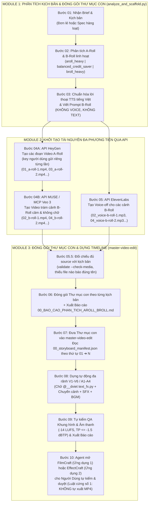
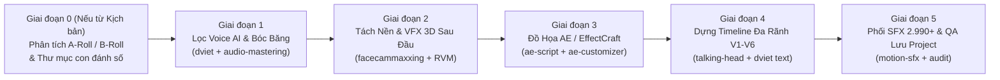

# kb-master-video-edit — toàn văn tài liệu của nguồn `master-video-edit`

> Trong `opa-video-studio`: mọi chỗ nhắc tới skill/mô-đun khác ("nạp X", "dùng skill X", `modules/X/MODULE.md`) = đọc `references/kb-X.md` trong chính skill này. Code / dữ liệu của nguồn này (nếu có) nằm ở `scripts/apps/master-video-edit/` (riêng nguồn lõi `master-video-edit`: `scripts/`, `assets/`, `tests/`). Nội dung dưới đây giữ NGUYÊN VĂN bản gốc; luật hiện hành và cách giải mâu thuẫn nằm ở `references/rules-full.md` + `rules.json`.

<!-- ===== file: master-video-edit/SKILL.md ===== -->

---
name: master-video-edit
description: >-
  Cửa vào duy nhất cho MỌI việc edit video: phân tích kịch bản tách A-Roll & B-Roll theo Quy trình 10 bước
  (HeyGen A-Roll + Muse/Veo 3 B-Roll không voice/không text + Voice-off → Thư mục con đánh số 01_a-roll-1.mp4,
  02_b-roll-1.mp4 + 02_voice-b-roll-1.mp3... + Báo cáo 00_BAO_CAO_PHAN_TICH_AROLL_BROLL.md), dựng, cắt lặng, sửa,
  thêm chữ/phụ đề, chuyển cảnh, B-roll, SFX, nhạc, lọc giọng -16 LUFS, motion graphics trên FilmCraft (.fcproj),
  EffectCraft (.ecproj), After Effects, Remotion, HyperFrames, OpenChatCut, phim 3D, học style kênh tham khảo.
  Tích hợp sẵn MotionFX (15–32 tracks, chữ chính phát sáng, phụ đề 2 dòng đa màu, chữ sau đầu, zoom động, nhấn nỗi đau,
  audit 8 luật) và 24 hiệu ứng chữ @__dviet. Dùng khi gọi "master-video-edit" ("dviet-text-fx") hoặc nhờ phân tích
  kịch bản, dựng/sửa video, làm phụ đề, hiệu ứng chữ, chuyển cảnh, nhạc nền, SFX.
---

# Master Video Edit — cửa vào duy nhất cho việc edit video

**Phiên bản 2.22 (chuẩn vận hành hiện hành — lịch sử đầy đủ `v2.0 → v2.22` ở `references/CHANGELOG.md`):**
- **Đọc `references/style.md` và `references/PROMPT_CHUAN_THEO_TANG.md` trước khi dựng** (toàn bộ quy tắc khoá cứng theo ID `A1..G5` và prompt vận hành 8 tầng có cổng ra).
- **Bộ máy dựng mặc định cho FilmCraft là `MotionFX` (15–19 tracks):** Kết hợp `scripts/motion_fx.py` (`MotionFX ⊃ FX`, thừa hưởng toàn bộ 24 hiệu ứng B1–B24 của `scripts/text_fx.py`) + `scripts/cut_plan.py` (phân tích điểm cắt & đề xuất chuyển cảnh) + `scripts/sfx_auto.py` (gắn SFX tự động theo `assets/motion-fx/sfx_catalog.json`, ưu tiên kho `HMC:` hot trend, 6 rãnh SFX không lặp file) + `scripts/edit_rules.py` (`zoom_keys`, `find_pain_in_*`, `audit` 8 mục) + `scripts/build_kit.py` (`refine_words`, `clamp_keys`, `pack`, `beat_grid`, `broll_scale`) + `scripts/silence_cut.py` (`speech_segments`, `fit_words`, `Timeline`) + `scripts/voice_level.py` (cân giọng −16 LUFS) + `scripts/fc_matte_band.py` (dải tối Color Matte mép trên) + `scripts/fc_fast_qa.py` (gộp matte band + limit-master + qa_frames + qa_audio + audit_sfx vào 1 phiên FilmCraft duy nhất) + `scripts/fc_fast_patch.py` (vá trực tiếp `.fcproj` trong `< 0.05s` khi sửa ở Tầng 8). Mẫu chạy trọn: `assets/motion-fx/example_build_spec.py` và dự án chuẩn `/home/vmiz/Thanh/Media/EDIT agnet/HanhTrinhMoi_OPA2_MotionFX/work/build_spec.py`.
- **Quy trình 10 bước A-Roll / B-Roll (`scripts/analyze_and_scaffold.py`, `references/aroll-broll-workflow.md`):** Tách cảnh `A-Roll` (HeyGen, key người dùng cấp riêng từng lần) & `B-Roll` (MUSE / Veo 3 khóa cứng `no_voice: true`, `no_text: true` + voice-off ElevenLabs) theo 3 chế độ (`aroll_heavy`, `balanced_credit_saver`, `broll_heavy`), đánh số thứ tự kép (`01_a-roll-1.mp4`, `02_b-roll-1.mp4` + `02_voice-b-roll-1.mp3`...), đối chiếu đủ nguồn ở Bước 05.5 trước khi dựng, dựng xong mở ứng dụng (`scripts/open_in_app.py`) cho người dùng tự duyệt.

Skill này **xếp loại việc → nạp đúng skill con → áp luật, style và thang kiểm → bàn giao**. Chi tiết nằm trong skill con và các file `references/`; riêng phần phân tích kịch bản A-Roll/B-Roll và chữ/MotionFX FilmCraft nằm ngay trong skill này.

**Đọc `references/style.md` trước khi dựng** (toàn bộ quy tắc, một dòng mỗi luật).

Thứ tự ưu tiên: lời người dùng trong chat/brief › `references/rules.md` › skill này › skill con. Khi skill con mâu thuẫn với luật người dùng, theo luật người dùng.

**Luật mặc định người dùng chốt 2026-10-31** (áp cả khi người dùng không nhắc; chi tiết ở `references/rules.md` mục 1 và 7):

1. Không xuất MP4; người dùng tự duyệt và tự xuất.
2. Nhiều video trong một yêu cầu: mỗi video một cửa sổ FilmCraft riêng, dựng song song.
3. Sửa video đã có project: sửa thẳng trên project đang mở, không tạo project hay bản `_V0n` mới.
4. Có điểm cắt là có chuyển cảnh; 3D cho chữ hoặc B-roll chỉ 3–4 lần mỗi video; SFX mở đầu ở khung 0–1, dài khoảng 0,3 s, mỗi video một kiểu khác, đặt ngay dưới track giọng.
5. Hai vùng chữ (chốt 2026-11-03): từ khoá / tiêu đề nổi ở khung trên (y 240–680), thoại / phụ đề ở khung dưới (y 1290–1480), rộng ≤ 800 px căn giữa; `text_fx.FX` đã đặt sẵn `key_y=500, cap_y=1400, max_w=800`. Chi tiết ở `references/rules.md` mục 2.
6. Luật dựng chốt 2026-11-06 (`references/rules.md` mục 2): 4–6 font mỗi video; chữ chính nhiều màu + luôn phát sáng, chữ phụ không cam / hồng / tím (dùng thì phát sáng nhẹ); mỗi nhịp cắt có chuyển cảnh ĐA DẠNG theo ngữ cảnh — flash / shutter / flicker ≤ 20 % (Rule 2, chốt 2026-11-11); nhiều B-roll + footage; ưu tiên edit vào từ khoá nỗi đau. Đo bằng `scripts/edit_rules.py audit`.
9. **Bốn luật chốt 2026-11-11 (`references/style.md` B14, C2, D4, D6):** (1) tốc độ chỉ `1.15x` / `1.1x`, bỏ `1.25x`; (2) chuyển cảnh đa dạng theo ngữ cảnh, flash / shutter / flicker ≤ 20 %; (3) giữ chất lượng gốc — CRF 12 slow BT.709, AAC 320k, không scale; (4) chữ không tĩnh — soft_in mờ nhoè → nét (đo @__dviet, `references/dviet-text-motion-2026-11-11.md`), phóng chậm lúc giữ, soft_out; `MotionFX.tracks()` tự áp. Test: `tests/test_rules_2026_11_11.py`.
11. **Không dải tối dưới chữ phụ & ảnh bìa ≤ 0,3 s (chốt 2026-11-11, `references/style.md` B15, A6):** phụ đề nổi bằng bóng mềm, không vignette / `caption_band` phía sau; ảnh bìa thumbnail hiện 0,2 s rồi mờ hết trước 0,3 s. `edit_rules.py audit` kiểm cả hai.
10. **Phông sáng + người ở 2/3 dưới khung (Rule 5, chốt 2026-11-11, `references/style.md` D7):** chỉ cho clip QUAY THẬT (không áp avatar HeyGen): đỉnh đầu ngang đường 1/3, 1/3 trên là nền sáng cho chữ; phông xanh / nền tối → tách người ghép phòng làm việc sáng mờ; nền sáng sẵn → chỉ chỉnh khung. `scripts/frame_person.py`, tự áp trong `run_kb_v2152.py` cho clip `live_shoot`.
11. **Cảnh chèn, quay thật, chữ khớp giọng (chốt 2026-11-11, `references/style.md` B16, D8–D10):** mỗi B-roll ≤ 1 lần / video, ≤ 2 video; chỉ B-roll của chính kịch bản; mỗi clip `soucre thô` ≤ 2 lần; chữ theo mốc giọng thật (`retime_voice.py`). Kiểm: `media_reuse.py audit`, `spec_lint` `text_voice_burst`.
12. **Phông xanh & nền studio (chốt 2026-11-12, `references/style.md` D11–D13, G7–G9):** clip `soucre thô` phông xanh luôn tách lại từ file GỐC bằng `scripts/chroma_studio.py` (không dùng bản `_Keyed`), phóng ≥ 1,3×, ghép lên nền ảnh phòng thật không người do người dùng gửi (`scripts/studio_plate.py`, kho `Nen_Background/Phong_Studio_Podcast`), không vẽ nền bằng code; làm theo lô 5 project, xuất tối đa 2 phiên song song, xoá MP4 lỗi khi được bảo.
8. **Không dấu phẩy trên hình (chốt 2026-11-10, `references/style.md` B13):** chữ hiện trên hình (phụ đề, từ khoá, nhãn) không có dấu phẩy `,` (chốt 2026-11-10, chỉ áp cho video dựng từ nay; dấu phẩy thập phân giữa hai số như 2,5 giữ nguyên; `text_fx.nfc` tự loại, `edit_rules.py audit` kiểm).
7. **Luật tốc độ, chất lượng & Kho tài nguyên mặc định (`references/style.md` D4, D5, D6, F4)**:
   - **Tốc độ chỉ `1.15x` hoặc `1.1x` — BỎ `1.25x` (Rule 1, chốt 2026-11-11):** `1.15x`; kết quả < 40 s thì `1.1x`; vẫn < 40 s thì `1.0x` (`build_kit.choose_speed`), áp cho video / voice HeyGen và Muse, kết hợp cắt sạch khoảng lặng (`silence_cut.py`).
   - **Chất lượng vào / ra (Rule 3, chốt 2026-11-11):** giữ độ phân giải gốc; mã hoá trung gian CRF 12 slow BT.709 + AAC 320k (`build_kit.X264_HQ`, `AAC_HQ`); MP4 giao CRF 14; `spec_lint` chặn media `x125`, cảnh báo nguồn bị phóng to.
   - **Kho tài nguyên trám cảnh (Footage & B-Roll)**: Luôn lấy thêm tài nguyên trám từ `/home/vmiz/Thanh/Media/A huy/soucre thô` (cảnh quay thật của Anh Huy: `soucre 1`, `soucre 2`, `soucre 3`, `soucre final`) kết hợp `/home/vmiz/Thanh/Media/A huy/B-roll` và `/home/vmiz/Thanh/Media/TNEDIT`. **Lưu ý bắt buộc**: các video trong `soucre thô` có phông xanh phải được xoay đúng chiều dọc 9:16, xóa sạch 100% phông xanh & mép tường (`rvm-matte` + `despill=type=green`) và ghép một background mới thay thế phông xanh trước khi đưa vào timeline.
   - **Kho SFX Hot Trend & Font**: Ưu tiên sử dụng các SFX hot trend từ `/home/vmiz/Thanh/Media/TNEDIT/02_SFX/sfx hmc` (`HMC:` trong `sfx_catalog.json`) và toàn bộ kho SFX, Font (`01_Font`), VFX, Assets, Nhạc nền tại `/home/vmiz/Thanh/Media/TNEDIT`.

## Bước 0 — Xếp loại việc

| # | Việc | Dấu hiệu | Nạp skill | Đọc thêm |
|---|---|---|---|---|
| A | Footage người nói → project FilmCraft | file quay thật (C00xx…), "dựng talking head", "edit như dviet" | `talking-head-premiere` + `dviet-viral-text-audio-edit`; chữ: `scripts/text_fx.py` (mục Chữ); VFX quanh người: `facecammaxxing`; xuất project: `craft-handoff`; làm sạch A-roll: mô-đun `talking-head-guide`; cắt nhiều take theo EDL: mô-đun `video-use` | `references/pipelines.md`, `references/dviet-style-guide.md` |
| B | Video người nói AI (HeyGen/avatar) hoặc dự án HyperFrames Studio | file HeyGen, link Studio, master prompt | `hyperframes` (+ `-core/-cli/-animation/-keyframes`), `talking-head-recut`, `embedded-captions` | `references/profiles.md` mục A |
| C | Lô HeyGen theo kiểu đã duyệt | "lô tiếp theo", "giao OPA" | `opa-delegate` → Hermes `dung-video-talking-head` | `references/profiles.md` mục B |
| D | Promo / explainer không footage | chỉ chữ, ảnh, nhạc, giọng đọc | `hyperframes`/`general-video`, hoặc Remotion (`remotion-best-practices`), `kinetic-typography`, `kinetic-reel`, `motion-director`; thẻ motion có sẵn: mô-đun `video-talkcraft`; cảnh terminal: `synthetic-screen-recording`; chữ Việt trong Remotion: `motion-presets-vi` | `references/profiles.md` mục C |
| E | Video sản phẩm từ trang web | URL, landing page | `remotion-best-practices` + `remotion-25d-motion` (`video-shotcraft` chỉ có trên USB) | `references/profiles.md` mục D |
| F | Phim 3D mascot / nhân vật | "3D", three.js, mascot OPA | `mascot-film-3d` | profiles mục F |
| G | Motion graphics AE / EffectCraft | `.jsx`, `.aep`, `.ecproj`, intro logo | `ae-script-builder`, `ae-template-customizer` (cần AE Windows), `ae-logo-intro-reveal`, `omni-flash-motion-director`, `sketch-to-mobile-ui` | `references/pipelines.md` GĐ3 |
| H | Sửa bản đã giao | gửi MP4/project, chỉ lỗi | sửa trong nguồn của dự án đó; FilmCraft/EffectCraft → sửa thẳng trên project đang mở (`references/rules.md` mục 1) | profiles mục E |
| I | Âm thanh | ồn, vang, nhỏ to, SFX, nhạc | lọc giọng `dviet-viral-text-audio-edit/scripts/clean_and_master_voice.py`; SFX & master `motion-sfx-audio-mastering`; nhạc AI `audio-jingle` 🔑 | pipelines GĐ1, GĐ5; quy luật đặt SFX `references/sfx-hmc.md` |
| J | Phụ đề / caption | "thêm phụ đề", "caption" | FilmCraft: `scripts/text_fx.py` `word_captions` (mục Chữ); Remotion: `remotion-captions`; HyperFrames: `embedded-captions`; nhanh: `pycaps` | style guide mục chữ |
| K | Cắt, ghép, nén, đổi khung nhanh | trim, concat, 9:16, nén | `video-editing` (ffmpeg) + mô-đun `ffmpeg` (preset xuất theo nền tảng); cắt khoảng lặng: `auto-editor`; tải nguồn: mô-đun `video-download` | `references/modules.md` |
| L | Sửa trong app OpenChatCut | "trong OpenChatCut" | `openchatcut` (MCP) | — |
| M | Học style từ kênh/video tham khảo | link TikTok/YouTube, "phân tích kênh" | quy trình `references/style-analysis.md`; xem nhanh 1 video: mô-đun `video-understand`; phân tích cảnh quay: `storyboard-shot-breakdown` | — |
| N | Ảnh/clip AI, thumbnail, GIF, giao file | ảnh/clip B-roll, chuyển cảnh bằng hình, thumbnail, GIF | **Muse** `scripts/muse_gen.py` (mặc định, xem Bước 3); `codex-imagegen` chỉ dự phòng; `slack-gif-creator`; thumbnail từ khung thật: mô-đun `video-thumbnail-generator`; trước khi giao: `strip-media-metadata` | — |
| O | Cắt video dài / livestream / nhiều clip thành clip ngắn, montage | podcast, livestream, "cắt short", "reel từ nhiều clip", nhạc nhịp | mô-đun `long-video-to-shorts`, `livestream-to-clips`, `multi-clips-to-reels`, `beat-sync-montage`, `batch-montage-variants`, `ecommerce-product-montage`, `news-rough-cut` + `video-use` để cắt | `references/modules.md` |
| P | Kịch bản quảng cáo, motion graphic, hoạt hình nhân vật, BĐS | "kịch bản quảng cáo", "chèn motion", nhân vật 2D, video bất động sản | mô-đun `product-ad-video-script`, `motion-graphic-placement`, `character-2d`, `real-estate-video-editing`, `anything2explainer` | `references/modules.md` |
| Q | Kịch bản / Brief → Phân tích A-Roll & B-Roll, đóng gói Thư mục con đánh số & Báo cáo 10 bước | gửi kịch bản/spec/brief, "phân tích A-roll B-roll", "tách cảnh tạo voice", "chuẩn bị thư mục kịch bản" | `script-aroll-broll-analyzer` + `scripts/analyze_and_scaffold.py` (mục Phân tích A-Roll & B-Roll); tạo B-roll: `scripts/muse_gen.py` | `references/aroll-broll-workflow.md` |

- Footage người nói không bao giờ đi đường E hay F. Không chắc loại nào: chọn theo bảng, ghi giả định, không dừng để hỏi.
- Danh mục đầy đủ (trạng thái chạy thật, agent nào có): `references/catalog.md`. Mô-đun (đọc `modules/<tên>/MODULE.md`, không phải skill riêng): `references/modules.md`.
- Việc nhiều phần (ví dụ Q + A + G + I) thì nạp lần lượt theo thứ tự trong `references/aroll-broll-workflow.md` và `references/pipelines.md`.

## Bước 1 — Brief & Phân tích Kịch bản (`A-Roll` / `B-Roll`)

- Điền brief theo `references/brief.md` từ lời người dùng và file có sẵn; ô trống dùng mặc định trong ngoặc. Hỏi gộp một lần, chỉ hỏi khi thiếu thứ không đoán được (kịch bản, CTA, số liệu, tên riêng, style). Trong lúc chờ, làm phần không phụ thuộc câu trả lời.
- Khi người dùng gửi **Brief hoặc Kịch bản (đơn lẻ hoặc file Spec nhiều kịch bản)** chưa có sẵn video `A-Roll`/`B-Roll`: chạy ngay **Quy trình 10 bước chuẩn** (`scripts/analyze_and_scaffold.py` hoặc `scripts/master_pipeline.py analyze-spec|analyze-json`, xem mục "Phân tích Kịch bản A-Roll / B-Roll & Xuất Báo Cáo Thư Mục Con" bên dưới và `references/aroll-broll-workflow.md`) để tách cảnh linh hoạt, chuẩn hóa lời đọc tiếng Việt, khóa rule B-Roll (`no_voice`, `no_text`), tạo **Thư mục con đánh số** (`01_a-roll-1.mp4`, `02_b-roll-1.mp4` + `02_voice-b-roll-1.mp3`...) và xuất báo cáo `00_BAO_CAO_PHAN_TICH_AROLL_BROLL.md`.

## Bước 2 — Chọn style

| Style | Khi nào | Nguồn |
|---|---|---|
| **Mặc định (MotionFX 2.14 + luật người dùng)** | không nói style, hoặc yêu cầu dựng chuẩn talking head / thương hiệu | `references/style.md` + `references/rules.md` mục 2 & 7 + `scripts/motion_fx.py`, `scripts/cut_plan.py`, `scripts/sfx_auto.py`, `scripts/edit_rules.py` |
| **@__dviet** | người dùng nói rõ "kiểu dviet", "Việt Mỏi Lưng" (1 màu nhấn/video, 3 font) | `references/dviet-style-guide.md` (đặc tả đo từ 17 video) + `references/dviet-style.json` (token máy đọc) |
| **Motion FX (reel mẫu)** | talking head "motion", motion graphic / animation cần chữ gõ, chuyển cảnh dải/ô, SFX tự gắn; người dùng nói "kiểu reel mẫu", "như Newbie / 1cho" | `references/motion-fx.md` (bảng "Khi nào dùng") + `scripts/motion_fx.py`, `scripts/sfx_auto.py` |
| Bản đang sửa | việc loại H | giữ thông số của bản đó, chỉ đổi phần bị chê |

<!-- dviet-summary:start -->
**Style @__dviet tóm tắt** (đầy đủ ở `references/dviet-style-guide.md`):

- 3 font: SF Pro Display (chữ nối/phụ đề) · Playfair Display Bold Italic (từ khoá, màu nhấn) · Great Vibes (viết tay, hiếm). Không dùng Instrument Serif/Satisfy (thiếu dấu Việt).
- Trắng + **một** màu nhấn/video (vàng `#F4C40C` mặc định; theo chủ đề: tím `#8C6CFF`, xanh neon `#04AC04`, hổ phách khi cảnh tối). Bóng mềm, không viền, giãn chữ âm.
- Ghép lớn–nhỏ (từ khoá to gấp 2–4 lần), chồng 3 tầng, số lớn mở đầu danh sách, tiêu đề phần ở y ≈ 25%, CTA "lưu lại" sớm (4–8 s).
- Chữ vào blur-in 0,17 s, đúng/sớm 0–0,1 s so với lời; ra bằng cắt cứng. Chữ minh hoạ chính hiệu ứng nó nói.
- Chuyển cảnh: cắt thẳng là chính; flash/âm bản 1–2 khung, vệt sáng 0,25–0,6 s ở chỗ đổi phần, punch-in ×1,12–1,25, zoom blur 0,15–0,25 s che jump cut. Mép khung hơi mờ.
- Nhịp ~287 từ/phút, mỗi khối chữ ~1,3 s. Nhạc chạy suốt, thấp hơn giọng ~6–7 dB, không duck; SFX theo khoảnh khắc hình.
- Dựng chữ: `scripts/text_fx.py` (mục "Chữ trên FilmCraft"); cách cũ `scripts/dviet_text.py events.json` chỉ giữ cho spec đã làm trước v2.0; dựng tay: 6 template FilmCraft `[DViet v2]` (khung 1080×1920). Footage mặt thấp: đặt `chest_y_pct` = cằm + 4.
<!-- dviet-summary:end -->

## Bước 3 — Dựng

- **Talking head / thương hiệu trên FilmCraft (Mặc định dùng `MotionFX` 15–19 tracks):** 5 giai đoạn ở `references/pipelines.md` (lọc giọng & bóc lời → tách người → đồ hoạ → timeline `MotionFX` → SFX, `fc_matte_band.py` & QA). CLI gom lệnh: `scripts/master_pipeline.py status|analyze-spec|analyze-json|validate-folders|normalize-tts|prep-video|matte|facecam|audit-sfx|limit-master|master-audio`. Mẫu chuẩn 18 tracks: `/home/vmiz/Thanh/Media/EDIT agnet/HanhTrinhMoi_OPA2_MotionFX/work/build_spec.py` và `assets/motion-fx/example_build_spec.py`; mẫu THCN 03 (`/home/vmiz/Thanh/Media/TNEDIT/09_Du_An/THCN/Video03_Mau/work/build_spec.py`); bản cũ C0019 (`/home/vmiz/Thanh/Media/TNEDIT/09_Du_An/vid a huy/Test_master-video-edit_C0019/work/build_spec.py`).
- Dựng từ **Thư mục con kịch bản đã đánh số** (`00_storyboard_manifest.json`): đọc danh sách `segments` theo đúng thứ tự `seq_prefix` (`01` ➔ `02` ➔ `03`...); đoạn `a-roll` đặt `<STT>_a-roll-<N>.mp4` (đã có cả hình + tiếng từ HeyGen) lên `V1` + `A1`; đoạn `b-roll` đặt `<STT>_b-roll-<M>.mp4` (hình câm từ MUSE/Veo 3, tắt tiếng clip) lên `V1`/`V2` và đặt `<STT>_voice-b-roll-<M>.mp3` (tiếng từ ElevenLabs) xuống `A1` khớp khít nhau.
- Cắt khoảng lặng tự động (A-roll một clip dài, nói lặp lại ngắt quãng): `scripts/silence_cut.py <giọng_đã_lọc.wav> --words <transcripts/*.json>` in các đoạn giữ và thời lượng sau cắt; trong `build_spec.py`: `words = load_words(json)`, `segs = speech_segments(voice, words)`, `words = fit_words(words, segs)` (bắt buộc trước khi làm phụ đề / đặt chữ theo lời), `words = refine_words(words, voice_wav)` (căn mốc từ đầu sau lặng theo tiếng thật), `tl = Timeline(segs)` → V1 / A1 mỗi đoạn một clip (`in` = giây vào, `at` = `tl.T0[i]`), chữ / SFX đặt bằng `tl.at(giây_nguồn)`, kết thúc chữ ở `tl.end_of(giây_nguồn)`; mọi điểm cắt vẫn phải có chuyển cảnh (`cut_plan.py`). Ngưỡng mặc định −35 dB / 0,3 s; phòng ồn thì lọc giọng `--mode heavy` trước. Ví dụ chạy trọn: `/home/vmiz/Thanh/Media/TNEDIT/09_Du_An/THCN/Video04_Thu_V2/work/build_spec.py` (53,6 s → 34,5 s, 12 đoạn).
- Viết `build_spec.py`: khởi tạo `fx = MotionFX(...)` từ `scripts/motion_fx.py` (kế thừa toàn bộ `FX` của `scripts/text_fx.py`); phân tích điểm cắt bằng `scripts/cut_plan.py`; gắn `zoom_keys` và nhấn từ khoá nỗi đau bằng `scripts/edit_rules.py`; tự chọn SFX bằng `scripts/sfx_auto.py`; căn mốc chữ / xếp track / chặn keyframe tràn clip bằng `scripts/build_kit.py` (`sfx_clip`, `pack`, `beat_grid`, `on_beat`, `align_words`, `refine_words`, `clamp_keys`; CLI `build_kit.py beats NHẠC` · `build_kit.py sfx FILE`). Kiểm spec bằng `scripts/edit_rules.py audit <spec.craft.json>` trước khi dựng. Không chép các hàm này sang từng dự án nữa.
- Áp nhịp dựng (`references/rules.md` mục 7) lên timeline spec có sẵn: `scripts/remix_rules.py` → `craft-handoff/tools/fc_build.py`. Dựng lại từ spec nên mất chỗ người dùng đã sửa tay; cách dùng và giới hạn ở `references/pipelines.md` GĐ4.
- Kiểm skill còn gọi được mọi nhiệm vụ: `python3 scripts/selfcheck.py` (mọi skill con, mô-đun, file, công cụ, font, template; chạy thử script con).
- HyperFrames / Remotion / AE: theo skill con đã nạp ở Bước 0.
- **Ảnh B-roll, clip B-roll, chuyển cảnh bằng hình/video AI: mặc định dùng Muse** (người dùng chốt 2026-10-30). Muse là muse2api chạy local `http://127.0.0.1:18610/v1`, khoá để ở `~/.config/muse/env`, không ghi khoá vào project hay brief.
  - Ảnh: `python3 scripts/muse_gen.py image "prompt" --size 16:9 -o x.png [--ref a.jpg …] [--transparent]`. Video: `python3 scripts/muse_gen.py video "prompt" --size 9:16 --seconds 5 [--first-frame a.png] -o x.mp4`.
  - Kết quả đo ngày 2026-10-30: ảnh mất khoảng 30 s, ra 2048×1152 hoặc 1152×2048. File gốc là WebP, script tự đổi sang đuôi của `-o`. Video 5 s mất khoảng 1–2 phút, ra 720×1280 hoặc 704×1248, 24fps, kèm sẵn tiếng nền. Khi đặt vào timeline: tắt tiếng clip và scale lên 1080×1920. Size và thời lượng chỉ là gợi ý nằm trong prompt, nên luôn đo lại file ra.
  - Giữ cùng nhân vật qua nhiều cảnh (cách này đã chạy tốt trên KB04 ngày 2026-10-30): lấy khung mặt nhân vật làm `--ref` cho ảnh, rồi dùng chính ảnh đó làm `--first-frame` cho video. Cần xem kỹ giây đầu, vì có clip để nội dung trên màn hình biến mất rồi dựng lại; gặp thì cắt bỏ đoạn đó.
  - Chuyển cảnh: lấy khung cuối của cảnh A làm `--first-frame`, viết prompt biến đổi sang cảnh B, rồi đặt clip đó vào V2 ở chỗ nối hai cảnh (chưa chạy thử trên video thật).
  - Muse không chạy (`/readyz` không ra `ready`): báo người dùng. Không tự chuyển sang dịch vụ trả phí; `codex-imagegen` chỉ dùng khi người dùng đồng ý.
- Chia việc: mặc định tự làm; việc độc lập lớn (phân tích nhiều video, nhiều cảnh) thì mở agent con chạy nền. Lệnh chạy lâu (whisper, render) do lead chạy nền. Đội OPA chỉ qua `opa-delegate`.

## Phân tích Kịch bản A-Roll / B-Roll & Xuất Báo Cáo Thư Mục Con — Quy trình 10 Bước (`scripts/analyze_and_scaffold.py`)

Tích hợp trọn vẹn **Module 1 (Bước 01–03)** và **Module 3 (Bước 06 — Đóng gói Thư mục con & Xuất Báo cáo 10 bước)** vào `master-video-edit` (chi tiết đầy đủ ở `references/aroll-broll-workflow.md`):

1. **Tỷ lệ và thứ tự `A-Roll` / `B-Roll` linh hoạt theo dạng kịch bản:**
   - `aroll_heavy` *(50%–70% A-Roll)*: Kịch bản tâm sự, chia sẻ góc nhìn cá nhân, kể chuyện trực diện.
   - `balanced_credit_saver` *(30%–38% A-Roll — Mặc định)*: Giữ `A-Roll` ở các nhịp chốt uy tín (`a-roll-1` mở màn, `a-roll-2` chuyển ý, `a-roll-3` dẫn chứng, `a-roll-4` CTA), phần giải thích dùng `B-Roll` để tiết kiệm **~68% credit HeyGen**.
   - `broll_heavy` *(15%–28% A-Roll)*: Kịch bản thị phạm thao tác, review sản phẩm/F&B/bất động sản.
   - Hỗ trợ mọi trật tự xen kẽ (`01_a-roll-1` ➔ `02_b-roll-1` ➔ `03_a-roll-2` hoặc mở đầu bằng `01_b-roll-1` ➔ `02_a-roll-1`).
2. **Đánh số thứ tự kép trong Thư mục con để AI hiểu tuyệt đối:**
   - **Cảnh `A-Roll` (API HeyGen — có Hình + Tiếng):** `<STT>_a-roll-<N>.mp4` *(VD: `01_a-roll-1.mp4`, `03_a-roll-2.mp4`)*.
   - **Cảnh `B-Roll` (API MUSE / MCP Veo 3 — chỉ Hình, KHÔNG VOICE, KHÔNG TEXT):** `<STT>_b-roll-<M>.mp4` *(VD: `02_b-roll-1.mp4`)*.
   - **File `Voice-off` của B-Roll (API ElevenLabs — đi cặp 1-1 cùng `<STT>`):** `<STT>_voice-b-roll-<M>.mp3` *(VD: `02_voice-b-roll-1.mp3`)*.
3. **Tự động chuẩn hóa lời thoại tiếng Việt (`tts_text`) & Khóa cứng Rule B-Roll:**
   - Chuyển mọi con số, `%`, tiền tệ (`15 triệu/tháng`, `4%`, `24/7`, `30fps`...) thành chữ tiếng Việt đầy đủ cho HeyGen & ElevenLabs.
   - Gắn `no_voice: true` và `no_text: true` vào mọi Prompt B-Roll trong `prompts_muse_veo_broll.json`.
4. **Xuất Báo cáo & Bộ file chuẩn trong Thư mục tổng / Thư mục con:**
   - Ở Thư mục tổng: `00_BAO_CAO_PHAN_TICH_AROLL_BROLL.md` (Báo cáo tổng hợp tỷ lệ A-Roll/B-Roll, tiết kiệm credit & bảng theo dõi tiến độ 10 bước) + `00_DANH_MUC_TONG_KICH_BAN.md`.
   - Ở từng Thư mục con (`KB01_...`, `KB02_...`): `00_BANG_PHAN_CANH.md`, `00_storyboard_manifest.json`, `prompts_heygen_aroll.json`, `prompts_elevenlabs_voice.json`, `prompts_muse_veo_broll.json`.

```bash
# Phân tích từ file Spec Markdown (1 hoặc nhiều kịch bản), tạo Thư mục con đánh số & xuất Báo cáo:
~/.venvs/video-skills/bin/python scripts/master_pipeline.py analyze-spec \
  "/home/vmiz/Thanh/Media/A huy/SPEC-10-KICH-BAN-V4.md" \
  --out-dir "/home/vmiz/Thanh/Media/A huy/Danh_Sach_Kich_Ban"

# Kiểm định cấu trúc Thư mục con & cập nhật Báo cáo tiến độ 10 bước:
~/.venvs/video-skills/bin/python scripts/master_pipeline.py validate-folders \
  "/home/vmiz/Thanh/Media/A huy/Danh_Sach_Kich_Ban" --check-media
```

## Chữ trên FilmCraft — 24 hiệu ứng @__dviet (`scripts/text_fx.py`)

Biến mô tả hiệu ứng ("cặp lớn–nhỏ tím phát sáng", "chữ sau đầu", "gõ chữ trong khung chọn"…) thành clip đúng thông số đo từ 17 video của kênh, ghép vào `*.craft.json` rồi dựng bằng `craft-handoff/tools/fc_build.py`. Trước khi dùng một hiệu ứng, đọc mục của nó trong `references/text-fx.md`.

```python
import sys; sys.path.insert(0, str(Path.home() / ".claude/skills/master-video-edit/scripts"))
from text_fx import FX, STRONG_SHADOW
fx = FX(gfx_dir=work / "gfx", accent="#F3C60F", key_y=500, cap_y=1440)   # 1 màu nhấn / video; đo key_y, cap_y trên khung
k = fx.text("set up", 3.0, 1.8, "sans", 140); fx.blur_in(k)
fx.script_accent("chuyên nghiệp", 3.4, 1.4, over=k)                     # B5
fx.word_captions([(w, t) for w, t in words], end=6.2)                    # B11, mốc từng từ: build_kit.align_words
spec["tracks"] = [v1_track, broll_tracks..., *fx.tracks(), *audio_tracks]
```

- `fx.tracks()` tự xếp lớp (đồ hoạ dưới → thẻ → chữ sau người → lớp người → phụ đề → chữ → chữ viết tay → đồ hoạ trên) và tách track khi clip chồng thời gian. Đặt sau A-roll / B-roll trong `tracks`.
- `fx.cues` chỉ là **gợi ý** SFX; kênh mẫu không gắn SFX cho mọi chữ (chỉ cao hơn ngẫu nhiên 2–15 điểm) — chữ lớn nên rơi vào phách nhạc (`build_kit.on_beat`), SFX rời chỉ ở chuyển động lớn hoặc có nghĩa.
- Hiệu ứng ảnh (khung chọn, bookmark, pill, gạch, gradient, chữ cong) được vẽ PNG vào `gfx_dir` bằng `scripts/fx_gfx.py`.

| Mã | Hiệu ứng | Hàm |
|---|---|---|
| B1 | Cặp lớn–nhỏ (nền của kênh) | `pair(big, small, at, dur, big_role="serif")` |
| B2 | Từ lớn thay trên chữ nhỏ đứng yên | `swap_big(small, [(từ, t)…], end)` |
| B3 / B4 | Chồng 3 tầng / chồng mà dễ đọc | `stack3(top, mid, low, at, dur, readable=False/True)` |
| B5 | Viết tay phát sáng chéo trên từ khoá | `script_accent(word, at, dur, over=clip)` |
| B6 | Từ viết tay thay nhau | `script_swap(small, [(từ, t)…], end)` |
| B7 | Số khổng lồ + bookmark | `number_hook(num, word, at, dur, small_words, bookmark_at)` |
| B8 | Trượt lên mượt | `slide_up_text(text, at, dur)` / `slide_up(clip)` |
| B9 | Giả 3D xoay | `swing3d(text, at, dur)` |
| B10 | Trượt xuống nhoè | `slide_down_text(text, at, dur)` |
| B11 | Phụ đề hiện từng chữ | `word_captions([(chữ, t)…], end, mode="grey"/"color", shadow=)` |
| B12 | Chữ sau đầu người | `behind_head(text, at, dur, matte_src, head_top=)` |
| B13 | Chữ gắn tường | `wall_text(main, script, at, dur)` |
| B14 | Nghiêng theo vật / tràn khung punch-in | `tilt_text(...)`, `punch_overflow(...)` |
| B15 | Phát sáng 2 | `glow_text(...)` / `glow(clip)` |
| B16 | Chữ mờ ảo | `dreamy_blur(...)` |
| B17 | Hoà vào cảnh (Overlay) | `overlay_text(...)` |
| B18 | Chữ gradient | `gradient_word(text, at, dur, colors)` |
| B19 | Gõ chữ trong khung chọn | `typed_box(text, at, dur, under=None)` |
| B20 | Pill kính lộ dần | `glass_pill(text, at, dur, fill=)` |
| B21 | Thẻ UI bo góc + nhãn | `ui_card(src, at, dur, label=…, src_w=, threed=)` |
| B22 | CTA "Lưu lại" + bookmark | `cta_save(at, dur, tail=[…], click_at=…)` |
| B23 | Chữ diễn: gạch / đổi font / chớp / cong | `strike_word`, `font_flip`, `flicker_text`, `curved_caption` |
| B24 | Bố cục quay màn hình hướng dẫn | `tutorial_layout(title, at, dur, captions, keywords)` |

Kiểu vào/ra dùng riêng: `blur_in`, `grey_in` (xám → trắng), `color_in` (tím → trắng), `nudge`, `slide_up`, `slide_down`, `script_in`, `flip3d_in`, `whip_out`, `glow`.

Luật khi dùng (luật người dùng thắng style kênh):
- Viết hoa chữ cái đầu dòng (`cap_case=True`, mặc định); chữ không đè mặt, không đè dấu dòng trên (B1, B3/B4, B5, B21 tự đo đỉnh/đáy mực để né dấu — vẫn xem ảnh kiểm); 3D chỉ 3–4 lần/video (`swing3d`, `ui_card(threed=True)`, `flip3d_in`, `wall_text` đều tính).
- Một màu nhấn mỗi video (`accent`, kể cả vạch `strike_word(color=accent)` và gradient); còn lại trắng, bóng mềm, không viền. **Chỉ áp khi người dùng chọn style @__dviet**; luật mặc định 2026-11-06 là chữ chính đa màu (xem Motion FX).
- Đo đỉnh đầu / cằm / ngực trên ảnh lưới khung trước khi chọn `key_y`, `cap_y`, `head_top`; trần/tường sáng thì đặt `top_shade_dark_text_zone_1080x1920.png` dưới chữ.
- `behind_head` cần lớp người có alpha: `scripts/master_pipeline.py matte --input <đoạn A-roll đã cắt> --output <người.mov>`, đặt `matte_in` khớp đoạn nguồn và chép cùng `motion` (push-in) của A-roll sang lớp người. Bebas Neue không có dấu: chữ có dấu tự đổi sang SF Pro Heavy.
- Sửa thư viện xong: chạy `scripts/text_fx_demo.py --snippets assets/text-fx/snippets.json`, cập nhật `const SNIP` trong trang xem trước, rồi `scripts/selfcheck.py --quick`.

## Motion FX — chữ gõ, chuyển cảnh dải/ô, SFX tự gắn (`scripts/motion_fx.py`, `scripts/sfx_auto.py`)

**Màu chữ** (chốt 2026-11-06): chữ key đa dạng màu (vàng, xanh lam, đỏ, tím, xanh dương, xanh ngọc, trắng — `DEFAULT_ROTATION`), **luôn phát sáng cùng màu** (`fx.key_glow`; vàng / trắng mức siêu nhẹ `GLOW["soft"]`); không hồng, cam, xanh lá — nếu buộc dùng thì phải phát sáng (`GLOW_REQUIRED`). Phụ đề dưới = dòng 1 trắng + dòng 2 xoay vòng đa màu theo cụm (`CAPTION_ROTATION`: vàng · xanh lam · xanh dương · xanh ngọc, không cam / hồng / tím / đỏ; nếu buộc dùng cam/hồng/tím thì phát sáng nhẹ `CAP_GLOW_REQUIRED`), font **đổi theo đoạn 3–5 nhịp** (Montserrat + viết tay mảnh ≤ 3 cụm · toàn Montserrat · Be Vietnam Pro · SF Pro Light — không dùng viết tay quá nhiều), có dải tối `fx.caption_band` sau vùng phụ đề (tương phản ≥ 4,5 : 1). Chữ phụ bóng nhẹ. Không xoá ngược chữ — ra bằng mờ dần; gõ chậm (~7 / ~6 ký tự/s). **Tiếng không vào trước hình** (kiểm bằng `qa_sync.py`). **Chữ không dùng viền** (yếu tố tiên quyết, rules.md mục 2): nổi bằng bóng đen lệch dưới-phải kiểu @magentx.ai (`MX_SHADOW`, `CAP_SHADOW`), màu bão hoà đậm. Tiếng chuyển cảnh 2 lớp (hút vào + hit) ở mức `transition`, nhạc hạ 5 dB quanh điểm cắt (`sfx_auto.duck`), `limit-master --max -2.0`.

**Bắt buộc trước khi chọn chuyển cảnh:** `scripts/cut_plan.py` phân tích từng điểm cắt (cùng khung / vào–ra B-roll / đổi cảnh, giữa câu hay sang câu mới) → bảng `work/transition_plan.md`, **đưa bảng cho người dùng xem trước khi dựng**; jump cut cùng khung không dùng dải dọc / ô lưới (người dùng chê 2026-11-04: lộ mặt lệch như hình vỡ). Áp kiểu đã chọn bằng `fx.cut_fx(cut, kind, clip_sau, variant)` (overlay TNEDIT · ghép sáng tạo · chuyển cảnh FilmCraft); không lặp kiểu ở 2 điểm cắt liền nhau. Không giới hạn một màu nhấn.

Chọn hiệu ứng theo **khoảnh khắc** (bảng "Khi nào dùng" trong `references/motion-fx.md`): câu thường → `captions2`, từ khoá → `keyword_tpl`, câu chốt → `collage`, liệt kê → `word_pop`, điểm cắt → kiểu do `cut_plan` chọn (`fx.cut_fx`), B-roll vào → `grid_reveal` / `strip_reveal` + `flash_burst`, cao trào → `cut_burst`. Mỗi hàm ghi `fx.cues`; `plan_sfx` biến thành clip SFX (đã căn đỉnh, chỉnh mức theo lúc đang nói, không lặp file, SFX mở đầu khung 0).

```python
from motion_fx import MotionFX
from sfx_auto import plan_sfx
from cut_plan import Cut, plan_cuts, plan_table
fx = MotionFX(gfx_dir=work / "gfx", accent="#FFC414", key_y=500, cap_y=1440)     # MotionFX ⊃ FX: 24 hiệu ứng cũ vẫn dùng được
plan = plan_cuts([Cut(T0[1], (aroll, seg1_out), (aroll, seg2_in), before="…câu trước.", after="Câu sau…")])
print(plan_table(plan))                                                             # đưa người dùng xem trước khi dựng
for c in plan:
    i = T0.index(c.t)
    fx.cut_fx(c.t, c.info["join"], v1[i], clip_before=v1[i - 1])   # vào B-roll (grid/strip_reveal), đổi punch: xem mẫu
fx.keyword_tpl("Đừng bắt AI viết", "Kịch bản", "chung chung", at=0.0, dur=2.2, palette="gold")
fx.caption_band(0.0, END, strength=0.5)
fx.captions2([(w, t) for w, t, _ in words], end=END, skip=[(0, 2.2)])
sfx = plan_sfx(fx.cues, words, END, name="THCN08")                                   # words = [(chữ, start, end)] trên timeline
spec["tracks"] = [v1_track, *fx.tracks(), voice_track, *[{"type": "audio", "name": f"SFX {i+1}", "clips": t} for i, t in enumerate(pack(sfx, 6))], music]
```

- Gõ chữ dùng `crop.right` giữ khung theo bề rộng từng ký tự; **không** dùng chuyển cảnh `typewriter` của FilmCraft (quét lưới cả khung + con trỏ trắng).
- Chuyển cảnh: overlay TNEDIT (`flash_burst`, `film_burn` có tiếng sẵn, `light_leak`, `glitch`, `film_roll` — khung sáng nhất trúng điểm cắt) kiểu ghép (`flash_shake`, `rgb_glitch`, `spin_zoom`, `light_sweep`, `slice`, `spring`, `spin`, `travel`, `glass`, `liquid`) và kiểu dựng bằng keyframe (`zoom_through`, `panel_wipe`, `split_slide` — cần `clip_before`), SFX đỉnh đúng khung hình đổi mạnh nhất. Mẫu chạy trọn: `assets/motion-fx/example_build_spec.py`. Không dùng chuyển cảnh `flash` của FilmCraft khi có dải tối phía trên (thành vệt xám).
- Overlay light leak TNEDIT là video ngang: `leak_overlay` xoay 90° phóng 177,8% và blend Add; phóng phủ khung thì mất vệt sáng.
- Mỗi click trong chùm (dải / ô / từng từ / cắt nhanh) là một file khác — `audit-sfx` phải ra `repeated_takes` = 0.
- Motion graphic trên EffectCraft / Remotion / HyperFrames: dùng cùng số đo và bảng SFX theo mục cuối `references/motion-fx.md`.

## Thang kiểm trước khi giao

Làm đủ từng nấc; nấc nào không làm được thì ghi "chưa kiểm", không bỏ qua im lặng.

0. **Trước khi dựng (v2.16–2.17):** `scripts/spec_lint.py SPEC.craft.json --words words_tl.json` — HARD (thiếu media, clip vượt cuối file, key trùng mốc) thì KHÔNG dựng; SOFT (hook sau 1,5 s, lời đầu sau 0,5 s, khoảng chết > 0,8 s, đuôi đen, thiếu SFX mở đầu) ghi báo cáo. Cả lô: `scripts/rotation.py plan <gốc lô> KB06 KB07 …` (SFX mở đầu / bộ kiểu chữ chính / màu đầu không lặp trong 5 video) → `scripts/batch_plan.py <lô>` (DUYỆT 1 trước khi tốn credit) → dựng → `scripts/contact_sheet.py` (trang duyệt mỗi video, `run_kb_v2152.py` tự làm) → `scripts/batch_report.py <lô>` (DUYỆT 2: PASS / WARN / HOLD, chỉ mở FilmCraft cho WARN / HOLD).
1. Project mở được, không thiếu media (FilmCraft: mở bằng bản riêng trên màn hình ảo theo `craft-handoff`, không đụng cửa sổ người dùng).
2. Xuất ảnh kiểm ở khung "đã hiện đủ" của từng cảnh/từng tầng chữ (`scripts/qa_frames.py PROJECT.fcproj OUT FPS t1 t2 …`); xem bằng mắt: chữ đủ dấu, không đè mặt, không đè dấu dòng trên, đúng tầng.
3. Dải khung ở mọi điểm cắt/chuyển cảnh (nháp hoặc `ui.exportFrame`).
4. Video có chuyển cảnh Motion FX: `scripts/qa_sync.py SPEC.craft.json PROJECT.fcproj OUT_DIR <mốc cắt…>` (đo trên bản xuất — đỉnh tiếng ≤ 0,05 s so với khung mạnh nhất, tiếng không vào trước hình).
4. Âm thanh: `master_pipeline.py limit-master <project.fcproj>` (hard_limiter −1,5 dB trên master — giọng đã lọc sát −1,5 dBFS nên cộng nhạc + SFX là vượt 0 dBFS); `master_pipeline.py audit-sfx <project.fcproj>` (đủ file, không lặp take, đuôi không vượt video, không vỡ); đo loudness/true peak trên bản trộn: `scripts/qa_audio.py PROJECT.fcproj work/qa/mix.wav` (FilmCraft `export.quick` WAV 48 kHz 24-bit, không phải MP4 giao; in ĐẠT khi −16…−14 LUFS và TP ≤ −1,5).
5. Rà chéo bằng agent khác khi video dài hoặc người dùng cần chắc.
6. Chỉ xuất MP4 khi được yêu cầu; xuất xong đo lại file giao và chạy `strip-media-metadata`.

## Bàn giao

- Đường dẫn project (và MP4 nếu đã xuất); bản trước giữ nguyên.
- Thay đổi chính; lỗi còn lại kèm timestamp; giả định; điểm chờ người dùng xác nhận.
- Gọi đúng tên phần đã kiểm ("tự kiểm" / "rà chéo"); còn nấc chưa kiểm thì gọi là "bản nháp".

## Lỗi hay gặp

| Dấu hiệu | Làm đúng |
|---|---|
| Dựng xong tự xuất MP4 | Không; lưu project, chờ người dùng duyệt |
| Kênh tham khảo dùng chữ vàng/viết tay nên áp luôn cho mọi video | Chỉ áp khi người dùng chọn style đó |
| Template DViet `.fcgt` canvas 1920×1080 | Đặt lại 1080×1920 trước khi dùng |
| FilmCraft không nhận WebM alpha | ProRes 4444 (`prores_ks -profile:v 4`) |
| Footage Sony vẫn mang transfer `iec61966-2-4` sau khi gắn `-color_trc`/bsf | Gắn trong filter: `setparams=color_primaries=bt709:color_trc=bt709:colorspace=bt709` |
| Chữ chạy qua điểm có chuyển cảnh | Kết thúc chữ đúng điểm cắt (FilmCraft đặt chuyển cảnh căn giữa điểm cắt) |
| Đặt `graphic_text.position` như tâm khối chữ | Là **điểm canh lề trên baseline dòng đầu** (đo trên ảnh xuất 2026-10-29); `dviet_text.py` đã tính theo khung mực thật |
| ffmpeg ghi file thiếu `-y` | Luôn `-y` (thiếu nó vẫn thoát 0 mà không ghi) |
| Chạy render bằng `&` | Dùng chế độ chạy nền của công cụ |
| Áp mặc định dựng mới cho lô Hermes hay bản đang sửa | Loại khác giữ thông số đã có |
| Phụ đề trắng chìm trên áo / tường sáng | `word_captions(..., shadow=STRONG_SHADOW)` + `vignette_bottom_1080x1920.png` opacity 70 (THCN 03) |
| Chép `beats.py`, `sfx_probe.py`, `qa_*.py` từ video trước sang dự án mới | Import `scripts/build_kit.py`; chạy `scripts/qa_frames.py`, `scripts/qa_audio.py` từ skill |
| Đổi luật trong `text_fx.py` rồi dựng lại video cũ | So spec mới với bản cũ trước khi dựng (khác biệt chỉ được nằm ở phần vừa sửa); project đang mở không dựng đè |

## File tham chiếu

| File | Nội dung |
|---|---|
| `references/aroll-broll-workflow.md` | Quy trình 10 bước chuẩn: phân tích kịch bản tách `A-Roll` & `B-Roll` linh hoạt (`aroll_heavy`, `balanced_credit_saver`, `broll_heavy`), đánh số thứ tự kép trong Thư mục con (`01_a-roll-1.mp4`, `02_b-roll-1.mp4` + `02_voice-b-roll-1.mp3`...), chuẩn hóa lời đọc tiếng Việt, khóa rule B-Roll (`no_voice`, `no_text`) & xuất báo cáo `00_BAO_CAO_PHAN_TICH_AROLL_BROLL.md` |
| `scripts/analyze_and_scaffold.py` | Công cụ CLI phân tích kịch bản (`from-spec`, `from-json`, `validate`, `report`, `normalize-tts`), tự động khởi tạo Thư mục con đánh số và xuất bộ file JSON payload cho HeyGen, ElevenLabs, MUSE/Veo 3 |
| `references/catalog.md` | Toàn bộ skill video trên máy: dùng khi nào, trạng thái, agent nào có |
| `references/rules.md` | Luật cứng của người dùng, đường dẫn trên máy Linux |
| `references/pipelines.md` | Quy trình FilmCraft 5 giai đoạn, CLI, mẹo đã đo (Whisper GPU, yt-dlp TikTok) |
| `references/dviet-style-guide.md` | Đặc tả style @__dviet: chữ, chuyển cảnh, hiệu ứng, nhịp, âm thanh, cách dựng lại |
| `references/dviet-style.json` | Token style máy đọc (font, màu, cỡ, vị trí, thời lượng animation) |
| `references/style-analysis.md` | Quy trình phân tích một kênh tham khảo (tải, đo, bóc lời, ảnh lưới, agent song song), đo SFX và đo nhịp của một video mẫu |
| `references/sfx-hmc.md` | SFX đo từ reel Hoàng Mạnh Cường (mật độ, 6 quy luật đặt, mức so với giọng) và kho `sfx hmc` 57 file (nhóm, giấy phép, giới hạn) |
| `references/brief.md`, `references/profiles.md` | Brief và hồ sơ từng loại việc (gộp từ `video-production-lead`) |
| `references/modules.md` | 23 mô-đun nhập từ USB (6 chạy được, 17 kiến thức) và lý do không nhập 44 skill khác |
| `references/filmcraft-effects.md` | 186 hiệu ứng / chuyển cảnh FilmCraft 0.13 kèm tham số (lấy trực tiếp từ app) |
| `scripts/text_fx.py`, `scripts/fx_gfx.py` | Thư viện 24 hiệu ứng chữ (`FX`) + vẽ PNG (khung chọn, bookmark, pill, gạch, gradient, chữ cong) |
| `references/text-fx.md` | Số đo, cách làm CapCut/FilmCraft và trạng thái kiểm từng hiệu ứng B1–B24 |
| `scripts/text_fx_demo.py` | Dựng 24 hiệu ứng nối tiếp để xem lại (`--aroll … --out DIR --matte --build`); tạo lại `assets/text-fx/snippets.json` (`--snippets`) |
| `assets/text-fx/preview/XEM_TRUOC_24_HIEU_UNG.html` | Xem trước 24 hiệu ứng trong trình duyệt, nút copy spec/CSS (sửa thư viện → tạo lại snippets → cập nhật `const SNIP`) |
| `scripts/build_kit.py` | Hàm chung cho `build_spec.py`: SFX theo đỉnh/onset, xếp track, lưới phách nhạc, khớp phụ đề với Whisper |
| `scripts/silence_cut.py` | Cắt khoảng lặng tự động (đoạn giữ theo `silencedetect` + lời Whisper, không để lặng đầu video), `fit_words` dời mốc chữ rơi vào chỗ đã cắt, `Timeline` đổi giây nguồn ↔ timeline |
| `scripts/qa_frames.py`, `scripts/qa_audio.py` | Ảnh kiểm từ project; WAV bản trộn + loudness/true peak |
| `scripts/dviet_text.py`, `scripts/build_dviet_templates.py` | Cách sinh chữ cũ (trước v2.0, giữ cho spec cũ); tạo lại 6 template FilmCraft `[DViet v2]` |
| `references/motion-fx.md` | Motion FX: bảng "khi nào dùng", thông số chữ / chuyển cảnh / SFX đo từ 28 reel mẫu, cách dựng tương đương trên EffectCraft / Remotion / HyperFrames |
| `scripts/motion_fx.py`, `scripts/sfx_auto.py`, `assets/motion-fx/sfx_catalog.json` | Thư viện Motion FX (`MotionFX` kế thừa `FX`, bảng màu + mức phát sáng, overlay / ghép chuyển cảnh, `cut_fx`), bộ chọn SFX tự động, bảng 20 loại SFX → file TNEDIT chọn bằng so phổ với reel mẫu |
| `assets/motion-fx/example_build_spec.py` | Mẫu chạy trọn Motion FX đã duyệt (THCN 03, vòng 9): phân tích điểm cắt → chuyển cảnh → chữ → SFX → nhạc |
| `scripts/fc_matte_band.py` | Dải tối mép trên bằng Color Matte + mask Opacity (thông số người dùng chốt: feather 868,8 · opacity 59,2 % · expansion 213,1); chạy sau `fc_build` |
| `scripts/open_in_app.py --select "<tên clip>"` | Mở project cho người dùng và chọn sẵn một clip (Effect Controls hiện thông số clip đó) |
| `scripts/voice_level.py` | Cân giọng đều giữa các clip / câu (lọc ù, giảm ồn nhẹ, `speechnorm`, nén, bù về −16 LUFS) + đo độ lệch |
| `scripts/cut_plan.py` | Phân tích điểm cắt trước khi chọn chuyển cảnh: đo độ giống hai khung, loại điểm cắt, đề xuất + lý do, bảng markdown |
| `scripts/qa_sync.py` | Kiểm SFX khớp chuyển cảnh trên bản xuất (bản chỉ SFX + video thấp, so khung mạnh nhất với tiếng to nhất) |
| `scripts/remix_rules.py` | Áp nhịp dựng 2026-10-31 lên timeline spec: chuyển cảnh mọi điểm cắt, đúng 4 lần 3D, thay SFX bằng `sfx hmc` |
| `scripts/edit_rules.py` | Luật 2026-11-06 & 2026-11-09: từ điển nỗi đau mở rộng 90+ cụm (`find_pain_in_text/words`), keyframe zoom in/out (`zoom_keys`), bộ kiểm 8 mục trên spec (`audit`: font 4–6, màu chữ phụ, chữ chính phát sáng, mọi cắt có chuyển cảnh, họ chuyển cảnh ưu tiên, zoom đoạn dài, B-roll dày, nỗi đau được nhấn) |
| `scripts/fc_fast_qa.py` | Gộp 4 bước hậu kỳ & QA (`fc_matte_band` + `limit-master -2.2 dB` + `qa_frames` + `qa_audio` + `audit_sfx`) vào **1 phiên FilmCraft headless duy nhất** (rút thời gian từ ~65s xuống ~15–20s) |
| `scripts/media_reuse.py` | D8–D10: vân tay hình mọi B-roll / clip quay thật trên các video → lặp trong video, quá 2 video, cảnh kịch bản khác, `soucre thô` quá 2 lần |
| `scripts/retime_voice.py` | B16: Whisper nghe lại giọng, giữ chữ kịch bản, căn mốc từng từ (sửa transcript HeyGen dồn mốc) |
| `scripts/frame_person.py` | Rule 5: đo nền (xanh / sáng / tối), hướng xoay, đỉnh đầu (YuNet `assets/models/`); chỉnh khung hoặc tách người ghép phòng sáng → người ở 2/3 dưới |
| `scripts/chroma_studio.py` | D11: tách phông xanh từ clip gốc 4K → xoay 9:16 → phóng người (đầu ở 36 %) → ghép nền studio; `chroma_studio.py SRC OUT PLATE DUR [speed] [zoom] [start]` |
| `scripts/studio_plate.py` | D12: dựng nền studio 1080×1920 từ ảnh phòng không người (`fit`, `nochair` xoá ghế, `curtain` lấy rèm, `dark`) |
| `scripts/text_motion.py` | Rule 4: bổ sung vào (soft_in) · giữ (phóng chậm) · ra (soft_out) cho mọi lớp chữ còn thiếu; `static_report` cho bộ kiểm |
| `references/dviet-text-motion-2026-11-11.md` | Số đo Text Motion & nhịp dựng @__dviet (video mẫu 4:3 cinematic + 4 video kênh) |
| `scripts/spec_lint.py` | Cổng kiểm spec trước `fc_build_fast`: HARD dừng dựng, SOFT ghi báo cáo; mỗi mục có mã + cách sửa (học từ ghost-editor) |
| `scripts/vn_numbers.py` | Đọc số thành chữ tiếng Việt (90% → chín mươi phần trăm) để khớp cụm chữ chính với lời Whisper |
| `scripts/rotation.py` | Sổ luân phiên cả lô `rotation.json`: SFX mở đầu (10 cặp), bộ kiểu chữ chính, màu bắt đầu — không lặp trong 5 video |
| `scripts/batch_plan.py` | Bảng kế hoạch cả lô (hook, từ chốt `landing_word`, nhãn trung thực, ô luân phiên, cờ số liệu trong prompt B-roll) |
| `scripts/contact_sheet.py` | Trang duyệt 1 video: khung ở 0 / 0,5 / 1,5 s, sau mỗi điểm cắt, cuối (≤ 24 khung) |
| `scripts/batch_report.py` | Bảng cả lô PASS / WARN / HOLD từ timing + `batch.jsonl` |
| `scripts/fc_fast_patch.py` | Vá trực tiếp file `.fcproj` JSON trong **`< 0.05s`** không cần mở lại FilmCraft (`--limiter-max`, `--track`, `--clip`, `--x`, `--y`, `--scale`, `--size`, `--color`, `--text`, `--gain-db`) |
| `references/style.md` | Quy tắc của skill, mỗi luật một dòng có ID (A giao file · B chữ · C chuyển cảnh · D cảnh chèn & tốc độ `1.15x` / `1.1x` & chất lượng D6 & xóa phông xanh `soucre thô` · E nỗi đau · F âm thanh & kho `sfx hmc` · G quy trình) và cách kiểm. Đọc trước khi dựng |
| `references/PROMPT_CHUAN_THEO_TANG.md` | Prompt chuẩn 8 tầng có cổng ra để người cài skill dán vào agent: luật khoá → đầu vào → phân tích → tạo nguồn → sơ đồ timeline → dựng → tự kiểm → mở phần mềm duyệt → sửa |
| `references/CHANGELOG.md` | Lịch sử các phiên bản `v2.0 → v2.17` (20+ vòng duyệt thực tế từ THCN 03–08, OPA2, KB01..KB05) |

<!-- ===== /file: master-video-edit/SKILL.md ===== -->

<!-- ===== file: master-video-edit/references/CHANGELOG.md ===== -->

# Lịch sử phiên bản `master-video-edit` (v2.0 → v2.22)

Tài liệu này lưu trữ lịch sử tiến hóa qua các vòng duyệt thực tế trên Cindy. Quy tắc hiện hành nằm tại `references/style.md` và `references/rules.md`.

- **Phiên bản 2.22 (2026-11-12, phông xanh tách lại từ file gốc + nền studio ảnh thật + chạy theo lô):** luật **D11** — không dùng `Footage_SoucreTho_*_Keyed.mp4` (người dính sẵn nền B-roll mờ, tách ra lỗi cánh tay / viền / ghế), tách lại từ `Source/soucre thô/soucre 2/C00xx.MP4` bằng `scripts/chroma_studio.py` (matte độ xanh trội, thành phần liên thông lớn nhất, khử ám xanh, phóng 1,3× đầu ở 36 %). Luật **D12** — nền studio phải là ảnh phòng thật không người do người dùng gửi, dựng bằng `scripts/studio_plate.py` (`fit`/`nochair`/`curtain`/`dark`); nền vẽ code thuần và xoá người tự động bị chê. Luật **D13** — footage ban công `AHUY QUAY` (xoay, tắt tiếng, ≤ 2 lần, chỉ thay cảnh có người còn nhìn thấy). Luật **G7–G9** — 5 project / lượt, xuất tối đa 2 phiên song song, đóng cửa sổ trước khi ghi, xoá MP4 lỗi khi được bảo, tra soát lô phông xanh. Đã áp: KB11–KB15 và KB04–KB08 tách lại (10 + 10 clip), KB09–KB10 chưa; 12 MP4 lỗi đã xoá, KB11–KB15 xuất lại. Kho nền: `TNEDIT/07_Assets/Nen_Background/Phong_Studio_Podcast/{ref,plate}`.
- **Phiên bản 2.21 (2026-11-11, cảnh chèn đúng kịch bản & chữ khớp giọng):** luật **D8** (B-roll ≤ 1 lần / video, ≤ 2 video), **D9** (chỉ B-roll của chính kịch bản), **D10** (`soucre thô` ≤ 2 lần), **B16** (chữ khớp giọng). `scripts/media_reuse.py` — vân tay 3 khung 16x16 (cùng clip ≤ 0,003, khác clip ≥ 0,149; quay thật ngưỡng 0,005); quét 15 video: 25 lỗi D9 + 2 lỗi D8 (KB06_B02, KB10_B02 vào 3 video), D10 đạt. Bỏ `LIBX` trong `gen_build_spec` (chặn `lib` khác mã), `opa_make_input` không lấy clip thư viện kịch bản khác. `scripts/retime_voice.py` — transcript giọng B-roll HeyGen dồn mốc (tới 18 từ cùng 1 mốc) → Whisper căn lại, khớp 88–100 %; `spec_lint` HARD `text_voice_burst`; `batch_report` thêm mục dùng lại cảnh (D9 → HOLD). Không có video mất giọng thật (agent đo 15 video); spec 30 VID còn trỏ đường dẫn cũ. Áp lại A6 (ảnh bìa 0,3 s) bị ghi đè trong `gen_build_spec` lúc 14:35. Dựng lại OPA01–05: hết chữ dồn cục, bỏ 10 lớp phủ kịch bản khác; còn 15 đoạn B-roll V1 là cảnh kịch bản khác (cần tạo B-roll mới).
- **Phiên bản 2.20 (2026-11-11, dải tối & ảnh bìa):** luật **B15** — không dải tối dưới chữ phụ: `MotionFX.caption_band` tắt mặc định (`ALLOW_CAPTION_BAND = False`), khuôn mẫu KB bỏ track `V4 Dải tối vùng phụ đề` và đoạn đậm thêm trên B-roll. Luật **A6** — ảnh bìa chỉ 0,2–0,3 s (`gen_build_spec`: dur 0,3, mờ 0,2 → 0,29). `edit_rules.py audit` thêm 2 mục kiểm. Dựng lại + xuất MP4 OPA01–05.
- **Phiên bản 2.19 (2026-11-11, Rule 5 phông sáng + khung người 2/3):** `scripts/frame_person.py` — đo loại nền (phông xanh / sáng / tối), hướng xoay (clip quay xoay ngang), đỉnh đầu bằng YuNet (`assets/models/face_detection_yunet_2023mar.onnx`, MIT); kế hoạch ok / reframe (phóng ≤ 1,35×) / composite (rvm-matte trên khổ 1080 để không hết bộ nhớ GPU, ghép phòng làm việc sáng mờ, đầu ở đường 1/3, thân chạm đáy). `run_kb_v2152.py` áp trước khi tăng tốc (media/r5), video 1.0x chỉ cảnh báo. **Sửa cùng ngày theo người dùng: chỉ áp cho clip quay thật (`live_shoot`), KHÔNG áp avatar HeyGen** — prompt HeyGen giữ BG-01. Đo: avatar KB06 nền 66/255 đầu y 297 → ghép 0,79×; phông xanh C0048 xoay 90° → ghép 0,95×; C0027 nền sáng → phóng 1,12×. Nền: `TNEDIT/07_Assets/Nen_Background/Phong_Lam_Viec_Sang/` (đang dùng nền dự phòng vẽ sẵn vì Muse hết tài khoản, Codex CLI chưa cài).
- **Phiên bản 2.18 (2026-11-11, 4 luật mới của người dùng):** **Rule 1 tốc độ** — bỏ `1.25x`, chỉ `1.15x` / `1.1x` / `1.0x` (`build_kit.choose_speed`, `speed_dir`; media `x115` / `x110`; `spec_lint` chặn `x125`). **Rule 2 chuyển cảnh** — 10 video KB chỉ dùng 6/26 kiểu, flash / shutter / flicker 57,6 %; bỏ vòng `priority_cycle` trong khuôn mẫu, `cut_plan._pick` chọn ít dùng nhất theo ngữ cảnh, không lặp 4 điểm cắt, họ nháy sáng ≤ 20 % cách ≥ 3; audit mới thay "≥ 40 % flash"; sửa audit không thấy lớp phủ ở track `trans N`. KB06: nháy sáng 56 % → 17 %, 6 → 12 kiểu. **Rule 3 chất lượng** — `X264_HQ` (CRF 12 slow BT.709) + `AAC_HQ` 320k cho tăng tốc / nguồn / Muse, MP4 giao CRF 14, `spec_lint` cảnh báo nguồn bị phóng to. **Rule 4 chữ không tĩnh** — đo @__dviet (video 7706183278461570356 + 4 video), `scripts/text_motion.py` tự thêm soft_in / phóng chậm lúc giữ / soft_out, audit "Chữ có chuyển động"; KB06 chữ đứng yên lúc giữ 65/80 → 0/83. Sau phản biện: bỏ qua clip chữ < 0,3 s, key phóng không vượt cuối clip, phóng chèn trước `track_matte`, flash vào B-roll chịu hạn mức (`cut_plan`) và khuôn mẫu KB xoay light_leak / film_burn / flash_burst khi vào B-roll. Test: `tests/test_rules_2026_11_11.py`.
- **Phiên bản 2.17 (2026-11-11, luân phiên cả lô + duyệt 2 lần — học từ ghost-editor):** `scripts/rotation.py` — sổ `rotation.json` cấp cho mỗi video cặp SFX mở đầu, hạt giống bộ kiểu chữ chính, màu bắt đầu; không lặp trong 5 video (cách cũ crc32 tên: 30 video lặp SFX mở đầu 16 lần, kiểu chữ chính đầu 5 lần → 0). `sfx_catalog.json` thêm 4 cặp mở đầu từ `sfx hmc` (6 → 10). `plan_sfx(opening_pair=…)`, `MotionFX(key_seed=…)` — không truyền thì như cũ. `scripts/contact_sheet.py` (trang duyệt mỗi video), `scripts/batch_report.py` (PASS / WARN / HOLD cả lô), `scripts/batch_plan.py` (bảng kế hoạch trước khi tốn credit, cờ số liệu trong prompt B-roll). Manifest nhận tầng đạo diễn tuỳ chọn `belief`, `element`, `landing_word`, `truth`; `gen_build_spec` dùng `landing_word` trước khi tự chọn cụm. `~/.claude/scripts/reel_usage.py` đo lượt / token mỗi video. Test: `tests/test_batch_tools.py`.
- **Phiên bản 2.16 (2026-11-11, cổng kiểm trước khi dựng — học từ ghost-editor):** thêm `scripts/spec_lint.py` — kiểm `.craft.json` trước `fc_build_fast`, mỗi mục `{id, status HARD|SOFT|OK, value, target, fix}`. HARD (dừng dựng): thiếu media, clip vượt cuối file (SFX ngắn), key trùng / lùi mốc, dur ≤ 0. SOFT (ghi báo cáo): chữ hook sau 1,5 s, lời đầu sau 0,5 s, khoảng chết > 0,8 s, hình hết trước giọng, đuôi đen, thiếu SFX mở đầu, tên craft.json cũ. Thêm `scripts/vn_numbers.py` (đọc số thành chữ: 90% → chín mươi phần trăm) để khớp cụm chữ chính với lời Whisper. `voice_level.level` khử click 10 ms đầu / cuối mỗi đoạn giọng (KB06: 8/19 chỗ nối có click tới 0,31 → 0). Prompt B-roll thêm luật trung thực: không logo, không số liệu, không giao diện bịa. Test: `tests/test_spec_lint.py`. Lô KB (`A huy/_tools`): khuôn mẫu đóng băng `templates/kb02_build_spec_v2155.py` + sha1; ngưỡng khớp cụm 0,4 → 0,8 kèm 3 gợi ý; tên craft.json theo mã video; `run_kb_v2152.py` chạy lint + audit làm cổng chặn và ghi `batch.jsonl` mỗi bước. Đồng bộ 7 bản skill.
- **Phiên bản 2.15.5 (2026-11-10, không dấu phẩy):** luật B13 — chữ hiện trên hình không có dấu phẩy (giữ dấu phẩy thập phân giữa hai số). `text_fx.no_commas` + `nfc` loại dấu phẩy ở mọi chữ vẽ; `edit_rules.py audit` thêm mục kiểm thứ 9; áp cho video dựng từ nay, project cũ không sửa.
- **Phiên bản 2.15.4 (2026-11-10, ngoại lệ tốc độ):** luật D4 thêm ngoại lệ — video sau khi tăng 1.25x còn dưới 40 s thì giữ 1.0x (`build_kit.choose_speed`, `style.md` D4, `rules.md` mục 7, `PROMPT_CHUAN_THEO_TANG.md` tầng 0). Dựng lại KB02–06, KB11–15: cả 10 video đều ra 31–38 s ở 1.25x nên về 1.0x.
- **Phiên bản 2.15.3 (2026-11-10, phụ đề có số):** `build_kit.tidy_words` — dính mảnh số Whisper tách rời ("300" + ".000" → "300.000", không ngắt dòng giữa số) và đổi «một» + đơn vị đếm (video, giây, lần, ngày…) → "1"; `motion_fx.captions2` — dòng phụ đề có chữ số không dùng font viết tay (0 giống 9), chuyển Montserrat. Mọi `build_spec` KB02–06, KB11–15 đã gắn `tidy_words`; đã dựng lại KB11 (KB06 chỉ phần số/«một»).
- **Phiên bản 2.15.2 (2026-11-10, dựng nhanh):** thêm `craft-handoff/tools/fc_build_fast.py` — ghi tham số / keyframe thẳng vào `.fcproj`, bỏ ~7 000 lệnh qua app (24 ms / lệnh, không có lệnh hàng loạt). KB02: `fc_build` 211 s → 52 s; so JSON dự án với bản `fc_build` dựng: 0 khác biệt; `verify` vẫn mở lại file bằng FilmCraft và đếm. `fc_build.py` giữ nguyên làm đường dự phòng.
- **Phiên bản 2.15.1 (2026-11-09, thống nhất luật):** `style.md` khớp `rules.md`: bóng chữ tách chính / phụ (B2); từ khoá chạm mặt không punch (E1, prompt tầng 0); bỏ `light leak` khỏi họ chuyển cảnh ưu tiên (C2); G4 ghi giả định thay vì hỏi; cột "Kiểm" ghi đúng `master_pipeline.py audit-sfx|limit-master`, `analyze_and_scaffold.py validate`. Đồng bộ 7 bản skill.
- **Phiên bản 2.15 (2026-11-08 & 2026-11-09, luật tốc độ 1.25x + kho `soucre thô` xóa phông xanh + kho `sfx hmc` + tăng tốc QA/Patch):**
  - **Khoá 3 luật mới (`references/style.md` D4, D5, F4 & `references/rules.md` mục 6, 7)**:
    1. **Luật `D4` (Tốc độ cố định `1.25x`)**: Chỉ tăng tốc **đúng `1.25x`** (`setpts=PTS/1.25`, `atempo=1.25` giữ nguyên cao độ giọng) đối với toàn bộ video / voice tạo từ **HeyGen** và **Muse**, kết hợp cắt khoảng lặng (`silence_cut.py`). Tuyệt đối **không** tăng lên `1.35x` hay `1.5x` vì làm giọng nói bị gấp và méo.
    2. **Luật `D5` (Kho tài nguyên `soucre thô` của Anh Huy & Xóa sạch 100% phông xanh)**: Luôn lấy thêm tài nguyên trám cảnh từ `/home/vmiz/Thanh/Media/A huy/soucre thô` kết hợp `/home/vmiz/Thanh/Media/A huy/B-roll` và `/home/vmiz/Thanh/Media/TNEDIT`. Mọi clip trong `soucre thô` có phông xanh phải xoay đúng chiều dọc 9:16, **xóa sạch 100% phông xanh & mép tường/kẹp phông** (`rvm-matte` + `despill=type=green`) và **ghép vào một background mới** thay thế hoàn toàn phông xanh trước khi đưa vào timeline.
    3. **Luật `F4` (Ưu tiên kho SFX Hot Trend `sfx hmc`)**: Ưu tiên sử dụng kho `/home/vmiz/Thanh/Media/TNEDIT/02_SFX/sfx hmc` (`HMC:` trong `sfx_catalog.json`) kết hợp toàn bộ kho SFX, Font (`01_Font`), VFX (`03_VFX`), Assets (`07_Assets`), Nhạc nền (`08_Nhac_Nen`) tại `/home/vmiz/Thanh/Media/TNEDIT`.
  - **Nâng cấp kỹ thuật & tốc độ**:
    - Thêm `scripts/fc_fast_qa.py`: gộp 4 bước hậu kỳ & QA (`fc_matte_band` + `limit-master -2.2 dB` + `qa_frames` + `qa_audio` + `audit_sfx`) vào **1 phiên FilmCraft headless duy nhất** (giảm thời gian từ ~65s xuống ~15–20s).
    - Thêm `scripts/fc_fast_patch.py` & nâng cấp `master_pipeline.py limit-master`: vá trực tiếp `.fcproj` JSON trong **`< 0.05s`** (thay vì ~15s mở FilmCraft), đặt `hard_limiter` mặc định `-2.2 dB` để True Peak inter-sample luôn `≤ -1.5 dBTP`.
    - Nâng cấp `scripts/build_kit.py`: thêm `broll_scale(w, h)` tự tính % scale phủ kín khung dọc 1080×1920 cho mọi cỡ B-roll (704×1248, 1080×1920, 1920×1080) không hở viền đen.
    - Nâng cấp `scripts/sfx_auto.py` & `assets/motion-fx/sfx_catalog.json`: thêm gốc `HMC`, hạ `-1.2 dB` khi tách âm từ video overlay (`audio_of`) tránh chạm 0 dBFS, tự động mượn pool `word_click` và khử trùng theo frame `(src, round(in*30))` cuối `plan_sfx()` đảm bảo `repeated_takes == 0`.
    - Mở rộng `PAIN_LEXICON` trong `scripts/edit_rules.py` lên 90+ cụm từ nỗi đau thực chiến (KB01–KB05).
    - Nâng cấp `craft-handoff/tools/fc_build.py`: chuyển `setTrack`, `markers.*` và `applyVideoTransition`/`applyAudioTransition` sang hàng đợi `qcmd` (pipeline batching).
- **Phiên bản 2.14 (2026-11-06, luật dựng 5 điểm + prompt khoá tầng):** chốt thêm 5 luật (`references/rules.md` mục 2 và 7): **mỗi video 4–6 font**; **chữ chính nhiều màu, luôn phát sáng + nổi; chữ phụ không cam / hồng / tím (nếu dùng thì phát sáng nhẹ)** — `CAPTION_ROTATION` bỏ tím, `CAP_GLOW_REQUIRED`; **mỗi nhịp cắt là chuyển cảnh, ưu tiên flash · shutter · flicker · glitch · zoom in/out** — `JOINS` thêm `flicker`, `shutter`, `cut_plan` xếp lên đầu; **zoom động cho đoạn nói dài** — `edit_rules.zoom_keys`; **nhiều B-roll / footage**; **ưu tiên edit vào từ khoá NỖI ĐAU** — `edit_rules.find_pain_in_*`, `analyze_and_scaffold.py` ghi `pain_keywords` mỗi phân cảnh. Thêm `scripts/edit_rules.py audit` (bộ kiểm 8 mục trên spec, có trong `selfcheck.py`), `references/style.md` và **`references/PROMPT_CHUAN_THEO_TANG.md`** (prompt 8 tầng có cổng ra, dán vào agent sau khi cài skill).
- **Phiên bản 2.13 (2026-11-06):** chốt quy trình vận hành 10 bước — key HeyGen người dùng gửi riêng từng lần (không lưu vào skill), Module 2 nối tiếp (A-Roll HeyGen xong mới Muse B-Roll), Bước 05.5 đối chiếu đủ source trước khi edit, Ứng dụng 1 = FilmCraft / Ứng dụng 2 = EffectCraft do user chọn, dựng xong agent mở phần mềm cho user tự duyệt. Đồng bộ `analyze_and_scaffold.py` bản đầy đủ (có `render-all/aroll/broll`, rule `live_shoot`) + sửa bug script_id hardcode "KB01" khi chạy nhiều kịch bản trong 1 file JSON.
- **Phiên bản 2.12 (2026-11-05, lần 19):** chữ chính đè lên mặt → ra sau người + phóng to (`fx.behind_person`: Track Matte đảo với lớp người tách nền ở V2, đỉnh đầu đo từ alpha); video nói liền: chuyển cảnh nhẹ 1/3 jump cut, `sfx_info` đo đỉnh theo độ to nghe được.
- **Phiên bản 2.11 (2026-11-05, lần 17–18 — đã duyệt; nhấp nháy dịu, ít lại):** chữ phụ thử 6 kiểu gõ theo lời · phát sáng dâng lên · blur-in · nhấp nháy · đổi font liên tục · từng chữ khớp lời; màu dòng phụ đổi mỗi cụm, thêm xanh ngọc; hết chồng chữ giữa hai cụm.
- **Phiên bản 2.10 (2026-11-05, lần 16):** chữ khớp giọng — `build_kit.refine_words` căn mốc từng từ theo tiếng thật (Whisper turbo đặt từ đầu sau lặng sớm 0,18–0,29 s); phụ đề gõ / khung chọn / quét lộ / từng chữ chạy theo mốc lời, dòng 2 chỉ hiện khi được nói tới.
- **Phiên bản 2.9 (2026-11-05, lần 13–15):** chữ phụ mặc định 7 kiểu nhẹ (gõ từng ký tự, từng từ nảy + click, gõ trong khung chọn, blur-in, từng chữ khớp lời, quét lộ, từ viết tay thay nhau); chữ chính mỗi video 10–15 kiểu chọn theo tên video từ `KEY_POOL`; dải tối mép trên = Color Matte + mask (`fc_matte_band.py`); `open_in_app.py --select`; `fc_build` gửi dồn lệnh (4 phút 24 → ~2 phút).
- **Phiên bản 2.8 (2026-11-05, lần 12):** kiểu chữ xuất hiện đa dạng — phụ đề xoay 8 kiểu, chữ chính xoay 8 kiểu luôn kèm phát sáng (`CAP_ENTRANCES`, `KEY_ENTRANCES`, `fx.enter`); chữ phụ đa màu trừ cam / hồng (`CAPTION_ROTATION`); cân giọng đều giữa các clip / câu bằng `scripts/voice_level.py`.
- **Phiên bản 2.7 (2026-11-04, vòng duyệt 11):** phụ đề Motion FX phân tầng font theo đoạn như @prodby.viet — mỗi 3–5 nhịp nói một kiểu, xoay vòng Montserrat + viết tay mảnh TF Whispers (≤ 3 cụm / đoạn) · toàn Montserrat · Be Vietnam Pro · SF Pro Light (`CAPTION_STYLES`, `CAPTION_STYLE_ROTATION`, `fx.next_cap_style`).
- **Phiên bản 2.6 (2026-11-04, vòng duyệt 10):** phụ đề Motion FX dòng trắng Montserrat ExtraBold + dòng 2 viết tay; thêm chuyển cảnh dựng bằng keyframe `zoom_through`, `panel_wipe`, `split_slide` + `spring`, `spin` (`fx.cut_fx(..., clip_before=)`); mỗi click một file SFX khác.
- **Phiên bản 2.5 (2026-11-04, tổng hợp 9 vòng duyệt demo Motion FX):** chữ key đa dạng màu và luôn phát sáng, chữ không viền, gõ chậm, ra bằng mờ dần; chuyển cảnh ghép sáng tạo (`flash_shake`, `rgb_glitch`, `spin_zoom`, `light_sweep`, `slice`, `travel`, `glass`, `liquid`) gọi chung qua `fx.cut_fx` và do `cut_plan.py` chọn luân phiên; kiểm khớp SFX trên bản xuất bằng `qa_sync.py`.
- **Phiên bản 2.4 (2026-11-04):** Thêm Motion FX theo 28 reel mẫu đã phân tích (`scripts/motion_fx.py`, `scripts/sfx_auto.py`, `assets/motion-fx/sfx_catalog.json`, 9 font đủ dấu cài từ TNEDIT).
- **Phiên bản 2.3 (2026-11-04):** Gộp skill `script-aroll-broll-analyzer` và Quy trình sản xuất video 10 bước chuẩn vào đây qua `scripts/analyze_and_scaffold.py`, `references/aroll-broll-workflow.md`.
- **Phiên bản 2.2 (2026-11-03):** Hai vùng chữ mặc định (luật số 5): từ khoá / tiêu đề nổi ở khung trên y 240–680, thoại / phụ đề ở khung dưới y 1290–1480, rộng ≤ 800 px căn giữa. **2.1 / 2.1.1 (2026-11-02..03):** thêm `scripts/silence_cut.py` + `fit_words()` + `Timeline`.
- **Phiên bản 2.0 (2026-11-01):** Gộp skill `dviet-text-fx` (`scripts/text_fx.py`), `scripts/build_kit.py`, `scripts/qa_frames.py`, `scripts/qa_audio.py`.

<!-- ===== /file: master-video-edit/references/CHANGELOG.md ===== -->

<!-- ===== file: master-video-edit/references/PROMPT_CHUAN_THEO_TANG.md ===== -->

# Prompt Chuẩn Duy Nhất — Làm Việc Với Skill `master-video-edit` (`v2.15`)

Chỉ dùng **1 bản Prompt duy nhất** bên dưới cho mọi việc (từ kịch bản mới, dựng từ video quay sẵn, đến sửa project đang mở).
Bạn chỉ cần điền phần **`[ĐẦU VÀO CỦA BẠN]`** ở trên cùng (ô nào không có thì để trống, agent tự nhận diện và chạy đúng tầng).

---

## BẢN COPY DUY NHẤT (Dán vào khung chat)

```text
Chạy skill `master-video-edit` (chuẩn v2.15 — đọc `references/style.md` trước khi làm).

═══ ĐẦU VÀO CỦA BẠN (chỉ điền dòng nào có, còn lại để trống) ═══
• NGUỒN (file video / thư mục / kịch bản): [dán đường dẫn hoặc kịch bản vào đây]
• YÊU CẦU / GÓP Ý SỬA (nếu có):          [ví dụ: dựng mới trọn gói / hoặc sửa giây xx...]
• CTA CUỐI VIDEO (nếu có):                [ví dụ: Follow kênh / Nhắn tin ngay...]
• ỨNG DỤNG (1 = FilmCraft, 2 = EffectCraft): [1]

═══ QUY TRÌNH 8 TẦNG BẮT BUỘC (Agent tự chạy & in "TẦNG n ✔ <số đo>" sau mỗi tầng) ═══
[TẦNG 0 — LUẬT KHOÁ CỨNG]
- KHÔNG tự xuất MP4; chỉ lưu project (.fcproj / .ecproj) và mở phần mềm cho tôi duyệt.
- KHÔNG lưu API key vào file/project (key HeyGen tôi gửi riêng từng lần).
- Chữ: KHÔNG có dấu phẩy `,` trong chữ hiện trên hình (B13); 4–6 font đủ dấu Việt; KHÔNG viền (nổi bằng bóng mềm); chữ chính đa màu LUÔN phát sáng (`glow`); chữ phụ 2 dòng xoay đa màu (KHÔNG cam/hồng/tím/đỏ); vùng chữ trên y 240–680, dưới y 1290–1480, rộng <= 800px; chạm mặt thì đưa ra sau người (`behind_person` Track Matte).
- Clip QUAY THẬT (không áp avatar HeyGen): phông SÁNG + người ở 2/3 dưới khung (chốt 2026-11-11): đỉnh đầu ngang đường 1/3, 1/3 trên trống cho chữ; nền tối / phông xanh thay bằng phòng làm việc sáng mờ (`frame_person`).
- KHÔNG dải tối dưới chữ phụ (chốt 2026-11-11); ảnh bìa thumbnail chỉ 0,2–0,3 s đầu video.
- B-roll ĐÚNG kịch bản (chỉ cảnh của chính kịch bản), mỗi cảnh ≤ 1 lần / video và ≤ 2 video; clip `soucre thô` ≤ 2 lần; chữ khớp mốc giọng thật (chốt 2026-11-11).
- Chữ KHÔNG tĩnh (chốt 2026-11-11): mọi lớp chữ có vào mờ nhoè → nét (0,29 s chữ chính / 0,17 s phụ đề, không nảy), giữ phóng chậm 100 → 103 %, ra mờ + nhoè 0,13 s (`text_motion`).
- Nhịp & Hình: mọi điểm cắt có chuyển cảnh, ĐA DẠNG theo ngữ cảnh (flash / shutter / flicker <= 20% và cách nhau >= 3 điểm cắt, >= 6 kiểu mỗi video, không lặp trong 4 điểm cắt); đoạn nói >= 4s có zoom động (`zoom_keys`); B-roll/footage >= 25% thời lượng (không nói trơ > 8s); từ khoá NỖI ĐAU bắt buộc có chữ phát sáng + zoom punch 118% + SFX nhấn (từ khoá chạm mặt: chữ ra sau người, giữ cỡ khung thường, không punch).
- **Tốc độ & Kho Tài Nguyên Mặc Định (Chốt 2026-11-09)**:
  + Tốc độ chỉ **`1.15x` hoặc `1.1x`** (chốt 2026-11-11, BỎ `1.25x`): `1.15x`, nếu kết quả < 40 s thì `1.1x`, vẫn < 40 s thì `1.0x` (`build_kit.choose_speed`).
  + Chất lượng: giữ độ phân giải gốc, mã hoá CRF 12 slow BT.709 + AAC 320k (`build_kit.X264_HQ`), MP4 giao CRF 14.
  + Lấy thêm tài nguyên trám cảnh (B-roll / Footage thật của Anh Huy) từ `/home/vmiz/Thanh/Media/A huy/soucre thô` kết hợp `/home/vmiz/Thanh/Media/A huy/B-roll` và `/home/vmiz/Thanh/Media/TNEDIT`. Với mọi video có phông xanh trong `soucre thô`, bắt buộc xóa sạch 100% phông xanh (`rvm-matte` + `despill=type=green`, xoay dọc 9:16 nếu bị ngang) và ghép một background mới thay thế phông xanh trước khi đưa vào timeline.
  + Sử dụng các SFX hot trend từ `/home/vmiz/Thanh/Media/TNEDIT/02_SFX/sfx hmc` (`HMC:`) và toàn bộ kho SFX, Font (`01_Font`), VFX (`03_VFX`), Assets (`07_Assets`), Nhạc nền (`08_Nhac_Nen`) tại `/home/vmiz/Thanh/Media/TNEDIT`.

[TẦNG 1 — NHẬN DIỆN ĐẦU VÀO]
- Nếu là Kịch bản/Spec chưa có video → chạy từ Tầng 2.
- Nếu đã có sẵn Video quay thật (`IMG_xxxx`, `C00xx`) hoặc đủ thư mục A-Roll/B-Roll → vào thẳng Tầng 4.
- Nếu là góp ý sửa project đang mở → vào thẳng Tầng 8.

[TẦNG 2 — PHÂN TÍCH KỊCH BẢN (`analyze_and_scaffold.py`)]
- Tách A-Roll / B-Roll (`balanced_credit_saver` mặc định), chuẩn hoá số sang chữ tiếng Việt (`tts_text`), khoá B-Roll (`no_voice: true`, `no_text: true`), dò `pain_keywords`, đánh số kép (`01_a-roll-1.mp4`, `02_b-roll-1.mp4` + `02_voice-b-roll-1.mp3`...) và xuất `00_BAO_CAO_PHAN_TICH_AROLL_BROLL.md`.

[TẦNG 3 — TẠO NGUỒN NỐI TIẾP & ĐỐI CHIẾU]
- 3a. A-Roll HeyGen (dry-run 0 credit trước; chờ tôi gửi key mới render thật) → 3b. B-Roll Muse (`muse_gen.py`) → 3c. Voice B-Roll.
- Cổng 05.5: chạy `validate --check-media` đủ 100% file trong manifest mới đi tiếp (thiếu báo đúng tên file và dừng).

[TẦNG 4 — TIỀN XỬ LÝ & LẬP SƠ ĐỒ TIMELINE]
- Lọc tạp âm & cân giọng đều `-14..-16 LUFS` (`clean_and_master_voice.py` + `voice_level.py`), bóc lời Whisper GPU, cắt khoảng lặng (`silence_cut.py`), căn mốc từng từ theo tiếng thật (`refine_words`), tách nền người `rvm-matte` (nếu có chữ sau đầu).
- Chạy `cut_plan.py` lập bảng: `Giây | Cảnh (A/B) | Chữ chính (màu, font) | Chuyển cảnh | Zoom | Nỗi đau | SFX`.

[TẦNG 5 — DỰNG TIMELINE ĐA RÃNH (`MotionFX` 15–32 Tracks)]
- Sinh spec bằng `scripts/motion_fx.py` + `sfx_auto.py` + `edit_rules.py` + `build_kit.clamp_keys` (6 rãnh SFX không lặp file).
- Đẩy vào `craft-handoff/tools/fc_build.py` (pipeline batching) + gắn dải tối mép trên `fc_matte_band.py`.

[TẦNG 6 — TỰ KIỂM ĐỊNH ĐỊNH LƯỢNG (6 CỔNG QA)]
- 6.1. `scripts/edit_rules.py audit <spec>.craft.json --words <words>.json` → bắt buộc đạt **8/8 `[OK]` (0 lỗi)**.
- 6.2. `fc_build_report.json` → `"ok": true`, `"mismatches": {}`.
- 6.3. Chạy `scripts/fc_fast_qa.py <project.fcproj> <out_dir> <fps> <mốc_giây...>` (gộp `fc_matte_band` + `limit-master -2.2 dB` + `qa_frames` + `qa_audio` + `audit-sfx` trong 1 phiên duy nhất) + `qa_sync.py`.
- Chưa đạt cổng nào phải tự sửa ngay trước khi sang Tầng 7.

[TẦNG 7 — MỞ PHẦN MỀM CHO TÔI DUYỆT]
- Chạy `scripts/open_in_app.py <project.fcproj>` mở cửa sổ cho tôi xem, in bảng kết quả đo Tầng 6 và chờ tôi phản hồi "DUYỆT" hoặc góp ý sửa.

[TẦNG 8 — SỬA THEO GÓP Ý (NẾU CÓ)]
- Sửa trực tiếp trên đúng file project đang mở (ưu tiên dùng `scripts/fc_fast_patch.py` vá tức thì `< 0.05s`, sao lưu trước, KHÔNG đẻ file `_V0n` mới) → chạy lại Tầng 6 → mở lại cửa sổ cho tôi duyệt.
```

<!-- ===== /file: master-video-edit/references/PROMPT_CHUAN_THEO_TANG.md ===== -->

<!-- ===== file: master-video-edit/references/aroll-broll-workflow.md ===== -->

# Quy Trình 10 Bước Chuẩn: Phân Tích Kịch Bản (`A-Roll` & `B-Roll`), Đóng Gói Thư Mục Con & Dựng Bằng `master-video-edit`

Tài liệu này quy định **Quy trình sản xuất video tự động 10 bước chuẩn** được tích hợp trực tiếp vào skill **`master-video-edit`** (từ Phiên bản 2.3) thông qua công cụ `scripts/analyze_and_scaffold.py` và điều phối viên `scripts/master_pipeline.py`.

---

## 1. Sơ Đồ Kiến Trúc Tổng Thể Quy Trình 10 Bước (`01 ➔ 10`)



---

## 2. Quy Tắc Cốt Lõi Khi Phân Tích `A-Roll` & `B-Roll`

### 2.1. Tỷ Lệ `A-Roll` / `B-Roll` Linh Hoạt Tùy Theo Dạng Kịch Bản
Không áp đặt cứng nhắc một tỷ lệ cố định cho mọi kịch bản. Dựa vào Brief và nội dung kịch bản, `analyze_and_scaffold.py` phân loại (hoặc nhận chỉ định) theo 3 chế độ:

| Chế độ (`ratio_mode`) | Khi nào áp dụng | Tỷ lệ `A-Roll : B-Roll` | Cách phân bổ phân cảnh |
| :--- | :--- | :---: | :--- |
| **`aroll_heavy`** *(Nhiều A-Roll, Ít B-Roll)* | Kịch bản tâm sự, chia sẻ góc nhìn cá nhân, triết lý làm nghề, kể chuyện trực diện, Q&A | `50%–70% A-Roll`<br>`30%–50% B-Roll` | Giữ `A-Roll` xuyên suốt các câu thể hiện cảm xúc, quan điểm và nhấn giọng; chỉ chèn `B-Roll` ở các câu nêu ví dụ cụ thể. |
| **`balanced_credit_saver`** *(Cân bằng – Tối ưu Credit HeyGen)* | Kịch bản chia sẻ kiến thức doanh nghiệp, giải pháp AI, phân tích sai lầm & quy trình *(Mặc định)* | `30%–38% A-Roll`<br>`62%–70% B-Roll` | Chỉ chọn các câu thật sự cần lộ mặt người nói để tạo uy tín (`a-roll-1` ở Hook mở màn, `a-roll-2` ở nhịp chuyển nỗi đau, `a-roll-3` dẫn vào bằng chứng, `a-roll-4` chốt CTA); phần giải thích/chứng minh dùng `B-Roll` để tiết kiệm **~68% credit HeyGen**. |
| **`broll_heavy`** *(Ít A-Roll, Nhiều B-Roll)* | Kịch bản thị phạm thao tác, review món ăn F&B, review bất động sản/bản đồ dòng tiền, giới thiệu dây chuyền/sản phẩm | `15%–28% A-Roll`<br>`72%–85% B-Roll` | Chỉ dùng `A-Roll` ở câu Hook mở đầu và câu CTA kết bài (hoặc 1 nhịp dẫn ngắn); toàn bộ thân bài là chuỗi `B-Roll` liên tiếp (`b-roll-1` ➔ `b-roll-2` ➔ `b-roll-3`...). |

- **Thứ tự xen kẽ hoàn toàn tự do:**
  - Kịch bản có thể mở đầu bằng `a-roll-1` rồi sang `b-roll-1`, rồi quay lại `a-roll-2` (`01_a-roll-1` ➔ `02_b-roll-1` ➔ `03_a-roll-2`).
  - Hoặc mở đầu bằng `b-roll-1` trước rồi mới vào `a-roll-1` (`01_b-roll-1` ➔ `02_a-roll-1` ➔ `03_a-roll-2` ➔ `04_b-roll-2` như Kịch bản `#08`).
  - Hoặc nhiều cảnh `b-roll` đi liền nhau (`04_b-roll-2` ➔ `05_b-roll-3` ➔ `06_b-roll-4`) khi câu thoại dài cần đổi góc hình liên tục mỗi `2.5s – 5.0s`.

---

### 2.2. Quy Ước Đánh Số Thứ Tự Kép (`<STT>_<Loại_Cảnh>`) Trong Thư Mục Con
Để AI và `master-video-edit` không bao giờ ghép nhầm thứ tự khi số lượng `A-Roll` và `B-Roll` thay đổi linh hoạt, mọi file trong thư mục con của từng kịch bản đều mang **2 lớp số thứ tự**:

1. **Số thứ tự xuất hiện trên Timeline (`01`, `02`, `03`, `04`...):** Quyết định vị trí nối tiếp từ đầu đến cuối video.
2. **Định danh vai trò & số thứ tự trong nhóm (`a-roll-1`, `b-roll-1`, `a-roll-2`, `b-roll-2`...):** Cho biết đó là cảnh A-Roll thứ mấy hay cảnh B-Roll thứ mấy.

| Loại file trong Thư mục con | Nguồn khởi tạo | Quy ước đặt tên file | Cách `master-video-edit` xử lý trên Timeline |
| :--- | :--- | :--- | :--- |
| **Video `A-Roll`** | **API HeyGen** | `<STT>_a-roll-<N>.mp4`<br>*(VD: `01_a-roll-1.mp4`, `03_a-roll-2.mp4`)* | Đã có sẵn **cả Hình lẫn Tiếng**. Đặt thẳng lên `V1` + `A1` tại vị trí `<STT>`. |
| **Video `B-Roll` (Hình câm)** | **API MUSE / MCP Veo 3** | `<STT>_b-roll-<M>.mp4`<br>*(VD: `02_b-roll-1.mp4`, `04_b-roll-2.mp4`)* | Chỉ có **hình ảnh minh họa (KHÔNG VOICE, KHÔNG TEXT)**. Đặt lên `V1`/`V2` tại vị trí `<STT>`, tắt tiếng gốc của clip. |
| **Audio `Voice-off B-Roll`** | **API ElevenLabs** | `<STT>_voice-b-roll-<M>.mp3`<br>*(VD: `02_voice-b-roll-1.mp3`, `04_voice-b-roll-2.mp3`)* | Đi cặp **1-1** với `<STT>_b-roll-<M>.mp4` (cùng số đầu `<STT>`). Đặt xuống rãnh giọng `A1` khớp khít với hình B-Roll đó. |

---

### 2.3. Quy Tắc Chuẩn Hóa Lời Thoại Tiếng Việt (`tts_text`) & Khóa Rule B-Roll
1. **Chuẩn hóa `tts_text` trước khi gửi API HeyGen & API ElevenLabs:**
   - Tự động chuyển mọi con số (`1`, `4`, `15`, `300`, `50.000`), ký hiệu phần trăm (`%`), tiền tệ (`k`, `tr`, `triệu`, `tỷ`, `đ`), cụm viết tắt (`24/7`, `30fps`, `15 triệu/tháng`) thành **chữ tiếng Việt đầy đủ** để AI đọc liền mạch, không nuốt âm.
   - Giữ nguyên câu gốc có số ở trường `display_text` để `scripts/text_fx.py` dựng phụ đề và chữ nhấn (`keywords`) trên màn hình.
2. **Rule bắt buộc cho mọi Prompt tạo Video `B-Roll` (`prompts_muse_veo_broll.json`):**
   - **`no_voice: true` (KHÔNG TẠO VOICE):** Tuyệt đối không tạo giọng nói trong video B-Roll vì phần tiếng lấy từ file `voice-b-roll` của ElevenLabs.
   - **`no_text: true` (KHÔNG TẠO TEXT / PHỤ ĐỀ):** Tuyệt đối không để AI vẽ chữ, phụ đề hay bảng số liệu có chữ lên video B-Roll. Mọi chữ nhấn, thẻ UI và bảng số liệu được dựng sắc nét ở Bước 08 bằng `scripts/text_fx.py` của `master-video-edit`.

---

## 3. Cấu Trúc Thư Mục Tổng, Thư Mục Con & Báo Cáo Xuất Ra

Khi chạy lệnh phân tích kịch bản qua `master_pipeline.py` hoặc `analyze_and_scaffold.py`, hệ thống tự động tạo cấu trúc chuẩn sau:

```text
<Thu_Muc_Tong_Cac_Kich_Ban>/
├── 00_BAO_CAO_PHAN_TICH_AROLL_BROLL.md          # Báo cáo tổng hợp tỷ lệ A-Roll/B-Roll, tiết kiệm credit & bảng theo dõi 10 bước
├── 00_DANH_MUC_TONG_KICH_BAN.md                 # Bảng mục lục tra cứu nhanh toàn bộ các thư mục con
├── KB01_<Slug_Ten_Kich_Ban_1>/
│   ├── 00_BANG_PHAN_CANH.md                     # Bảng phân cảnh chi tiết của kịch bản #01 (cho người & AI đọc)
│   ├── 00_storyboard_manifest.json              # Manifest JSON chỉ dẫn thứ tự ghép 01 -> N cho master-video-edit
│   ├── prompts_heygen_aroll.json                # Payload gọi API HeyGen tạo các đoạn A-Roll
│   ├── prompts_elevenlabs_voice.json            # Payload gọi API ElevenLabs tạo các đoạn Voice-off B-Roll
│   ├── prompts_muse_veo_broll.json              # Payload gọi API MUSE / MCP Veo 3 tạo B-Roll (no_voice, no_text)
│   ├── 01_a-roll-1.mp4                          # [Sau Bước 04] Video A-Roll 1 (HeyGen)
│   ├── 02_b-roll-1.mp4                          # [Sau Bước 04] Video B-Roll 1 (MUSE/Veo3 — Không voice, không text)
│   ├── 02_voice-b-roll-1.mp3                    # [Sau Bước 05] Voice-off của B-Roll 1 (ElevenLabs)
│   ├── 03_a-roll-2.mp4                          # [Sau Bước 04] Video A-Roll 2 (HeyGen)
│   └── ...
└── KB02_<Slug_Ten_Kich_Ban_2>/
    └── ...
```

---

## 3.5. Quy Tắc Vận Hành Chốt Bởi Người Dùng (2026-11-06) — Áp Bắt Buộc

1. **Key API HeyGen không đấu vào skill:** người dùng gửi key riêng từng lần qua chat; agent chỉ dùng key đó cho lần render hiện tại, tuyệt đối KHÔNG lưu vào `~/.config/heygen/env`, project hay brief. Không có key thì dừng ở dry-run (`render-all` / `render-aroll` không `--yes`) và báo người dùng.
2. **Thứ tự Module 2 là NỐI TIẾP, không song song:** phân tích xong (Bước 01–03) ➔ tạo **A-Roll bằng HeyGen trước** (Bước 04A) ➔ xong mới tạo **B-Roll bằng Muse** (Bước 04B). Muse đã cài sẵn (`~/.config/muse/env`), chạy được ngay.
3. **Đối chiếu đủ source trước khi edit (Bước 05.5):** chạy `validate --check-media` và so với `00_storyboard_manifest.json` — đủ cặp `<STT>_a-roll-<N>.mp4` (trừ shot `live_shoot` do người dùng tự quay), `<STT>_b-roll-<M>.mp4` + `<STT>_voice-b-roll-<M>.mp3` thì mới sang Bước 07. Thiếu file nào thì báo đúng tên file còn thiếu, không edit nửa chừng.
4. **Ứng dụng edit do người dùng chọn:** **Ứng dụng 1 = FilmCraft** (`.fcproj`), **Ứng dụng 2 = EffectCraft** (`.ecproj`). Agent hỏi một lần duy nhất khi bắt đầu Bước 08 nếu chưa biết; không đoán thay.
5. **Duyệt bản dựng:** sau khi dựng xong, **agent mở phần mềm (FilmCraft/EffectCraft) cho người dùng**, việc **kiểm tra và duyệt là của người dùng** (khớp Luật cứng số 1: không tự xuất MP4). Agent chỉ sửa theo góp ý sau duyệt.

## 4. Các Lệnh Tích Hợp Trong `master-video-edit`

```bash
# 1. Phân tích file Spec Markdown nhiều kịch bản, tạo Thư mục con đánh số & xuất Báo cáo tổng hợp:
~/.venvs/video-skills/bin/python ~/.claude/skills/master-video-edit/scripts/master_pipeline.py analyze-spec \
  "/duong/dan/SPEC-10-KICH-BAN-V4.md" --out-dir "/duong/dan/Danh_Sach_Kich_Ban"

# 2. Phân tích từ file JSON kịch bản (1 hoặc nhiều kịch bản do AI vừa bóc tách từ Brief):
~/.venvs/video-skills/bin/python ~/.claude/skills/master-video-edit/scripts/master_pipeline.py analyze-json \
  "/duong/dan/input_scripts.json" --out-dir "/duong/dan/Danh_Sach_Kich_Ban"

# 3. Kiểm định cấu trúc các Thư mục con & cập nhật lại Báo cáo tiến độ 10 bước:
~/.venvs/video-skills/bin/python ~/.claude/skills/master-video-edit/scripts/master_pipeline.py validate-folders \
  "/duong/dan/Danh_Sach_Kich_Ban" --check-media

# 4. Chuẩn hóa nhanh một câu thoại tiếng Việt sang lời đọc TTS (HeyGen / ElevenLabs):
~/.venvs/video-skills/bin/python ~/.claude/skills/master-video-edit/scripts/master_pipeline.py normalize-tts \
  "Làm 1 clip 5 phút chỉ tốn đúng 4% token, tiết kiệm 15 triệu/tháng!"

# 5. Dry-run render (0 credit, luôn chạy trước khi gọi API thật):
~/.venvs/video-skills/bin/python ~/.claude/skills/master-video-edit/scripts/analyze_and_scaffold.py render-all \
  "/duong/dan/Danh_Sach_Kich_Ban" --filter-id KB01

# 6. Render A-Roll thật (chỉ khi người dùng đã gửi HEYGEN_API_KEY trong chat — không lưu key):
#    export HEYGEN_API_KEY=<key người dùng gửi> rồi:
~/.venvs/video-skills/bin/python ~/.claude/skills/master-video-edit/scripts/analyze_and_scaffold.py render-aroll \
  "/duong/dan/Danh_Sach_Kich_Ban" --filter-id KB01 --yes

# 7. Render B-Roll thật bằng Muse (đã cài sẵn):
~/.venvs/video-skills/bin/python ~/.claude/skills/master-video-edit/scripts/analyze_and_scaffold.py render-broll \
  "/duong/dan/Danh_Sach_Kich_Ban" --filter-id KB01 --mode image-to-video
```

<!-- ===== /file: master-video-edit/references/aroll-broll-workflow.md ===== -->

<!-- ===== file: master-video-edit/references/brief.md ===== -->

> Gộp từ `video-production-lead` (2026-10-29). Đường dẫn Windows cũ đã đổi sang bản trên USB `Over Powers` (`D:\Vibe Coding\` → `/media/vmiz/Over Powers/SaoLuu_D_20261028_132523/Vibe Coding/`, `D:\MMO\` → `/media/vmiz/Over Powers/MMO/`); chỉ dùng được khi cắm USB. `<master>`, `<review>`, `<scripts>`: xem `rules.md` mục 6.

# Brief chung cho mọi dự án video

Mở rộng từ mục 7 của `/media/vmiz/Over Powers/SaoLuu_D_20261028_132523/Vibe Coding/AI Video/prompts/MASTER_VIDEO_EDITOR_VI.md`: thêm ba ô **LOẠI DỰ ÁN**, **KHUNG HÌNH**, **GIỌNG ĐỌC**, và ô **PHẠM VI SỬA** cho loại E. Ô để trống thì dùng giá trị trong ngoặc. Ô không áp dụng cho loại dự án thì bỏ.

```text
LOẠI DỰ ÁN: [A một video người nói | B lô HeyGen | C không có footage | D sản phẩm từ web | E sửa bản đã giao] (để trống = lead tự xếp theo bảng ở SKILL.md và ghi là giả định)
VIDEO NGUỒN: [Đường dẫn file | không có]
KỊCH BẢN GỐC: [File + mục, ví dụ khối VIDEO SCRIPT của mục NN trong "60 kịch bản HeyGen v3" | không có]
MỤC TIÊU / NGƯỜI XEM / KÊNH: [Một câu]
THÔNG ĐIỆP VÀ CTA CHÍNH XÁC: [Nội dung; không tự dùng CTA của video khác]
THAM CHIẾU / BẢN CŨ: [File/link + đoạn thích + điều không muốn sao chép]
KHUNG HÌNH: [Dọc 1080×1920 | Ngang 1920×1080 | Vuông 1080×1080] (để trống = dọc 1080×1920), 60fps
CÔNG CỤ: [HyperFrames Studio | Remotion | Hermes] (để trống = theo bảng chọn quy trình)
CHẾ ĐỘ CHẠY: [Nhiều agent song song | Một agent | Workflow | OPA Hermes] (để trống = Nhiều agent song song)
THỜI LƯỢNG: [Giữ theo nguồn | <số giây>] (loại C phải ghi)
QUYỀN CẮT LỜI: Giữ nguyên nội dung/thứ tự; [ghi nếu cho phép, ví dụ "cắt khoảng lặng > 0,6 s"]
GIỌNG ĐỌC: [Giọng trong video nguồn | file ghi âm <đường dẫn> | TTS <công cụ, giọng> | không] (loại C để trống = không có giọng, video đi theo nhạc)
KIỂU PHỤ ĐỀ ĐÃ DUYỆT: [Dự án/file + font, cỡ, vị trí, hiệu ứng] (để trống = kiểu SF Pro ở mục 3.3 của master)
GIỮ NGUYÊN: Kiểu phụ đề đã duyệt; viết hoa đầu từng dòng; font và effect riêng cho cụm nhấn
HƯỚNG HÌNH: Chữ tự do, căn theo shot, sạch và tự nhiên; minh họa đúng ý; ít thẻ nền
NHẠC: [Bài/thư mục | "không nhạc"] (để trống = kho mặc định ở A.8 của master, rất nhỏ dưới giọng; Minh chốt 2026-10-08); [bài đã chê]; [reference nhạc: chỉ để tham khảo cảm giác]
SFX: /media/vmiz/Over Powers/MMO/Sound Effect/5. Sound Effect (không dùng theSOUNDS); SFX rõ vừa phải
ÂM LƯỢNG: [Mục tiêu khác nếu kênh cần] (để trống = −16 LUFS integrated, true peak ≤ −2 dBTP)
FONT: /media/vmiz/Over Powers/MMO/Font/Cinematic fonts pack
FX: /media/vmiz/Over Powers/MMO/Van Minh AI/@tinytapes FASTFX
B-ROLL AI: [Muse | GPT Image | công cụ khác + trần số ảnh, số clip, chi phí | không] (để trống = Muse qua `scripts/muse_gen.py`, khoá ở `~/.config/muse/env`; trần tính theo lượt gửi, kể cả ảnh nguồn của clip và lượt thử lại; ghi "theo asset" nếu muốn tính số asset dùng được)
KHÓA: [Đường dẫn file env ngoài mọi dự án; khóa dán vào chat chỉ dùng trong phiên đó và nên đổi sau]
PHẠM VI SỬA (loại E): [Danh sách lỗi kèm timestamp | "rà toàn bộ rồi sửa lỗi chặn bàn giao"]
THƯ MỤC LÀM VIỆC / GIAO FILE: [Đường dẫn] (để trống = dự án ở /media/vmiz/Over Powers/SaoLuu_D_20261028_132523/Vibe Coding/AI Video/output/<tên ngắn>-<yyyymmdd>/; file giao đặt cạnh video nguồn, tên mới có hậu tố phiên bản như -v1, không ghi đè bản nào; loại B theo thư mục ra của pipeline Hermes)
CÁCH DUYỆT: Tự kiểm tra mẫu ngắn rồi hoàn thiện; mở Studio để tôi theo dõi
```

## Khi nào hỏi

Gộp mọi câu hỏi thành một lần; trong lúc chờ vẫn làm phần không phụ thuộc câu trả lời. Gọi Minh là "bạn", không đoán "anh/chị". Mỗi câu hỏi nêu luôn mặc định sẽ dùng nếu Minh không trả lời. Chỉ hỏi khi:
- thiếu thông tin ảnh hưởng nội dung: CTA không nghe rõ, tên riêng hay số liệu không chắc, không xác định được kịch bản đúng;
- ô B-ROLL AI cho tạo mà thiếu trần, hoặc công cụ cần khóa mà không có khóa;
- loại C không có THỜI LƯỢNG, hoặc cần giọng đọc mà ô GIỌNG ĐỌC không chỉ cách có giọng;
- loại B: cần tạo hơn 3 card OPA một lúc (trình danh sách một lần cho cả lô); kiểu đã duyệt của rulebook lệch luật chữ của Minh (chọn giữ nguyên hay vá);
- loại E: lỗi được chê không có timestamp (đề xuất các chỗ nghi ngờ đã soát, hỏi để chốt);
- ô NHẠC chỉ tới bài hay thư mục không tìm thấy; ô QUYỀN CẮT LỜI cho cắt mà không rõ ngưỡng.

Lựa chọn sáng tạo đảo ngược được (bố cục, chuyển cảnh, bài nhạc trong kho) thì không hỏi: chọn, ghi giả định vào `BRIEF.md`, nêu khi bàn giao.

<!-- ===== /file: master-video-edit/references/brief.md ===== -->

<!-- ===== file: master-video-edit/references/catalog.md ===== -->

# Danh mục skill edit video — bảng điều phối đầy đủ

Mỗi dòng: **dùng khi** · trạng thái trên máy này (Linux, kiểm 2026-10-29) · có ở agent nào.
Gọi skill con bằng công cụ Skill (Claude Code) hoặc đọc `SKILL.md` của nó (Antigravity, Codex).

Ký hiệu trạng thái: ✅ đã chạy thật · ⚠️ chạy một phần · 🟢 nền tảng chạy được, chưa thử riêng · 🔑 cần API key (máy chưa có key nào) · ⛔ thiếu phần mềm · 📘 kiến thức, không cần cài · ⚪ chưa kiểm.
Có ở: **C** Claude Code · **A** `~/.agents/skills` · **G** Antigravity `~/.gemini/config/skills` · **X** Codex `~/.codex/skills`.

## 1. Dựng & sửa footage thật (người nói, vlog, phỏng vấn)

| Skill | Dùng khi | TT | Có ở |
|---|---|:-:|---|
| `talking-head-premiere` | Dựng/sửa video người nói trên FilmCraft `.fcproj` (hoặc Premiere `.prproj`): cắt nhịp, punch-in, icon bám lời, caption, SFX | ✅ | C A G X |
| `script-aroll-broll-analyzer` | Phân tích kịch bản tách `A-Roll` & `B-Roll` linh hoạt (`aroll_heavy`, `balanced_credit_saver`, `broll_heavy`), chuẩn hóa lời thoại TTS tiếng Việt, khóa rule B-Roll (`no_voice`, `no_text`) & tạo Thư mục con đánh số (`01_a-roll-1.mp4`, `02_b-roll-1.mp4` + `02_voice-b-roll-1.mp3`...) + xuất báo cáo `00_BAO_CAO_PHAN_TICH_AROLL_BROLL.md` (gộp vào `master-video-edit` ở bản 2.3, 2026-11-04) | ✅ | C A G X |
| **master-video-edit** · `scripts/analyze_and_scaffold.py` | CLI tích hợp sẵn trong `master-video-edit` để phân tích Spec/JSON kịch bản, tạo Thư mục con đánh số và xuất báo cáo Quy trình 10 bước | ✅ | C A G X |
| `dviet-viral-text-audio-edit` | Chữ nghệ thuật kiểu @__dviet trên FilmCraft/EffectCraft + lọc giọng (`clean_and_master_voice.py`) | ✅ | C A G |
| **master-video-edit** · `scripts/text_fx.py` | 24 hiệu ứng chữ @__dviet sinh clip cho FilmCraft (gộp từ skill dviet-text-fx ở bản 2.0, 2026-11-01); 16 hiệu ứng đã dùng thật trên THCN 03 | ✅ | C A X |
| `facecammaxxing` | 22 hiệu ứng motion quanh người nói (chữ sau đầu, thẻ số liệu, đạo cụ 3D, kinetic caption) render bằng Remotion; `track --matte rvm` để tách người | ✅ | C A G |
| `craft-handoff` | Đổi kết quả bất kỳ skill nào thành project FilmCraft/EffectCraft sửa tiếp được (không giao MP4 phẳng) | ⚪ | C A G X |
| `openchatcut` | Sửa trong app OpenChatCut qua MCP (44 công cụ: đọc/sửa timeline) | ✅ | C A G |
| `video-editing` | Cắt ghép nhanh bằng ffmpeg (trim, concat, speed, nén) | ⚪ | C A |
| `talking-head-recut` | Video người nói dựng bằng HyperFrames: thẻ đồ hoạ theo lời | 🟢 | C A |
| `embedded-captions` | Phụ đề cho video người nói (HyperFrames) | 🟢 | C A |
| `heygen-veo-broll-video` | Ghép A-roll HeyGen + B-roll Veo | ⚠️🔑 | C A G |
| `videodb` | Xử lý video trên dịch vụ VideoDB | 🔑 | C A |

## 2. After Effects / EffectCraft

| Skill | Dùng khi | TT | Có ở |
|---|---|:-:|---|
| `ae-script-builder` | Dựng project motion mới bằng `.jsx` (chạy trên EffectCraft qua `tools/ec.py` — nằm trong template dự án `templates/du-an-ae/tools/`, chép theo dự án), luật chữ Việt R1–R10 | ✅ | C A G |
| `ae-template-customizer` | Sửa template `.aep` Envato/VideoHive (cần After Effects Windows; phần Python chạy được) | ⚠️ | C A G |
| `ae-logo-intro-reveal` | Intro logo công nghệ (script A7XZTEC chạy trên EffectCraft) | ⚠️ | C A G |
| `omni-flash-motion-director` | Đạo diễn clip motion với Google Flow/Omni + dựng khung | ✅ | C A G |
| `sketch-to-mobile-ui` | SVG/phác thảo → shape EffectCraft giữ nhóm | ✅ | C A G |

## 3. Remotion (video bằng React)

| Skill | Dùng khi | TT | Có ở |
|---|---|:-:|---|
| `remotion-best-practices` | Luật viết composition Remotion (đọc trước mọi việc Remotion) | ✅ | C A G |
| `remotion-create` / `-studio` / `-render` | Tạo project / mở Studio / render | ✅ | C A G |
| `remotion-captions` | Phụ đề Whisper (chạy script bằng `npx tsx`) | ✅ | C A G |
| `remotion-markup`, `-multimedia`, `-interactivity` | Cú pháp Sequence/Video, đọc media, tham số chỉnh được | ✅ | C A G |
| `remotion-maps` | Bản đồ động (MapLibre không cần key; tự thêm Hoàng Sa, Trường Sa) | ✅ | C A G |
| `remotion-saas`, `-docs`, `-upgrade` | Render phía server, tra tài liệu, nâng cấp | ✅ | C A G |
| `remotion-25d-motion` | Clip 2.5D (parallax, camera) | ✅ | C A G |
| `remotion` | Render timeline JSON (json-render) | ⚪ | C A |
| `remotion-video-creation` | Bản cũ của best-practices — chỉ dùng khi bản mới thiếu | ⚪ | C A |

## 4. HyperFrames (video bằng HTML)

| Skill | Dùng khi | TT | Có ở |
|---|---|:-:|---|
| `hyperframes` | Cửa vào HyperFrames (đọc trước) | 🟢 | C A |
| `hyperframes-core`, `-cli`, `-animation`, `-keyframes`, `-creative`, `-registry`, `-studio`, `-audio` | Cấu trúc composition, lệnh, chuyển động, punch-in/Ken Burns, định hướng hình, khối dựng sẵn, làm cùng người dùng trong Studio, trộn âm | 🟢 | C A |
| `general-video` | Composition HyperFrames tự do | 🟢 | C A |
| `media-use` | Thư viện nhạc/SFX/ảnh/giọng cho HyperFrames | 🟢 | C A |

## 5. Motion graphics & hoạt hình bằng code

| Skill | Dùng khi | TT | Có ở |
|---|---|:-:|---|
| `kinetic-typography` | Chữ động (có script kiểm MP4: `seek-shot.sh`, `contact-sheet.sh`, `probe-mp4.sh`) | ✅ | C A G |
| `kinetic-reel` | Reel chữ động MP4 bằng code | ⚪ | C A |
| `motion-director` | Đạo diễn motion bằng code | ⚪ | C A |
| `mascot-film-3d` | Phim 3D mascot (three.js + Remotion) | ✅ | C A G |
| `lemo-opuscar`, `painted-animation` | Phim ngắn toàn code; hoạt hình màu nước | ⚪ | C A |
| `ui-demo` | Quay demo giao diện bằng Playwright | ⚪ | C A |
| `manim-video`, `blender-motion-state-inspection` | Manim / Blender | ⛔ | C A |

## 6. Âm thanh

| Skill | Dùng khi | TT | Có ở |
|---|---|:-:|---|
| `motion-sfx-audio-mastering` | Thiết kế SFX từ kho 2.990+ file, cao độ, QA, master EBU R128 | ✅ | C A G |
| `dviet-viral-text-audio-edit` (`scripts/clean_and_master_voice.py`) | Lọc ồn/khử vang giọng: DeepFilterNet, ClearerVoice, Resemble Enhance | ✅ | C A G |
| `audio-jingle` | Nhạc/jingle/giọng AI (Suno, ElevenLabs…) | 🔑 | C A |

## 7. AI tạo video / ảnh

| Skill | Dùng khi | TT | Có ở |
|---|---|:-:|---|
| `scripts/muse_gen.py` (Muse, muse2api local) | **Mặc định** để tạo ảnh, clip B-roll và chuyển cảnh bằng hình/video. Khoá ở `~/.config/muse/env` | ✅ | C A G X |
| `fal-ai-media` | Tạo ảnh/video qua fal.ai | 🔑 | C A |
| `video-shortform` | Clip ngắn 3–10 s (HyperFrames + model AI) | ⚪ | C A |
| `codex-imagegen` | Tạo/sửa ảnh: thumbnail, ảnh B-roll (dự phòng khi Muse lỗi) | ⚪ | C A |

## 8. Chiến lược, nhận diện, giao file

| Skill | Dùng khi | TT | Có ở |
|---|---|:-:|---|
| `personal-brand-video-engine` | Chiến lược nội dung video 90 ngày (không tự đăng) | ⚠️ | C A G |
| `opa-design-system-chatbot` | Bộ nhận diện OPA cho video | ✅ | C A G |
| `strip-media-metadata` | Xoá metadata nguồn tạo trước khi giao ảnh/clip | ✅ | C A |
| `slack-gif-creator` (`anthropic-skills:`) | GIF động | ⚪ | C |

## 9. Công cụ dòng lệnh đã cài (không phải skill)

`ffmpeg`/`ffprobe` 8.1 (`~/.local/bin/ffmpeg`) · `deep-filter` · `clearvoice-enhance` · `resemble-enhance` · `audio-separator` · `ffmpeg-normalize` · `auto-editor` (cắt khoảng lặng, xuất XML FilmCraft mở được) · `rvm-matte` (tách người → ProRes 4444 alpha) · `pycaps` · `yt-dlp` (bản mới: `uvx --from yt-dlp --with curl_cffi yt-dlp`) · faster-whisper `large-v3-turbo` trong `~/.venvs/video-skills` (GPU cần mượn thư viện CUDA, xem `pipelines.md`).

## 10. Có trên máy nhưng ở nơi khác

- **Đội OPA (Hermes)**: `dung-video-talking-head` (lô HeyGen kiểu đã duyệt), HyperFrames template/frame (`frame-*`, `social-*`, `*-video-template`), nhạc AI, kịch bản/brief video, các skill HeyGen/fal/Sora. Giao việc cho OPA chỉ qua skill `opa-delegate`.
- **Cindy**: nhân viên mẫu `video-editor` (chưa thêm vào đội).
- **USB** `/media/vmiz/Over Powers/SaoLuu_D_20261028_132523/Vibe Coding/` (bản sao lưu ổ D): 26 skill đã nhập thành mô-đun của skill này (`references/modules.md`); 44 skill còn lại không nhập (cần key, cần Manim, trùng, cũ hơn bản đang dùng, hoặc không an toàn) — lý do từng cái trong `modules.md`.
- **Đã cất**: `video-production-lead` (gộp vào skill này 2026-10-29; luật → `rules.md`, brief/hồ sơ → `brief.md`, `profiles.md`), `adobe-video-master`, `after-effects`, 5 skill video trong `.archive` của OPA.

<!-- ===== /file: master-video-edit/references/catalog.md ===== -->

<!-- ===== file: master-video-edit/references/cindy-memories/MEMORY.md ===== -->

# Memory Index

## feedback
- [feedback_analyze-cuts-before-transitions.md] Phân tích điểm cắt trước khi chọn chuyển cảnh; chữ nhiều màu, đọc rõ, chậm; overlay TNEDIT — Motion FX: phân tích điểm cắt trước; overlay TNEDIT khớp SFX; chữ nhiều màu, có viền, gõ chậm; không dùng flash FilmCraft dưới dải tối
- [feedback_edit-rules-2026-11-06-font-color-transition-pain.md] Luật dựng 2026-11-06: 4–6 font, màu chữ, flash/shutter/flicker + zoom, nỗi đau — 5 luật dựng mới + prompt 8 tầng; đo bằng master-video-edit scripts/edit_rules.py audit
- [feedback_key-text-behind-face.md] Chữ chính đè lên mặt → đưa ra sau người và phóng to — Từ khoá chạm vùng đầu/mặt: phóng ~1,45×, đặt sau đầu (Track Matte đảo với lớp người tách nền ở V2), tóc che ~25% chân chữ
- [feedback_opening-sfx-every-video.md] Mọi video phải có SFX mở đầu ở khung 0, mỗi video một kiểu — Đặt SFX hook ~0,3 s ngay 00:00:00:00–01, mỗi video dùng bộ SFX/kiểu khác nhau, dễ thấy trên timeline
- [feedback_text-colors-and-sfx-sync.md] Motion FX: màu, font phụ đề theo đoạn, chuyển cảnh, click riêng (lần 11) — Key đa màu + glow; phụ đề trắng+vàng, font đổi mỗi 3–5 nhịp (viết tay mảnh ≤ 3 cụm); mỗi click 1 file; chuyển cảnh sáng tạo; qa_sync
- [feedback_text-entrance-color-voice-rules.md] Chữ phụ 6 kiểu đã duyệt (nhấp nháy dịu, ít), đa màu mỗi cụm, chữ chính 10–15 kiểu, khớp giọng — Chữ phụ: gõ·phát sáng dâng·blur·nhấp nháy dịu·đổi font·từng chữ, theo lời; màu mỗi cụm có xanh ngọc; chữ chính 10–15 kiểu; giọng đều
- [feedback_text-no-stroke-black-shadow.md] Chữ không dùng viền — nổi bằng đổ bóng đen kiểu magentx — Yếu tố tiên quyết: chữ video không viền; làm nổi bằng bóng đen mềm lệch dưới-phải như TikTok @magentx.ai, màu bão hoà đậm
- [feedback_time-budget-is-wall-clock.md] Thời gian người dùng giao ("trong vòng 5 phút") là tổng thời gian thực, phải giữ đúng — "Làm trong N phút" = tổng thời gian thật từ lúc nhận việc đến lúc mở project; mục tiêu dựng gọn dưới 10 phút
- [feedback_top-band-color-matte-mask.md] Dải tối mép trên = Color Matte đen + mask Opacity (thông số người dùng chốt) — Làm nổi chữ trên: Color Matte đen + mask chữ nhật mép trên, feather 868,8 · mask opacity 59,2% · expansion 213,1 (fc_matte_band.py)

## project
- [project_aroll-broll-10step-pipeline.md] Quy trình 10 bước A-Roll/B-Roll chốt 2026-11-06 trong master-video-edit — Luồng kịch bản→phân tích→HeyGen→Muse→đối chiếu→edit→duyệt đã chốt trong references/aroll-broll-workflow.md (v2.13)
- [project_filmcraft-ram-limit.md] Giới hạn số FilmCraft chạy cùng lúc (máy từng hết RAM) — Khoảng 10 instance FilmCraft cùng lúc làm máy hết RAM 62 GB và tắt sạch cửa sổ (2026-10-31)
- [project_master-video-edit-motion-fx.md] Motion FX trong master-video-edit (2026-11-04) — Skill master-video-edit có Motion FX (chữ gõ, dải/ô lưới, SFX tự gắn) theo 28 reel mẫu; demo THCN03; còn chờ chốt lặp SFX trong chùm click
- [project_thcn-personal-brand-videos.md] Chuỗi video THCN (thương hiệu cá nhân MagentX): nguồn, style, nơi dựng — THCN: kịch bản trong KE_HOACH_THCN_TOI_GIAN_THUC_CHIEN.md phần 7, dựng FilmCraft ở TNEDIT/09_Du_An/THCN; chữ kiểu @__dviet (SF Pro trắng + Great Vibes glow)
- [project_thcn-voice-ambient-noise.md] Giọng THCN còn nghe tiếng ồn bên ngoài sau lọc — THCN 03: giọng đã lọc DeepFilterNet −14 LUFS vẫn còn tiếng ồn bên ngoài; người dùng tạm để nguyên (2026-11-01)

<!-- ===== /file: master-video-edit/references/cindy-memories/MEMORY.md ===== -->

<!-- ===== file: master-video-edit/references/cindy-memories/feedback_analyze-cuts-before-transitions.md ===== -->

---
title: >-
  Phân tích điểm cắt trước khi chọn chuyển cảnh; chữ nhiều màu, đọc rõ, chậm;
  overlay TNEDIT
description: >-
  Motion FX: phân tích điểm cắt trước; overlay TNEDIT khớp SFX; chữ nhiều màu,
  có viền, gõ chậm; không dùng flash FilmCraft dưới dải tối
type: feedback
updatedAt: '2026-11-04T10:58:20.292Z'
---
Người dùng xem demo Motion FX ngày 2026-11-04 (2 lần) và chê: dải dọc nối hai đoạn A-roll cùng khung không hợp; chữ một màu; SFX không khớp đoạn chuyển cảnh; chữ chạy nhanh; dòng màu chìm trên áo sáng; chuyển cảnh đơn điệu — muốn dùng flash và thành phần từ TNEDIT.

**Why:** chọn hiệu ứng không nhìn điểm cắt thì lạc đoạn; flash FilmCraft nằm dưới dải tối thành vệt xám; SFX phải rơi đúng khung hình mạnh nhất.

**How to apply:** (1) chạy scripts/cut_plan.py, đưa bảng điểm cắt → loại → chuyển cảnh → SFX → lý do cho người dùng trước khi dựng; jump cut cùng khung không dải/ô. (2) Chuyển cảnh lớn = overlay TNEDIT qua fx.transition (flash_burst, film_burn có tiếng sẵn, light_leak, glitch, film_roll), khung sáng nhất trúng điểm cắt, SFX căn đỉnh vào đó, không lặp kiểu liền nhau. (3) Chữ: bảng màu xoay vòng; caption dòng 2 ExtraBold Italic + viền tối 3 px + bóng đậm; gõ ~16 ký tự/s (từ khoá ~12), cụm ≤ 5 từ thay thẳng, từ khoá giữ ≥ 2 s.

<!-- ===== /file: master-video-edit/references/cindy-memories/feedback_analyze-cuts-before-transitions.md ===== -->

<!-- ===== file: master-video-edit/references/cindy-memories/feedback_edit-rules-2026-11-06-font-color-transition-pain.md ===== -->

---
title: 'Luật dựng 2026-11-06: 4–6 font, màu chữ, flash/shutter/flicker + zoom, nỗi đau'
description: >-
  5 luật dựng mới + prompt 8 tầng; đo bằng master-video-edit
  scripts/edit_rules.py audit
type: feedback
updatedAt: '2026-11-06T09:56:39.543Z'
---
Người dùng chốt 2026-11-06 khi rà checklist skill master-video-edit: (1) mỗi video 4–6 font; (2) chữ chính nhiều màu, luôn phát sáng + nổi; chữ phụ KHÔNG cam / hồng / tím, nếu dùng thì phát sáng nhẹ; (3) mỗi nhịp cắt là chuyển cảnh, ưu tiên flash · camera shutter · flicker, đặc biệt zoom in / out cho đoạn nói dài và từ khoá nỗi đau; (4) nhiều cảnh chèn + footage; (5) ưu tiên edit vào từ khoá NỖI ĐAU.

**Why:** video đơn điệu (ít font, ít màu, chuyển cảnh lặp, người nói trơ lâu) làm người xem rời đi; nỗi đau là chỗ giữ chân nên phải nhấn mạnh nhất.

**How to apply:** mọi video dựng bằng master-video-edit. Đã ghi vào references/rules.md mục 2 và 7; code ở scripts/edit_rules.py (pain, zoom_keys, audit), motion_fx.py (JOINS thêm flicker + shutter, CAP_GLOW_REQUIRED, CAPTION_ROTATION bỏ tím), cut_plan.py, analyze_and_scaffold.py (pain_keywords). Prompt 8 tầng: references/PROMPT_CHUAN_THEO_TANG.md. Ngưỡng 4 s / 8 s / 25% / 40% là số skill đề xuất, người dùng chưa chốt. Bản chuẩn ở ~/.claude/skills/master-video-edit (đã đồng bộ sang video-agent-server/agent/.claude/skills); bản ~/.agents, ~/.gemini, ~/.codex đang cũ (04/11).

<!-- ===== /file: master-video-edit/references/cindy-memories/feedback_edit-rules-2026-11-06-font-color-transition-pain.md ===== -->

<!-- ===== file: master-video-edit/references/cindy-memories/feedback_key-text-behind-face.md ===== -->

---
title: Chữ chính đè lên mặt → đưa ra sau người và phóng to
description: >-
  Từ khoá chạm vùng đầu/mặt: phóng ~1,45×, đặt sau đầu (Track Matte đảo với lớp
  người tách nền ở V2), tóc che ~25% chân chữ
type: feedback
updatedAt: '2026-11-05T05:09:00.722Z'
---
Người dùng chốt 2026-11-05 (video Anh Huy OPA 2): có đoạn chữ bị đè lên mặt → nếu đoạn nào xuất hiện mặt như vậy thì cho text ra đằng sau và phóng to text ra.

**Why:** chữ đè mặt người nói trông rối và che biểu cảm; chữ to sau đầu (kiểu @__dviet) vừa nổi vừa không che mặt.

**How to apply:** master-video-edit: dò mặt Haar (venv clearvoice, OpenCV 4) + master_pipeline.py matte; từ khoá chạm vùng đầu và không nằm trên B-roll → keyword_tpl(size≈218, y = max(đỉnh đầu thật từ alpha + 0,18×cỡ, 235 + 0,75×cỡ)) rồi fx.behind_person (track_matte đảo, lớp người là track V2 ngay trên V1, dưới dải tối); đoạn đó không punch; bỏ dòng viết tay rơi vào mặt. Kiểm bằng ảnh khung.

<!-- ===== /file: master-video-edit/references/cindy-memories/feedback_key-text-behind-face.md ===== -->

<!-- ===== file: master-video-edit/references/cindy-memories/feedback_opening-sfx-every-video.md ===== -->

---
title: 'Mọi video phải có SFX mở đầu ở khung 0, mỗi video một kiểu'
description: >-
  Đặt SFX hook ~0,3 s ngay 00:00:00:00–01, mỗi video dùng bộ SFX/kiểu khác nhau,
  dễ thấy trên timeline
type: feedback
updatedAt: '2026-10-31T06:09:29.975Z'
---
Người dùng yêu cầu (2026-10-31): mỗi video phải có SFX mở đầu (ting, switch, bùm, chuyển cảnh…) đánh ngay khung 00:00:00:00 hoặc 00:00:00:01, dài khoảng 0,3 s, để người xem vừa lướt từ video khác sang là nghe ngay. Không dùng cùng một form mở đầu cho nhiều video: mỗi video một bộ SFX và cách chồng lớp riêng, hợp chủ đề.

**Why:** Đây là hook âm thanh giữ chân người xem khi lướt. Lần đầu mình dùng cùng một khuôn 2 lớp cho cả 3 video, lại đặt ở track cuối (A7–A8): bạn ấy không tìm thấy và chê là trùng form.

**How to apply:**
- Khi dựng video mới, cắt điểm vào của SFX để tiếng đánh rơi ngay khung 0–1, không để đoạn lặng hay đoạn dồn lên ở trước. Mờ dần khoảng 0,1 s ở cuối.
- Đặt các track này ngay dưới A1 với tên "★ SFX MỞ ĐẦU …" và tô màu Violet, thêm marker "SFX MỞ ĐẦU" ở 00:00.
- Chọn bộ SFX khác nhau cho từng video. SFX lấy từ /home/vmiz/Thanh/Media/sfx hmc khi người dùng chỉ định kho đó.

<!-- ===== /file: master-video-edit/references/cindy-memories/feedback_opening-sfx-every-video.md ===== -->

<!-- ===== file: master-video-edit/references/cindy-memories/feedback_text-colors-and-sfx-sync.md ===== -->

---
title: 'Motion FX: màu, font phụ đề theo đoạn, chuyển cảnh, click riêng (lần 11)'
description: >-
  Key đa màu + glow; phụ đề trắng+vàng, font đổi mỗi 3–5 nhịp (viết tay mảnh ≤ 3
  cụm); mỗi click 1 file; chuyển cảnh sáng tạo; qa_sync
type: feedback
updatedAt: '2026-11-04T16:06:50.505Z'
---
Người dùng chốt 2026-11-04 (duyệt demo Motion FX lần 4–11). Lần 11 (mẫu kênh @prodby.viet): chữ viết tay phải MẢNH kiểu copperplate và KHÔNG dùng quá nhiều — phân tầng theo đoạn: đoạn Montserrat + viết tay mảnh, đoạn toàn Montserrat, đoạn font UTM / font hiện đại mảnh; cứ 3–5 nhịp nói tối đa 3–4 chữ viết tay. Lần 10: mỗi click trong chùm là một file SFX khác; chuyển cảnh sáng tạo hơn; dòng trắng nét to. Lần 9: chữ key đa màu, luôn phát sáng (vàng/trắng siêu nhẹ); bỏ hồng, cam, xanh lá (dùng thì phải phát sáng); giữ xanh ngọc. Lần 4–8: phụ đề trắng + vàng, tương phản cao; không xoá ngược; chữ chậm; SFX không vào trước hình.

**Why:** viết tay dày / dùng mọi cụm thấy nặng và rối; xen kẽ font theo nhịp tạo phân tầng nội dung như mẫu; cùng một tiếng lặp trong chùm nghe máy móc; chuyển cảnh lặp thấy đơn điệu; SFX khớp trong spec nhưng trên bản xuất vang trước hình.

**How to apply:** master-video-edit Motion FX: CAPTION_STYLES + CAPTION_STYLE_ROTATION (script · mont · bevn · script · sf · mont), đoạn 3–5 cụm, SCRIPT_PER_SEGMENT 3, thin_script = TF Whispers (bộ ProdByViet trong TNEDIT/01_Font), máy không có UTM nên dùng Be Vietnam Pro / SF Pro Light; mọi dòng vàng CAP_SCRIPT_SHADOW + dải tối tới cap_y+150, đo tương phản ≥ 4,5:1; kho click ≥ 8 file / nhóm, audit-sfx repeated_takes = 0; chuyển cảnh qua cut_plan + fx.cut_fx(..., clip_before=); đỉnh SFX vào khung hình đổi mạnh nhất; luôn chạy qa_sync trên bản xuất trước khi báo xong. Đã ghi vào references/rules.md và references/motion-fx.md.

<!-- ===== /file: master-video-edit/references/cindy-memories/feedback_text-colors-and-sfx-sync.md ===== -->

<!-- ===== file: master-video-edit/references/cindy-memories/feedback_text-entrance-color-voice-rules.md ===== -->

---
title: >-
  Chữ phụ 6 kiểu đã duyệt (nhấp nháy dịu, ít), đa màu mỗi cụm, chữ chính 10–15
  kiểu, khớp giọng
description: >-
  Chữ phụ: gõ·phát sáng dâng·blur·nhấp nháy dịu·đổi font·từng chữ, theo lời; màu
  mỗi cụm có xanh ngọc; chữ chính 10–15 kiểu; giọng đều
type: feedback
updatedAt: '2026-11-05T04:23:07.505Z'
---
Người dùng chốt 2026-11-05 (lần 12–18):
- Chữ phụ (phụ đề) dùng 6 kiểu: gõ từng ký tự, phát sáng dâng lên, blur-in, nhấp nháy, đổi font liên tục, hiện từng chữ khớp lời (lần 18 giữ bộ này). Nhấp nháy phải dịu và ít (bản tắt bật mạnh bị chê chói mắt). 7 kiểu mạnh (đập vào, loé sáng, bay vào…) KHÔNG dùng cho chữ phụ.
- Chữ chính: mỗi video 10–15 kiểu trong bộ 24 kiểu của skill, luôn phát sáng.
- Chữ phụ đa màu sáng, đổi mỗi cụm, có xanh ngọc; trừ cam/hồng (cam/hồng chỉ cho chữ chính và phải phát sáng); đỏ / xanh dương đậm / tím đậm bị chìm.
- Chữ phải khớp giọng; giọng giữa các clip phải đều.

**Why:** chữ phụ cần đọc được, nhẹ mắt nhưng không đơn điệu; chữ lệch giọng và giọng lúc to lúc nhỏ gây khó chịu.

**How to apply:** master-video-edit motion_fx: CAP_ENTRANCES (vòng 11 vị trí, nhấp nháy 1 lần, flicker_in dịu), LABEL_ENTRANCES gõ/phát sáng/blur, KEY_POOL + MotionFX(name=…), CAPTION_ROTATION đổi mỗi cụm; build_kit.refine_words + type_sync/wipe_sync/word_in; voice_level.py. Chi tiết ở references/rules.md và motion-fx.md.

<!-- ===== /file: master-video-edit/references/cindy-memories/feedback_text-entrance-color-voice-rules.md ===== -->

<!-- ===== file: master-video-edit/references/cindy-memories/feedback_text-no-stroke-black-shadow.md ===== -->

---
title: Chữ không dùng viền — nổi bằng đổ bóng đen kiểu magentx
description: >-
  Yếu tố tiên quyết: chữ video không viền; làm nổi bằng bóng đen mềm lệch
  dưới-phải như TikTok @magentx.ai, màu bão hoà đậm
type: feedback
updatedAt: '2026-11-04T11:21:42.859Z'
---
Người dùng chốt 2026-11-04 khi duyệt demo Motion FX: 'yếu tố tiên quyết là chữ không sử dụng viền', tham khảo cách làm chữ của https://www.tiktok.com/@magentx.ai (text nổi nhờ đổ bóng đen).

**Why:** viền tối trông thô; dòng màu pastel chìm trên áo / tường sáng.

**How to apply:** mọi chữ (FilmCraft text_fx / motion_fx, Remotion, HyperFrames…): không stroke; bóng đen lệch 4–6 px dưới-phải, nhoè 10–14 px, đậm 75–90%, thêm độ lan khi nền sáng; màu nhấn bão hoà đậm. Đã ghi vào master-video-edit references/rules.md mục 2.

<!-- ===== /file: master-video-edit/references/cindy-memories/feedback_text-no-stroke-black-shadow.md ===== -->

<!-- ===== file: master-video-edit/references/cindy-memories/feedback_time-budget-is-wall-clock.md ===== -->

---
title: >-
  Thời gian người dùng giao ("trong vòng 5 phút") là tổng thời gian thực, phải
  giữ đúng
description: >-
  "Làm trong N phút" = tổng thời gian thật từ lúc nhận việc đến lúc mở project;
  mục tiêu dựng gọn dưới 10 phút
type: feedback
updatedAt: '2026-11-04T18:30:22.630Z'
---
"Edit trong vòng N phút" là giới hạn tổng thời gian thực từ lúc nhận việc tới lúc mở project, không phải độ dài video. Người dùng dặn (2026-11-05): "lần sau ráng dựng gọn dưới 10 phút".

**Why:** THCN 05, 06 vượt giờ (chờ Muse, vòng chờ lỗi); THCN 07 lần 1 mất 18,8 phút / giao 6–10 (whisper large-v3 chưa cache, thiếu libcublas, fc_build 4,4 phút × 3 lần), lần 2 mất 6 phút 17 / giao 5. Nguyên nhân fc_build chậm: FilmCraft ~45 ms mỗi lệnh, ~4.500 lệnh (83% keyframe gõ chữ) → đã sửa bằng gửi dồn lệnh (craftctl.pipeline) + ít gõ chữ: dựng lại trọn THCN 07 ≈ 2 phút 10.

**How to apply:** Bóc lời bằng faster-whisper large-v3-turbo CPU int8 ngay từ đầu; tiếng từ file video qua audio_of; kẹp keyframe trong clip; nguồn 4K quay ngang → proxy 1080×1920 bằng ffmpeg; chỉ fc_build một lần sau khi soát spec; kiểm 3–4 khung trước khi mở; qa_sync chạy sau khi mở project; không chờ Muse trong hạn ngắn; báo tiến độ theo mốc thời gian.

<!-- ===== /file: master-video-edit/references/cindy-memories/feedback_time-budget-is-wall-clock.md ===== -->

<!-- ===== file: master-video-edit/references/cindy-memories/feedback_top-band-color-matte-mask.md ===== -->

---
title: Dải tối mép trên = Color Matte đen + mask Opacity (thông số người dùng chốt)
description: >-
  Làm nổi chữ trên: Color Matte đen + mask chữ nhật mép trên, feather 868,8 ·
  mask opacity 59,2% · expansion 213,1 (fc_matte_band.py)
type: feedback
updatedAt: '2026-11-04T18:49:07.861Z'
---
Người dùng tự làm mẫu trong FilmCraft 2026-11-05: thay PNG dải tối trên bằng Color Matte (màu đen hoặc màu khác) + Opacity mask chữ nhật phủ mép trên; thông số thấy ổn nhất: Mask Feather 868,8, Mask Opacity 59,2 %, Mask Expansion 213,1, Opacity 100 %, Normal.

**Why:** dải tối bằng Color Matte + mask chỉnh tay được trong Effect Controls và mềm hơn, làm chữ chính vùng trên nổi.

**How to apply:** sau fc_build chạy master-video-edit/scripts/fc_matte_band.py PROJECT.fcproj (mặc định đúng các thông số trên); mở cho người dùng bằng open_in_app.py --select "Dải tối trên · Color Matte". Khi người dùng gửi ảnh Effect Controls làm mẫu, lấy đúng số trong ảnh.

<!-- ===== /file: master-video-edit/references/cindy-memories/feedback_top-band-color-matte-mask.md ===== -->

<!-- ===== file: master-video-edit/references/cindy-memories/project_aroll-broll-10step-pipeline.md ===== -->

---
title: Quy trình 10 bước A-Roll/B-Roll chốt 2026-11-06 trong master-video-edit
description: >-
  Luồng kịch bản→phân tích→HeyGen→Muse→đối chiếu→edit→duyệt đã chốt trong
  references/aroll-broll-workflow.md (v2.13)
type: project
updatedAt: '2026-11-06T04:01:08.390Z'
---
Quy trình 10 bước chốt bởi người dùng 2026-11-06, ghi trong ~/.claude/skills/master-video-edit/references/aroll-broll-workflow.md mục 3.5 và SKILL.md v2.13:
- Key API HeyGen người dùng gửi riêng từng lần qua chat, KHÔNG lưu vào ~/.config/heygen/env hay skill; không có key thì dừng ở dry-run.
- Muse đã cài sẵn (~/.config/muse/env).
- Module 2 nối tiếp: phân tích (01–03) → A-Roll HeyGen (04A) xong mới Muse B-Roll (04B).
- Bước 05.5: validate --check-media đối chiếu đủ source với manifest trước khi edit; thiếu file báo đúng tên.
- Ứng dụng 1 = FilmCraft (.fcproj), Ứng dụng 2 = EffectCraft (.ecproj); user chọn, agent hỏi một lần nếu chưa biết.
- Dựng xong: agent mở phần mềm, user tự kiểm & duyệt (luật không tự xuất MP4).

Đã đồng bộ analyze_and_scaffold.py bản đầy đủ (render-all/aroll/broll + rule live_shoot) vào master-video-edit/scripts và sửa bug script_id hardcode "KB01" (chạy nhiều kịch bản 1 JSON bị ghi đè thư mục). ElevenLabs render voice chưa có lệnh trong script — chỉ xuất prompts_elevenlabs_voice.json.

<!-- ===== /file: master-video-edit/references/cindy-memories/project_aroll-broll-10step-pipeline.md ===== -->

<!-- ===== file: master-video-edit/references/cindy-memories/project_filmcraft-ram-limit.md ===== -->

---
title: Giới hạn số FilmCraft chạy cùng lúc (máy từng hết RAM)
description: >-
  Khoảng 10 instance FilmCraft cùng lúc làm máy hết RAM 62 GB và tắt sạch cửa sổ
  (2026-10-31)
type: project
updatedAt: '2026-10-31T06:09:36.079Z'
---
Ngày 2026-10-31 lúc 12:57, máy bị hết RAM (global OOM, RAM 62 GB). Lúc đó đang chạy 7 cửa sổ FilmCraft cùng 3 FilmCraft headless để chụp kiểm. Hệ thống tắt scope của ứng dụng Cindy, kéo theo mọi FilmCraft mở từ shell của agent, kể cả cửa sổ người dùng đang mở.

**Why:** Mỗi FilmCraft nạp footage 4K tốn vài GB RAM. Mở thêm instance để kiểm là cách dễ nhất để làm sập phiên làm việc của người dùng.

**How to apply:**
- Chạy tối đa 3 cửa sổ duyệt cùng lúc, cộng thêm 1 instance headless. Các lệnh dựng/kiểm chạy lần lượt từng cái.
- Đóng các cửa sổ bản cũ (sau khi kiểm không có chỉnh sửa chưa lưu) trước khi mở bản mới.
- Mở cửa sổ duyệt bằng `systemd-run --user --collect --setenv=DISPLAY=:0 --setenv=XAUTHORITY=/home/vmiz/.Xauthority filmcraft --no-recover --data-dir <dir> <proj>`, để tách khỏi scope của Cindy.
- Bị sập thì cứu chỉnh sửa của người dùng từ `Auto-Save/` và `<data-dir>/Recovery/*/snapshot.fcproj`.

<!-- ===== /file: master-video-edit/references/cindy-memories/project_filmcraft-ram-limit.md ===== -->

<!-- ===== file: master-video-edit/references/cindy-memories/project_master-video-edit-motion-fx.md ===== -->

---
title: Motion FX trong master-video-edit (2026-11-04)
description: >-
  Skill master-video-edit có Motion FX (chữ gõ, dải/ô lưới, SFX tự gắn) theo 28
  reel mẫu; demo THCN03; còn chờ chốt lặp SFX trong chùm click
type: project
updatedAt: '2026-11-04T10:21:33.465Z'
---
Ngày 2026-11-04 thêm Motion FX vào skill master-video-edit theo yêu cầu: video talking head motion phải có chữ, chuyển cảnh, SFX như các reel mẫu (Newbie Edit, 1cho.mejia, Fauzaib, Lens Distortions). Phạm vi người dùng muốn: đa dạng (talking head, animation, motion graphic), còn phần 'khi nào dùng' phải tối giản để ghép vào edit talking head — chọn theo khoảnh khắc (câu thường / từ khoá / liệt kê / đổi phần / B-roll vào / cao trào).

File: scripts/motion_fx.py, scripts/sfx_auto.py, assets/motion-fx/sfx_catalog.json, references/motion-fx.md. Báo cáo phân tích: /home/vmiz/Thanh/Media/EDIT agnet/Research_Style_Chu_ChuyenCanh_SFX_2026-11-04/. Demo: /home/vmiz/Thanh/Media/EDIT agnet/Demo_MotionFX_THCN03_2026-11-04/.

Điểm chờ người dùng chốt (2026-11-04): chùm click (dải dọc / ô lưới / từng từ) đang dùng chung một file như mẫu 1cho — lệch luật 'không lặp một take cả video'. Motion FX chưa là mặc định cho mọi talking head; chỉ áp khi người dùng nói 'motion' / 'kiểu reel mẫu'.

<!-- ===== /file: master-video-edit/references/cindy-memories/project_master-video-edit-motion-fx.md ===== -->

<!-- ===== file: master-video-edit/references/cindy-memories/project_thcn-personal-brand-videos.md ===== -->

---
title: 'Chuỗi video THCN (thương hiệu cá nhân MagentX): nguồn, style, nơi dựng'
description: >-
  THCN: kịch bản trong KE_HOACH_THCN_TOI_GIAN_THUC_CHIEN.md phần 7, dựng
  FilmCraft ở TNEDIT/09_Du_An/THCN; chữ kiểu @__dviet (SF Pro trắng + Great
  Vibes glow)
type: project
updatedAt: '2026-11-01T10:35:31.131Z'
---
Chuỗi video ngắn 90 ngày "Dựng Có Chủ Đích" (THCN, thương hiệu cá nhân MagentX).

- Kịch bản: /home/vmiz/Thanh/THCN/KE_HOACH_THCN_TOI_GIAN_THUC_CHIEN.md phần 7 (Video 1 C001, Video 2 C022, Video 3 C040, Video 4 C055; 5 câu/video). Footage iPhone dọc 1080×1920 trong /home/vmiz/Thanh/THCN/<thư mục> (mỗi câu một clip, thứ tự theo creation_time; hay có bản nói lại trong cùng clip).
- Project: /home/vmiz/Thanh/Media/TNEDIT/09_Du_An/THCN/Video01_3_Giay_Dau/ và Video02/ (script work/build_spec.py tái dùng). Người dùng xuất Video 01 ra /home/vmiz/Thanh/THCN/video edit/ ngày 2026-11-01, không sửa gì trong project.
- Chữ (người dùng yêu cầu theo video mẫu @__dviet 7664447064352509204 ngày 2026-11-01): SF Pro Display trắng, không viền, bóng mềm; từ khoá Bold to trên câu Semibold nhỏ; chữ viết tay Great Vibes có glow chéo trên-phải từ khoá (không đè dấu); giữ luật viết hoa chữ đầu dòng. Chữ ở vùng trần phía trên đầu (góc máy thấp) + dải tối TNEDIT/07_Assets/Gradient_Vignette_9x16/top_shade_dark_text_zone_1080x1920.png.
- Video 02 nâng cấp: phụ đề hiện thêm từng chữ (xám → trắng), chữ lớn rơi vào phách nhạc, VFX chữ có nghĩa (khung REC, gạch chữ, khung chọn chữ kiểu phần mềm dựng, danh sách bước, 70% bị cắt).
- Font: Montserrat variable bị FilmCraft đọc thành 'Thin' → đã cài bản tĩnh ~/.local/share/fonts/Montserrat_Static/Montserrat-Black.otf.
- SFX mở đầu đã dùng: Video 01 "Bấm giờ", Video 02 "Bíp quay phim".
- B-roll Mixkit cho chuỗi này: TNEDIT/06_B-Roll/Stock_Theo_Chu_De_Mixkit (không dùng lại cảnh đã dùng ở video trước).

<!-- ===== /file: master-video-edit/references/cindy-memories/project_thcn-personal-brand-videos.md ===== -->

<!-- ===== file: master-video-edit/references/cindy-memories/project_thcn-voice-ambient-noise.md ===== -->

---
title: Giọng THCN còn nghe tiếng ồn bên ngoài sau lọc
description: >-
  THCN 03: giọng đã lọc DeepFilterNet −14 LUFS vẫn còn tiếng ồn bên ngoài; người
  dùng tạm để nguyên (2026-11-01)
type: project
updatedAt: '2026-11-01T14:38:20.892Z'
---
2026-11-01: người dùng nghe video mẫu THCN 03 (Video03_Mau, footage F1C4) và báo "vẫn chưa thấy lọc âm bên ngoài". Giọng dùng `prep/*_voice_clean_14lufs.wav` (master_pipeline prep-video: DeepFilterNet + chuẩn −14 LUFS). Người dùng dặn "hiện tại cứ dựng như thế đã" → chưa xử lý.

**Why:** lọc mặc định chưa đủ với phòng quay THCN (tiếng ồn ngoài vẫn lọt).
**How to apply:** lần tới dựng/sửa video THCN hoặc người dùng nhắc lại tiếng ồn: đề xuất lọc mạnh hơn (DeepFilterNet attenuation cao hơn / ClearerVoice / gate) trên giọng, nghe thử đoạn ngắn trước rồi mới thay vào project.

<!-- ===== /file: master-video-edit/references/cindy-memories/project_thcn-voice-ambient-noise.md ===== -->

<!-- ===== file: master-video-edit/references/dviet-style-guide.md ===== -->

# Style @__dviet — đặc tả dựng lại

Đo từ **toàn bộ 17 video** của kênh TikTok @__dviet (20/07–05/10/2026), phân tích 2026-10-29: điểm cắt (ffmpeg scdet), lời có mốc từng từ (Whisper), ảnh lưới 1 khung/giây cho mọi video, khoảng 300 dải khung 12 khung/giây ở mọi lần chữ vào/ra, màu lấy bằng pixel trên khung gốc, âm thanh tách giọng/nhạc rồi đo. Số liệu gốc: báo cáo `PHAN-TICH-STYLE-DVIET.md` trong thư mục `/home/vmiz/Thanh/Media/Skill_va_Quy_Trinh/skill ae-pr`. Token máy đọc: `dviet-style.json`.

Cách làm **từng hiệu ứng chữ** (24 hiệu ứng, kèm ảnh dải khung, bước CapCut theo lời tác giả và bước FilmCraft bằng mã hiệu ứng có thật; đo lại 2026-11-01): `/home/vmiz/Thanh/Media/EDIT agnet/Bao_cao_hieu_ung_text_dviet_2026-11-01/BAO_CAO.md` (dữ liệu từng video trong `du_lieu_phan_tich/`). Dựng 24 hiệu ứng này trên FilmCraft: `scripts/text_fx.py` của skill này (mục "Chữ trên FilmCraft" trong SKILL.md, số đo từng hiệu ứng ở `references/text-fx.md`; gộp từ skill `dviet-text-fx` ở bản 2.0).

Chỉ áp khi người dùng chọn style này (xem `rules.md` mục 2). Học kỹ thuật và nhịp, không chép nội dung, câu chữ hay logo của kênh.

## Dùng nhanh

Từ bản 2.0 chữ mới dựng bằng `scripts/text_fx.py` (24 hiệu ứng, xem SKILL.md mục "Chữ trên FilmCraft"). `dviet_text.py` bên dưới là cách cũ, giữ cho spec làm trước 2026-11-01:

```bash
SK=~/.claude/skills/master-video-edit
# 1. Viết events.json: mỗi câu chữ một vai trò (caption | keyword | pair | stack3 | number | header | cta), mốc lấy từ Whisper
#    "case": "sentence" (mặc định: viết hoa chữ đầu dòng theo luật người dùng) | "lower" (chữ thường như kênh)
~/.venvs/video-skills/bin/python $SK/scripts/dviet_text.py events.json -o text_tracks.json --accent yellow_default
# 2. Chép các track trong text_tracks.json vào "tracks" của timeline spec (trên V1 A-roll)
# 3. Dựng project FilmCraft + ảnh kiểm
python3 ~/.claude/skills/craft-handoff/tools/fc_build.py spec.craft.json out.fcproj --report r.json --frames 10
```

`dviet_text.py` đo khung mực thật của từng dòng (gồm dấu tiếng Việt) nên dòng phụ **không bao giờ đè dấu** dòng chính; chữ vào bằng blur-in/fade đúng thời lượng đo được, ra bằng cắt cứng. Đã chạy thật trên footage C0022 (ảnh kiểm đạt, 13 clip chữ / 4 track).

- **Vị trí theo footage**: số đo "ngực 52%" là khung kiểu dviet (mặt ở 1/3 trên). Footage ngồi xa/mặt thấp (như C00xx ngoài trời) phải đặt `"chest_y_pct"` = vị trí cằm + 4 (C0022: ~64) — lấy vị trí mặt từ `facecammaxxing track` hoặc xem ảnh kiểm. Tiêu đề phần luôn ở ~25%.
- **Dựng tay trong FilmCraft**: 6 template `[DViet v2]` (Graphics Templates → Titles): Phụ đề ngực, Cặp chữ nối + từ khoá serif, Chồng 3 tầng, Số lớn mở đầu danh sách, Tiêu đề phần, CTA lưu lại — khung 1080×1920, có ô sửa chữ/màu nhấn. Tạo lại khi đổi token: `scripts/build_dviet_templates.py OUT_DIR --background <ảnh nền>`.

## 1. Mười luật cốt lõi

1. **Ba font, không hơn**: sans gọn (SF Pro Display) cho chữ nối và phụ đề; serif nghiêng đậm (Playfair Display Bold Italic) cho từ khoá; chữ viết tay hiếm, cho tên riêng/cảm xúc.
2. **Trắng + một màu nhấn** cho cả video; màu nhấn chọn theo chủ đề/tông cảnh, chỉ rơi vào 1 từ mỗi khối.
3. **Lớn–nhỏ**: từ khoá to gấp 2–4 lần chữ nối, hai dòng sát nhau (gần như không giãn dòng).
4. **Chữ thường, giãn chữ âm** (−2 đến −5%); bóng mềm rơi xuống; không viền, không hộp nền.
5. **Vào bằng blur-in 0,17 s** (0,1–0,25), đúng hoặc sớm 0–0,1 s so với từ được nói; **ra bằng cắt cứng**.
6. **Chữ ở ngực** (tâm y ≈ 52–56%), tiêu đề phần ở y ≈ 22–28%, chữ to có thể nằm **sau đầu/vai** ở chỗ còn thấy nền.
7. **Chữ minh hoạ chính nó**: nói "phát sáng" thì chữ phát sáng, "mờ" thì chữ mờ, "3D" thì chữ nghiêng 3D.
8. **Chuyển cảnh có lý do**: cắt thẳng là chính; flash trắng/âm bản 1–2 khung, vệt sáng, zoom blur để che jump cut hoặc đổi phần.
9. **Mép khung luôn hơi mờ**, tâm nét; quay màn hình luôn nổi trên nền mờ, không tràn khung.
10. **Nhịp nhanh**: ~287 từ/phút, mỗi khối chữ ~1,3 s, cảnh nói 1,7–3 s; nhạc nền chạy suốt, chỉ thấp hơn giọng ~6–7 dB.

## 2. Hệ chữ

### 2.1 Font (trên máy này)

| Vai | Kênh dùng | Dùng trên máy | Ghi chú |
|---|---|---|---|
| Sans | SF Pro Display Regular / Semibold / Bold / Heavy (+ Heavy Italic) | SF Pro Display (`~/.local/share/fonts/apple-fonts/`) | đủ dấu |
| Serif nhấn | Playfair Display (Bold) Italic | `PlayfairDisplay-BoldItalic.ttf` (bản tĩnh tạo 2026-10-29) | FilmCraft không thấy kiểu Bold Italic của file variable → dùng bản tĩnh |
| Viết tay | Whisper / Cookie | **Great Vibes** (hoặc Dancing Script, Alex Brush, Pinyon Script) | Whisper, Cookie, **Satisfy (thiếu 44 ký tự), Instrument Serif (thiếu 41)** không đủ dấu Việt — không dùng |

### 2.2 Bảng tầng chữ (khung 1080×1920)

Cỡ = cỡ font px, quy từ chiều cao chữ x đo được (trung vị 17 video) / hệ số font đo trên file thật (SF Pro x ≈ 0,52 em, Playfair Italic 0,54 em).

| Tầng | Kênh dùng ở | Font | Cỡ (khoảng) | Tâm y | Màu | Vào |
|---|---|---|---|---|---|---|
| Phụ đề từng cụm 1–3 từ | 17/17 video | SF Pro Semibold | 56 (46–82; đo 52) | 52% | trắng | fade 0,1 s hoặc thay cứng |
| Chữ nối nhỏ | 14/17 | SF Pro Regular | 64 (57–75) | sát trên từ khoá | trắng | blur-in, trễ 0,07 s |
| Từ khoá sans | 15/17 | SF Pro Bold/Heavy | 125 (95–260) | 55% | trắng (hoặc nhấn) | blur-in 0,17 s |
| Từ khoá serif nghiêng | 10/17 | Playfair Bold Italic | 120 (100–230) | 55% | **màu nhấn** | blur-in 0,17 s |
| Số lớn (mở đầu danh sách) | 6/17 | SF Pro Heavy | 300 (270–370) | 56% | màu nhấn | blur-in |
| Tiêu đề phần (giữ suốt mục) | nhiều video hướng dẫn | nhãn SF Semibold 44 / chữ lớn SF Heavy 160 / phụ serif 64 căn phải | — | 22–28% | trắng + nhấn | so le 0,07 s |
| CTA "lưu lại" | 14/17 | viết tay 160 | — | ~55% | màu nhấn | slide-up + blur 0,35–0,4 s |
| Phụ đề tiếng Anh (video tài trợ) | 1/17 | SF Pro nghiêng 40 | — | 82% | #E7C52A | — |

Giãn chữ: phụ đề −20, chữ lớn −35, chữ HOA đậm −50 (đơn vị tracking FilmCraft). Bóng: đen, độ mờ 50%, blur 10, lệch 4 px. Từ khoá màu tím/mint thêm glow mềm.

### 2.3 Màu

- Trắng `#FFFFFF`/`#FAFAFA` chiếm ~85% lớp chữ; tối `#111111`.
- Nhấn mặc định vàng `#F4C40C`–`#F3C610` (cảnh sáng), hổ phách `#D79E00` (cảnh tối), vàng kim `#E0B52B` cho serif, vàng nhạt `#E3D294` cho viết tay mảnh.
- Nhấn theo chủ đề: tím `#8C6CFF` (hiện ra `#AE61EF` khi có glow), lavender `#9C84F4` (tập series), xanh neon `#04AC04` + glow (chủ đề âm thanh), mint `#83C7A5→#4F927B` (hợp áo xanh), xanh UI phẳng `#009900` cho đường dẫn menu/thông số.
- Màu ngoài bảng (hồng `#FC84CC`, tím `#8C44F4`) chỉ cho 1–2 từ cảm xúc.

### 2.4 Khối ghép đặc trưng (vai trò trong `dviet_text.py`)

| Khối | Cách xếp | Vai trò |
|---|---|---|
| **Cặp lớn–nhỏ** | chữ nối nhỏ trên-trái, từ khoá serif nghiêng màu nhấn bên dưới, sát nhau | `pair` |
| **Chồng 3 tầng** | nhỏ trên / sans rất đậm / serif nhấn lệch phải ở dưới; kênh làm mờ dần nửa dưới chữ lớn để chữ nhấn đọc được (mặt nạ gradient 45%→100%) | `stack3` |
| **Số lớn** | số màu nhấn bên trái, danh từ đậm nghiêng đè mép phải số, ngữ cảnh nhỏ dưới danh từ; tay người nói có thể che một phần | `number` |
| **Tiêu đề phần** | nhãn nhỏ / chữ rất lớn / phụ đề nghiêng căn phải, giữ suốt mục | `header` |
| **CTA lưu lại** | chữ viết tay màu nhấn + icon bookmark + con trỏ click; dùng lại y hệt giữa các video | `cta` |
| Chữ trên tường | CHỮ HOA đậm 2 dòng cạnh đầu, dòng đầu màu nhấn, phối cảnh theo tường; mở đầu và kết thúc cùng vị trí | (tay) |
| Chữ hoa viết tay | chữ cái đầu viết tay rất lớn + phần còn lại sans | (tay) |
| Trích dẫn cắt dán | một từ viết tay rất lớn (~25% chiều cao) + chữ sans nhỏ quanh; xoá cả khối trong 1 khung | (tay) |
| Thẻ thông tin | nhãn nhỏ / tên lớn bằng font riêng / số 01–03 | (tay) |

### 2.5 Animation chữ

| Kiểu | Thời lượng đo | Dựng trên FilmCraft |
|---|---|---|
| Blur-in (46 lần đo) | trung vị **0,17 s** (0,1–0,25) | `gaussian_blur.blurriness` 24 → 0 (easeIn) + opacity 0 → 100 trong 60% thời lượng |
| Blur-in từng từ | 0,17 s/từ, theo mốc lời | mỗi từ một clip |
| Fade | 0,1 s | opacity |
| Trượt lên + blur ("Máy phát nhạc 3") | 0,4 s, 40–60 px, blur 12 → 0 | `motion.position` + `gaussian_blur`; thêm xoay 10–15° + phối cảnh cho giả 3D |
| Whip vào | 0,2–0,33 s | `move` + `directional_blur` |
| Ra | **cắt cứng** (đa số); khi có: blur-out/fade 0,08 s, hoặc bay theo chuyển cảnh | — |

Không có kiểu nảy/phóng to bật. Phụ đề trong phần quay màn hình thay cứng theo cụm.

### 2.6 Luật tiếng Việt (bắt buộc khi áp style này)

- Kênh để chữ thường. Luật người dùng (`rules.md`) là **viết hoa chữ cái đầu dòng** — giữ luật người dùng, trừ khi người dùng cho phép chữ thường cho style này.
- Kênh cho dòng chồng ~20%; với tiếng Việt chỉ được chạm sát khung mực (khe ≥ 6 px), **không đè dấu**. Muốn chồng thật thì làm mờ dần nửa dưới chữ lớn trước.
- Font viết tay phải đủ dấu (bảng 2.1).

## 3. Chuyển cảnh (số video dùng / 17)

| Loại | Video | Thời lượng | Dùng ở | FilmCraft |
|---|---|---|---|---|
| Cắt thẳng | 16 | — | phần lớn; giữa các bước quay màn hình | — |
| Flash trắng / âm bản / bóng người trắng | 15 | 1–2 khung (0,03–0,1 s) | mở đầu, che jump cut, biến mất | `flash`, `dip_to_white` 2 khung; bóng trắng = lớp người tách nền + lumetri exposure tối đa |
| Hoà tan (thường kèm vệt sáng) | 12 | 0,25–0,6 s | đổi phần, hook → thân, quay lại camera | `light_leak`, `cross_dissolve` |
| Punch-in | 6 | tức thì, ×1,12–1,25 | giữa câu trong đoạn nói | tách clip, `motion.scale` 112–125 |
| Zoom blur xuyên tâm | 5 | 0,15–0,25 s | jump cut trên camera | `zoom_blur` (strength ~50), `cross_zoom` |
| Whip / đẩy | 5 | 0,2–0,33 s | vào B-roll | `whip`, `push` |
| Glitch | 4 | ~0,25 s | chữ/tiêu đề công nghệ | `glitch`, `rgb_split` |
| Mặt nạ lộ hình | 4 | — | lộ kết quả | `linear_wipe`, `track_matte` |
| Uốn sóng | ~3 | 0,15 s | giữa các bước quay màn hình | `wave_warp` keyframe |

Lưu ý: punch-in cũng phóng to cả chữ (chữ bị cắt ra ngoài khung) — kênh cố ý để tạo năng lượng; muốn giữ chữ thì đặt chữ trên track riêng không chịu scale.

## 4. Hiệu ứng

| Hiệu ứng | Video | Công thức dựng lại |
|---|---|---|
| Nền mờ dưới thẻ/quay màn hình | 12 | bản sao chính cảnh, `gaussian_blur` 40–60, giảm bão hoà |
| Chữ sau người | 7 | `rvm-matte` → ProRes 4444 trên track cao hơn chữ (xem `pipelines.md` GĐ2); chỉ đặt chữ ở chỗ còn thấy nền |
| Thẻ 3D / thẻ bo góc | 6 | `rounded_crop` (viền 13 px `#FAFAFA`, bo 26 px), `basic_3d` swivel/tilt |
| Vệt sáng | 5 | `light_leak` (chuyển cảnh) hoặc `light_leaks` (hiệu ứng) |
| Vignette / mép mờ | 5 + mọi cảnh nói | `vignette`; mép mờ = bản sao `gaussian_blur` ~20 + mặt nạ elip ngược ~60% khung |
| Phân thân | 4 | nhiều lần quay trên cùng plate, mỗi bản một track + mặt nạ mềm 5–10 px, xuất hiện bằng flicker 2 khung |
| RGB split / glitch chữ | 3 | `rgb_split` amount 4–10 |
| Glow chữ | 3 | `wonder_glow` / `echo_glow` |
| Blend mode | 5 | Overlay: chữ hoà vào cảnh; Screen: xoá nền đen; Multiply: xoá nền trắng (thuộc tính `blend` của clip) |
| Flash biến mất (kết cảnh) | 2 | người tách nền + glow 4–5 khung → âm bản 4 khung → khung trắng mờ dần 0,5 s → plate trống; SFX riser + whoosh |
| Strobe đổi màu | 1 | đổi 2 kiểu màu của cùng clip mỗi 4–5 khung, chậm dần trước khi lộ |
| Cảnh quay cũ | 1 | đen trắng + `posterize_time` 12 + `noise` |
| Kéo dài điểm ảnh | 1 | ffmpeg crop 1 hàng px rồi scale đầy khung, đặt dưới người tách nền |

## 5. Bố cục

- **Talking head**: trung cận, ngồi bàn, đèn ấm; chữ ở vùng y 45–65%; tiêu đề trên đầu hoặc trên tường trống cạnh đầu.
- **Quay màn hình**: dải ngang toàn chiều rộng y 31–67% trên bản sao mờ (giảm bão hoà) của chính nó; phụ đề 1 dòng dính mép trên dải (~30%) hoặc 67%; tên menu chữ HOA vàng phía trên.
- **So sánh trước/sau**: 2 thẻ dọc viền trắng 13 px, bo 26 px, thẻ "sau" 50% bề ngang đè thẻ "trước" 31%, nền mờ đen-xám, timeline chạy bên dưới.
- **Chia đôi**: kết quả ở trên, người nói ở dưới, chữ 1 từ ở đường nối.
- **Trang chèn**: nền khói/lụa động hoặc gradient tím xuyên tâm; số mờ khổng lồ + ô ảnh bo góc + tên hiệu ứng.

## 6. Cấu trúc & nhịp

1. **Hook 0–3 s**: cho xem kết quả trước; tiêu đề tự minh hoạ kỹ thuật; hình (zoom-out/strobe) + chữ 2 tầng + 1 SFX cùng khung.
2. **CTA lưu lại sớm** (~4–8 s), trước phần hướng dẫn.
3. **Thân**: mục đánh số; mỗi mục có tiêu đề phần giữ suốt mục → minh hoạ trên B-roll/quay màn hình.
4. **Nhịp nghỉ**: ~0,6 s nền trống, mỗi lần một từ, trước ý chính.
5. **Kết**: CTA kép (lưu + thích/follow) ở cùng chỗ tiêu đề mở đầu; flash biến mất hoặc câu ngắn.

Video tài trợ: cùng ngữ pháp chữ; bảng màu chuyển trắng-đen theo nhãn hàng; logo nhãn hàng thành nhân vật chính (glow, gõ từng chữ); thêm phụ đề tiếng Anh vàng y 82%; cấu trúc nỗi đau → phát hiện → sản phẩm → 3 bước → kết quả → CTA comment từ khoá.

## 7. Âm thanh (đo trên stem tách bằng audio-separator)

| Đo | Giá trị |
|---|---|
| Loudness cả video | −10,7 đến −13,8 LUFS (video có giọng) |
| Giọng (stem) | −12,3 đến −15,0 LUFS |
| Nhạc + SFX so với giọng | trung vị **−6,6 dB** (−13 đến −1) |
| Nhạc có mặt | 96–100% thời lượng |
| Hạ nhạc khi nói (duck) | ~0 dB — **không duck** |
| Tiếng nhấn trùng điểm cắt | ≈ mức ngẫu nhiên → SFX gắn với khoảnh khắc hình (chữ lớn vào, flash, vệt sáng, biến mất), không phải mọi điểm cắt |
| Nhạc làm "SFX" cho chữ (đo 2026-11-01 trên video 7664447064352509204, tách stem BS-RoFormer) | tiếng nổi bật trong stem nền lặp đều 1,23 s = snare của nhạc 97,5 BPM; chữ lớn / viết tay rơi đúng snare ("21" 6,8 s, "videographer" 18,0 s, "editor" 19,2 s, "<3" 26,6 s); gần như không có SFX rời. Áp: chọn nhạc nhịp rõ, kéo mốc chữ lớn vào phách gần nhất (sớm ≤ 0,15 s / trễ ≤ 0,06 s so với lời), giảm SFX rời. Bộ đo nhịp không cần librosa: `09_Du_An/THCN/Video02/work/beats.py` |

Chọn nhạc: BPM ≥ 140 cho talking head; đặt drop ngay sau câu chốt của hook (trước đó có thể lọc low-pass); tách stem khi cần bỏ giai điệu dưới giọng. Khi dựng: giọng −14 LUFS, nhạc ~−20 LUFS chạy suốt, SFX theo `motion-sfx-audio-mastering`.

## 8. Track trên FilmCraft

| Track | Nội dung |
|---|---|
| V1 | A-roll; punch-in bằng tách clip + `motion.scale`; mép mờ (bản sao V2 + mặt nạ) khi cần |
| V2 | B-roll / quay màn hình (dải giữa) + nền mờ |
| T3 Chữ lớn | từ khoá sans, số lớn, tiêu đề phần (track này nằm **dưới** người tách nền khi làm chữ sau đầu) |
| V Người tách nền | ProRes 4444 từ `rvm-matte` (chỉ đoạn có chữ sau đầu) |
| T1 Phụ đề, T2 Chữ nhỏ, T4 Chữ nhấn | từ `dviet_text.py` |
| Hiệu ứng | flash/vệt sáng/zoom blur đặt ở chuyển cảnh V1 |
| A1 giọng, A2 SFX, A3 nhạc | theo mục 7 |

## 9. Kiểm style trước khi giao

- [ ] Chỉ 3 font, đủ dấu; một màu nhấn; ≤ 1 tầng chính + 2 tầng phụ cùng lúc.
- [ ] Không dòng nào đè dấu dòng khác (xem ảnh kiểm ở khung "đã hiện đủ").
- [ ] Chữ không đè mặt; chữ sau người vẫn đọc được ≥ 70%.
- [ ] Blur-in 0,1–0,25 s, chữ vào không trễ hơn lời.
- [ ] Nhạc chạy suốt, thấp hơn giọng ~6–7 dB; SFX đúng khoảnh khắc hình, nguyên đuôi.

## 10. Sửa so với bộ DViet cũ (2026-10-29 sáng)

- Template `.fcgt` DViet cũ khung 1920×1080 (giữ nguyên, không dùng cho video dọc) → bộ `[DViet v2]` khung 1080×1920 (`~/.local/share/filmcraft/Graphics Templates/dviet-v2-*.fcgt`).
- Instrument Serif, Satisfy thiếu dấu Việt → Playfair Display Bold Italic, Great Vibes.
- Nhạc nền "−22 đến −28 dB dưới giọng" → kênh thật chỉ ~−6,6 dB, không duck.
- Cách tách lớp V5/V6 cũ (script đặt lệch lên 45–65 px đè chữ sans) → xếp theo khung mực, không đè dấu.

<!-- ===== /file: master-video-edit/references/dviet-style-guide.md ===== -->

<!-- ===== file: master-video-edit/references/dviet-text-motion-2026-11-11.md ===== -->

# @__dviet — đo Text Motion & nhịp dựng (2026-11-11)

Nguồn đo:
- Video mẫu: `tiktok.com/@__dviet/video/7706183278461570356`.
- 4 video kênh: 7693026626333871381, 7688934517783989524, 7683763922234641684, 7677448217667063061.

Cách đo: tải bằng yt-dlp 2026.10.26, chép lời bằng faster-whisper (sai số ±80 ms), đo mặt nạ chữ từng khung, optical flow và contact sheet.

> **Lưu ý:** video mẫu là bản **4:3 điện ảnh** (1440×1080, 24 fps, quảng bá MagentX). Bản này khác các video 9:16 hướng dẫn trong `dviet-style-guide.md`, nên coi đây là **biến thể "cinematic"**, không phải sửa luật cũ.

## Số liệu nhịp

| Video | Khung | Chuyển cảnh | Cắt / phút | Shot TB | Chữ / phút |
|---|---|---|---|---|---|
| 7706183278461570356 (mẫu) | 4:3 · 24 fps | 21: 9 cắt thẳng, 8 dissolve, 3 flash, 1 vật quét | 20,6 | 2,78 s | 37 từ khoá vàng (~75 kể cả dòng nối trắng) |
| 7693026626333871381 | 9:16 · 60 fps | 23 | 28,0 | 2,05 s | – |
| 7688934517783989524 | 9:16 · 60 fps | 21 | 19,5 | 2,94 s | – |
| 7683763922234641684 | 9:16 · 60 fps | 16 | 16,2 | 3,49 s | – |
| 7677448217667063061 | 9:16 · 30 fps | 30 | 25,1 | 2,31 s | – |

Ghi chú thêm:
- Mỗi từ khoá dài 1–3 từ (trung vị 2) và hiện khoảng 1,3 s (0,75–2,0 s).
- Mỗi dòng nối dài 2–4 từ.
- Chữ hiện **trước lời 25 ms** (trung vị). Phạm vi chấp nhận: sớm 0–80 ms; từ khoá lớn sớm tới 250 ms; sau điểm cắt thì 1–3 khung.

## Kỹ thuật chuyển động chữ (khung @24 fps)

| Kỹ thuật | Thông số đo | Trong skill |
|---|---|---|
| **soft_in — từ khoá** | 7 khung (4–10). Opacity 0 → 15 → 65 → 88 → 100 % ở khung 0/1/3/5/7; blur 22 → 9 → 3 → 0. **Không scale, không dời** | `text_motion.SOFT_IN_KEY` (mặc định), `blur` |
| soft_in chậm — từ cảm xúc | 10 khung, đường chữ S: 0, 0, 13, 22, 48, 59, 69, 79, 92, 96, 100 % | `dreamy` |
| Dòng nối vào | 3–4 khung, fade + blur, không dời | `text_motion.SOFT_IN_CAP` |
| tint_settle (trắng → vàng) | Hiện trắng; sau 2–4 khung độ bão hoà tăng gần tuyến tính trong 8–13 khung | **MỚI — chưa dựng** |
| char_scatter (chữ cái bay về) | Thứ tự ngẫu nhiên trong 5–7 khung; mỗi ký tự lệch ~40–70 px (≈ ±38 px ở 1080), opacity 0 → 100 trong 3 khung, ease-out; ra ngược lại ~5 khung | **MỚI — chưa dựng** |
| Đổi từ, giữ khối | Từ cũ blur + mờ 3–4 khung đồng thời với từ mới soft_in | B2 / B6 |
| Hiện từng từ theo lời | Mỗi từ fade 2–3 khung đúng lúc đọc | B11 `word` |
| layer_truck (cả lớp trượt ngang) | 8–16 px/khung, chậm dần, xuyên qua các lần đổi từ (≈ 250 px / 30 khung) | **MỚI — chưa dựng** |
| Chữ cong quanh đầu | Cung ~90° | B23 |
| Chữ sau người / vật | Đầu che chữ; cột đi ngang che chữ | B12 |
| soft_out | Opacity 100 → 0 + blur 0 → 12 trong 3–4 khung; với dissolve thì kết thúc trễ 0–2 khung | `text_motion.soft_out` |

**Lúc giữ:**
- Kênh gần như đứng: trôi ≤ 1 px/khung, độ rộng đổi +0,2…+1,4 %. Không có nảy, slam hay overshoot.
- Rule 4 của người dùng ("không để chữ tĩnh") nên skill phóng chậm đều 100 → 103 % (chữ chính) và 101,5 % (phụ đề), vẫn dưới ngưỡng gây giật.

**Nhấn từ quan trọng:** kênh nhấn bằng **hình**, không nhấn bằng chữ:
- Lia mờ 3 khung (độ dài 30–40).
- Sáng +40 % trong 2 khung.
- Vệt sáng quét 8 khung khi chữ hiện.

**Tạo hình chữ:**
- Màu nhấn vàng #F8D612; dòng nối màu trắng.
- Glow mềm (≈ nửa sức ở 10 px, hết ở 25–30 px trên khung rộng 1440). Không viền, không hộp.
- Cao 8–14 % khung, đặt ở khoảng trống cạnh đầu, ngang mắt đến ngực.
- Font: sans hình học chữ thường (a, g một tầng). URW Gothic thiếu 92 ký tự Việt nên không dùng; nên thử Montserrat Alternates.

## Chuyển cảnh đi cùng chữ

| Chuyển cảnh | Cách chữ đi cùng |
|---|---|
| Cắt thẳng | Chữ chết đúng điểm cắt; chữ mới vào sau 1–3 khung |
| Dissolve 3–13 khung | Chữ mờ cùng cảnh cũ, trễ ≤ 2 khung |
| Flash âm bản 3 khung | Chữ bị đảo màu cùng hình |
| Flash trắng / ấm 6–8 khung + vệt ống kính | Chữ bị tẩy trắng; chữ sau bắt đầu ngay trong flash |
| Vật quét 12 khung | Cột tiền cảnh quét qua, che chữ |
| Mất nét rồi dissolve 13 khung | Nền nhoè 6 khung, chữ vẫn nét |

## Áp vào skill (Rule 4)

`scripts/text_motion.py` được `MotionFX.tracks()` gọi tự động:
- Lớp chữ chưa có kiểu vào thì thêm soft_in.
- Chữ đứng yên lúc giữ thì thêm phóng chậm đều.
- Chữ chưa có kiểu ra thì thêm soft_out.

Bộ kiểm `edit_rules.py audit` có mục "Chữ có chuyển động": 0 lớp thiếu kiểu vào, ≤ 5 % lớp đứng yên lúc giữ.

KB06: đứng yên lúc giữ 65/80 → 0/83.

Dữ liệu đo, contact sheet và script đo nằm trong thư mục tạm của phiên 2026-11-11, không lưu vào skill.

<!-- ===== /file: master-video-edit/references/dviet-text-motion-2026-11-11.md ===== -->

<!-- ===== file: master-video-edit/references/filmcraft-effects.md ===== -->

# FilmCraft 0.13 — danh sách hiệu ứng & chuyển cảnh (lấy trực tiếp bằng `effects.list`, 2026-10-29)

Dùng id này trong `.fcproj` / timeline spec của `craft-handoff`. Tham số `=mặc định`, `{lựa chọn}`. Bỏ qua nhóm Obsolete, Immersive và bản legacy.


## Hiệu ứng hình (gắn lên clip)

**Adjust**

- `levels` — Levels: in_black=0.0, in_white=255.0, out_black=0.0, out_white=255.0, gamma=100.0
- `proc_amp` — ProcAmp: brightness=0.0, contrast=100.0, hue=0.0, saturation=100.0
- `extract` — Extract: black=0.0, white=255.0, softness=0.0, invert=False
- `lighting_effects` — Lighting Effects: l1_type{None|Directional|Omni|Spotlight}, l1_color=[1.0,1.0,1.0,1.0], l1_center=xy, l1_major=20.0, l1_minor=20.0, l1_angle=0.0, l1_intensity=20.0, l1_focus=50.0, l2_type{None|Directional|Omni|Spotlight}, l2_color=[1.0,1.0,1.0,1.0], l2_center=xy, l2_major=20.0, l2_minor=20.0, l2_angle=0.0, l2_intensi

**Blur & Sharpen**

- `gaussian_blur` — Gaussian Blur: blurriness=0.0, dimensions{Horizontal and Vertical|Horizontal|Vertical}, repeat_edge=False
- `directional_blur` — Directional Blur: direction=0.0, length=0.0
- `sharpen` — Sharpen: amount=0.0
- `unsharp_mask` — Unsharp Mask: amount=50.0, radius=1.0, threshold=0.0
- `bokeh_blur` — Bokeh Blur: amount=10.0, shape{Circle|Triangle|Square|Pentagon|Hexagon|Octagon}, rotation=0.0, highlight=50.0, threshold=80.0
- `channel_blur` — Channel Blur: red=0.0, green=0.0, blue=0.0, alpha=0.0, repeat_edge=False, dimensions{Horizontal and Vertical|Horizontal|Vertical}
- `compound_blur` — Compound Blur: layer{None|Video 1|Video 2|Video 3|Video 4|Video 5}, max=20.0, stretch=True, invert=False
- `focus_blur` — Focus Blur: shape{Radial|Linear}, center=xy, angle=0.0, size=200.0, feather=200.0, amount=20.0, show=False
- `reduce_interlace_flicker` — Reduce Interlace Flicker: softness=0.0

**Color Correction**

- `brightness_contrast` — Brightness & Contrast: brightness=0.0, contrast=0.0
- `tint` — Tint: black=[0.0,0.0,0.0,1.0], white=[1.0,1.0,1.0,1.0], amount=100.0
- `lumetri` — Lumetri Color: basic_on=True, input_lut=, temperature=0.0, tint=0.0, exposure=0.0, contrast=0.0, highlights=0.0, shadows=0.0, whites=0.0, blacks=0.0, saturation=100.0, hdr_white=1000.0, hdr_specular=0.0, creative_on=True, look{None|Teal & Orange|Warm Film|Cool Blue|Bleach Bypass|Faded Matte}, look_lut=, look_inten
- `asc_cdl` — ASC CDL: r_slope=1.0, r_offset=0.0, r_power=1.0, g_slope=1.0, g_offset=0.0, g_power=1.0, b_slope=1.0, b_offset=0.0, b_power=1.0, saturation=1.0
- `video_limiter` — Video Limiter: clip_level{100 IRE|101 IRE|102 IRE|103 IRE|104 IRE|105 IRE}, compression{None|3%|5%|10%|20%}, axis{Luma|Chroma|Luma and Chroma|Smart Limit}, gamut_warning=False, warning_color=[1.0,0.0,0.0,1.0]
- `vignette` — Vignette: amount=-50.0, midpoint=50.0, roundness=0.0, feather=50.0, color=[0.0,0.0,0.0,1.0]

**Cơ bản**

- `motion` — Motion: position=xy, scale=100.0, scale_width=100.0, uniform_scale=True, rotation=0.0, anchor=xy, anti_flicker=0.0
- `opacity` — Opacity: opacity=100.0, blend{Normal|Dissolve|Darken|Multiply|Color Burn|Linear Burn}
- `time_remap` — Time Remapping: speed=100.0
- `graphic_text` — Text: name=, text=, font=Inter, font_style=Regular, size=100.0, align{Left|Center|Right|Justify}, tracking=0.0, kerning=True, ligatures=True, leading=0.0, baseline_shift=0.0, faux_bold=False, faux_italic=False, caps{Normal|All Caps|Small Caps}, underline=False, box_width=0.0, box_height=0.0, vertical=Fals
- `graphic_shape` — Shape: name=, shape{Rectangle|Ellipse|Polygon|Path}, size=xy, sides=6.0, corner_radius=0.0, points=[], fill=True, fill_color=[1.0,1.0,1.0,1.0], fill_kind{Solid|Linear Gradient}, gradient_start=[1.0,1.0,1.0,1.0], gradient_end=[0.15,0.15,0.15,1.0], gradient_angle=0.0, stroke=False, stroke_color=[0.0,0.0,0.0,

**Distort**

- `mirror` — Mirror: center=xy, angle=0.0
- `lens_distortion` — Lens Distortion: curvature=0.0, v_decentering=0.0, h_decentering=0.0
- `twirl` — Twirl: angle=50.0, radius=30.0, center=xy
- `wave_warp` — Wave Warp: height=10.0, width=40.0, direction=90.0, speed=1.0
- `corner_pin` — Corner Pin: upper_left=xy, upper_right=xy, lower_left=xy, lower_right=xy
- `magnify` — Magnify: shape{Circle|Square}, center=xy, magnification=200.0, size=100.0, feather=0.0, opacity=100.0, mode{Normal|Add|Screen|Multiply|Overlay}
- `spherize` — Spherize: radius=0.0, center=xy
- `turbulent_displace` — Turbulent Displace: displacement{Turbulent|Bulge|Twist|Turbulent Smoother|Bulge Smoother|Twist Smoother}, amount=50.0, size=100.0, offset=xy, complexity=1.0, evolution=0.0, cycle=False, cycle_revs=1.0, seed=0.0, pinning{None|Pin All|Pin Horizontal|Pin Vertical}, antialias{Low|High}
- `warp_stabilizer` — Warp Stabilizer: result{Smooth Motion|No Motion}, smoothness=50.0, method{Position|Position, Scale, Rotation|Perspective|Subspace Warp}, preserve_scale=False, framing{Stabilize Only|Stabilize, Crop|Stabilize, Crop, Auto-scale|Stabilize, Synthesize Edges}, max_scale=150.0, action_safe=0.0, additional_scale=100.0, det

**Generate**

- `four_color_gradient` — 4-Color Gradient: c1=[1.0,1.0,0.0,1.0], c2=[0.0,1.0,0.0,1.0], c3=[1.0,0.0,1.0,1.0], c4=[0.0,0.0,1.0,1.0], blend=100.0, opacity=100.0
- `gradient` — Gradient: start=xy, start_color=[0.0,0.0,0.0,1.0], end=xy, end_color=[1.0,1.0,1.0,1.0], shape{Linear|Radial|Reflected|Diamond}, scatter=0.0, midpoint=50.0, blend=0.0

**Image Control**

- `black_white` — Black & White
- `color_pass` — Color Pass: color=[1.0,0.0,0.0,1.0], similarity=10.0, reverse=False
- `gamma_correction` — Gamma Correction: gamma=10.0
- `invert` — Invert: channel{RGB|Red|Green|Blue|Alpha}, blend=0.0
- `channel_mix` — Channel Mix: rr=100.0, rg=0.0, rb=0.0, rc=0.0, gr=0.0, gg=100.0, gb=0.0, gc=0.0, br=0.0, bg=0.0, bb=100.0, bc=0.0, monochrome=False
- `color_replace` — Color Replace: similarity=10.0, solid=False, target=[1.0,0.0,0.0,1.0], replace=[0.0,0.0,1.0,1.0]
- `rounded_crop` — Rounded Crop: left=0.0, top=0.0, right=0.0, bottom=0.0, radius=40.0, feather=0.0, border=0.0, border_color=[1.0,1.0,1.0,1.0]

**Keying**

- `ultra_key` — Ultra Key: key_color=[0.0,0.8,0.2,1.0], output{Composite|Alpha Channel|Color Channel}, setting{Default|Relaxed|Aggressive|Custom}, transparency=45.0, highlight=10.0, shadow=50.0, tolerance=50.0, pedestal=10.0, choke=0.0, soften=0.0, spill=50.0, contrast=0.0, mid_point=50.0, desaturate=25.0, range=50.0, spill_l
- `track_matte` — Track Matte Key: matte{None|Video 1|Video 2|Video 3|Video 4|Video 5}, composite{Matte Alpha|Matte Luma}, reverse=False
- `color_key` — Color Key: color=[0.0,0.0,1.0,1.0], tolerance=0.0, thin=0.0, feather=0.0
- `luma_key` — Luma Key: threshold=0.0, cutoff=0.0
- `alpha_adjust` — Alpha Adjust: opacity=100.0, ignore=False, invert=False, mask_only=False
- `logo_cutout` — Logo Cutout: background{White|Black|Custom Color}, color=[1.0,1.0,1.0,1.0], threshold=5.0, softness=10.0, unmultiply=True, invert=False

**Lights & Glows**

- `lens_flare` — Lens Flare: center=xy, brightness=100.0, blend=0.0, lens_type{50-300mm Zoom|35mm Prime|105mm Prime|Anamorphic}, color=[1.0,0.9,0.75,1.0], size=100.0, ghosts=3.0
- `echo_glow` — Echo Glow: threshold=60.0, echoes=4.0, radius=12.0, spread=1.8, intensity=100.0, decay=50.0, color=[1.0,0.85,0.6,1.0]
- `edge_glow` — Edge Glow: threshold=20.0, width=2.0, radius=10.0, intensity=150.0, color=[0.3,0.8,1.0,1.0], only=False
- `glint` — Glint: threshold=75.0, rays{2|4|6|8}, length=60.0, rotation=45.0, intensity=100.0, color=[1.0,1.0,1.0,1.0], colorize=0.0
- `light_leaks` — Light Leaks: c1=[1.0,0.45,0.1,1.0], c2=[1.0,0.15,0.35,1.0], intensity=70.0, scale=100.0, direction=30.0, speed=1.0, seed=0.0, mode{Screen|Add|Overlay}
- `rgb_split` — RGB Split: mode{Linear|Radial}, amount=10.0, angle=0.0, center=xy, blend=0.0
- `volumetric_rays` — Volumetric Rays: center=xy, threshold=60.0, length=50.0, intensity=100.0, color=[1.0,0.95,0.8,1.0], only=False
- `wonder_glow` — Wonder Glow: threshold=60.0, radius=25.0, intensity=100.0, saturation=100.0, use_color=False, color=[1.0,0.8,0.5,1.0], mode{Add|Screen}

**Noise & Grain**

- `noise` — Noise: amount=0.0, color=True, clip=True, grain_size=1.0

**Perspective**

- `basic_3d` — Basic 3D: swivel=0.0, tilt=0.0, distance=0.0
- `drop_shadow` — Drop Shadow: color=[0.0,0.0,0.0,1.0], opacity=50.0, direction=135.0, distance=5.0, softness=0.0, only=False
- `long_shadow` — Long Shadow: angle=135.0, length=100.0, color=[0.0,0.0,0.0,1.0], opacity=50.0, fade=True, only=False

**Stylize**

- `posterize` — Posterize: levels=7.0
- `mosaic` — Mosaic: horizontal=10.0, vertical=10.0, sharp=False, softness=0.0
- `find_edges` — Find Edges: invert=False, blend=0.0
- `strobe` — Strobe Light: color=[1.0,1.0,1.0,1.0], blend=0.0, duration=0.05, period=0.5
- `brush_strokes` — Brush Strokes: angle=135.0, size=2.0, length=10.0, density=1.0, randomness=1.0, surface{Paint On Original Image|Paint On Transparent|Paint On White|Paint On Black}, blend=0.0
- `color_emboss` — Color Emboss: direction=45.0, relief=1.0, contrast=100.0, blend=0.0
- `roughen_edges` — Roughen Edges: edge_type{Roughen|Roughen Color|Cut|Spiky|Rusty|Rusty Color}, edge_color=[0.8,0.5,0.2,1.0], border=8.0, sharpness=1.0, influence=1.0, scale=100.0, stretch=0.0, offset=xy, complexity=2.0, evolution=0.0, seed=0.0

**Time**

- `posterize_time` — Posterize Time: rate=12.0

**Transform**

- `horizontal_flip` — Horizontal Flip
- `vertical_flip` — Vertical Flip
- `transform` — Transform: anchor=xy, position=xy, uniform_scale=True, scale_height=100.0, scale_width=100.0, skew=0.0, skew_axis=0.0, rotation=0.0, opacity=100.0, shutter_override=False, shutter_angle=180.0
- `offset` — Offset: shift=xy, blend=0.0
- `rotate_3d` — 3D Rotate: rot_x=0.0, rot_y=0.0, rot_z=0.0, perspective=50.0, z=0.0, hide_back=False
- `auto_reframe` — Auto Reframe: preset{Slower Motion|Default|Faster Motion}, offset=xy, zoom=100.0, aspect{Sequence|Vertical 9:16|Square 1:1|Vertical 4:5|Horizontal 16:9}
- `camera_shake` — Camera Shake: amount=20.0, rotation=1.0, zoom=5.0, frequency=4.0, complexity=3.0, motion_blur=0.0, seed=0.0
- `grow` — Grow: from=100.0, to=120.0, center=xy, easing{Linear|Ease In|Ease Out|Ease In and Out}
- `shrink` — Shrink: from=120.0, to=100.0, center=xy, easing{Linear|Ease In|Ease Out|Ease In and Out}
- `move` — Move: from=xy, to=xy, easing{Linear|Ease In|Ease Out|Ease In and Out}, motion_blur=0.0
- `spin` — Spin: amount=360.0, center=xy, easing{Linear|Ease In|Ease Out|Ease In and Out}, scale=100.0
- `spacer` — Spacer: left=40.0, top=40.0, right=40.0, bottom=40.0, uniform=True, radius=0.0, fill=False, color=[0.0,0.0,0.0,1.0]
- `wiggle` — Wiggle: frequency=2.0, amount=20.0, rotation=0.0, scale=0.0, dimensions{Horizontal and Vertical|Horizontal|Vertical}, seed=0.0

**Utility**

- `simple_text` — Simple Text: text=Simple Text, position=xy, size=64.0, font{Inter|JetBrains Mono}, alignment{Left|Center|Right}, color=[1.0,1.0,1.0,1.0], bg_opacity=0.0
- `auto_align` — Auto Align: horizontal{None|Left|Center|Right}, vertical{None|Top|Center|Bottom}, margin_x=0.0, margin_y=0.0
- `cineon_converter` — Cineon Converter: conversion{Log to Linear|Linear to Log|Log to Log}, black10=95.0, black_internal=0.0, white10=685.0, white_internal=255.0, gamma=1.7, rolloff=20.0
- `clone` — Clone: columns=2.0, rows=1.0, gap=0.0, mirror=False
- `stroke` — Stroke: color=[1.0,1.0,1.0,1.0], width=4.0, position{Outside|Center|Inside}, opacity=100.0, only=False

**Video**

- `metadata_burnin` — Metadata & Timecode Burn-in: source{Sequence Timecode|Media Timecode|Clip Name|File Name|Frame Count|Sequence Name}, position=xy, alignment{Bottom Center|Bottom Left|Bottom Right|Top Center|Top Left|Top Right}, size=6.0, color=[1.0,1.0,1.0,1.0], opacity=60.0, prefix=

**Video Effects**

- `camera_blur` — Camera Blur: percent=0.0
- `replicate` — Replicate: count=2.0
- `crop` — Crop: left=0.0, top=0.0, right=0.0, bottom=0.0, zoom=False, feather=0.0
- `edge_feather` — Edge Feather: amount=0.0
- `ramp` — Ramp: start=xy, start_color=[0.0,0.0,0.0,1.0], end=xy, end_color=[1.0,1.0,1.0,1.0], shape{Linear Ramp|Radial Ramp}, blend=0.0
- `alpha_glow` — Alpha Glow: glow=30.0, brightness=252.0, start_color=[1.0,1.0,1.0,1.0], end_color=[1.0,1.0,1.0,1.0], use_end=False, fade_out=True
- `block_dissolve` — Block Dissolve: completion=0.0, block_w=1.0, block_h=1.0, feather=0.0, soft=True


## Chuyển cảnh (giữa 2 clip hoặc đầu/cuối clip)

**Animation**

- `block_motion` — Block Motion: direction{From North|From East|From South|From West}, blocks=6.0, motion_blur=50.0
- `flip_motion` — Flip Motion: direction{From North|From East|From South|From West}, perspective=50.0, motion_blur=50.0
- `fold_motion` — Fold Motion: direction{From North|From East|From South|From West}, perspective=50.0
- `pop_motion` — Pop Motion: overshoot=20.0, motion_blur=50.0
- `pull_motion` — Pull Motion: direction{From North|From East|From South|From West}, motion_blur=50.0
- `spin_motion` — Spin Motion: rotation=360.0, spin{Clockwise|Counter-clockwise}, motion_blur=50.0
- `spring_motion` — Spring Motion: direction{From North|From East|From South|From West}, bounce=40.0, motion_blur=50.0
- `travel_motion` — Travel Motion: direction{From North|From East|From South|From West}, zoom=40.0, motion_blur=50.0

**Dissolve**

- `additive_dissolve` — Additive Dissolve
- `blur_dissolve` — Blur Dissolve: blur=40.0
- `burn_alpha` — Burn Alpha: burn_color=[1.0,0.45,0.1,1.0], softness=25.0, seed=1.0
- `cross_dissolve` — Cross Dissolve
- `dip_to_black` — Dip to Black
- `dip_to_color` — Dip to Color: color=[0.85,0.2,0.2,1.0], hold=0.0
- `dip_to_white` — Dip to White
- `film_dissolve` — Film Dissolve
- `luma_fade` — Luma Fade: source{Outgoing|Incoming}, softness=20.0, invert=False
- `morph_cut` — Morph Cut
- `mosaic_transition` — Mosaic: block_size=64.0, dissolve=True

**Grunge & Distort**

- `chaos` — Chaos: amount=60.0, seed=1.0
- `earthquake` — Earthquake: shake=40.0, seed=1.0, motion_blur=50.0
- `flicker` — Flicker: flickers=8.0, seed=1.0
- `glass` — Glass: cell_size=90.0, refraction=40.0, seed=1.0
- `glitch` — Glitch: amount=60.0, seed=1.0
- `grunge` — Grunge: scale=120.0, edge_color=[0.22,0.14,0.08,1.0], edge_width=12.0, seed=1.0
- `kaleidoscope` — Kaleidoscope: segments=6.0, zoom=30.0
- `liquid_distortion` — Liquid Distortion: amount=60.0, scale=200.0, seed=1.0
- `tv_power` — TV Power: glow_color=[0.85,0.95,1.0,1.0], line=4.0
- `vhs_damage` — VHS Damage: amount=60.0, seed=1.0

**Lights & Blurs**

- `burn_chroma` — Burn Chroma: amount=80.0
- `chroma_leak` — Chroma Leak: amount=70.0, seed=1.0
- `cross_zoom` — Cross Zoom: center=xy, strength=60.0
- `directional_blur_transition` — Directional Blur: angle=90.0, blur=160.0
- `flare` — Flare: color=[1.0,0.8,0.55,1.0], amount=80.0, angle=20.0
- `flash` — Flash: color=[1.0,1.0,1.0,1.0], intensity=100.0
- `glow` — Glow: radius=40.0, intensity=80.0
- `lens_blur` — Lens Blur: radius=30.0
- `light_leak` — Light Leak: color=[1.0,0.55,0.2,1.0], amount=80.0, seed=1.0
- `light_sweep` — Light Sweep: angle=70.0, width=160.0, color=[1.0,0.97,0.9,1.0], amount=80.0
- `phosphor` — Phosphor: color=[0.55,1.0,0.6,1.0], decay=50.0
- `radial_blur` — Radial Blur: center=xy, angle=40.0
- `ray` — Ray: center=xy, amount=80.0, length=50.0
- `solarize` — Solarize: amount=100.0
- `stripe` — Stripe: stripes=8.0, angle=30.0, color=[1.0,1.0,1.0,1.0]
- `zoom_blur` — Zoom Blur: center=xy, strength=50.0

**Slide**

- `roll_3d` — 3D Roll: direction{From North|From East|From South|From West}, perspective=50.0
- `film_roll` — Film Roll: direction{From North|From East|From South|From West}, gap=40.0, gap_color=[0.03,0.03,0.03,1.0], motion_blur=50.0
- `push` — Push: direction{From North|From East|From South|From West}, motion_blur=50.0
- `roll` — Roll: direction{From North|From East|From South|From West}, motion_blur=50.0
- `slide` — Slide: direction{From North|From East|From South|From West}, motion_blur=50.0
- `split` — Split: orientation{Horizontal|Vertical}, motion_blur=50.0
- `stretch` — Stretch: direction{From North|From East|From South|From West}
- `whip` — Whip: direction{From North|From East|From South|From West}, blur=80.0

**Smart Tools**

- `motion_camera` — Motion Camera: zoom=40.0, rotation=8.0, motion_blur=50.0
- `motion_tween` — Motion Tween: scale=15.0
- `shape_dissolve` — Shape Dissolve: shape{Circle|Square|Diamond|Star|Heart|Triangle}, size=120.0, softness=2.0, rotation=0.0, order{Random|Left to Right|Center Out}, seed=1.0
- `shape_flow` — Shape Flow: shape{Circle|Square|Diamond|Star|Heart|Triangle}, direction{From North|From East|From South|From West}, softness=4.0

**Text**

- `text_animator` — Text Animator: columns=24.0, rows=10.0
- `typewriter` — Typewriter: columns=32.0, rows=12.0, cursor=True

**Transformers**

- `spin_3d` — 3D Spin: direction{From North|From East|From South|From West}, perspective=50.0
- `spinback_3d` — 3D Spinback: direction{From North|From East|From South|From West}, depth=60.0
- `frame` — Frame: frame_width=24.0, frame_color=[1.0,1.0,1.0,1.0], scale=60.0
- `louver` — Louver: slats=8.0, orientation{Horizontal|Vertical}
- `mirror_transition` — Mirror: direction{From North|From East|From South|From West}
- `page_peel` — Page Peel: corner{Top Left|Top Right|Bottom Right|Bottom Left}, radius=60.0, shadow=True
- `slice` — Slice: slices=8.0, angle=20.0, motion_blur=50.0
- `wave` — Wave: direction{From North|From East|From South|From West}, amplitude=60.0, wavelength=300.0

**Video Transitions**

- `barn_doors` — Barn Doors: orientation{Horizontal|Vertical}, border_width=0.0, border_color=[0.0,0.0,0.0,1.0], antialias{Off|Low|Medium|High}
- `center_split` — Center Split
- `inset` — Inset: corner{Top Left|Top Right|Bottom Right|Bottom Left}, border_width=0.0, border_color=[0.0,0.0,0.0,1.0], antialias{Off|Low|Medium|High}
- `iris_box` — Iris Box: center=xy, border_width=0.0, border_color=[0.0,0.0,0.0,1.0], antialias{Off|Low|Medium|High}
- `iris_cross` — Iris Cross: center=xy, border_width=0.0, border_color=[0.0,0.0,0.0,1.0], antialias{Off|Low|Medium|High}
- `iris_diamond` — Iris Diamond: center=xy, border_width=0.0, border_color=[0.0,0.0,0.0,1.0], antialias{Off|Low|Medium|High}
- `iris_round` — Iris Round: center=xy, border_width=0.0, border_color=[0.0,0.0,0.0,1.0], antialias{Off|Low|Medium|High}
- `non_additive_dissolve` — Non-Additive Dissolve
- `wipe` — Wipe: direction{From North|From East|From South|From West}
- `band_slide` — Band Slide
- `checker_wipe` — Checker Wipe
- `cube_spin` — Cube Spin
- `flip_over` — Flip Over
- `gradient_wipe` — Gradient Wipe: softness=10.0
- `page_turn` — Page Turn
- `venetian_blinds` — Venetian Blinds

**Wipe**

- `clock_wipe` — Clock Wipe: center=xy, start=0.0, feather=0.0, border_width=0.0, border_color=[0.0,0.0,0.0,1.0], antialias{Off|Low|Medium|High}
- `linear_wipe` — Linear Wipe: angle=90.0, feather=0.0, border_width=0.0, border_color=[0.0,0.0,0.0,1.0], antialias{Off|Low|Medium|High}
- `neon_wipe` — Neon Wipe: angle=90.0, color=[0.2,0.9,1.0,1.0], glow=40.0, amount=100.0
- `panel_wipe` — Panel Wipe: direction{From North|From East|From South|From West}, panels=6.0, feather=0.0, border_width=0.0, border_color=[0.0,0.0,0.0,1.0], antialias{Off|Low|Medium|High}
- `plateau_wipe` — Plateau Wipe: angle=90.0, plateaus=5.0, feather=4.0, border_width=0.0, border_color=[0.0,0.0,0.0,1.0], antialias{Off|Low|Medium|High}
- `radial_wipe` — Radial Wipe: corner{Top Left|Top Right|Bottom Right|Bottom Left}, feather=0.0, border_width=0.0, border_color=[0.0,0.0,0.0,1.0], antialias{Off|Low|Medium|High}
- `soft_wipe` — Soft Wipe: angle=90.0, feather=300.0
- `star_wipe` — Star Wipe: center=xy, points=5.0, inner=45.0, rotation=0.0, feather=0.0, border_width=0.0, border_color=[0.0,0.0,0.0,1.0], antialias{Off|Low|Medium|High}
- `stretch_wipe` — Stretch Wipe: direction{From North|From East|From South|From West}, stretch=200.0

<!-- ===== /file: master-video-edit/references/filmcraft-effects.md ===== -->

<!-- ===== file: master-video-edit/references/modules.md ===== -->

# Mô-đun nhập từ USB (2026-10-29)

26 skill trên USB `Over Powers` (bản sao lưu ổ D) được rà nội dung từng cái và nhập vào `modules/<tên>/MODULE.md` của skill này — không thành skill riêng, nên chỉ cần gọi `master-video-edit`. Tiêu chí: chạy tại máy, không cần API key, không trùng skill đã có, không gắn vào repo khác, script không có gì đáng ngờ. Đầu mỗi `MODULE.md` có ghi chú nguồn và những gì phải đổi trên máy này. Đọc `MODULE.md` của mô-đun khi việc khớp cột "Dùng khi".

## Chạy được (đã sửa để không cần key)

| Mô-đun | Dùng khi | Ghi chú |
|---|---|---|
| `video-use` | Cắt nhiều take thô theo danh sách (EDL), bám ranh giới từ, xem filmstrip + waveform, preset màu | `helpers/transcribe.py` đã đổi sang faster-whisper; thử thật trên C0022 |
| `video-understand` | "Xem" một video: khung cảnh chính + lời → JSON | đã đổi sang faster-whisper; thử thật |
| `video-download` | Tải video/âm/phụ đề bằng yt-dlp | gọi `uvx --from yt-dlp --with curl_cffi yt-dlp` (bản hệ thống cũ) |
| `ffmpeg` | Preset xuất theo nền tảng, chuẩn bị clip cho Remotion, PiP, cạnh nhau, xử lý lỗi ffmpeg | ffmpeg ở `~/.local/bin/ffmpeg`; bỏ dòng brew |
| `synthetic-screen-recording` | Cảnh terminal/CLI giả gõ lệnh khớp lời đọc (Remotion) | kèm `components/TerminalScene.tsx` |
| `video-talkcraft` | 108 thẻ motion Remotion có code, lập kế hoạch cảnh (SHOTBOOK), QA khung đứng | viết cho tiếng Trung; script cài runtime sẽ `npm install` — chạy trong bản sao dự án, không chạy trong thư mục skill |

## Kiến thức (đọc để quyết định; công cụ trong file dùng khi có)

| Mô-đun | Dùng khi |
|---|---|
| `talking-head-guide` | Làm sạch A-roll người nói: từ đệm, nói lại, khoảng lặng; quyết định từng motion graphic, B-roll |
| `long-video-to-shorts` | Cắt video dài (podcast, phỏng vấn, khoá học) thành clip ngắn: chọn khoảnh khắc đứng riêng được, chấm điểm |
| `multi-clips-to-reels` | Dựng reel từ nhiều clip thô |
| `livestream-to-clips` | Cắt livestream thành clip có bằng chứng (lời, hình, tương tác) |
| `beat-sync-montage` | Montage khớp nhịp: đường cong mật độ, neo downbeat, chỗ thở (nhịp: `npx hyperframes beats` hoặc phân tích tại máy) |
| `batch-montage-variants` | Nhiều bản cắt khác cấu trúc từ một kho clip |
| `ecommerce-product-montage` | Video bán hàng: hook → nỗi đau → demo → bằng chứng → CTA |
| `news-rough-cut` | Cắt thô tin tức: giữ/bỏ theo sự thật, cắt ở ranh câu (gốc tiếng Trung) |
| `motion-graphic-placement` | Mật độ motion graphic theo khung (dọc 3–5 s/lần), chỗ không được che |
| `product-ad-video-script` | Góc quảng cáo, khung kịch bản hook/vấn đề/bằng chứng/CTA, chỉ nói điều có căn cứ |
| `storyboard-shot-breakdown` | Phân tích cảnh quay 5 chiều (bố cục, ống kính, chuyển động, cắt, kể) — dùng `video-understand`/ffmpeg để lấy khung |
| `video-thumbnail-generator` | Thumbnail từ khung thật, tỉ lệ theo nền tảng, chữ 2–5 từ |
| `motion-presets-vi` | Chữ động tiếng Việt trong Remotion: chuẩn NFC, tách grapheme, giãn dòng — không tách dấu khỏi chữ |
| `remotion-vietnamese-reel-expert` | Mẫu hook 3 giây và thang chữ tiếng Việt cho reel 9:16 (bỏ đường dẫn Windows trong file) |
| `real-estate-video-editing` | Style video bất động sản đã duyệt (1440×2560, chữ gradient theo lời); font `1FTV Autography` chưa có → thay Montserrat hoặc cài font |
| `anything2explainer` | Nguyên tắc viết lời, từ vựng chuyển động, bố cục/ánh sáng, QC cho explainer (gốc tiếng Trung, chỉ có SKILL + reference) |
| `character-2d` | Hoạt hình nhân vật 2D: rig, thư viện pose, diễn bằng GSAP theo frame, QA (gộp 4 skill OpenMontage) |

## Không nhập (44) — lý do chính

- Cần API key: các skill ElevenLabs, HeyGen, fal, Seedance, Gemini, Grok, LTX, Doubao, DashScope, `voice`, `music`, `video-gen`, `image-gen`, `asset-generator`.
- Cần phần mềm chưa có: Manim (`manim-composer`, `manimce-/manimgl-best-practices`, `manim-fallback`).
- OpenChatCut bản cài (0.2.17) đã tự phục vụ skill nội bộ của nó qua `load_skill`: `asset-import`, `export`, `transcription`, `verification`, `openchatcut-plugin-basics`, `create-motion-graphics`, `explainer-video`, `shader-gen`, `music-intelligence`…
- HyperFrames trên USB (CLI 0.7.52) cũ hơn bản đang dùng (0.8.214), router đã tự tải workflow: `website-to-video`, `product-launch-video`, `music-to-video`, `pr-to-video`, `faceless-explainer`, `slideshow`, `motion-graphics`, `figma`, `remotion-to-hyperframes`.
- Gắn vào repo taw-video (cần file riêng của repo đó) hoặc trùng skill đã có: `taw-video*`, `tiktok-export`, `youtube-shorts-9x16`, `ffmpeg-pipeline`, `scene-presets`, `remotion-setup`, `error-to-vi`, `bgm-picker`, `video-edit`, `playwright-recording`, `threejs-animation`, `lottie-bodymovin`…
- Không an toàn / chỉ Windows: `tai-video` (bảo agent tự duyệt mọi lệnh).

Chi tiết từng skill: `usb_review.json` đi kèm báo cáo `RA-SOAT-SKILL-EDIT-CHUA-TICH-HOP.md`.

<!-- ===== /file: master-video-edit/references/modules.md ===== -->

<!-- ===== file: master-video-edit/references/motion-fx.md ===== -->

# Motion FX — chữ, chuyển cảnh, SFX theo các reel mẫu (bản tổng hợp 2026-11-04, sau 11 vòng duyệt demo)

Nguồn số đo: báo cáo phân tích 28 reel `/home/vmiz/Thanh/Media/EDIT agnet/Research_Style_Chu_ChuyenCanh_SFX_2026-11-04/BAO_CAO.md`
(Newbie Edit, 1cho.mejia, TechKeyFi, Kreator Needs, Lens Distortions, Fauzaib Nadir) + 5 video @magentx.ai (cách làm chữ nổi).
Code: `scripts/motion_fx.py` (`MotionFX`, kế thừa `text_fx.FX` — 24 hiệu ứng @__dviet vẫn gọi được), `scripts/cut_plan.py`,
`scripts/sfx_auto.py`, `scripts/qa_sync.py`, bảng tiếng `assets/motion-fx/sfx_catalog.json`.
Mẫu chạy trọn (THCN 03, 21,5 s, bản vòng 11): `assets/motion-fx/example_build_spec.py`
(bản gốc ở `/home/vmiz/Thanh/Media/EDIT agnet/Demo_MotionFX_THCN03_2026-11-04/work/build_spec.py`).

## Quy trình (đúng thứ tự)

1. **Phân tích điểm cắt** → `plan_cuts()` → bảng `plan_table()` vào `work/transition_plan.md`, đưa người dùng xem.
2. **Áp chuyển cảnh** theo cột "Chuyển cảnh": `fx.cut_fx(cut, kind, clip_sau, variant, clip_before=clip_trước)`; vào B-roll: `grid_reveal` /
   `strip_reveal` + `fx.transition(cut, "flash_burst", clip_after=b_roll)`; jump cut giữa câu: đổi punch 100 ↔ 112% +
   `fx.join(clip, "zoom")`.
3. **Chữ** theo khoảnh khắc (bảng "Khi nào dùng"), dải tối `caption_band`, phụ đề `captions2` (né khoảng chữ khác bằng `skip`).
4. **SFX**: `plan_sfx(fx.cues, words, END, name=tên_video, gain_offset=-0.5)` → `pack(sfx, 6)`; nhạc `duck()` quanh điểm cắt.
5. **Dựng**: `fc_build.py` → `master_pipeline.py limit-master --max -2.0`.
6. **Kiểm** (bắt buộc, trên bản xuất — không tin spec): `qa_frames.py` (khung trước / giữa / sau mỗi chuyển cảnh + mỗi chữ
   key), `qa_sync.py` (mọi điểm cắt ĐẠT), `qa_audio.py` (−16 … −14 LUFS, TP ≤ −1,5), tương phản phụ đề ≥ 4,5 : 1.

## Phân tích điểm cắt (`scripts/cut_plan.py`)

Dải dọc nối hai đoạn A-roll cùng khung trông như hình vỡ (mỗi dải lộ một khuôn mặt lệch) — người dùng chốt phải phân tích
trước. `Cut(t, a=(file, giây), b=(file, giây), b_kind, a_kind, before, after, section)` → `plan_cuts()` đo độ giống bố cục
(sim), độ sáng / tương phản cảnh sau, câu trước đã hết chưa; chọn kiểu **chưa dùng ở 2 điểm cắt gần nhất** (bảng `OPTIONS`).

| Loại điểm cắt (đo) | Chuyển cảnh (thứ tự ưu tiên) | Không dùng |
|---|---|---|
| Jump cut cùng khung (cùng file A-roll, sim ≥ 0,3; hoặc sim ≥ 0,8), giữa câu | zoom blur 5 khung + đổi punch 100 ↔ 112% | dải dọc, ô lưới |
| Jump cut cùng khung, sang câu mới | zoom_through → panel_wipe → flash_shake → spin_zoom → light_leak → light_sweep → slice → spring → film_roll → flash_burst | dải dọc, ô lưới, `flash` FilmCraft |
| Jump cut cùng khung, đổi phần lớn | split_slide → rgb_glitch → film_burn → spin → glass → whip → liquid | — |
| Vào B-roll khác cảnh | ô lưới (B-roll lệch sáng ≥ 45, TB ≤ 185) hoặc dải dọc (B-roll sáng / phẳng) + flash_burst ở chỗ nối | — |
| Ra B-roll về người nói | light_leak → zoom (B-roll là lớp phủ: chỉ overlay hoặc `transition_out` của chính nó) | hiệu ứng lớn |
| Đổi cảnh thật (sim < 0,5) | panel_wipe → film_burn → flash_shake → liquid → travel | — |
| Đổi góc gần (sim 0,5–0,8) | slice → zoom_through → flash_burst → travel → slide | — |

**Không dùng chuyển cảnh `flash` của FilmCraft** khi có dải tối (V2/V3) trên A-roll: khung trắng nằm dưới dải tối → vệt
gradient xám. Loé trắng luôn là overlay `flash_burst` ở lane `trans`.

## Chuyển cảnh — 4 họ, gọi chung bằng `fx.cut_fx(cut, kind, clip_sau, variant, clip_before)`

### Overlay TNEDIT (`TRANS`, `fx.transition`)

Khung sáng nhất của overlay (đo độ sáng từng khung) đặt trúng điểm cắt; lane `trans` (trên A-roll / B-roll / dải tối, dưới
chữ — overlay từng làm chìm chữ). Overlay ngang có vệt sáng ở 2 mép → xoay 90° rồi phóng 177,8% (phóng 267% mất hết vệt).

| kind | File TNEDIT | Đoạn dùng (vào → sáng nhất [, trễ tiếng]) | SFX |
|---|---|---|---|
| `flash_burst` | `03_VFX/Halo_Backlight_Flash/OVL_Flash_Out_Burst_60fps.mp4`, Add, 0,75 s | 0 → 0 | flash_hit (thump + màn trập), không tiếng hút trước |
| `film_burn` | `05_…/Lorus_Film_Burn/…Casey Neistat Style.mp4`, xoay, Screen, 0,8 s | 10,05 → 10,43, −0,04 · 19,05 → 19,44, −0,02 · 24,5 → 24,82, +0,04 · 3,2 → 3,5, +0,11 | **tiếng có sẵn** (tách WAV ở `~/.cache/master-video-edit/sfx_from_video/`, mức theo đỉnh đúng đoạn dùng, bù trễ) |
| `light_leak` | `03_VFX/Overlay_Video_PR/…light_leaks_spin…46236.mp4`, xoay, Add + sáng 20, 80%, 0,85 s | 23,15 → 23,57 · 7,75 → 8,13 · 5,05 → 5,4 | suck_in + leak (đỉnh swell trùng khung sáng) |
| `glitch` | `03_VFX/Overlay_Video_PR/…pixel_noise_4111.mp4`, xoay, Screen 70%, 0,23 s + `glitch` 4 khung trên V1 | 5,33 → 5,43 · 9,3 → 9,4 · 0,47 → 0,57 | glitch |
| `film_roll` | `03_VFX/Overlay_Video_PR/…vintage_film_roll…4421.mp4`, xoay, Screen, 0,6 s | 6,7 → 7,0 · 0,7 → 0,97 · 2,0 → 2,27 | máy chiếu phim |

### Ghép sáng tạo (`COMBO_KINDS`, `fx.combo`) — thêm 2026-11-04 lần 9 ("chuyển cảnh cần sáng tạo hơn")

| kind | Cấu tạo | SFX |
|---|---|---|
| `flash_shake` | `flash_burst` + clip sau phóng 108 → 100% trong 0,25 s (easeOut, chỉ khi clip chưa có push-in) + `camera_shake` 28 → 0 trong 0,35 s (xoay 1,5, tần số 9, motion blur 40) | flash_hit |
| `rgb_glitch` | overlay `glitch` + `glitch` 4 khung trên V1 + `rgb_split` 45 → 0 trong 0,22 s | glitch (file to nhất ngay đầu) |
| `spin_zoom` | `motion_camera` 8 khung (xoay + zoom + motion blur) | whoosh căn giữa |
| `light_sweep` | `light_sweep` 10 khung (vệt sáng quét chéo) | leak |
| `travel` | `travel_motion` 8 khung (lao vào + motion blur) | whoosh |
| `slice` | `slice` 8 khung (chém dải chéo) | whoosh |
| `glass` | `glass` 8 khung (kính vỡ khúc xạ) | whoosh |
| `liquid` | `liquid_distortion` 10 khung | whoosh |
| `spring` / `spin` | `spring_motion` 10 khung (nảy vào) / `spin_motion` 8 khung (xoay 360°) | whoosh |

### Dựng bằng keyframe (`KEYED`) — thêm 2026-11-04 lần 10 ("chuyển cảnh sáng tạo hơn")

Cần `clip_before` (clip ngay trước điểm cắt); thiếu thì tự đổi sang `spin_zoom`.

| kind | Cấu tạo (đo trên bản xuất) | SFX (đỉnh = khung đổi mạnh nhất) |
|---|---|---|
| `zoom_through` | clip trước: `transform` phóng 100 → 175% trong 0,2 s cuối (tăng tốc, nhoè chuyển động `shutter_angle` 360); clip sau 170 → 96 → 100% trong 0,3 s (nảy) + `zoom_blur` 4 khung | whoosh đỉnh đúng khung cắt, vào từ lúc bắt đầu phóng |
| `panel_wipe` | 3 tấm màu đặc (`PANEL_COLORS` trắng · vàng · đen), nghiêng −8°, phóng 130%, quét đều từ dưới lên, cách 2 khung; tấm đen phủ kín ~4 khung quanh điểm cắt rồi quét tiếp lên. **Đi đều, không ease** — ease làm tấm đen đứng ~0,27 s như tối sập | whoosh 1 khi **tấm trắng lướt qua giữa khung** (khung đổi mạnh nhất, không phải lúc tấm đen phủ kín) · whoosh 2 khi tấm ra |
| `split_slide` | phần tiếp của clip trước tách đôi trái / phải (crop 50%), trượt ra 1150 px trong 0,3 s (tăng tốc + `directional_blur` 0 → 90); clip sau nảy 108 → 100% | whoosh đỉnh ngay khung cắt (vết tách xuất hiện), không vang trước |

Ý tưởng chưa làm: `neon_wipe` (cần tiếng điện / zap), `shape_flow`, `roll_3d` (tính vào 3–4 lần 3D / video). Khói TNEDIT
(`OVL_Smoke_Matte_*`) đo 2026-11-04: khói dâng 1,5–3 s — quá chậm cho chuyển cảnh. Mực luma matte (`OVL_Ink_LumaMatte_*`)
cần `track_matte` trỏ "Video 1–5" — phải sắp lại track, chưa làm.

### Chuyển cảnh FilmCraft đơn (`JOINS`, `fx.join`) và chuyển cảnh lộ cảnh

| Hàm | Thông số |
|---|---|
| `join(clip, kind)` | `transition_in` trên clip sau điểm cắt: zoom_blur 5 · whip 4 (+ boom trầm −0,08 s) · glitch 4 · light_leak 8 · push 6 · cross_zoom 5 · flash 4 (chỉ khi không có dải tối) |
| `grid_reveal(src, src_in, cut)` | 3×3 ô, ô giữa trước, cách 0,07 s, mỗi ô trắng 3 khung rồi hiện hình; B-roll phải tương phản (nền trắng → ô trông trắng xoá) |
| `strip_reveal(src, src_in, cut)` | 4 dải dọc rộng 12%, cao 85%, cách 5 khung, nháy trắng 2 khung; chỉ cho cảnh **khác** (không nối A-roll cùng khung) |
| `cut_burst(shots, start)` | 5–7 cảnh B-roll, độ dài rút 0,46 → 0,17 s, click mỗi cắt, riser bên dưới, kết bằng `flash_burst` + flash hit |
| `leak_overlay(cut, kind)` | leak / flare / burn từ `05_Hieu_Ung_Chuyen_Canh/Overlay_Video`, Add + sáng 40, xoay 90° 177,8% |

## Đồng bộ SFX với chuyển cảnh (`scripts/qa_sync.py`)

Người dùng chê "SFX lệch chuyển cảnh" 3 lần trong khi spec đã khớp — lệch thật chỉ thấy trên bản xuất. Luật:
- Tiếng **không bắt đầu trước khi hình đổi**: chuyển cảnh tức thời (flash, cắt) → tiếng tấn công đúng khung đổi, không tiếng
  hút trước; overlay dâng dần (leak, burn) → tiếng vào cùng overlay (`max_pre` = độ dâng); chuyển cảnh FilmCraft căn giữa
  điểm cắt → tiếng vào từ nửa đầu (`max_pre` = nửa thời lượng + 0,02 s).
- Đỉnh tiếng đặt vào **khung hình đổi mạnh nhất**, không phải điểm cắt danh nghĩa: tấm màu → lúc tấm đầu lướt qua giữa
  khung; tách đôi → ngay khung cắt (qa_sync lần 10 bắt lệch +0,14 / +0,10 s rồi sửa).
- File SFX cho chuyển cảnh phải **to nhất ngay đầu** (đỉnh cách đầu ≤ 0,06 s). Bản glitch "stutter" đỉnh trễ 0,19 s làm
  lệch +0,16 s (2026-11-04 lần 9) → đã bỏ khỏi catalog. Thêm file mới: đo đầu → đỉnh trước.
- Tiếng có sẵn trong overlay: bù độ trễ đo từng đoạn (phần tử thứ 3 của `variants`).
- Dải tối nằm **dưới** overlay (lane `band` dưới `trans`) — dải tối trên overlay làm flash mờ, qa_sync báo LỆCH.
- Kiểm: `python3 scripts/qa_sync.py work/x.craft.json x.fcproj qa <mốc cắt…>` → ĐẠT khi |đỉnh tiếng − khung mạnh nhất|
  ≤ 0,05 s và tiếng không vào sớm hơn hình > 0,1 s. Demo THCN 03 bản vòng 10 và 11: 6/6 ĐẠT (−0,04 … +0,05 s).

## Màu chữ (chốt 2026-11-04 lần 9 — rules.md mục 2)

- **Chữ key (chữ chính: từ khoá `keyword_tpl`, chữ viết tay to của `collage`) — đa dạng màu, LUÔN phát sáng cùng màu**
  (`fx.key_glow`, `wonder_glow`). Vòng mặc định `DEFAULT_ROTATION` = gold · cyan · red · gold · violet · blue · mint · white.
- **Vàng, trắng làm chữ key: phát sáng siêu nhẹ** (`GLOW["soft"]`: bán kính 12, cường độ 55 → 20). Màu khác:
  `GLOW["normal"]` (bán kính 20, 170 → 70). Bảng thuộc `SOFT_GLOW` thì tự dùng mức nhẹ.
- **Không dùng hồng, cam, xanh lá** (`pink`, `fire`, `coral`, `lime` — `GLOW_REQUIRED`). Nếu người dùng yêu cầu dùng thì chữ
  đó **bắt buộc phát sáng**, kể cả phụ đề (`caption2` tự thêm glow khi màu dòng 2 thuộc các bảng này).
- Xanh ngọc (`mint`) vẫn dùng (người dùng giữ lại) — luôn phát sáng như mọi chữ key. Xanh lam / xanh dương dùng hạn chế.
  Tím (`violet` #DCD2FF → #8C6CFF) thêm cho đa dạng — **chỉ cho chữ chính** (từ 2026-11-06 không còn trong `CAPTION_ROTATION`; chữ phụ dùng tím phải phát sáng nhẹ).
- **Phụ đề: dòng 1 trắng + dòng 2 màu đổi MỖI CỤM** (lần 17) xanh ngọc · vàng · xanh lam · xanh ngọc · xanh da trời #9FD4FF · vàng · xanh lam (2026-11-06: bỏ tím #D6CCFF)
  (`CAPTION_ROTATION`, lần 12 — trừ cam / hồng; màu dòng phụ phải có độ chói ≥ 0,45: đỏ #FF3B30 0,25 → 3,0 : 1, xanh dương
  #5B9BFF 0,33 và tím #B9A6FF chìm khi đo THCN 07), không glow — chỉ bóng (`CAP_SHADOW` dòng 1, `CAP_SCRIPT_SHADOW` mọi dòng 2 vàng). Font dòng 2 đổi theo đoạn (mục dưới).
- Tương phản phụ đề ≥ 4,5 : 1: `fx.caption_band(0, END, 0.5)` (dải tối mềm sau vùng phụ đề, lane `band`) +
  `fx.caption_band(b0 - 0.2, b1 - b0 + 0.4, 0.4, fade=0.2)` cho đoạn B-roll sáng. Demo đo: áo xám 3,9 → 6,8 : 1;
  B-roll sáng 1,8–2,0 → 5,1–5,5 : 1. Vignette đáy cũ (đậm 15–27%) không đủ.
- Luật "một màu nhấn mỗi video" của @__dviet KHÔNG áp cho Motion FX.

`PALETTES`: mỗi bảng có `key` (gradient dọc từ khoá [sáng, đậm]), `glow`, `script` (chữ viết tay tương phản), `cap` (dòng 2
phụ đề, bản bão hoà đậm). `MotionFX(palettes=[...])` đặt vòng xoay; `keyword_tpl(..., palette="red")` chọn cố định.

## Phụ đề 2 dòng — phân tầng font theo đoạn & đổi màu mỗi cụm (chốt 2026-11-04..06, mẫu @prodby.viet)

Dòng 1 trắng, dòng 2 đổi màu mỗi cụm theo `CAPTION_ROTATION` (xanh ngọc · vàng · xanh lam · xanh da trời — không cam/hồng/tím/đỏ); **font đổi theo đoạn**, không dùng chữ viết tay quá nhiều:

- **Nhịp nói = một cụm phụ đề** (một hơi nói, ≤ 5 từ). **Đoạn = 3–5 nhịp**: đổi đoạn ở cuối câu khi đã ≥ 3 cụm, bắt buộc đổi
  ở cụm thứ 5 (`SEGMENT_MIN`, `SEGMENT_MAX`). Mỗi đoạn một kiểu, xoay `CAPTION_STYLE_ROTATION` = script · mont · bevn ·
  script · sf · mont (`fx.next_cap_style()`, tự chạy trong `captions2`; ép một kiểu: `captions2(..., style="sf")`).
- Đoạn `script` chỉ ≤ 3 cụm (`SCRIPT_PER_SEGMENT`) có dòng viết tay mảnh, cụm còn lại về `mont` → cộng chữ viết tay của từ
  khoá (`keyword_tpl` / `collage`) vẫn ≤ 4 chữ viết tay trong 3–5 nhịp. `fx.cap_style_log` ghi (giây, kiểu) từng cụm để kiểm.

| Kiểu | Dòng 1 (trắng) | Dòng 2 (vàng) | Cỡ dòng 2 |
|---|---|---|---|
| `script` | Montserrat ExtraBold | **TF Whispers** (`thin_script`) — viết tay copperplate mảnh, chữ hoa uốn lượn, giống mẫu prodby nhất; nằm trong bộ font Việt hoá ProdByViet (`TNEDIT/01_Font/Cinematic_Viet_Hoa_ProdByViet/Font Việt hóa cinematic`). Thay: `pinyon` (Pinyon Script) | 1,35× |
| `mont` | Montserrat ExtraBold | Montserrat ExtraBold Italic | 0,9× |
| `bevn` | Be Vietnam Pro ExtraBold | Be Vietnam Pro Light Italic — font Việt hiện đại, mảnh (thay cho UTM: máy và TNEDIT không có file UTM nào, kiểm 2026-11-04; có file UTM thì thêm role vào `FONTS` + `CAPTION_STYLES`) | 0,95× |
| `sf` | SF Pro Display Bold | SF Pro Display Light Italic (cặp sans của prodby) | 0,95× |
| `script_bold` | Montserrat ExtraBold | SVN-Mercury Script Bold (bản lần 10 — viết tay đậm, không còn mặc định) | 1,15× |

- Chọn TF Whispers: lọc 224 font viết tay đủ 178 chữ cái Việt trong `TNEDIT/01_Font`, so 18 font mảnh với ảnh mẫu prodby
  ("Slide", "Reel", "Clone", "Flicker", "Breakdown"). Viết tay lộ mượt như nét bút (không gõ từng ký tự).
- Bố cục dòng viết tay: sát dưới dòng 1 theo nét thật (`ink_top` dòng 2 + `mark_below` dòng 1), **không** giãn 1,28× (luật
  đó cho hai dòng cùng font — áp vào chữ viết tay làm dòng 2 rơi khỏi vùng phụ đề, tới y ≈ 1580); cả khối nâng 0,45× cỡ.
- **Mọi dòng vàng** dùng `CAP_SCRIPT_SHADOW` (đậm 100, nhoè 12, lệch 3, lan 7) + dải tối `caption_band` phủ tới
  `cap_y + 150`. Đo tương phản vàng với nền quanh nét 12 px (demo vòng 11): viết tay 6,6–7,1 : 1 · Montserrat 4,7–5,9 ·
  Be Vietnam 5,5–6,4 (dòng vàng Montserrat với bóng nhẹ cũ chỉ 3,4 : 1).

## Chữ khớp giọng (chốt 2026-11-05 lần 16 — "text chưa khớp với voice")

Đo THCN 07: file giọng đã cân khớp gốc (≤ 0,025 s) — lệch nằm ở (1) Whisper turbo đặt từ đầu sau khoảng lặng **sớm
0,18–0,29 s** so với tiếng thật (giữa câu chỉ ±0,05 s) và (2) phụ đề gõ theo tốc độ cố định 7 ký tự/s, dòng 2 hiện ngay sau dòng 1
dù chưa được nói. Sửa:
- `build_kit.refine_words(words, audio)` ngay sau bóc lời: từ sau lặng ≥ 0,25 s → chỗ năng lượng vượt nền + 18 dB; từ giữa câu →
  điểm bật âm tiết (spectral flux) gần nhất ±0,2 s. Đầu mỗi đoạn cắt gọn hơn (THCN 07: 46,5 → 44,7 s).
- `captions2` truyền mốc từng từ (giây tính từ đầu cụm) cho cả 2 dòng; dòng 2 bắt đầu ở mốc từ đầu của nó − 0,05 s.
  `type_sync` (gõ / khung chọn: mỗi từ gõ trong lúc được nói, ≥ 12 ký tự/s), `wipe_sync` (mép quét chạy theo mốc từ),
  `word_in` (chưa nói thì chưa hiện), viết tay lộ mượt theo lời; blur hiện cả dòng đúng lúc dòng bắt đầu được nói.
  `_mono` giữ keyframe tăng dần (dòng ngắn, từ dồn → gộp vào cùng khung).
- Kiểm: tính mốc nói trên timeline rồi chụp khung +0,06 s sau mỗi mốc — chữ hiện tới đúng từ vừa nói.
- Cụm phụ đề kết thúc đúng lúc cụm sau vào (mốc từ đầu − 0,05 s) — trước lần 17 hai cụm chồng nhau 0,05 s, thấy rõ khi cụm sau
  nhấp nháy / blur.

## Chữ chính sau người (lần 19 — "chữ đè lên mặt → cho text ra đằng sau và phóng to")

- Dò mặt: OpenCV Haar (`haarcascade_frontalface_default`) trên nguồn mỗi 0,25 s → `work/faces.json`. OpenCV 5 trong
  `video-skills` đã bỏ Haar → chạy bằng `~/.venvs/clearvoice/bin/python` (OpenCV 4.10).
- Tách nền: `master_pipeline.py matte --input NGUỒN --output người.mov --downsample 0.4` (90 s 720p ≈ 3 phút, ProRes 4444 alpha,
  cùng khung / thời gian với nguồn).
- Từ khoá chạm vùng đầu (đỉnh tóc → cằm) và không nằm trên B-roll → `keyword_tpl(..., size=218, y=…)` rồi
  `fx.behind_person(block, v1, người.mov)`: thêm `track_matte {matte: "Video 2", composite: "Matte Alpha", reverse: true}` cho
  ảnh từ khoá (từ dẫn giữ phía trước), trả clip người khớp src / motion / transform / chuyển cảnh của V1 → đặt thành **track V2
  ngay trên V1, dưới dải tối** (đặt lớp người trên dải tối thì đầu / thân sáng bật lên mỗi lần từ khoá hiện).
- Vị trí: đỉnh đầu thật = hàng đầu tiên có alpha > 50 % trong cột mặt (ước từ khung mặt − 35 % chiều cao bị thấp ~25 px → đầu che
  nửa chữ); `y = max(đỉnh đầu + 0,18 × cỡ, 235 + 0,75 × cỡ)`. Đoạn có chữ sau người giữ cỡ 150 % (punch 168 % đẩy đầu lên).
- Bỏ dòng viết tay dưới từ khoá khi ra sau người (nó rơi đúng vào mặt). Mẫu: build_spec Anh Huy OPA 2.

## Video nói liền nhiều điểm cắt (Anh Huy · Hành trình mới OPA 2, 2026-11-05)

Avatar nói liền 90 s → cắt khoảng lặng ra 35 đoạn (75,8 s), 34 điểm cắt, 31 rơi vào giữa câu. Rút ra:
- `cut_plan`: jump cut giữa câu cứ 3 lần thì 1 lần chuyển cảnh nhẹ, xoay slice → light_sweep → spin_zoom → spring (vòng riêng —
  `_pick` sau 2 lần zoom luôn ra slice); còn lại zoom + punch. Whoosh cho zoom + punch 1/3 lần.
- Điểm cắt nằm dưới B-roll phủ: cắt thẳng, không tiếng (chuyển cảnh không thấy mà vẫn nghe whoosh → qa_sync LỆCH).
- `sfx_info` lấy đỉnh theo độ to nghe được (RMS 10 ms làm mượt 50 ms), không theo mẫu lớn nhất — whoosh dài căn sai 0,3–0,4 s.
- `COMBOS` có phần tử dời mốc tiếng: spring −0,08 s, spin_zoom +0,08 s; dời sớm thì `max_pre` bớt tương ứng.
- Tấm màu chỉ 1 whoosh (lúc vào). Kho whoosh mở rộng 8 → 20 file, hit 7 → 10 (so phổ). 94 → 71 SFX, lặp 23 → 4.
- Mẫu: `/home/vmiz/Thanh/Media/TNEDIT/09_Du_An/A_Huy/HanhTrinhMoi_OPA2_MotionFX/work/build_spec.py`.

## Kiểu chữ xuất hiện đa dạng (chốt 2026-11-05 lần 12)

Người dùng: "đã dạy rất nhiều kiểu chữ xuất hiện (bay từ ngoài vào, nảy lên, từng từ…) mà vẫn dùng đúng 1 kiểu". Kiểm lại:
skill có ~24 kiểu vào (`text_fx`: blur_in, grey_in, color_in, nudge, slide_up, slide_down, script_in, glow, flip3d_in, swing3d,
punch_overflow, flicker_text, font_flip, dreamy_blur, word_captions, typed_box, glass_pill, swap_big, script_swap; `motion_fx`:
type_in, pen_in, wipe_in, word_pop, label_quote) nhưng đường Motion FX chỉ gọi `type_in`. Nay:

| Nhóm | Xoay vòng (không lặp liền nhau) | Ghi chú |
|---|---|---|
| Chữ phụ (`CAP_ENTRANCES`, phụ đề mỗi cụm) | **lần 17, người dùng giữ ở lần 18**: type (gõ theo lời) · glow_rise (phát sáng dâng lên: hiện 0,12 s, quầng cùng màu 0 → 120 trong 0,35 s rồi lắng 40) · blur · flicker (lần 18: dịu — hiện, chùng 60 % một khung rồi đứng; chỉ 1 lần / 11 cụm qua vòng 11 vị trí) · font_flip (dòng 1 chớp qua Anton → viết tay → SF mảnh → Be Vietnam, mỗi font 2 khung, rồi về font chính; dòng 2 blur-in khi được nói) · word (từng chữ khớp lời). Lần 15 (vẫn gọi được qua `entrance=`): word_pop · box · wipe · script_swap. Nhãn / từ dẫn: `LABEL_ENTRANCES` gõ · phát sáng dâng lên · blur. Lần 14 (đập vào, loé sáng… cho chữ phụ) bị chê | đã kiểm khung thật THCN 07 |
| Chữ chính (`KEY_POOL` 17 kiểu → mỗi video 10–15 kiểu chọn theo `MotionFX(name=tên video)`, xoay vòng) | slam · burst · flicker · pop · glow_in · fly · drop · slide_up · slide_down · type · grey · blur · nudge · dreamy · wipe · flip3d · swing_in (2 kiểu cuối là 3D, tính vào 3–4 lần 3D / video) | luôn kèm phát sáng `key_glow`; THCN 07 (15 kiểu, 7 từ khoá): quét lộ · xám → sáng · nảy · đập vào · trượt xuống · blur · mờ ảo |

Gọi lẻ: `fx.enter(clip, "slam", anchor=(x, y))`; ép kiểu: `captions2(..., entrance="word")`, `keyword_tpl(..., entrance="pop")`.
`fx.entrance_log` ghi (giây, nhóm, kiểu) để kiểm; `fx.key_kinds` = bộ kiểu chữ chính của video. SFX: bộ chọn ưu tiên file
chưa dùng trong cả video; click "từng từ nảy" dùng chung 27 file click (dải, lưới, từng từ) — THCN 07: 55 SFX, 1 file lặp. 3D (`flip3d_in`, `swing3d`) không nằm trong vòng — tính vào 3–4 lần 3D / video.

## Dải tối mép trên bằng Color Matte + mask (người dùng làm mẫu 2026-11-05, lần 13)

Thay PNG `top_shade_dark_text_zone` bằng **Color Matte đen** + mask Opacity chữ nhật mềm — chỉnh tay được trong Effect
Controls. Thông số người dùng chốt: Mask Feather **868,8** · Mask Opacity **59,2 %** · Mask Expansion **213,1** · khung mask
phủ mép trên (y −50 → 115, tràn hai bên), Opacity clip 100 %, Normal. Màu đen (hoặc màu khác qua `--color`).
Chạy sau `fc_build`: `python3 scripts/fc_matte_band.py PROJECT.fcproj` (xoá clip «Dải tối trên», đặt Color Matte cùng chỗ,
lưu); mở cho người dùng xem: `open_in_app.py PROJECT.fcproj --select "Dải tối trên · Color Matte"` (chọn sẵn clip; điều khiển
FilmCraft không có lệnh chuyển tab — người dùng bấm tab Effect Controls). Ảnh kiểm THCN 07: tối mềm như PNG cũ.

## Chữ nổi bằng bóng đen, KHÔNG viền

Như @magentx.ai: chữ trắng / màu bão hoà, bóng đen mềm lệch dưới-phải, không viền (người dùng cấm viền). Chữ phụ chỉ bóng
nhẹ: `MX_SHADOW` 55 / nhoè 8 / lệch 3 / 135° (mặc định của `MotionFX.text`, từ dẫn, nhãn), `SCRIPT_SHADOW` 55 / 7 / 3 (viết
tay), `CAP_SHADOW` 75 / 10 / 3 / lan 2 (phụ đề — đậm hơn để tương phản). PNG từ khoá có bóng sẵn (`fx_gfx.gradient_text`).

## Nhịp chữ và kiểu ra

- Chữ ra = **mờ dần** `OUT_FADE` 8 khung. Không "chạy ra rồi thu vào" (bỏ xoá ngược; `type_out` còn nhưng không gọi).
- Phụ đề gõ ~7 ký tự/s (`CAP_CPS`; 22 → 16 → 12 → 9 đều bị chê nhanh), gõ xong trước 80% thời gian hiện; cụm ≤ 5 từ, cụm
  hiện < 1,8 s gộp với cụm sau (≤ 8 từ); cụm sau thay thẳng, chỉ mờ dần ở cuối câu / trước khoảng lặng.
- Từ khoá gõ ~6 ký tự/s, từ dẫn ~7, chữ viết tay lộ 30 khung; từ khoá hook giữ ≥ 2,2 s (1,6 s bị chê nhanh).

## Khi nào dùng (chọn theo khoảnh khắc, không theo dạng video)

| Khoảnh khắc | Chữ | Chuyển cảnh | SFX tự gắn |
|---|---|---|---|
| Câu thoại thường | `captions2` | — | không (phụ đề không tick) |
| Hook / từ khoá của câu | `keyword_tpl` (dẫn nhỏ + từ khoá gradient phát sáng + viết tay) | — | tick gõ, hit khi từ khoá rơi, nét bút, lấp lánh khi giữ ≥ 1,4 s |
| Câu chốt nhiều tầng nghĩa | `collage` (sans đậm + viết tay to phát sáng) | — | hit ở chữ lớn |
| Liệt kê, đếm, outro | `word_pop` / `label_quote` | — | click mỗi từ (một chùm một file) |
| Jump cut giữa câu | — | punch 100 ↔ 112% + `join(clip, "zoom")` | whoosh nhẹ |
| Jump cut sang câu mới | — | theo `cut_plan` (zoom_through, panel_wipe, flash_shake, spin_zoom, light_leak…) | theo kiểu |
| Đổi phần lớn | — | split_slide / rgb_glitch / film_burn / spin | theo kiểu |
| B-roll vào | — | `grid_reveal` / `strip_reveal` + flash_burst | click mỗi ô + flash hit |
| Cao trào, dẫn chứng dồn dập | — | `cut_burst` | riser + click mỗi cắt + flash hit |

Luật người dùng vẫn đứng trên (rules.md): mọi điểm cắt có chuyển cảnh, SFX mở đầu khung 0 (sfx_auto tự đặt, mỗi video một
cặp theo tên), 3D 3–4 lần/video (thêm bằng `swing3d` / `ui_card(threed=True)` / `roll_3d`), 2 vùng chữ, viết hoa chữ đầu dòng.

## Chữ — hàm và thông số

| Hàm | Mẫu gốc | Thông số |
|---|---|---|
| `type_in(c, cps)` | Newbie 9/9 | Gõ bằng `crop.right` giữ khung theo bề rộng từng ký tự (đo PIL), blur 10 → 0 trong 8 khung. **Không dùng chuyển cảnh FilmCraft `typewriter`** (quét lưới 32×12, vẽ con trỏ trắng) |
| `caption2(top, bottom, style=, bottom_role=)` / `captions2(words, end, skip=, style=)` | Newbie + lần 10–11 | Dòng 1 trắng 86 px, dòng 2 vàng vào sau 0,15 s; font theo kiểu của đoạn (`CAPTION_STYLES`, mục "Phụ đề 2 dòng"); `captions2` tự xoay kiểu mỗi 3–5 cụm. Kiểu không viết tay: giãn ≥ 1,28× khi dòng 2 có dấu chồng |
| `keyword_tpl(lead, key, script, palette=)` | Newbie | Dẫn Montserrat Medium 36% cỡ; 0,2 s sau từ khoá Montserrat ExtraBold 150 PNG gradient, gõ từng ký tự, blur 12 → 0, `key_glow`; viết tay MTD Houstoner Script 78% cỡ màu `script`, đè chéo dưới-phải, lộ 30 khung sau 0,45 s; ra mờ dần |
| `collage(parts, end, palette=)` | Fauzaib | Mỗi phần một dòng, blur-in 0,12 s đúng lúc nói; chữ viết tay (`brush` / `pen`) to 2–3× chữ thường, đè dòng trên ~20%, màu `key[1]` của bảng + `key_glow` |
| `word_pop(words, end)` | 1cho outro | SVN-Helvetica Neue Bold 64, ≤ 3 từ/dòng, mỗi từ phóng 85 → 100% trong 2 khung, 1 click/từ |
| `label_quote(text)` | 1cho | In hoa trong ngoặc kép, SVN-Helvetica Neue Bold 46, y 290, mờ + trượt 40 px trong 0,25 s |
| `caption_band(at, dur, strength, fade)` | — | PNG dải tối mềm (`fx_gfx.caption_band`) ở lane `band` |

Font (đủ dấu Việt, từ `TNEDIT/01_Font`): `~/.local/share/fonts/Montserrat_Static/` (ExtraBold, Medium, SemiBold Italic,
ExtraBold Italic — tách từ bản variable bằng fontTools), `~/.local/share/fonts/motion-fx/` (MTD Houstoner Script, SVN-Nexa
Rush Script, SVN-Helvetica Neue Bold / Light / Heavy, SVN-Mercury Script Bold, SVN-Flamingo Script, SVN-Beloved, TF Whispers,
Pinyon Script, Be Vietnam Pro Light / Light Italic / ExtraBold), Anton, SF Pro Display (`apple-fonts/`).
Role `FONTS`: `mx_heavy`, `mx_med`, `mx_it`, `mx_heavy_it`, `pen`, `brush`, `grotesk`, `grotesk_light`, `anton`,
`cap_script`, `flamingo`, `beloved`, `thin_script`, `pinyon`, `sf_bold`, `sf_light_it`, `bevn_xbold`, `bevn_light_it`.

Chưa làm (cần lớp người tách nền): nhân bản người / bóng trắng nháy (1cho "clone pop"), chấm đỏ nhảy (`data_beep` có sẵn).

## SFX (`sfx_auto.plan_sfx`)

- File mỗi loại chọn bằng **so phổ** với tiếng cắt từ reel mẫu chỉ có SFX (1cho.mejia, Newbie; tiếng lẫn nhạc so trên dải
  ≥ 3 kHz), lọc theo tên, kho TNEDIT `02_SFX` + `sfx trends` (gồm `02_SFX/sfx hmc`; bỏ tiếng tách từ reel người khác): click
  dải ≈ `paper-staple`, click ô ≈ `click-camera`, click từ ≈ `lock-quick`, flash ≈ thump trầm + màn trập (`with: shutter`),
  lấp lánh ≈ `sparkle-poof-hit`, gõ ≈ `go_chu_ky_thuat_so_02`.
- `kind` trong catalog: `type`, `untype`, `pen`, `key_hit`, `sparkle`, `word_click`, `bar_click`, `grid_click`, `charge`,
  `flash_hit`, `data_beep`, `whoosh`, `boom_pre`, `leak`, `glitch`, `pop`, `riser`, `shutter`, `film`, `suck_in`.
- Mức đỉnh theo tầng `[đang nói, lúc ngừng]`: big −12 / −7 dBFS · mid −16 / −11 · soft −21 / −16. Tiếng chuyển cảnh
  (`transition: true`) −6 / −4 và **không bị lọc trùng mốc** (cú flash hit từng bị loại vì trùng tiếng hút).
- Trộn: giọng −2,4 dB, nhạc ~−22,5 LUFS (`duck()` hạ 5 dB quanh điểm cắt), SFX `gain_offset` −0,5, `limit-master --max
  -2.0` (−1,5 cho true peak −1,4). Demo bản cuối: −15,3 LUFS, TP −2,0.
- Không lặp file khi còn file khác (dùng lại khi cách ≥ 6 s). **Mỗi click trong một chùm (ô lưới, dải, từng từ, cắt nhanh)
  là một file khác** (chốt lần 10 — bỏ ngoại lệ "cả chùm chung một file" theo mẫu 1cho). Kho click: `grid_click` 10,
  `bar_click` 8, `word_click` 9 file, không chung file giữa các nhóm; chọn thêm bằng so phổ với bộ click cũ (giữ chất tiếng),
  bỏ bản trùng tiếng (khoảng cách phổ < 0,08 — kho TNEDIT có nhiều file cùng tiếng khác tên) và bản méo (đỉnh bị cắt bằng:
  `Pop 4`, `Pop 5`). Demo vòng 10: 41 SFX = 41 file, `audit-sfx` `repeated_takes` = 0.
- SFX mở đầu khung 0: một cặp trong `opening` theo `crc32(name)` — `name` = tên video để mỗi video một kiểu.
- Đường dẫn trong catalog là `GỐC:đường/dẫn` theo `roots`; khi kho TNEDIT đổi chỗ, sửa `roots` (hoặc đường dẫn tuyệt đối)
  rồi chạy `selfcheck.py`. 2026-11-04: `sfx hmc` đã chuyển vào `TNEDIT/02_SFX/sfx hmc`.

## Bài học từ 12 vòng duyệt (2026-11-04 → 05) → luật

| Vòng | Người dùng chê / yêu cầu | Luật rút ra (đã nằm trong code) |
|---|---|---|
| 1 | Dải dọc nối A-roll cùng khung như hình vỡ; màu chỉ xanh lam; SFX chưa giống mẫu | Phân tích điểm cắt trước (`cut_plan`); vòng màu; so phổ SFX |
| 2 | SFX chưa khớp chuyển cảnh; chữ nhanh; chữ chìm; chuyển cảnh đơn điệu | Overlay TNEDIT căn khung sáng nhất; bóng chữ; giảm tốc độ gõ |
| 3 | SFX vẫn lệch; chữ chìm; **cấm viền chữ**, xem magentx | Bóng đen mềm lệch dưới-phải, không viền |
| 4 | SFX lệch; dùng màu lạnh, hạn chế cam / hồng; chữ còn nhanh | `max_pre`, bỏ tiếng hút trước flash; bỏ cam / hồng |
| 5 | Chậm hơn nữa; không xoá ngược; chữ key phát sáng, chữ phụ bóng nhẹ, phụ đề không đỏ | `OUT_FADE`, `CAP_CPS` 7, `MX_SHADOW` nhẹ |
| 6 | Giữ xanh ngọc | `mint` trong vòng |
| 7 | Hạn chế chữ xanh ở phụ đề (chìm) | Phụ đề không xanh |
| 8 | Tăng tương phản phụ đề; phụ đề trắng + vàng | `caption_band`, `CAPTION_ROTATION = ["gold"]`, đo ≥ 4,5 : 1 |
| 9 | Đa dạng màu nhưng không hồng / cam / xanh lá (nếu dùng phải phát sáng); chữ chính luôn phát sáng, vàng / trắng siêu nhẹ; giữ SFX; chuyển cảnh sáng tạo hơn | `GLOW`, `SOFT_GLOW`, `GLOW_REQUIRED`, `violet`; `COMBOS` + `cut_fx`; SFX chuyển cảnh phải to nhất ngay đầu |
| 10 | Mỗi click một file khác; chuyển cảnh sáng tạo hơn nữa; phụ đề: dòng trắng Montserrat nét to + dòng vàng chữ viết tay điệu | Kho click mở rộng, bỏ dùng chung file; `KEYED` (zoom_through, panel_wipe, split_slide) + spring / spin; `cap_script` + `CAP_SCRIPT_SHADOW`, dải tối phủ dòng 2 |
| 11 | Viết tay phải **mảnh** như @prodby.viet và **không quá nhiều**: phân tầng theo đoạn — đoạn Montserrat + viết tay mảnh, đoạn toàn Montserrat, đoạn UTM / font hiện đại mảnh; 3–5 nhịp tối đa 3–4 chữ viết tay | `CAPTION_STYLES` + `CAPTION_STYLE_ROTATION`, `next_cap_style`, `SCRIPT_PER_SEGMENT` 3; `thin_script` TF Whispers; Be Vietnam Pro / SF Pro thay UTM; bóng đậm cho mọi dòng vàng |
| 12 | Đã dạy rất nhiều kiểu chữ xuất hiện mà vẫn dùng 1 kiểu; chữ phụ đa màu trừ cam / hồng; chữ chính luôn có điểm nhấn; giọng phải đều | `CAP_ENTRANCES` / `KEY_ENTRANCES` + `fx.enter`, `CAPTION_ROTATION` 6 màu, `voice_level.py` (loudnorm một lượt làm lệch nặng hơn với đoạn ngắn → đo rồi bù) |

Chung: SFX lệch chỉ thấy trên bản xuất → luôn chạy `qa_sync`; mọi lần đổi PNG phải dựng lại project trước khi chụp khung QA
(tên `kw_N` bị ghi đè).

## Nguồn lạ và thời gian chạy (đo khi dựng THCN 07, 2026-11-05)

- **Cỡ khung FilmCraft không cố định theo một luật**: A-roll 4K quay ngang (3840×2160, người nằm ngang) xoay 90° với scale
  177,8 bị phóng ~2,86× (mặt sát mép) — khung xoay vừa đủ ≈ 62%; clip dọc 720×1280 hiện gần cỡ gốc (thiếu hai bên) — cần
  ~146–150%. Luôn xuất 3–4 khung QA ngay sau lần dựng đầu rồi chỉnh scale / position theo số đo, đừng đoán.
- **Thời gian `fc_build` (đo 2026-11-05)**: không phải do 4K — FilmCraft xử lý **~45 ms mỗi lệnh điều khiển** (bật TCP_NODELAY /
  QUICKACK không đổi), và THCN 07 cần ~4.500 lệnh, 83% là keyframe gõ chữ (mỗi ký tự 2 lệnh: giá trị + kiểu hold).
  Đã sửa: `craftctl.Craft.pipeline` + `fc_build` xếp hàng lệnh keyframe / áp hiệu ứng / đổi tên / gain rồi **gửi dồn theo lô**
  (~24 ms / lệnh), kết hợp kiểu chữ đa dạng (ít gõ chữ → keyframe crop 1.170 → 439): 4 phút 24 → **1 phút 55**; dựng lại
  trọn THCN 07 (spec + cân giọng + fc_build + limiter + mở) ≈ 2 phút 10. Chữ gõ càng nhiều, dựng càng chậm. proxy A-roll 4K quay ngang:
  `ffmpeg -vf "transpose=1,crop=…,scale=1080:1920"` ≈ 15 s; `qa_sync` ≈ 4 phút; `qa_audio` ≈ 1 phút. Bóc lời: faster-whisper
  thiếu `libcublas.so.12` (không chạy GPU) và `large-v3` chưa có trong cache → dùng `mobiuslabsgmbh/faster-whisper-large-v3-turbo`
  CPU int8 (70 s âm thanh ≈ 25 s), giải mã bằng ffmpeg rồi đưa mảng numpy (bản `av` không nhận `metadata_errors`).
  Việc có hạn 6–10 phút: bỏ lọc giọng nặng, dựng một lần, kiểm khung trước, `qa_sync` chạy sau khi mở project.
- Clip có khoảng lặng dài giữa câu (CTA THCN 07: 5,2 s) → tách đoạn theo mốc lời (khoảng lặng > 0,9 s), mỗi đoạn một clip
  V1 và có chuyển cảnh riêng.
- Video ≥ 40 s với 5–7 từ khoá: kho `type`, `pen`, `key_hit`, `whoosh` đã mở rộng 2026-11-05 lên 7 / 7 / 7 / 8 file (so phổ,
  bỏ bản trùng / méo; bỏ file khớp tên nhầm như "door-**open**", "type**write**r", tiếng braam / boom quá to). THCN 07: 38 SFX
  = 38 file.
- `voice_level` xuất WAV **2 kênh**: WAV mono đo −16 LUFS nhưng FilmCraft phát ra 2 kênh → to thêm 3 dB (bản trộn −12,8 LUFS).
- Keyframe chữ vượt cuối clip khi chữ quá ngắn so với tốc độ gõ → `fc_build` từ chối; kẹp key vào trong clip trước khi ghi
  spec (`clamp_keys` trong build_spec THCN 07).

## Dựng trên công cụ khác (motion graphic, animation)

| Hiệu ứng | EffectCraft (`.ecproj`) | Remotion | HyperFrames / CSS + GSAP |
|---|---|---|---|
| Gõ chữ + blur → nét | Text Animator theo ký tự: opacity 0 → 100 lệch theo ~6–7 ký tự/s + blur 10 → 0 trong 8 khung | `text.slice(0, Math.ceil(n * progress))` theo `useCurrentFrame()`, `filter: blur()` 10 → 0 | span từng ký tự, `gsap.from(chars, {opacity:0, duration:0.01, stagger:1/7})` + blur |
| Ra | Opacity 100 → 0 trong 8 khung | interpolate opacity 8 khung cuối | `gsap.to(el, {opacity:0, duration:0.27})` |
| Caption 2 dòng | 2 layer chữ, dòng 2 lệch 0,15 s | 2 `<div>`, dòng 2 `margin-top` âm ~12% cỡ | như Remotion |
| Từ khoá gradient + phát sáng | Fill gradient + Glow cùng màu (vàng / trắng: glow rất nhẹ) | `background-clip:text` + `filter: drop-shadow(0 0 r màu)` | như Remotion |
| Dải dọc / ô lưới | Precomp cảnh sau + mask chữ nhật lệch 5 khung, Exposure +2 hai khung đầu | `clipPath: inset()` theo frame, `brightness(3)` 2 khung | `clip-path: inset()` + stagger 0,167 s / 0,07 s |
| Flash + rung | Layer trắng Add 0,75 s + Wiggle position/rotation tắt dần 0,35 s | `<AbsoluteFill>` trắng + transform rung theo `random(frame)` tắt dần | `gsap.fromTo` + `CustomWiggle` |
| Tách RGB | 3 kênh lệch ngang tắt dần 0,22 s | 3 lớp `mix-blend-mode: screen` lệch x | như Remotion |
| Light leak | Layer video blend Add | `<OffthreadVideo>` `mixBlendMode: "plus-lighter"` | `mix-blend-mode: plus-lighter` |
| SFX | đọc `sfx_catalog.json`, đặt theo cùng mốc | `<Audio>` theo cue | `<audio>` theo cue |


## Luật 2026-11-06 — font 4–6, màu, chuyển cảnh ưu tiên, zoom, B-roll dày, từ khoá nỗi đau

Chi tiết luật ở `rules.md` mục 2 (5 điểm đầu) và mục 7. Phần code:

| Việc | Hàm / lệnh | Ghi chú |
|---|---|---|
| Dò nỗi đau trong lời | `edit_rules.find_pain_in_words(words)` → `[{"phrase","t"}]` | `words` = `[(chữ, giây_timeline)]`; câu chữ: `find_pain_in_text` |
| Zoom đoạn nói dài | `edit_rules.zoom_keys(dur, pains=[giây_từ_đầu_clip…])` → `clip["motion"]["scale"]` | in / out luân phiên 3,2 s, punch 118 % ở nỗi đau; đặt `anchor`/`position` ở tâm mặt |
| Chuyển cảnh ưu tiên | `fx.join(clip, "flicker")`, `fx.join(clip, "shutter")`; `cut_plan` tự xếp lên đầu | `shutter` = `flash` 3 khung + SFX `shutter` |
| Chữ phụ cam / hồng / tím | tự phát sáng nhẹ (`CAP_GLOW_REQUIRED`) | `CAPTION_ROTATION` không còn tím |
| Kiểm | `python3 scripts/edit_rules.py audit work/x.craft.json --words work/words_tl.json` | 8 mục; thoát 1 nếu có LỖI |

Nhịp dựng nỗi đau (mỗi từ khoá): t−0,12 s bắt đầu punch · t chữ chính vào + glow · t+0,03 đỉnh zoom 118 % · t+0,9 trả về · SFX nhấn đúng khung đỉnh · cảnh chèn minh hoạ ngay sau.

<!-- ===== /file: master-video-edit/references/motion-fx.md ===== -->

<!-- ===== file: master-video-edit/references/pipelines.md ===== -->

# Quy trình dựng footage người nói trên FilmCraft (5 giai đoạn) & CLI hợp nhất

`$SK` = thư mục skill của agent đang chạy: Claude Code `~/.claude/skills`, Antigravity `~/.gemini/config/skills`, dùng chung `~/.agents/skills`.
Style chữ/chuyển cảnh/hiệu ứng mặc định cho talking head khi người dùng chọn kiểu @__dviet: `dviet-style-guide.md` (đo từ 17 video thật).

## 1. Quy Trình Sản Xuất Liên Hoàn 5 Giai Đoạn (End-to-End Master Pipeline)

Khi người dùng giao một video gốc hoặc một yêu cầu sản xuất hoàn chỉnh và gọi **`master-video-edit`**, thực thi tuần tự 5 giai đoạn sau (hoặc dùng công cụ CLI hợp nhất `scripts/master_pipeline.py`):



### Giai đoạn 0 (Module 1): Phân Tích Kịch Bản (`A-Roll` & `B-Roll`), Xuất Báo Cáo & Đóng Gói Thư Mục Con Đánh Số (`scripts/analyze_and_scaffold.py`)
Khi đầu vào là **Brief hoặc Kịch bản (đơn lẻ hoặc file Spec nhiều kịch bản)** theo Quy trình 10 bước chuẩn (`references/aroll-broll-workflow.md`):
1. Chạy `scripts/master_pipeline.py analyze-spec` (hoặc `analyze-json`) để tách cảnh linh hoạt theo 3 chế độ (`aroll_heavy`, `balanced_credit_saver`, `broll_heavy`), chuẩn hóa lời đọc tiếng Việt (`tts_text`) cho HeyGen & ElevenLabs, khóa cứng rule B-Roll (`no_voice: true`, `no_text: true`) cho MUSE / Veo 3.
2. Hệ thống tự động tạo các **Thư mục con đánh số thứ tự kép** (`01_a-roll-1.mp4`, `02_b-roll-1.mp4` + `02_voice-b-roll-1.mp3`, `03_a-roll-2.mp4`...) kèm `00_storyboard_manifest.json`, `00_BANG_PHAN_CANH.md` và xuất Báo cáo tổng hợp `00_BAO_CAO_PHAN_TICH_AROLL_BROLL.md` ở Thư mục tổng.

### Giai đoạn 1: Tiền xử lý Video, Lọc Giọng Nói AI & Bóc Băng Từ Khóa (M2 + M6)
1. **Kiểm tra & xoay chiều video (nếu quay dọc bị nằm ngang 3840×2160):**
   ```bash
   ~/.local/bin/ffmpeg -i in.MP4 -vf "transpose=1,scale=1080:1920" -c:v libx264 -crf 16 -c:a aac out_vertical.mp4
   ```
2. **Làm sạch tạp âm, khử vang phòng và chuẩn hóa giọng nói `-14 LUFS`:**
   - Chạy chuỗi tự động (kết hợp `DeepFilterNet3` + DSP 8 bước + `EBU R128 -14 LUFS`):
     ```bash
     ~/.venvs/video-skills/bin/python $SK/dviet-viral-text-audio-edit/scripts/clean_and_master_voice.py \
       --input "input.mp4" --output "voice_clean_14lufs.wav" --mode studio
     ```
   - Hoặc dùng GPU khử vang sâu nhất bằng **ClearerVoice** (`MossFormer2_SE_48K`):
     ```bash
     clearvoice-enhance voice_raw.wav voice_clear.wav
     ```
3. **Bóc băng lấy mốc thời gian từng từ (Word-level Timestamps):**
   ```bash
   ~/.venvs/video-skills/bin/python $SK/motion-sfx-audio-mastering/scripts/transcribe.py "voice_clean_14lufs.wav"
   ```
   Đối chiếu transcript để xác định các nhịp nhấn: **Hook (0–3s) → Proof / Số liệu → Chuyển ý / Đối lập → Ví dụ / Cơ chế → Payoff / CTA**.
4. **Cắt khoảng lặng tự động** (A-roll một clip dài, nhiều chỗ ngập ngừng): `~/.venvs/video-skills/bin/python $SK/master-video-edit/scripts/silence_cut.py voice_clean_14lufs.wav --words transcripts/<tên>.json -o segments.json` → đoạn giữ (bỏ lặng ≥ 0,3 s dưới −35 dB, bỏ tiếng thở không chạm chữ, đệm 0,07 / 0,09 s). Dùng trong `build_spec.py` qua `speech_segments()` + `fit_words()` + `Timeline` (xem SKILL.md Bước 3). Điểm vào đoạn đầu không sớm hơn tiếng thật (đo ở ngưỡng thấp hơn 15 dB), vì Whisper hay đặt chữ đầu sớm 0,3–0,4 s (THCN 04, 05 đều dư ~0,4 s lặng đầu trước bản 2.1.1). Sau khi dựng, luôn xem khung 0–1 s: phải thấy người đang nói và có giọng ngay. Đo THCN 04: 53,6 s → 34,5 s, 12 đoạn; lời bóc thường hay lời có gợi ý kịch bản ra cùng 12 đoạn.

---

### Giai đoạn 2: Tách Nền Chủ Thể & Kết Xuất Hiệu Ứng 3D / Biểu Đồ Sau Đầu (M3 `facecammaxxing` + M2)
Khi kịch bản có các câu tuyên bố (claim), số liệu chứng minh (proof), xếp hạng hoặc tiêu đề lớn cần đặt **phía sau đầu người nói**:
1. **Trường hợp 1 — Nhúng trực tiếp vào Timeline FilmCraft / EffectCraft:**
   Chạy `RobustVideoMatting` (GPU) xuất file ProRes 4444 có kênh Alpha trong suốt để đè lên lớp chữ ở track `V3`:
   ```bash
   rvm-matte input_vertical.mp4 person_alpha.mov 0.25
   ```
2. **Trường hợp 2 — Dựng các đại cảnh 3D / Biểu đồ / Camera Parallax bằng `facecammaxxing`:**
   Sử dụng bộ 22 hiệu ứng của `facecammaxxing` (Remotion + GSAP + Three.js + Blender):
   ```bash
   FCM="$SK/facecammaxxing/.venv/bin/python $SK/facecammaxxing/scripts/fcm.py"
   $FCM track input_vertical.mp4 ./job_facecam
   $FCM words ./job_facecam
   $FCM check ./job_facecam plan.json
   $FCM render ./job_facecam plan.json --out segment_vfx.mp4
   ```
   - **Số liệu & Bằng chứng:** `over-the-shoulder` (camera đẩy qua vai xem thẻ Before/After), `kallaway-split` (video thu vào thẻ trên giấy kẻ ô, biểu đồ cột mọc lên sau đầu), `glass-graph`, `glass-widgets`, `tier-list` (bảng xếp hạng S–D dưới cằm).
   - **Đạo cụ 3D & Chiều sâu:** `prop-3d` (cúp `trophy`, đồng hồ `clock`, đồng xu `coin`, điện thoại `phone` hiển thị ảnh chụp màn hình thật, hoặc model Blender `.glb` riêng), `carousel-spin`, `orbit`.
   - **Chữ & Mở đầu:** `text-behind`, `backdrop-word`, `kinetic-caption`, `freeze-frame`, `name-tag`, `window-cards`, `color-grade`.
   - **Quy tắc bắt buộc:** Không bao giờ che mặt (`faceGuard`), giữ sạch vùng giao diện Reels (`y: 0..250`, `y: 1536..1920`, `x > 940` ở `y: 864..1536`), kiểm tra ảnh `sheet.jpg` trước khi xuất.

---

### Giai đoạn 3: Dựng Đồ Họa Chuyển Động After Effects / EffectCraft (M4 `ae-script-builder` + M5 `ae-template-customizer`)
Khi video cần các phân cảnh đồ họa chuyển động độc lập, intro logo, minh họa toàn màn hình hoặc tùy biến từ file `.aep`:

1. **Dựng mới từ con số 0 bằng mã ExtendScript (`.jsx`) (`ae-script-builder`):**
   - Trên Linux chạy qua **EffectCraft 0.17** (`~/.local/bin/effectcraft`) với `tools/ec.py` và thư viện `templates/du-an-ae/build/lib.jsx`. Trên Windows chạy ngầm qua `AfterFX.exe -noui -m -s` với `tools/ae.py`.
   - **Tuân thủ nghiêm ngặt 10 Quy tắc Chữ Tiếng Việt không cắt dấu (`R1–R10`):**
     - **R1:** Ưu tiên đơn vị `Words` (`ADBE TextIndexUnits = 2`), `Offset: -30% -> 100%`, `Shape = Ramp Up`, `Ease Low = 85%`.
     - **R4:** Không bật 3D Per-Character trừ khi xoay trục X/Y để tránh răng cưa dấu tiếng Việt.
     - **R6 (Cấm cắt dấu):** Không dùng `Track Matte` cắt sát thân chữ cho dòng có dấu chồng (`Ấ, Ể, Ộ, Ự`). Dùng `Opacity + Position Y` trong Text Animator và đặt `leading >= fontSize * 1.28`.
     - **R10:** Đo hộp bao thực tế bằng `sourceRectAtTime(t, false)`.
   - Kiểm định chữ bằng `tools/qa_chu.py`, kiểm định chuyển động bằng `scripts/v2w/metrics.py` (`dead_frame_pct = 0.0%`), và nén MP4 kèm đủ cờ màu **BT.709 (`1-1-1`)**: `-colorspace bt709 -color_primaries bt709 -color_trc bt709 -color_range tv`.
2. **Tùy biến sâu Template `.aep` thương mại (`ae-template-customizer`):**
   - Bước 1: Quét cây precomp & tính thời gian toàn cục bằng `scripts/parse_aep_timings.py`.
   - Bước 2: Chạy `scripts/customize_template_assets.jsx` để thay nhân vật/UI giữ nguyên keyframe (`layer.replaceSource`) và sửa lỗi mất chữ tiếng Việt cuối câu do `Range Selector` (đổi sang `Percentage 100%` hoặc cập nhật `End = text.length`).
   - Bước 3 & 4: Chuẩn hóa SFX High-Tech SaaS UI (`48kHz 24-bit`, lọc lowpass `11kHz` bằng `prepare_sfx_pro.py`) và tự động sinh script `.jsx` gắn SFX khớp keyframe (`generate_ae_sfx_jsx.py`).
3. **Cảnh 3D nặng trên EffectCraft** (đo 2026-10-30 trên `OPA_Motion_Mau_20261030` V04, gắn vào cửa sổ đang mở bằng `ec_attach.py` theo `rules.md` mục 1):
   - Tìm layer nặng: đo thời gian `comp.saveFrameAs` một khung full-res ở chỗ chậm nhất, tắt lần lượt từng nhóm layer (lọc theo tên) rồi đo lại; nhóm nào tắt mà thời gian giảm mạnh là thủ phạm.
   - Thủ phạm hay gặp: Glow / Gaussian blur trên layer 3D hoặc layer phẳng lớn khi máy quay áp sát (layer phủ gần cả khung). Đo được: Glow riêng trên 6 mặt khối ≈ 6 s/khung, Glow trên một layer 3D ≈ 1,6 s, blur 140 ≈ 1,2 s.
   - Cách thay: một layer `BLOOM` chung thay cho Glow từng mặt; glow giả = nét rộng mờ (stroke ~34 px, opacity ~30%) đặt dưới nét chính; quầng mềm giả = 4 ellipse đồng tâm fill mờ + blur nhỏ (60). Khung chậm nhất từ 21 s xuống ~2 s, cả video 1–3 s/khung.
   - Máy quay bay xa (z hàng chục nghìn): đặt tiếp tuyến không gian của mọi key về 0 (`setSpatialTangentsAtKey(i, zero, zero)`), nếu không bezier tự động làm máy văng khỏi vật thể giữa hai key.
   - Xem preview: playback `resolution: half`, `cacheBeforePlayback: true`.

---

### Giai đoạn 4: Dàn Dựng Timeline Đa Rãnh Trên FilmCraft (Mặc định 15–19 Track bằng `MotionFX`)
**QUAN TRỌNG (Chuẩn Cindy v2.14):** Mọi video dựng trên FilmCraft mặc định dùng **`scripts/motion_fx.py` (`MotionFX`, kế thừa toàn bộ 24 hiệu ứng của `text_fx.FX`) + `scripts/cut_plan.py` + `scripts/sfx_auto.py` + `scripts/edit_rules.py` + `scripts/voice_level.py` + `scripts/fc_matte_band.py`**.
- `fx.tracks()` tự động phân rã và xếp lớp thành **12–14 track hình & chữ** (`V1 A-roll`, `V2 Người tách nền Track Matte` khi có `behind_person`, `V3 Dải tối trên Color Matte`, `V4 Dải tối dưới`, `FX · band`, `FX · gfx_under`, `FX · text_behind`, `FX · matte`, `FX · text_low 1..6` cho phụ đề 2 dòng đa màu/đa kiểu vào, `FX · text`, `FX · script`, `FX · trans`, `FX · gfx_over`).
- `pack(sfx, 6)` xếp **6 track SFX (`A2..A7`)** dưới `A1 Giọng` và trên `Nhạc nền`.
- **KHÔNG** gộp phụ đề thành 1 track `.srt` đơn điệu hay dựng 5 track thủ công, trừ khi người dùng yêu cầu rõ. Bảng `V1..V6` bên dưới chỉ là sơ đồ phân tầng khái niệm (hoặc dùng khi dựng tay trên Premiere Pro `.prproj`):

| Track | Phân lớp nội dung trên Timeline | Kỹ thuật, Kho Asset (`/home/vmiz/Thanh/Media/TNEDIT/`) & Preset áp dụng |
| :--- | :--- | :--- |
| **`V6`** | **Chữ nhấn tầng trên (Calligraphy Script)** | Font `GreatVibes-Regular.ttf`, `PinyonScript-Regular.ttf`, `AlexBrush-Regular.ttf`, `InstrumentSerif-Italic.ttf` tại `/home/vmiz/Thanh/Media/TNEDIT/01_Font/Google_Fonts_Style_DViet/`. Đặt lệch lên trên `45–65px`, đè nhẹ lên chữ ở `V5`. Gắn `[DViet] Slide Up Text Reveal + Motion Blur`. |
| **`V5`** | **Chữ chính (Sans-Serif Bold) & Caption động** | Font `BeVietnamPro-ExtraBold.ttf`, `PlusJakartaSans-Variable.ttf`, `Anton-Regular.ttf` (`tracking: -35` đến `-45`, trễ hơn `V6` `0.06–0.08s`). Dùng 11 template `.fcgt` có sẵn: `[DViet] Dual-Font Calligraphy + Sans Title`, `[DViet] Giant Number + 2-Tier Hook (3 Effects)`, `[DViet] Overlapping Solid + Hollow Stroke Text`, `[Editorial] 2-Tier Chest Caption`, `[SubMachine] Hormozi Dynamic Pop Caption`. Ngắt 3–7 từ/cụm, không lạm dụng ALL CAPS. |
| **`V4`** | **Icon bám lời nói, 3D Glass Badges & UI Cards** | Lấy từ `/home/vmiz/Thanh/Media/TNEDIT/`:<br>• `07_Assets/Icon_Lucide_Glass_Badge/` (24 SVG + 24 3D Glass Badges + 24 Glow PNG)<br>• `07_Assets/UI_Card_Glassmorphism/` (`Card_DViet_3D_Fanned_Pocket.png`, `Card_DViet_Floating_Frame_Mask_9x16.png`...)<br>Diễn hoạt bằng `[MisterHorse] Smooth Pop-In Elastic`, `[MisterHorse] Slide In Motion Blur`, `[DViet] Flash Out & Radial Blur Finisher`. |
| **`V3`** | **Chủ thể tách nền (Alpha Cutout) & Flash Overlay** | Đặt `person_alpha.mov` khi làm **Text Behind Subject** (để che phần dưới của chữ lớn ở `V2`/`V5`), hoặc đặt `OVL_Flash_Out_Burst_60fps.mp4` (`Screen` blend mode). |
| **`V2`** | **B-Roll, Quầng sáng Backlight Halo & Vignette** | B-roll từ `/home/vmiz/Thanh/Media/TNEDIT/06_B-Roll/Stock_Theo_Chu_De_PR`; thiếu thì tạo bằng Muse (`scripts/muse_gen.py`, clip tắt tiếng). Quầng sáng `Halo_Purple_Cyber_Backlight.png` / `Halo_Cyan_Teal_Backlight.png` sau lưng chủ thể, và lớp phủ tối `Overlay_Bottom_Dark_Vignette_9x16.png` ở 1/3 dưới khung hình. |
| **`V1`** | **A-Roll chính (Talking Head)** | Cắt nhịp theo nội dung, punch-in/out `105%–115%` tại từ khóa/chuyển ý (chọn `anchor` chuẩn không cắt mặt). Gắn LUT điện ảnh (`Dehancer Kodak Vision3 2383` hoặc `FilmConvert Fuji Eterna 250D`) hoặc `[DViet] Floating Rounded Card Frame (PiP)`. |

**Áp nhịp dựng (`rules.md` mục 7) lên một timeline spec có sẵn** — `scripts/remix_rules.py` (đã dùng cho KB03, A Huy, Sony ngày 2026-10-31; chạy lại trên A Huy V09 ra đúng 59 chuyển cảnh, 53 SFX):
```bash
~/.venvs/video-skills/bin/python $SK/master-video-edit/scripts/remix_rules.py IN.craft.json OUT.craft.json "Tên sequence"
~/.venvs/video-skills/bin/python $SK/craft-handoff/tools/fc_build.py OUT.craft.json <project>.fcproj
```
- **Dựng nhanh (khuyên dùng, v2.15.2):** thay `fc_build.py` bằng `craft-handoff/tools/fc_build_fast.py` (cùng đối số). Tham số / keyframe ghi thẳng vào `.fcproj` thay vì ~7 000 lệnh qua app; KB02 (299 clip, 1491 keyframe) 211 s → 52 s, JSON dự án giống hệt bản `fc_build` dựng (so từng trường, 0 khác biệt), báo cáo vẫn do FilmCraft mở lại file và đếm. Tham số không chuyển được kiểu tự quay về lệnh app.
- Làm gì: mọi điểm cắt V1 và cảnh chèn có chuyển cảnh 2D (kèm whoosh khi trong 0,3 s chưa có SFX); gỡ hết 3D cũ rồi đặt đúng 4 lần 3D (2 chữ "lớn/tiêu đề/nhấn" + 2 cảnh chèn, rải đều video); thay mọi SFX bằng file `sfx hmc`, căn đỉnh tiếng vào khoảnh khắc cũ, giữ mức đỉnh, cùng file cách nhau ≥ 6 s; track SFX mới nằm ngay dưới giọng; trỏ đường dẫn cũ về `TNEDIT`.
- Dừng với lỗi khi không chọn đủ 4 điểm 3D (thiếu track chữ tên "lớn"/"tiêu đề"/"nhấn" hoặc thiếu cảnh chèn video).
- Không làm SFX mở đầu: thêm riêng theo `rules.md` mục 7.
- Dựng lại từ spec nên **mất mọi chỗ người dùng sửa tay trong FilmCraft** sau khi spec được tạo. Project đã có chỉnh tay: sửa thẳng trên project thay vì dùng script, hoặc hỏi người dùng trước; ghi đè đúng `.fcproj` cũ sau khi sao lưu (`rules.md` mục 1).

---

### Giai đoạn 5: Thiết Kế Âm Thanh Đa Rãnh (SFX) & Chuẩn Hóa Mastering (M6 `motion-sfx-audio-mastering` + M1)
1. **Nguồn SFX sử dụng trên máy:**
   - Kho nhanh cho Talking Head (78 file WAV / 14 nhóm): `/home/vmiz/Thanh/Media/TNEDIT/02_SFX/Thu_Vien_SFX_PR` (`Whoosh`, `Swoosh`, `Pop`, `UI_Click`, `UI_Select`, `Transition`, `Impact`, `Notification`, `Paper`, `Keyboard`, `Coin`, `Camera`, `Glitch`, `Cinematic`); riser và các bộ SFX khác (Mixkit cắt sẵn, KobeMedia, Lorus, JianYing…) ở `/home/vmiz/Thanh/Media/TNEDIT/02_SFX`.
   - Kho đại tổng hợp Motion Graphics (2.995 file SFX / 7 nhóm `01-whooshes` .. `07-textures`): `/media/vmiz/Over Powers/SaoLuu_D_20261028_132523/Vibe Coding/Motion Claude/sfx` (tra cứu thông số `peak_offset_ms`, `max_dBFS` trong `$SK/motion-sfx-audio-mastering/data/kho_sfx_do.csv`).
   - Kho `sfx hmc` (57 file / 8 nhóm, bản gần giống SFX trong reel Hoàng Mạnh Cường, tên tiếng Việt không dấu): `/home/vmiz/Thanh/Media/TNEDIT/02_SFX/sfx hmc`. Ít whoosh (16 file), dùng một mình sẽ phải lặp; giới hạn và giấy phép ở `references/sfx-hmc.md`.
2. **Quy tắc đặt SFX sống động & nguyên đuôi:**
   - **Đặt theo khoảnh khắc hình** (đo từ reel HMC, chi tiết `references/sfx-hmc.md`): chữ tiêu đề hiện ra là có SFX (pop/ding, gõ chữ, swish theo kiểu chữ vào); chuyển cảnh có hiệu ứng hình thì whoosh, chuyển lớn thêm boom; thẻ vào lần lượt thì mỗi thẻ một tiếng giống nhau cách đều; SFX mang nghĩa theo lời; mở đầu dày, CTA sạch; khoảng 20 SFX/phút; SFX nhỏ hơn giọng ~9 LU.
   - **Đặt sớm bù trễ (`Pre-roll Offset`):** Các tiếng `Whoosh / Transition` đặt sớm **`80ms – 150ms` trước frame cắt cảnh** để đỉnh năng lượng (`Transient Peak`) nổ đúng vào frame hình chuyển động.
   - **Giữ nguyên 100% đuôi âm (`Full Tail`):** Tuyệt đối không cắt cụt đuôi âm thanh khi hình đã chuyển cảnh; xếp chồng so le trên các rãnh `A2`, `A3` để đuôi âm ngân tự nhiên.
   - **Đa dạng hóa nguồn âm:** Không lặp lại 2–3 take cho cả phút video; nếu dùng file WAV construction kit có nhiều biến thể, cắt đúng 1 biến thể hoàn chỉnh (`attack + body + tail`).
   - **Đồng bộ cao độ hợp âm (tùy chọn):** Chạy `scripts/cao_do.py` để dịch các tiếng Pop/Chime về đúng hợp âm **La trưởng (`A Major: A - C# - E`)**.
3. **Tháp phân tầng âm lượng chuẩn công nghiệp (`Mix Hierarchy`):**
   - **`A1` — Giọng đọc chính (Dialogue/Voice):** **`-14.0 LUFS` đến `-16.0 LUFS`** (`True Peak <= -1.5 dBTP`). Gắn preset `[OpenAudio] DeepFilterNet + VxStudio Dialogue Polish` hoặc `[CrumplePop] Studio Podcast Voice`.
   - **`A2` — SFX Điểm nhấn chính (Transition Whoosh / Hero Pop / Impact):** **`-12.0 dBFS` đến `-16.0 dBFS`** (nghe rõ, tạo lực nhấn nhưng không đè chữ).
   - **`A3` — SFX Vi tương tác (UI Click / Text Tick / Keyboard / Paper):** **`-18.0 dBFS` đến `-24.0 dBFS`** (có thể pan nhẹ trái/phải `±15%` theo vị trí icon).
   - **`A4` — Nhạc nền (BGM từ `/home/vmiz/Thanh/Media/TNEDIT/08_Nhac_Nen/BGM_Thu_Vien_PR`):** Hạ nền **`-22 dB` đến `-28 dBFS`** dưới giọng nói, gắn `[AutoDuck] Smart BGM Ducking Under Voice`.
4. **Kiểm định cuối cùng trước khi bàn giao:**
   - Kiểm tra timeline `.fcproj` / `.prproj` bằng script kiểm toán SFX:
     ```bash
     ~/.venvs/video-skills/bin/python $SK/talking-head-premiere/scripts/audit_sfx.py <duong_dan_project>
     ```
   - Khi cần chuẩn hóa và kiểm định file âm thanh độc lập:
     ```bash
     ~/.venvs/video-skills/bin/python $SK/motion-sfx-audio-mastering/scripts/master.py in.wav out_master.wav --lufs -14.0 --tp -1.5
     ~/.venvs/video-skills/bin/python $SK/motion-sfx-audio-mastering/scripts/audio/qa_audio.py out_master.wav
     ```

---

## 2. Công Cụ Dòng Lệnh Hợp Nhất (`scripts/master_pipeline.py`)

Skill này đi kèm công cụ CLI hợp nhất tại `$SK/master-video-edit/scripts/master_pipeline.py` giúp gọi nhanh toàn bộ 6 mô-đun chỉ bằng một lệnh duy nhất:

```bash
# 1. Kiểm tra trạng thái sẵn sàng của cả 6 skills, kho Asset, kho SFX và các AI model trên máy
~/.venvs/video-skills/bin/python $SK/master-video-edit/scripts/master_pipeline.py status

# 2. Chạy tiền xử lý trọn gói cho 1 video mới (Lọc ồn giọng nói -14 LUFS + Bóc băng lấy timestamp từng từ)
~/.venvs/video-skills/bin/python $SK/master-video-edit/scripts/master_pipeline.py prep-video \
  --input "/duong/dan/video.mp4" --workdir "./project_prep" --mode studio

# 3. Tách nền người nói Alpha Matte (ProRes 4444) để làm Text Behind Subject trên FilmCraft
~/.venvs/video-skills/bin/python $SK/master-video-edit/scripts/master_pipeline.py matte \
  --input "/duong/dan/video.mp4" --output "./person_alpha.mov"

# 4. Gọi trực tiếp FacecamMaxxing (track / words / list / check / render 22 hiệu ứng 3D & biểu đồ)
~/.venvs/video-skills/bin/python $SK/master-video-edit/scripts/master_pipeline.py facecam list

# 5. Kiểm toán SFX trong project FilmCraft (.fcproj) hoặc chuẩn hóa & QA âm thanh chuẩn EBU R128
~/.venvs/video-skills/bin/python $SK/master-video-edit/scripts/master_pipeline.py audit-sfx "/duong/dan/project.fcproj"
~/.venvs/video-skills/bin/python $SK/master-video-edit/scripts/master_pipeline.py master-audio \
  --input "raw.wav" --output "mastered.wav" --lufs -14.0
```


## 3. Mẹo đã đo trên máy này

- **Test trọn bản 2.0 ngày 2026-11-01 (THCN 03 mẫu, clip 65,5 s → 36,9 s)**: `prep-video` (DeepFilterNet −14 LUFS + Whisper, bóc lại có gợi ý kịch bản) → ảnh lưới 6 khung đo đầu/ngực (`key_y` 500, `cap_y` 1440) → `matte` đoạn mở đầu (19 s GPU; trước bản 2.0 lỗi với đường dẫn tương đối) → `build_spec.py` với `text_fx` (150 chữ phụ đề + 38 clip chữ/VFX, 16 hiệu ứng) + `build_kit` (26 SFX, nhạc 129 BPM) → `fc_build` → `limit-master` → `audit-sfx` → `qa_frames.py` + `qa_audio.py`: −14,9 LUFS, true peak −1,5. Ảnh kiểm bắt được 4 lỗi chữ (dấu nặng bị che, chữ nhỏ chạm dấu, nhãn thẻ đè mép, phụ đề chìm trên áo trắng) — đã sửa trong thư viện. Script: `/home/vmiz/Thanh/Media/TNEDIT/09_Du_An/THCN/Video03_Mau/work/build_spec.py`.
- **Test trọn quy trình 2026-10-29 (C0019, 24,5 s)**: xoay + cắt khung trung cận `transpose=1,crop=1224:2176:468:880,scale=1080:1920` + `setparams` BT.709 → `prep-video` (lọc giọng −15,1 LUFS, bóc 78 từ trong 2,8 s) → `matte` đoạn tiêu đề (35 s GPU) → `scripts/dviet_text.py` (26 clip chữ) → `craft-handoff/tools/fc_build.py` (6 cảnh, 2 chuyển cảnh, 5 SFX, nhạc) → `limit-master` → `audit-sfx`. Bản trộn FilmCraft: −14,7 LUFS, LRA 2,1, true peak −1,5. Script mẫu: `/home/vmiz/Thanh/Media/TNEDIT/09_Du_An/vid a huy/Test_master-video-edit_C0019/work/build_spec.py`.
- **Bóc lời trong `prep-video`** dùng `modules/video-use/helpers/transcribe.py` (faster-whisper turbo GPU, JSON kiểu Scribe ở `<workdir>/transcripts/`). Script cũ `motion-sfx-audio-mastering/scripts/transcribe.py` cần 2 tham số và model large-v3 chưa có — không gọi qua pipeline nữa.

- **Whisper trên GPU**: venv `~/.venvs/video-skills` có faster-whisper nhưng thiếu `libcublas`; mượn thư viện có sẵn:
  ```bash
  R=~/.local/share/uv/tools/resemble-enhance/lib/python3.11/site-packages/nvidia
  A=~/.local/share/uv/tools/audio-separator/lib/python3.11/site-packages/nvidia
  LD_LIBRARY_PATH=$R/cublas/lib:$A/cudnn/lib:$R/cuda_runtime/lib ~/.venvs/video-skills/bin/python script.py
  ```
  Model `mobiuslabsgmbh/faster-whisper-large-v3-turbo` đã có trong cache; PyAV trong venv lệch phiên bản → giải mã âm bằng ffmpeg (`-f s16le -ac 1 -ar 16000 -`) rồi đưa mảng numpy cho `model.transcribe`. 17 video (13,6 phút) bóc xong khoảng 1 phút.
- **Tải video tham khảo TikTok**: `uvx --from yt-dlp --with curl_cffi yt-dlp …` (bản yt-dlp hệ thống 2024 quá cũ). Danh sách kênh theo tên hay lỗi "secondary user ID" → lấy `channel_id` từ `info.json` của một video rồi dùng `tiktokuser:<channel_id>`.
- **Footage Sony C00xx** quay nằm ngang: `transpose=1`; gắn lại BT.709 cho mọi lớp; FilmCraft không đọc WebM VP9 alpha → dùng ProRes 4444.
- **Tách giọng/nhạc** để đo bản tham khảo: `audio-separator in.wav --output_format WAV` (model mặc định BS-RoFormer, GPU).

<!-- ===== /file: master-video-edit/references/pipelines.md ===== -->

<!-- ===== file: master-video-edit/references/profiles.md ===== -->

> Gộp từ `video-production-lead` (2026-10-29). Đường dẫn Windows cũ đã đổi sang bản trên USB `Over Powers` (`D:\Vibe Coding\` → `/media/vmiz/Over Powers/SaoLuu_D_20261028_132523/Vibe Coding/`, `D:\MMO\` → `/media/vmiz/Over Powers/MMO/`); chỉ dùng được khi cắm USB. `<master>`, `<review>`, `<scripts>`: xem `rules.md` mục 6.

# Sáu loại dự án: dùng gì, bỏ gì, khác gì

`<master>` = `/media/vmiz/Over Powers/SaoLuu_D_20261028_132523/Vibe Coding/AI Video/prompts/MASTER_VIDEO_EDITOR_VI.md`. `<scripts>` = `/media/vmiz/Over Powers/SaoLuu_D_20261028_132523/Vibe Coding/AI Video/scripts/hf-pipeline`. Mã làn (L1–L6, S, Q), cổng (G0–G5) và các mục 2.x, 3.x, A.x là của `<master>`.

## A. Một video người nói, dựng đẹp (HyperFrames Studio)

Playbook: `<master>` đầy đủ, bắt đầu từ "Đọc nhanh cho lead". Sườn dự án: chép khung v3 `<scripts>\template\` theo `template\HOW_TO_USE.md`.

Theo nguồn:
- **HeyGen có kịch bản** (`/media/vmiz/Over Powers/MMO/Van Minh AI/Vid Heygen/<n>/<n>.mp4`):
  - Lời đúng nằm ở khối `### VIDEO SCRIPT` của mục `## NN.` trong `/media/vmiz/Over Powers/MMO/Van Minh AI/60 kịch bản HeyGen v3 — phiên bản 45–60 giây.md`. Bỏ phần `APPLY CUSTOM MOTION`.
  - Ghép video với mục theo nội dung, không theo số: L1 bước 1 đo tỉ lệ khớp (0,9 / 0,8). Đã biết: `34.mp4` ở thư mục gốc đọc mục 35; video 31, 33, 37 đọc nguyên placeholder; 38 đọc nhầm khối APPLY CUSTOM MOTION.
  - Hai file `60-kich-ban-video-ngan-ai-vm-dabest.md` và `60-kich-ban-heygen-talking-head.md` không phải lời nói.
  - Nguồn thường 2160×3840 @25fps, một góc máy, 45–60 s. Lệnh A.2 tự scale; `cuts` thường rỗng; khoảng 6 cảnh nên sau đoạn mẫu lead thường tự dựng phần còn lại (bước 10).
- **Quay điện thoại hay nhiều góc**: L2 tìm điểm cắt góc máy; cắt lời chỉ khi brief cho (2.7).
- **Avatar AI khác** (như Huy): như trên; xác định đúng "bạn" trong lời là ai trước khi chọn nhân vật B-roll.
- **Video đã có bản dựng bằng pipeline khác** (ví dụ `Vid Heygen\<n>\edit-r1.2.3\`): không đụng thư mục đó, không sửa board Hermes; dựng ở dự án mới. Dữ liệu cũ (`words.json`, `face.json`) chỉ để đối chiếu, đo lại trước khi dùng.
- **Video còn card chưa chạy trên board Hermes** (ví dụ thuộc lô đang dở): hỏi Minh giữ video đó trong lô hay rút ra, để không dựng hai lần. Trong lúc chờ vẫn dựng ở dự án riêng.

Biến thể:
- **Chỉ thêm phụ đề**:
  - Chạy L1, L5, L6; lead làm G1, G3–G5. Rà chéo: một agent Q cho chữ, cộng Q5 cho tiếng và đồng bộ. Bỏ L2, L4, S; L3 chỉ chép font.
  - Không nhạc, không SFX, trừ khi brief ghi.
  - Khung v3 không nhận `TIMELINE` rỗng: viết `tools/timeline.py` với một cảnh `s01` (`kind: "overlay"`, `start` 0, `end` = thời lượng A-roll đo theo A.2, `tail` 0) và một file `tools/scenes/s01.py` trống (`def build(): return Scene.from_timeline("s01")`). Không có file cảnh thì build in `CHƯA CÓ s01` và G3 không qua. Cách này chưa chạy thử trên video thật.
  - Kiểu SF Pro đã duyệt không có cụm nhấn trong phụ đề, nên bản chỉ phụ đề có 0 cụm nhấn là đúng kiểu. Minh nói "cho đẹp" mà muốn chữ nhấn thì đó là lớp cảnh: hỏi một lần, nêu khi bàn giao.
- **Ngang 16:9 hoặc vuông**:
  - Khung v3 đọc khung hình từ `CANVAS` ở đầu `tools/design.py` (mặc định `(1080, 1920)`). Ngay sau khi chép khung, trước lần build đầu, L5 sửa thành `CANVAS = (1920, 1080)` (ngang) hoặc `CANVAS = (1080, 1080)` (vuông) rồi kiểm như `template\HOW_TO_USE.md`; `selftest_l5.py` chạy được với cả ba khung hình. Giá trị khác thì build báo `LỖI`. Đã thử 2026-10-08 trên dự án tổng hợp ngang và vuông (build, lint 0 lỗi, check sạch, snapshot), chưa chạy trên video thật.
  - Các chỗ khác cũng đổi theo khung hình:
    - `init --resolution landscape` hoặc `--resolution square` (A.2);
    - A-roll ở A.2: `scale=1920:1080` (vuông `scale=1080:1080`); có cắt lời thì `<scripts>\edl_cut.py` thêm `--size 1920x1080` (vuông `--size 1080x1080`);
    - L2 ghi `face` của `shots.json` theo px của khung đầu ra, không theo 1080×1920;
    - L6 viết `captions.py` theo `W`, `H`, `SAFE` của `design.py` (mục 1 của `tools/README.md`);
    - kiểm DOM đặt `w.__QA_FRAME_W = 1920; w.__QA_FRAME_H = 1080` (vuông: 1080 và 1080) trước khi `eval` (A.6), không thì chữ ở x > 1080 bị coi là không hiện;
    - tờ khung A.9 đổi `scale=300:533` thành `scale=533:300` (vuông `scale=300:300`), dải khung `scale=216:384` thành `scale=384:216`;
    - lệnh đổi định dạng ảnh/clip ở A.7 và lệnh cắt overlay CRT ở A.8 đổi kích thước;
    - G5 kiểm theo ô KHUNG HÌNH.
  - Ảnh B-roll ngang: dùng Muse `scripts/muse_gen.py image … --size 16:9`, ra 2048×1152 (đo qua muse2api ngày 2026-10-30; ghi chú cũ "Muse chỉ ra khung dọc 864×1536" đã lỗi thời). `codex-imagegen` chỉ là dự phòng.
  - Chưa có kiểu phụ đề ngang đã duyệt: giữ font, màu, bóng và chuyển động của kiểu SF Pro, đo lại cỡ và vị trí cho khung mới, ghi là giả định và cho Minh xem ở đoạn mẫu.
  - Vùng an toàn: title-safe 80% của khung.

## B. Lô video HeyGen theo kiểu lô đã duyệt (Hermes)

Dấu hiệu: nhiều số video, "lô tiếp theo", "đúng kiểu các lô trước", hoặc Minh bảo giao OPA/Hermes.

- Dùng skill `opa-delegate` để giao cho pipeline Hermes `dung-video-talking-head` (`C:\Users\Minh PC\AppData\Local\hermes\shared-skills\video\dung-video-talking-head\`). Claude làm vai operator theo `releases/<ver>/stages/OPERATOR.md`. Release đang dùng: đọc dòng `releases/<ver>/` trong `SKILL.md` của skill đó, không đoán.
- Không dựng lô này bằng HyperFrames hay `<master>`, trừ khi Minh chỉ định. Giữ đúng `rules.json` của release (30fps, kiểu chữ, mức âm, B-roll của rulebook), không áp các mặc định HyperFrames.
- **Video nào "chưa làm"**: không xác định theo tên thư mục ("NN - Done" chỉ có ở vài lô; nhiều lô đã duyệt mà chưa đổi tên). Đối chiếu ba nguồn:
  - sổ lô `/media/vmiz/Over Powers/MMO/Van Minh AI/Vid Heygen/_batches/<lô>/` và `APPROVALS.md`;
  - board `vm-heygen-<lô>`;
  - thư mục `edit-r*` trong từng `Vid Heygen\<n>\`.

  Video lỗi nguồn (đọc placeholder, đọc nhầm khối) thì chờ Minh render lại HeyGen, không dựng. Danh sách chờ render lại nằm ở `Vid Heygen\_rerender\`. Không đủ số video Minh xin thì báo số thật và chạy lô nhỏ hơn; không lấy video lỗi nguồn cho đủ.
- CLI Hermes không nằm trong PATH: gọi `C:\Users\Minh PC\AppData\Local\hermes\bin\hermes.cmd`. Lệnh ghi (tạo, link, archive card) làm đúng như `make_cards.py` in ra, không tự tóm tắt lại: bỏ sót một lệnh archive là card cũ chạy song song với card mới.
- **Lô đang dở** (board có sẵn, card bị block, card `timed_out`): tiếp lô đó trước khi mở lô mới.
  - Làm theo ma trận lỗi trong `OPERATOR.md`: dọn tiến trình sót, `make_cards --retry`.
  - Link cha mới trước, unlink cha cũ sau; không tự unblock card do worker block.
  - Kiểm trần thời gian chạy của stage nặng (BUILD từng vượt 1500 s).
- **Trước khi mở lô mới:**
  - tối đa 10 video một lô; ghép kịch bản theo nội dung;
  - kiểm gateway gốc (một dispatcher), `max_in_progress_per_profile = 1`, credit model ảnh/clip;
  - tạo hơn 3 card thì trình danh sách cho Minh duyệt một lần.
- Card OPA viết theo memory `opa-worker-card-design`: một việc một card, mục API chép nguyên, khối KHÔNG ĐƯỢC LÀM. Worker có 60 lượt, lệnh bị cắt ở 420 s, bị chặn `python -c`.
- Không chạy test chậm hay render thử trong lúc lô đang dựng.
- Video có cờ `claim_gate` không đăng trước khi Minh xác nhận; gửi Minh canary, mẫu 1/5, video CONCERN và claim_gate.

## C. Promo hay explainer không có footage (HyperFrames)

Playbook: `<master>` với các điểm khác dưới đây. Khung v3 chạy được khi không có `assets/video/aroll.mp4`: thời lượng lấy từ cuối cảnh cuối của `tools/timeline.py`.

- **Làn:**
  - Bỏ L2 và cắt lời.
  - L1 và L6 chỉ chạy khi có giọng đọc (ô GIỌNG ĐỌC).
  - Giữ L3 (font, SFX, nhạc), L4 (B-roll AI trong trần), L5, S, Q. Q5 soát nhịp theo nhạc và mức âm; chỉ đo lệch tiếng khi có giọng.
- **Giọng đọc**: không tự dùng TTS. Ô GIỌNG ĐỌC ghi file ghi âm hay công cụ TTS thì dùng đúng thứ đó; để trống thì video đi theo nhạc, chữ mang toàn bộ nội dung.
  - Khi cần hỏi Minh, nêu các lựa chọn có sẵn trên máy:
    - edge-tts 7.2.8 (miễn phí, cần mạng, giọng `vi-VN-HoaiMyNeural`/`vi-VN-NamMinhNeural`, điều khoản dùng cho quảng cáo chưa rõ);
    - HeyGen TTS qua `C:\Users\Minh PC\.claude\skills\media-use\audio\scripts\heygen-tts.mjs` (tốn credit; máy đã đăng nhập, không mở file đăng nhập);
    - Minh tự thu file;
    - không giọng.
  - Có giọng thì coi file giọng như tiếng A-roll: phiên âm (A.3), phụ đề kiểu đã duyệt, cảnh căn theo giờ của giọng. Khung v3 chỉ phát tiếng từ `assets/video/aroll.mp4`, nên bọc giọng thành A-roll hình đen dài đúng THỜI LƯỢNG (cảnh `full` che kín hình). Đã thử 2026-10-08 (giọng 20 s, video 30 s: hình 30,000 s, tiếng 30,000 s):

    ```bash
    ffmpeg -y -f lavfi -i "color=c=black:s=<W>x<H>:r=60:d=<giây>" -i <giọng.wav> -filter_complex "[1:a]apad,loudnorm=I=-16:TP=-3.5:LRA=7,aresample=48000,atrim=0:<giây>[a]" -map 0:v -map "[a]" -c:v libx264 -pix_fmt yuv420p -g 30 -c:a aac -b:a 256k -t <giây> assets/video/aroll.mp4
    ```

    `TP=-3.5` như A-roll ở A.2 (bản 2.1): chừa chỗ cho nhạc và SFX, để master linear ở A.10 khả thi.
- **Thời lượng và nhịp**: ô THỜI LƯỢNG bắt buộc. Cảnh đều là `kind: "full"`. Cắt theo câu chữ và câu nhạc, không theo đồng hồ 2 s; mỗi khung chữ đủ thời gian đọc ở cỡ điện thoại.
- **Nhạc là lớp chính** khi không có giọng:
  - L3 dựng theo thời lượng `TIMELINE`, không có `--voice`. `music_bed.py` vẫn dùng được để chọn điểm bắt đầu, nối vòng và fade, với `--voice-lufs <I của brief> --rel 0`.
  - Chuỗi EQ của script (cắt dưới 100 Hz, giảm 3 dB ở 2 kHz) làm cho nền nằm dưới giọng; nghe lại xem nhạc có bị mỏng không, rồi kiểm cả mix ở A.10.
  - Có giọng thì dựng nền như loại A: −15 LU dưới giọng.
- **Chữ là nội dung chính**: áp đủ luật chữ ở 3.3. Không có mặt người nên bỏ luật "không đè mặt", giữ vùng an toàn của kênh.
- **Đoạn mẫu G2**: 8–12 s đầu, gồm một cụm nhấn, một chuyển cảnh, một minh họa có âm thanh.

## D. Video sản phẩm từ trang web hay frontend

Dùng skill `video-shotcraft` (repo `/media/vmiz/Over Powers/SaoLuu_D_20261028_132523/Vibe Coding/AI Video/video-shotcraft`, Remotion + ảnh chụp trang thật + 2.5D + cắt theo nhạc). Không dùng `<master>` hay khung v3 cho loại này.
- Không chạy pipeline shotcraft lên footage người nói: đó là loại A hoặc B.
- Trong dự án Remotion gọi `./node_modules/.bin/remotion`, không `npx remotion` (hook rtk viết lại lệnh).
- `ui/pop.mp3` của shotcraft không rõ nguồn: không dùng cho video thương mại.
- Luật chữ của Minh (viết hoa đầu dòng, cụm nhấn có font riêng và hiệu ứng) vẫn áp dụng.

## E. Sửa hay rà một bản đã giao

Playbook: `/media/vmiz/Over Powers/SaoLuu_D_20261028_132523/Vibe Coding/AI Video/prompts/VIDEO_EDITOR_REVIEW_PROMPT_VI.md`. Minh nói "sửa giúp" là chế độ "Đánh giá và tự sửa trong phạm vi brief"; chỉ đưa MP4 hay hỏi "thế nào" là "Chỉ đánh giá".

1. **Tìm đúng nguồn trước khi sửa.** Đọc memory của dự án (ví dụ `huy-recut-v2`: nguồn thật là `/media/vmiz/Over Powers/MMO/Huy/hyperframes-v2/tools/*.py`). Bản do công cụ khác dựng thì không sửa project đó; dựng lại hay sửa trên bản sao.
2. **Tái hiện từng lỗi** ở timestamp bằng ảnh (snapshot hoặc tờ khung A.9) và số đo (loudness, sync), ghi bảng lỗi theo prompt rà soát. Lỗi chữ không có timestamp: so `transcript.json` với whisper gốc của dự án, bản cũ và kịch bản nếu có, đọc dump phụ đề, nghe lại (phiên âm lại) từng cửa sổ nghi ngờ; đưa danh sách chỗ nghi ngờ để Minh chốt. Chỉ sửa chữ khi Minh chốt hoặc kịch bản gốc xác nhận, không sửa theo phán đoán.
3. **Sửa trong nguồn, không sửa tay file sinh**:
   - dự án theo khung v3: sửa `tools/`, rồi `python tools/build.py`. Build dừng ở `có chỉnh tay` thì Minh đã chỉnh trong Studio: chép chỉnh đó vào `tools/` trước, rồi mới `--force`;
   - dự án cũ không có bảo vệ này (như Huy v2): build lại trong một bản sao, so với `index.html`/`compositions/*.html` đang có bằng `canon_hash` của `<scripts>\html_canon.py`, lệch ở đâu thì chép chỉnh đó vào `tools/` trước khi build đè;
   - thêm nhạc vào dự án cũ không có `tools/aroll.py`: dựng `assets/music/bed.wav` bằng `music_bed.py --voice assets/video/aroll.mp4` (script tự đo mức giọng thật), rồi thêm một thẻ `<audio>` `data-volume="1"` trên track riêng trong `build.py`, để build lại không mất nhạc.
4. **Chỉ sửa đúng lỗi được chê và lỗi chặn bàn giao.**
   - Giữ thông số của bản đang sửa (kiểu phụ đề, font, palette, loudness), kể cả khi khác mặc định của video mới.
   - Không đổi cùng lúc font, nhạc, palette hay toàn bộ nhịp.
   - Lỗi chữ trong phụ đề thì sửa `transcript.json` hoặc bảng sửa của L1, không sửa chữ trong HTML. Chữ sai có thể nằm trên thẻ của cảnh chứ không ở phụ đề: tìm cả trong file cảnh.
   - Minh chỉ ra lỗi mà không có timestamp: tự soát để đề xuất các chỗ nghi ngờ, rồi hỏi một lần để chốt.
5. **Soát lại**:
   - snapshot ở đúng mốc lỗi, so trước/sau cùng mốc, kiểm lại cả đoạn quanh mốc;
   - render, rồi so bản mới với bản cũ trên cả video (tờ khung 2 s, hoặc SSIM theo thời gian) để chắc ngoài chỗ sửa không đổi gì;
   - master âm theo mục tiêu của bản cũ (A.10). Bản cũ master ở chế độ dynamic thì ghi rõ; cổng true peak lấy theo số đo của bản cũ;
   - đo file giao.
6. **Giao bản mới với tên mới** (ví dụ `-v3`), không ghi đè bản cũ. Báo lỗi đã sửa, lỗi còn lại, phạm vi đã xem/nghe.

Chia việc: một lead thường đủ. Lỗi rải nhiều cảnh (hơn khoảng 10 lỗi) thì chia agent S theo khối cảnh như 2.2.

## F. Phim 3D mascot (three.js)

Dùng skill `mascot-film-3d` (thêm 19/10/2026, Minh đồng ý). Skill đặt ở cấp thư mục `/media/vmiz/Over Powers/SaoLuu_D_20261028_132523/Vibe Coding/Motion Claude/.claude/skills/`: mở Claude Code ở `/media/vmiz/Over Powers/SaoLuu_D_20261028_132523/Vibe Coding/Motion Claude` thì mới thấy skill. Không dùng `<master>` hay khung v3 HyperFrames cho loại này.
- Mặc định: 1920×1080, 60 fps; H.264 `yuv420p`, bt709 dải TV; âm −16 LUFS, master mono như V2, V3, true peak ≤ −2 dBTP trên WAV. Bản đăng mạng xã hội −14 LUFS (Minh chốt 22/10/2026).
- Chữ và end card là lớp phủ Remotion trong suốt (ProRes 4444), ghép lên bản FFV1 của phần 3D, mã hóa H.264 một lần.
- Thang kiểm loại F 8 nấc của skill thay cho `hf lint` và kiểm DOM của HyperFrames; rà chéo bằng agent Q mới cho hình và chữ.
- Luật chữ của Minh vẫn áp. Thương hiệu OPA: `BRAND-SPEC.md` mục 9 trong dự án OPA.
- Footage người nói không bao giờ đi đường F.
- Ca mẫu: phim "Thủ môn" bản 2, 21 s (Minh duyệt 21/10/2026), `/media/vmiz/Over Powers/SaoLuu_D_20261028_132523/Vibe Coding/Motion Claude/OPA-Motion-graphic-mascot/out/thu-mon-3d-16x9-ban2/`; đăng mạng xã hội bằng file `_-14LUFS.mp4` trong đó. Bản 1 ở `out\thu-mon-3d-16x9\` chỉ để tra.

<!-- ===== /file: master-video-edit/references/profiles.md ===== -->

<!-- ===== file: master-video-edit/references/rules.md ===== -->

# Luật cứng của người dùng cho mọi việc video

Gộp từ `video-production-lead` (chốt 2026-10-08) và các phản hồi sau đó. Lời người dùng trong chat và brief đứng trên file này. Khi viết cho người dùng, gọi là "bạn".

## 1. Giao file

- **Không tự xuất MP4** sau khi dựng trên FilmCraft / EffectCraft / Premiere. Lưu project (`.fcproj`, `.ecproj`, `.prproj`) đủ track, clip, keyframe để người dùng duyệt. Người dùng tự duyệt và tự xuất; chỉ xuất khi được yêu cầu rõ.
  - Được render clip thành phần (VFX từ `facecammaxxing`, Remotion, EffectCraft) để đưa vào timeline.
- **Nhiều video trong một yêu cầu: mỗi video một cửa sổ FilmCraft riêng, dựng song song** (chốt 2026-10-31). Mỗi video giao một agent chạy nền; dựng xong mở tất cả cùng lúc trên màn hình người dùng: `python3 scripts/open_in_app.py a.fcproj b.fcproj c.fcproj`.
- **Sửa thẳng trên project đang mở, không tạo project mới** (chốt 2026-10-31). Sửa video đã có project FilmCraft/EffectCraft thì sửa trong chính project đó, không tạo `.fcproj`/`.ecproj` hay bản `_V0n` mới. Chỉ tạo project mới khi dựng video lần đầu hoặc người dùng bảo.
  - EffectCraft mở kèm cổng điều khiển (`--control`): gắn vào đúng cửa sổ đó qua cổng của tiến trình, token đọc từ `/proc/<pid>/environ` (ví dụ đã chạy: `/home/vmiz/Thanh/Media/Footage_Mau_Thu_Nghiem/effectscr/OPA_Motion_Mau_20261030/build/ec_attach.py`). MCP `effectcraft`/`filmcraft` luôn mở cửa sổ mới nên không dùng được cho việc này.
  - FilmCraft mở bằng `open_in_app.py` không có cổng điều khiển: sửa thẳng file `.fcproj` đó (lưu đè đúng đường dẫn), rồi mở lại file cho người dùng xem. Cửa sổ cũ còn thay đổi chưa lưu thì hỏi người dùng trước.
  - Trước khi lưu đè, chép bản hiện tại vào `~/.cache/master-video-edit/backup/<tên>-<yyyymmdd-hhmm>.<đuôi>` (bản dự phòng, không phải bản giao). Người dùng dặn không lưu thì để thay đổi trong cửa sổ cho họ tự lưu.
  - Không mở hay đóng project khác trong cửa sổ đó.
- Bản người dùng **đã duyệt** để ở `/home/vmiz/Thanh/Media/TNEDIT/09_Du_An/ Video Final/` (tên thư mục **bắt đầu bằng dấu cách**, giữ nguyên).
- Không tự đóng cửa sổ người dùng đang mở. Xuất khung kiểm, đo âm thanh bằng một FilmCraft riêng trên màn hình ảo (`craft-handoff`).
- Trước khi giao ảnh/clip: chạy `strip-media-metadata` (trừ khi người dùng muốn giữ metadata).

## 2. Chữ

- **Luật chốt 2026-11-06 (áp cho mọi video; đo được bằng `scripts/edit_rules.py audit`):**
  1. **Font: mỗi video dùng 4–6 font family khác nhau** cho chữ (đếm trong spec; font phải đủ dấu tiếng Việt). Dưới 4 là đơn điệu, trên 6 là rối. Phụ đề đổi font theo đoạn (`CAPTION_STYLE_ROTATION`) + chữ chính + chữ viết tay mảnh là đủ 4–6; không thêm font chỉ để cho đủ số.
  2. **Màu chữ đa dạng, có phân vai:** *chữ chính* (từ khoá, câu chốt) nhiều màu và **luôn phát sáng + nổi** (bóng đổ, kiểu vào mạnh, phóng); *chữ phụ* (phụ đề, nhãn, từ dẫn) **không dùng cam, hồng, tím**; nếu vẫn dùng một trong 3 màu đó thì **phải phát sáng nhẹ**. Đỏ cũng chỉ cho chữ chính (luật 2026-11-04 giữ nguyên).
  3. **Mỗi nhịp cắt là một chuyển cảnh** (mở rộng mục 7). Ưu tiên họ **flash · camera shutter (màn trập) · flicker (nháy) · glitch · light leak**, đặc biệt **zoom in / zoom out**: dùng cho cả đoạn nói dài lẫn đoạn có từ khoá nỗi đau. Đoạn nói liền từ 4 s trở lên phải có zoom động (chậm, luân phiên in / out), không để khung đứng yên.
  4. **Nhiều cảnh chèn và footage:** B-roll + footage phải dày để mắt người xem không nhàm; không để người nói trơ một mình quá 8 s mà không có cảnh chèn, và cảnh chèn chiếm tối thiểu ~25 % thời lượng (con số do skill đề xuất, chưa phải số người dùng chốt).
  5. **Ưu tiên edit vào từ khoá NỖI ĐAU** của người xem (thất bại, mất khách, tốn thời gian, không biết bắt đầu…): mỗi từ khoá nỗi đau có **chữ chính phát sáng + zoom punch + SFX nhấn** rơi trong khoảng −0,3 … +1,5 s quanh lúc nói; B-roll chèn ngay sau là cảnh minh hoạ chính nỗi đau đó. Từ điển ở `edit_rules.PAIN_LEXICON`, từ khoá riêng của ngành thêm qua `keywords` của kịch bản; `analyze_and_scaffold.py` ghi sẵn `pain_keywords` cho từng phân cảnh.

- **Màu chữ** (chốt 2026-11-04..06): chữ key **đa dạng màu** (vàng, xanh lam, đỏ, tím, xanh dương, xanh ngọc, trắng) — **không dùng hồng, cam, xanh lá**; nếu buộc dùng các màu này thì chữ đó **phải phát sáng** (`GLOW_REQUIRED`). Xanh ngọc vẫn dùng. **Phụ đề / chữ phụ ở vùng dưới**: dòng 1 trắng nét to + dòng 2 **đổi màu mỗi cụm** theo `CAPTION_ROTATION` (xanh ngọc · vàng · xanh lam · xanh da trời — không đỏ, không cam, không hồng, không tím); **font phụ đề phân tầng theo đoạn** (chốt lần 11, mẫu @prodby.viet): mỗi đoạn 3–5 nhịp nói (cụm phụ đề) một kiểu — Montserrat + chữ viết tay **mảnh** (TF Whispers), toàn Montserrat, font Việt hiện đại (Be Vietnam Pro — máy không có UTM), font hiện đại mảnh (SF Pro Light) — xoay vòng; **không dùng viết tay quá nhiều**: trong 3–5 nhịp tối đa 3–4 chữ viết tay (đoạn viết tay ≤ 3 cụm phụ đề + chữ viết tay của từ khoá). Mọi dòng 2 màu dùng bóng đậm `CAP_SCRIPT_SHADOW` + dải tối phủ tới dòng 2. Code: `CAPTION_STYLES`, `CAPTION_STYLE_ROTATION` trong `scripts/motion_fx.py`. Phụ đề phải đủ tương phản: dải tối mềm ngay sau vùng phụ đề (`fx.caption_band`, ~50%, đậm thêm ~40% trên B-roll sáng) — đo tương phản chữ trắng với nền ≥ 4,5 : 1. Motion FX: `DEFAULT_ROTATION` (chữ key) và `CAPTION_ROTATION` (phụ đề) trong `scripts/motion_fx.py`.
- **Kiểu chữ xuất hiện phải đa dạng** (chốt 2026-11-05 lần 12): dùng nhiều kiểu vào đã dạy (từng từ, blur-in, trượt lên / xuống, nảy, đập vào, nở ra, bay từ ngoài vào, rơi xuống, nhấp nháy, gõ chữ, nét bút…), không lặp một kiểu ở 2 lần liền nhau; **chữ phụ** (phụ đề) — người dùng duyệt lần 18: gõ từng ký tự · phát sáng dâng lên · blur-in · nhấp nháy (**dịu, ít**: 1 lần / 11 cụm, chỉ chùng 60 % một khung — bản tắt bật mạnh bị chê chói mắt) · đổi font liên tục · hiện từng chữ khớp lời (`CAP_ENTRANCES`; bộ lần 15 — từng từ nảy + click, khung chọn, quét lộ, viết tay thay nhau — vẫn gọi được; 7 kiểu mạnh đập vào / loé sáng… bị chê khi làm chữ phụ); nhãn, từ dẫn: gõ / phát sáng dâng lên / blur (không nhấp nháy). Màu dòng phụ đổi **mỗi cụm**, có xanh ngọc (lần 17: "thêm xanh ngọc, trông quá đơn điệu"). **Chữ chính**: mỗi video dùng 10–15 kiểu chọn theo tên video từ bộ 24 kiểu + kiểu ghép (`KEY_POOL`, `MotionFX(name=…)`) (`scripts/motion_fx.py`, `fx.next_entrance`). Không dùng mãi một kiểu (trước lần 12 gần như chỉ gõ chữ).
- **Chữ phải khớp giọng** (chốt 2026-11-05 lần 16): căn mốc từng từ bằng `build_kit.refine_words` trước khi dựng (Whisper turbo đặt từ đầu sau khoảng lặng sớm 0,18–0,29 s); phụ đề gõ / khung chọn / quét lộ / từng chữ chạy **theo mốc lời** (không theo tốc độ cố định), dòng 2 chỉ hiện khi bắt đầu được nói tới. Kiểm bằng ảnh khung ngay sau mốc từng từ.
- **Chữ phụ đa màu** (lần 12, thay luật lần 8 "chỉ trắng + vàng"): dòng màu của phụ đề xoay vàng · xanh lam · xanh ngọc · xanh da trời (`CAPTION_ROTATION`), **trừ cam, hồng và tím** (chốt 2026-11-06: tím bỏ khỏi vòng xoay chữ phụ); cam / hồng / tím chỉ cho chữ chính và phải phát sáng; nếu buộc dùng một trong 3 màu đó cho chữ phụ thì chữ phụ **phải phát sáng nhẹ** (`CAP_GLOW_REQUIRED`, `key_glow(soft=True)`). Màu chữ phụ phải **sáng** (độ chói ≥ 0,45): đỏ, xanh dương đậm, tím đậm chìm trên áo / B-roll (đo THCN 07: đỏ 3,0 : 1, xanh dương / tím gần như mất) nên chỉ dùng cho chữ chính. Mọi dòng màu vẫn bóng đậm + dải tối, tương phản ≥ 4,5 : 1.
- **Dải tối mép trên = Color Matte đen + mask Opacity** (người dùng làm mẫu 2026-11-05): Mask Feather 868,8 · Mask Opacity 59,2 % · Mask Expansion 213,1, khung mask phủ mép trên — `scripts/fc_matte_band.py` (thay PNG dải tối cũ, chỉnh được trong Effect Controls).
- **Chữ chính đè lên mặt → đưa ra SAU người và phóng to** (chốt 2026-11-05 lần 19): dò mặt (Haar) + tách nền người (`master_pipeline.py matte`); từ khoá chạm vùng đầu / mặt thì phóng ~1,45×, đặt đáy chữ thấp hơn đỉnh đầu thật (đo từ alpha lớp tách nền) ~0,18 cỡ để tóc chỉ che ~25 % chân chữ, ẩn chỗ có người bằng Track Matte đảo (`fx.behind_person`). Đoạn đó giữ cỡ khung thường (không punch — đầu lên cao che giữa chữ). Từ khoá nằm trên B-roll giữ phía trước.
- **Chữ chính luôn có điểm nhấn**: phát sáng (luôn có) + kiểu vào mạnh (đập vào, nở ra, nhấp nháy, nảy, bay vào…) hoặc đổ bóng.
- **Chữ key / chữ chính** (từ khoá to, chữ viết tay to của câu chốt) **luôn phát sáng cùng màu**; chữ key **vàng hoặc trắng chỉ phát sáng siêu nhẹ** (`GLOW["soft"]`), màu khác phát sáng rõ (`GLOW["normal"]`) — chốt 2026-11-04 lần 9. **Chữ phụ** (phụ đề, từ dẫn, nhãn, chữ viết tay nhỏ) chỉ đổ bóng **nhẹ**.
- **Chuyển cảnh phải sáng tạo, đa dạng** (chốt 2026-11-04 lần 9, nhắc lại lần 10): ưu tiên kiểu dựng bằng keyframe (`zoom_through`, `panel_wipe`, `split_slide`) và kiểu ghép (`flash_shake`, `rgb_glitch`, `spin_zoom`, `light_sweep`, `slice`, `spring`, `spin`, `travel`, `glass`, `liquid`) bên cạnh overlay TNEDIT; không lặp một kiểu trong 2 điểm cắt liền nhau (`scripts/cut_plan.py`). SFX chuyển cảnh: giữ cách chọn hiện tại, tiếng không vào trước hình, kiểm bằng `qa_sync.py`.
- **Không dùng kiểu chữ "chạy ra rồi thu vào"** (gõ vào rồi xoá ngược hết): chữ gõ vào xong thì ra bằng mờ dần ngắn. Nhịp chữ chậm: phụ đề gõ ~7 ký tự/s, từ khoá ~6 ký tự/s, mờ dần 8 khung.
- **Không dấu phẩy trong chữ hiện trên hình (chốt 2026-11-10):** Chữ hiện trên hình (phụ đề, từ khoá, nhãn) không có dấu phẩy `,` (chốt 2026-11-10, chỉ áp cho video dựng từ nay; dấu phẩy thập phân giữa hai số như 2,5 giữ nguyên; `text_fx.nfc` tự loại, `edit_rules.py audit` kiểm). Project đã dựng trước ngày này không sửa.
- **Chữ không dùng viền (stroke)** — yếu tố tiên quyết, người dùng chốt 2026-11-04. Chữ nổi bằng **đổ bóng đen** mềm lệch dưới-phải như kênh @magentx.ai; chữ phụ bóng nhẹ (đậm ~55–60%, nhoè 8–9 px, lệch 3 px); màu nhấn dùng bản bão hoà, không pastel.
- Viết hoa chữ cái đầu mọi dòng hiển thị (kể cả dòng bắt đầu bằng số); tên file hiện trên hình giữ chữ thường.
- Cụm nhấn dùng **font khác** font thân, kèm hiệu ứng có nghĩa (in đậm hay phóng to thôi chưa đủ); các mục song song xử lý như nhau.
- Chữ nhỏ nhất 28 px trên khung 1080 px; không đè mặt; các khối thẳng một cột.
- **Hai vùng chữ** (người dùng chốt 2026-11-03, đo trên ảnh khung TikTok 1080×1920): phần lớn chữ nằm trong 2 khung.
  - Khung trên, x 140–940, y 240–680: từ khoá, tiêu đề nổi (key). Baseline dòng đầu mặc định y ≈ 500 (`FX(key_y=500)`; khối chồng 3 tầng cao nhất vẫn nằm trọn trong khung).
  - Khung dưới, x 140–920, y 1290–1480: thoại thường, phụ đề. Baseline mặc định y ≈ 1400 (`FX(cap_y=1400)`).
  - Rộng tối đa khoảng 800 px, căn giữa x 540 (`FX(max_w=800)`), để tránh cột icon TikTok bên phải (x > 950) và phần tên, mô tả ở đáy (y > 1500).
  - Chỉ đặt chữ ngoài 2 khung khi hiệu ứng cần (chữ sau đầu, chữ gắn tường, CTA giữa màn hình), và ghi lý do trong spec.
  - Mặt người lọt vào khung: giữ chữ trong khung, chỉnh scale / vị trí A-roll cho mặt nằm giữa 2 khung (y ≈ 700–1280), không dời chữ ra ngoài.
- **Phân tầng rõ**: một tầng chính, tối đa hai tầng phụ cùng lúc (người dùng chốt khi duyệt V07).
- Không mặc định nền navy, chữ viết tay (chữ vàng giờ là màu chủ đạo theo dòng "Màu chữ" ở trên). Kiểu @__dviet (serif nghiêng màu nhấn) chỉ áp khi người dùng chọn style đó — xem `dviet-style-guide.md`.
- Dấu tiếng Việt: dòng phụ không được đè lên dấu thanh của dòng chính; giãn dòng ≥ 1,28 × cỡ chữ khi có dấu chồng.
- Có kịch bản gốc thì chữ lấy từ kịch bản; Whisper chỉ để căn giờ. Không đoán tên riêng, số liệu, CTA.

## 3. Âm thanh

- **Giọng phải đều** (chốt 2026-11-05 lần 12): clip thu to / nhỏ, trong nhà / ngoài trời → cân từng đoạn bằng `scripts/voice_level.py` (lọc ù, giảm ồn nhẹ, san câu to – nhỏ, bù về −16 LUFS); kiểm các đoạn lệch ≤ 1,5 LU.
- Giọng là lớp chính; SFX căn đỉnh vào khoảnh khắc hình, giữ nguyên đuôi, không lặp một take cả video. **Mỗi click trong một chùm (ô lưới, dải, từng từ, cắt nhanh) là một file khác** (chốt 2026-11-04 lần 10); không dùng file SFX bị méo (đỉnh bị cắt bằng).
- Không dùng theSOUNDS.
- Mặc định dựng mới: −14 đến −16 LUFS, true peak ≤ −1,5 dBTP (bản giữ thông số cũ khi sửa bản đã giao).

## 4. Quyền

- Không publish, không đăng mạng xã hội, không upgrade CLI tự ý, không đưa nguồn lên host nào.
- Không sửa file gốc hay thư mục dựng của pipeline khác.
- Khoá API không bao giờ ghi vào project, prompt, báo cáo.
- Giao việc cho đội OPA (Hermes) chỉ qua skill `opa-delegate`.

## 5. Quy trình

- Việc dựng video **không** áp quy trình phần mềm của luật chung `~/.claude` (TDD, độ phủ test, tự mở planner/code-reviewer…). Kiểm bằng thang kiểm ở `SKILL.md`.
- Không chắc loại việc: chọn theo bảng điều phối, ghi giả định, không dừng để hỏi. Chỉ hỏi khi quyết định thật sự thuộc về người dùng.

## 6. Đường dẫn trên máy Linux này

| Nội dung | Đường dẫn |
|---|---|
| Kho tài nguyên dựng | `/home/vmiz/Thanh/Media/TNEDIT/` — xếp theo loại: `01_Font`, `02_SFX`, `03_VFX`, `04_Footage`, `05_Hieu_Ung_Chuyen_Canh`, `06_B-Roll`, `07_Assets`, `08_Nhac_Nen`; danh mục ở `README_DANH_MUC_TAI_NGUYEN.md` |
| Kho SFX lớn (2.995 file) | `/media/vmiz/Over Powers/SaoLuu_D_20261028_132523/Vibe Coding/Motion Claude/sfx` |
| Kho SFX theo reel Hoàng Mạnh Cường (57 file / 8 nhóm) | `/home/vmiz/Thanh/Media/TNEDIT/02_SFX/sfx hmc` — quy luật đặt và giới hạn ở `sfx-hmc.md` |
| Kho tài nguyên quay thật (A Huy `soucre thô`) | `/home/vmiz/Thanh/Media/A huy/soucre thô` (`soucre 1`, `soucre 2`, `soucre 3`, `soucre final`) + `/home/vmiz/Thanh/Media/A huy/B-roll` |
| Bản đã duyệt | `/home/vmiz/Thanh/Media/TNEDIT/09_Du_An/ Video Final/` |
| Playbook HyperFrames cũ (Windows `D:\Vibe Coding\…`) | `/media/vmiz/Over Powers/SaoLuu_D_20261028_132523/Vibe Coding/AI Video/` (`prompts/MASTER_VIDEO_EDITOR_VI.md`, `prompts/VIDEO_EDITOR_REVIEW_PROMPT_VI.md`, `scripts/hf-pipeline/`, `EDITORIAL_RULES.md`) — chỉ có khi cắm USB |
| Phần mềm | FilmCraft 0.13 (`~/.local/bin/filmcraft`), EffectCraft 0.17, OpenChatCut, Diffusion Studio; không có After Effects / Premiere |
| GPU | RTX 3070 Ti 8 GB, dùng chung với FilmCraft/EffectCraft: công cụ AI nặng có thể thiếu bộ nhớ → chạy CPU hoặc đóng bớt app |

## 7. Nhịp dựng (chốt 2026-10-31)

Áp cho mọi video dựng hoặc sửa trên FilmCraft, kể cả khi dùng style @__dviet (luật này thay cho "cắt thẳng là chính" trong `dviet-style-guide.md`).

- **Có điểm cắt là có chuyển cảnh.** Mọi chỗ nối hai clip (A-roll với A-roll, A-roll với B-roll) đều đặt một hiệu ứng chuyển cảnh (danh sách ở `filmcraft-effects.md`). Chữ kết thúc đúng điểm cắt.
  - **Đa dạng chuyển cảnh (Rule 2, chốt 2026-11-11 — thay "họ ưu tiên ≥ 40 %" ngày 2026-11-06):** 10 video KB06–15 chỉ dùng 6/26 kiểu, flash / shutter / flicker chiếm 57,6 % điểm cắt. Từ nay `cut_plan` chọn theo ngữ cảnh (câu mới · đổi phần · đổi cảnh · đổi góc gần · ra B-roll), lấy kiểu ít dùng nhất, không lặp trong 4 điểm cắt; họ nháy sáng (`flash_burst`, `flash_shake`, `shutter`, `flicker`) ≤ 20 % và cách nhau ≥ 3 điểm cắt; file mẫu dựng KHÔNG còn ghi đè bằng vòng cố định. Bộ kiểm: nháy sáng ≤ 25 %, ≥ 6 kiểu, không lặp liền.
- **3D cho chữ hoặc B-roll chỉ 3–4 lần mỗi video.** Hiệu ứng 3D (xoay, lật, nghiêng phối cảnh) dùng lúc chữ hoặc B-roll xuất hiện; tính chung cả chữ và B-roll là 3–4 lần. Các lần xuất hiện khác dùng hiệu ứng phẳng.
- **SFX mở đầu ở khung 0–1.** Một tiếng ting, switch, bùng nổ (impact), whoosh hoặc glitch bắt đầu ở 00:00:00:00 hoặc 00:00:00:01, dài khoảng 0,3 s, để người xem vừa lướt tới là nghe ngay. Cắt bỏ khoảng lặng đầu file SFX để tiếng vang lên liền.
  - Mỗi video một kiểu khác nhau; không dùng chung một bộ mở đầu cho nhiều video.
  - Đặt ngay dưới track giọng (A2, A3…) và cắm marker "SFX MỞ ĐẦU" ở 00:00 để mở timeline là thấy. Ngày 2026-10-31 đặt ở track cuối (A7–A8) nên người dùng phải kéo xuống mới thấy và tưởng chưa có.
- **Không dải tối dưới chữ phụ (chốt 2026-11-11, B15):** không đặt dải tối / vignette sau vùng phụ đề; phụ đề nổi bằng bóng đen mềm. Dải tối mép trên cho chữ chính vẫn giữ.
- **Ảnh bìa chỉ 0,2–0,3 s đầu video (chốt 2026-11-11, A6):** để 1 s che mất nội dung mở đầu.
- **Chữ không tĩnh (Rule 4, chốt 2026-11-11):** mọi lớp chữ có vào · giữ · ra chuyển động theo số đo @__dviet (`references/dviet-text-motion-2026-11-11.md`): soft_in mờ nhoè → nét 0,29 s (chữ chính) / 0,17 s (phụ đề), không nảy; lúc giữ phóng chậm 100 → 103 % / 101,5 %; ra mờ + nhoè 0,13 s. `MotionFX.tracks()` tự bổ sung phần còn thiếu (`scripts/text_motion.py`); bộ kiểm: 0 lớp thiếu kiểu vào, ≤ 5 % đứng yên lúc giữ.
- **Tốc độ video/voice từ HeyGen và Muse (Rule 1, chốt 2026-11-11 — thay luật 1.25x):**
  - Chỉ được tăng **`1.15x` hoặc `1.1x`**; **bỏ hẳn `1.25x`** (cùng `1.35x`, `1.5x`).
  - Chọn `1.15x`; nếu sau khi tăng video còn dưới 40 s thì `1.1x`; vẫn dưới 40 s thì giữ `1.0x` — `build_kit.choose_speed(tổng_giây_gốc)` (tổng các đoạn giữ lại sau cắt lặng).
  - Media tăng tốc ở `media/x115/` hoặc `media/x110/` (`build_kit.speed_dir`); `spec_lint` chặn HARD spec còn dùng `x125`.
- **Phông sáng + khung người 2/3 dưới (Rule 5, chốt 2026-11-11):** clip QUAY THẬT (`live_shoot`: phông xanh, nền sáng sẵn) có nền SÁNG phía sau và người nằm trong 2/3 dưới khung — đỉnh đầu ngang đường 1/3 (y ≈ 640), 1/3 trên trống cho chữ. Nền tối / phông xanh: tách người ghép phòng làm việc sáng, mờ; nền sáng sẵn: chỉ chỉnh khung (phóng ≤ 1,35×). **Không áp cho avatar HeyGen** (giữ nền và khung gốc). `frame_person.py`; `run_kb_v2152.py` tự áp cho clip `live_shoot` trước khi tăng tốc (video 1.0x chỉ cảnh báo).
- **Cảnh chèn & quay thật không lặp, đúng kịch bản (chốt 2026-11-11, D8–D10):** mỗi B-roll ≤ 1 lần / video và ≤ 2 video; chỉ dùng B-roll của chính kịch bản (cấm cảnh kịch bản khác); mỗi clip `soucre thô` ≤ 2 lần tổng. Kiểm: `scripts/media_reuse.py audit <thư mục>` (bảng lô tự chạy).
- **Chữ khớp giọng (B16, chốt 2026-11-11):** mốc chữ theo giọng thật — `scripts/retime_voice.py` sửa transcript giọng HeyGen dồn mốc; `spec_lint` chặn `text_voice_burst`.
- **Chất lượng vào / ra (Rule 3, chốt 2026-11-11):** giữ độ phân giải gốc, không scale khi chỉ đổi tốc độ / cắt; mã hoá trung gian `build_kit.X264_HQ` (CRF 12 slow, BT.709) + `AAC_HQ` 320k; nguồn Muse / B-roll CRF 12 slow; MP4 giao CRF 14. Nguồn thấp hơn khung dựng → `spec_lint` cảnh báo `low_res_source`.
- **Tài nguyên trám cảnh & SFX mặc định (chốt 2026-11-09):**
  - Lấy thêm tài nguyên chèn (footage/B-roll) từ `/home/vmiz/Thanh/Media/A huy/soucre thô` kết hợp `/home/vmiz/Thanh/Media/A huy/B-roll` và `/home/vmiz/Thanh/Media/TNEDIT`.
  - **Bắt buộc xóa phông xanh khi dùng `soucre thô`**: các video quay phông xanh trong `/home/vmiz/Thanh/Media/A huy/soucre thô` (`C0043..C0071`, `soucre 1..3`, `soucre final`) phải được xoay đúng chiều dọc 9:16, tách sạch 100% phông xanh + mép tường/kẹp phông (`rvm-matte` + `despill=type=green`) và ghép một background mới (phòng studio tối, văn phòng hiện đại, màn hình hệ thống) thay thế phông xanh trước khi chèn vào timeline. Tuyệt đối không để lộ vải phông xanh.
  - Ưu tiên sử dụng các SFX hot trend từ `/home/vmiz/Thanh/Media/TNEDIT/02_SFX/sfx hmc` (`HMC:`) và kho SFX/Font tại `/home/vmiz/Thanh/Media/TNEDIT`.

<!-- ===== /file: master-video-edit/references/rules.md ===== -->

<!-- ===== file: master-video-edit/references/sfx-hmc.md ===== -->

# SFX đo từ reel Hoàng Mạnh Cường và kho `sfx hmc`

Nguồn: reel https://www.facebook.com/reel/3322526481469979 (2:36, 1920×1080, 30 fps), phân tích ngày 2026-10-30. Cách đo ở `style-analysis.md` mục 5. Dữ liệu đầy đủ (bảng 56 SFX theo giây, file cắt từng tiếng, ảnh timeline): `/home/vmiz/Thanh/Media/EDIT agnet/SFX_reel_3322526481469979/` (`bao_cao_sfx.md`, `bao_cao_sfx.csv`, `sfx_tach/`, `sfx_tach_loc_nhac/`, `timeline_sfx.png`).

Dùng làm mốc khi đặt SFX cho talking head / reel mà người dùng không chọn style khác. Luật trong `rules.md` đứng trên file này: ví dụ `rules.md` mục 7 bắt mọi điểm cắt có chuyển cảnh, nên quy luật "cắt thẳng thì không có SFX" chỉ dùng khi người dùng cho cắt thẳng.

## Mật độ và nhóm

56 SFX trong 2:36, khoảng **21,5 SFX/phút**. Dày nhất ở 10 s mở đầu (11 SFX) và đoạn "Góc nhìn marketing" (11 SFX trong 23 s). 14 s CTA cuối gần như sạch: chỉ 1 whoosh lúc vào đoạn.

| Nhóm | Số lần | Dùng ở đâu |
|---|---:|---|
| Whoosh / Swish | 20 | Chuyển cảnh có flash / light leak / blur, chữ hoặc khung trượt vào |
| Pop / Ding | 13 | Chữ tiêu đề bật lên, thẻ/khung thông tin xuất hiện |
| Gõ chữ | 6 | Chữ hiện từng ký tự (digital cho tiêu đề, bàn phím thật cho phụ đề) |
| Riser / Boom | 6 | Chuyển cảnh lớn: flash trắng, vào montage, logo, đổi tiêu đề chính |
| Đặc biệt | 5 | SFX mang nghĩa: nước bắn ("cá lớn trong ao nhỏ"), ka-ching ("miễn phí"), bíp công nghệ (quả địa cầu) |
| Flash / Máy ảnh | 4 | Hiệu ứng cháy phim, flash đổi B-roll |
| Glitch / Click | 2 | Chuyển cảnh nhiễu RGB / blur giật |

## 6 quy luật đặt SFX

1. **Chữ tiêu đề xuất hiện thì luôn có SFX**, đúng khung hình chữ hiện. Chữ bật lên → pop/ding/chime; chữ gõ từng ký tự → tiếng gõ; chữ trượt → swish.
2. **Chuyển cảnh có hiệu ứng hình** (flash, light leak, blur, glitch, whip pan) thì có whoosh; chuyển lớn thêm boom.
3. **Thẻ/khung vào lần lượt thì mỗi thẻ một tiếng giống nhau, cách đều** (ví dụ 0:06.98 / 0:07.25 / 0:07.52).
4. **Cắt thẳng giữa các góc máy hoặc B-roll thì không có SFX** (khoảng 20 điểm cắt như vậy).
5. **SFX mang nghĩa theo lời**: tiếng minh hoạ đúng thứ đang được nói.
6. **Mở đầu dày, CTA sạch** (số liệu ở mục trên).

## Độ to

- SFX nhỏ hơn giọng **4–15 LU, trung vị khoảng 9 LU**. Vài điểm nhấn được đẩy gần ngang giọng ("4 BUỔI", "MIỄN PHÍ").
- Nhạc + SFX thấp hơn giọng khoảng **12 LU** (khác @__dviet: nhạc thấp hơn giọng ~6–7 dB).
- Nhạc là một track ~118 BPM chạy suốt; rút trống/bass 2 lần rồi đánh lại đúng lúc vào ý lớn.
- Đo bằng loudness 400 ms, sai số ±2–3 LU.

## Kho `sfx hmc`

`/home/vmiz/Thanh/Media/TNEDIT/02_SFX/sfx hmc`: 57 file, tên tiếng Việt không dấu, tải 2026-10-30. Đây là **bản gần giống nhất** từ kho miễn phí (chọn bằng so phổ với đoạn cắt từ reel), không phải bản gốc, nên người dùng nghe lại trước khi chốt. Mỗi loại 2–3 bản; `_01` là bản ưu tiên. `danh_sach_sfx.md` / `.csv` ghi mỗi file thay cho SFX số mấy, giây nào trong reel, tên gốc, nguồn, tác giả, giấy phép.

| Thư mục | Số file | Gồm |
|---|---:|---|
| `01_vut_gio_chuyen_canh` | 12 | Whoosh chuyển cảnh, whoosh kèm chớp sáng, swish khung trượt vào, whip pan, swish đổi chữ |
| `02_tu_luc_cao_trao` | 5 | Riser ồn ngắn, synth vút lên, noise sweep |
| `03_bum_va_cham` | 6 | Boom chuyển cảnh, impact bật logo, boom + rumble |
| `04_ting_chuong` | 13 | Pop + ding hiện thẻ, ding ngân dài, chime lấp lánh, chuông kim loại, pluck trầm |
| `05_go_chu` | 6 | Gõ chữ digital, blip từng ký tự, gõ bàn phím thật |
| `06_nhieu_ky_thuat_so` | 4 | Glitch chuyển cảnh, click glitch gắt |
| `07_may_anh_chop_sang` | 4 | Màn trập + flash, máy chiếu phim |
| `08_dac_biet` | 7 | Nước bắn, ka-ching, xu thắng giải, bíp công nghệ đi xuống |

Giấy phép: Mixkit dùng miễn phí cả thương mại, không cần ghi nguồn, nhưng không được chia sẻ lại như một kho SFX; StoryCut là CC0.

## Giới hạn của kho

- Chỉ có 16 file whoosh/chuyển cảnh/glitch (`01` + `06`). Video dựng theo `rules.md` mục 7 cần khoảng 60 SFX (53–67 trên 3 video ngày 2026-10-31), nên chỉ dùng kho này thì phải lặp file. Đó là trái luật "không lặp một take cả video" (`rules.md` mục 3): bổ sung từ `TNEDIT/02_SFX/Thu_Vien_SFX_PR` hoặc kho lớn trên USB; buộc phải lặp thì cùng file cách nhau ≥ 6 s (`scripts/remix_rules.py` làm sẵn) và báo người dùng.
- Không có tiếng đồng hồ tích tắc. Ngày 2026-10-31 đã thay bằng máy chiếu phim cũ cho cảnh đồng hồ của A Huy; người dùng chưa duyệt.
- SFX mở đầu đã dùng ngày 2026-10-31 (mỗi video một kiểu, không lặp lại cho video mới): "Glitch số" (KB03: nhiễu VHS + glitch sci-fi + bíp số), "Ký ức" (A Huy: màn trập máy ảnh cổ + cuộn phim tua + lấp lánh), "Ka-ching" (Sony: deep kick + ching máy tính tiền + swish). Ngày 2026-11-01: "Bấm giờ" (THCN 01 "3 giây đầu tiên": `ShotCraft_SFX/counter/clock-tick-single` cắt từ 0,33 s + `Mixkit_Gon_48k/06_impact/impact_bass_short_01`), "Bíp quay phim" (THCN 02: `ShotCraft_SFX/ui/switch-click-quick` + `ShotCraft_SFX/scifi/hitech-bleep`), "Khởi động AI" (THCN 03 mẫu: `ShotCraft_SFX/ui/ui-notify-tech` + `ShotCraft_SFX/ui/switch-tap`), "Nét bút" (THCN 04: `ShotCraft_SFX/text/write-fast` + `ShotCraft_SFX/impact/hit-weak`). Ngày 2026-11-02: "Click timeline" (THCN 05: `ShotCraft_SFX/ui/ui-select-click` + `ShotCraft_SFX/data/sweep-digital`). Ngày 2026-11-03: "Máy đánh chữ" (THCN 06: `ShotCraft_SFX/text/typewriter-hit-single` + `ShotCraft_SFX/text/typewriter-return-bell`), "Lật trang" (THCN 07: `ShotCraft_SFX/paper/paper-page-turn` + `ShotCraft_SFX/paper/paper-slice-quick`).

<!-- ===== /file: master-video-edit/references/sfx-hmc.md ===== -->

<!-- ===== file: master-video-edit/references/style-analysis.md ===== -->

# Học style từ một kênh / video tham khảo

Quy trình đã chạy thật cho kênh @__dviet (17 video, 2026-10-29). Mục tiêu: rút ra đặc tả **đo được** (font, cỡ, màu, vị trí, thời lượng animation, nhịp cắt, mức âm) để dựng lại bằng FilmCraft / EffectCraft / Remotion — không chép nội dung của người khác.

Script dùng lại: `scripts/style_analysis/` (`probe.py`, `sheets.py`, `transcribe.py`, `strip.sh`, `audio_analyze.py`). Đặt `T=<thư mục làm việc trong scratchpad>`.

## 1. Lấy danh sách và tải

```bash
# yt-dlp hệ thống quá cũ; dùng bản mới qua uvx (kèm curl_cffi để giả trình duyệt)
Y="uvx --from yt-dlp --with curl_cffi yt-dlp"
$Y --flat-playlist -J "https://www.tiktok.com/@<kenh>" > $T/channel.json
# Lỗi "Unable to extract secondary user ID": tải 1 video bất kỳ của kênh với --write-info-json,
# lấy channel_id trong info.json rồi dùng "tiktokuser:<channel_id>"
$Y -a urls.txt --write-info-json -f "bv*+ba/b" --merge-output-format mp4 -o "$T/videos/%(id)s.%(ext)s" --sleep-requests 1
```

Video tải về chỉ để phân tích, để trong scratchpad, không đưa vào project hay đăng lại.

## 2. Đo tự động (rẻ, chạy hết mọi video)

| Bước | Lệnh | Ra |
|---|---|---|
| Thông số, điểm cắt (ffmpeg `scdet`, ngưỡng 10), độ dài cảnh, loudness | `python3 probe.py videos metrics` | `metrics/<id>.json` |
| Ảnh lưới 1 khung/giây, 12 khung/ảnh, có nhãn thời gian | `python sheets.py videos sheets 1` (cần PIL) | `sheets/<id>_NN.jpg` |
| Bóc lời có mốc từng từ | `transcribe.py` (faster-whisper turbo, GPU — xem mẹo CUDA trong `pipelines.md`) | `transcripts/<id>.json/.txt` |
| Tách giọng/nhạc rồi đo nhạc vs giọng, duck, tiếng nhấn ở điểm cắt | `audio-separator audio/*.wav --output_format WAV` → `audio_analyze.py $T` | `audio_metrics/<id>.json` |

Lưu ý khi đọc số: `scdet` coi hiệu ứng nhấp nháy/flash là điểm cắt (một video @__dviet có 40 "cắt", trung vị 0,15 s là do hiệu ứng) → luôn xem dải khung trước khi kết luận.

## 3. Xem bằng mắt (agent song song)

- Chia video thành 3–5 lô, mỗi lô một agent con chạy nền; mỗi agent: đọc info + transcript + metrics, xem mọi ảnh lưới, rồi dùng `strip.sh <id> <t> <dur> 12 6` (dải 12 khung/giây) ở mọi lần chữ vào/ra, mọi điểm cắt, mọi hiệu ứng; `strip.sh <id> <t> full` lấy khung gốc để nhận font và lấy màu bằng PIL.
- Mỗi video ghi một `analysis/<id>.json` theo schema: `structure`, `text_layers` (vai trò, font, cỡ % chiều cao khung, màu hex, viền/bóng, vị trí %, quan hệ với người, ghép tầng, anim vào/ra + thời lượng, luật nhấn, đồng bộ lời), `transitions`, `effects`, `overlays_broll`, `techniques_taught`, `pacing`, `takeaways`.
- Agent chỉ ghi vào `analysis/` và `zoom/`; ví dụ chữ tối đa 6 từ; kỹ thuật tóm tắt bằng lời mình.

## 4. Tổng hợp

1. Gộp mọi `analysis/*.json` + số đo → đếm tần suất từng kiểu chữ/chuyển cảnh/hiệu ứng (bao nhiêu video dùng).
2. Viết đặc tả: hệ chữ (tầng, font, cỡ px trên khung 1080×1920, màu, vị trí, anim), chuyển cảnh, hiệu ứng, nhịp, âm thanh, cấu trúc video, kèm cách dựng lại trên FilmCraft / EffectCraft / Remotion.
3. Xuất token máy đọc (`*-style.json`) để script dựng dùng chung.
4. Báo cáo cho người dùng: đặt trong thư mục làm việc; đưa đặc tả vào `references/` của skill này.

## 5. Đo SFX của một video mẫu

Đã chạy 2026-10-30 trên reel Hoàng Mạnh Cường (56 SFX, kết quả ở `sfx-hmc.md`).

1. Tách giọng khỏi nhạc + SFX: `audio-separator` (BS-RoFormer).
2. Nhạc nền nhịp đều: tìm BPM, so mỗi khung với chính nó ở ±1–8 phách để dựng lại phần nhạc lặp, rồi trừ đi; phần vượt lên trên nhạc là SFX.
3. Xem phổ từng đoạn 12 s, phóng to chỗ nghi; xem dải khung 0,1 s quanh từng điểm để khớp với hình.
4. Loại tiếng giả: phụ âm lọt từ giọng ("ch"), tiếng thở, nhạc tự đổi đoạn.
5. Ghi độ chắc từng SFX: **Chắc** (rõ trên phổ, khớp một khoảnh khắc hình) / **Khá chắc** (khớp hình nhưng nhỏ hoặc lẫn nhạc) / **Có thể** (có thể là một phần của nhạc). Đo mức so với giọng bằng loudness 400 ms.
6. Cắt mỗi SFX ra file riêng tên `NN_mmMss_SSs_mo-ta.wav`, kèm bảng `.md`/`.csv` và ảnh timeline theo nhóm.
7. Tìm bản thay để dùng: bản gốc thường từ kho trả phí; chọn bản gần nhất trong kho miễn phí (Mixkit, StoryCut) bằng so phổ với đoạn cắt, ghi nguồn, tác giả, giấy phép. Người dùng nghe lại rồi chốt.

## 6. Đo nhịp video mẫu để dựng lại theo nhịp

Đã chạy 2026-10-30: dựng lại mẫu Envato 3D trên EffectCraft (`/home/vmiz/Thanh/Media/Footage_Mau_Thu_Nghiem/effectscr/OPA_Motion_Mau_20261030/`, bảng nhịp trong `work/V04_concept_mau_NOTES.md`).

1. Đường chuyển động và độ sáng theo từng khung:
   ```bash
   ffmpeg -v error -i mau.mp4 -vf "scale=160:90,format=gray" -f rawvideo -y $T/frames_gray.raw
   ```
   ```python
   a = np.fromfile("frames_gray.raw", np.uint8).reshape(-1, 90, 160).astype(np.float32)
   motion = np.r_[0, np.abs(np.diff(a, axis=0)).mean(axis=(1, 2))]   # chuyển động
   lum = a.mean(axis=(1, 2))                                           # độ sáng
   k = np.ones(5) / 5; motion, lum = np.convolve(motion, k, "same"), np.convolve(lum, k, "same")
   ```
   Đỉnh chuyển động / độ sáng là nhịp (cú chạm, flash, đổi cảnh, máy quay lao đi).
2. Xem dải 10 khung/giây quanh mọi đỉnh để đặt tên từng nhịp.
3. Khoá mốc chính vào cú nhấn của nhạc (ví dụ logo ở 14,0 s), co các nhịp khác theo tỉ lệ thời lượng (mẫu 21,8 s tới logo → bản mình 14,0 s, hệ số ≈ 0,63), làm tròn theo lưới phách (0,5 s ở 120 BPM).
4. Kiểm bằng ảnh đặt cạnh nhau mẫu và bản mình ở 10–12 mốc khớp (ví dụ `work/V04_so_nhip_mau.jpg`), cùng thứ tự và tỉ lệ là đạt.

<!-- ===== /file: master-video-edit/references/style-analysis.md ===== -->

<!-- ===== file: master-video-edit/references/style.md ===== -->

# STYLE — quy tắc của skill `master-video-edit`

Đọc file này TRƯỚC khi dựng. Mỗi luật một dòng: **ID · Luật · Kiểm**. Chi tiết và lý do ở `rules.md`, `motion-fx.md`.
Thứ tự ưu tiên: lời người dùng > `rules.md` > `SKILL.md` > skill con. Style @__dviet chỉ áp khi người dùng chọn.
Kiểm: `edit_rules` = `python3 scripts/edit_rules.py audit <spec>.craft.json --words <lời>.json` · `mắt` = xem ảnh khung `qa_frames.py`.
`[đề xuất]` = ngưỡng do skill đặt, người dùng chưa chốt số; sửa ở đầu `scripts/edit_rules.py`.

## A. Giao file

| ID | Luật | Kiểm |
|---|---|---|
| A1 | Không tự xuất MP4. Lưu project (`.fcproj` / `.ecproj`), mở phần mềm cho người dùng tự duyệt | mắt |
| A2 | Nhiều video: mỗi video một cửa sổ FilmCraft riêng, dựng song song | — |
| A3 | Sửa video đã có project: sửa thẳng trên project đó, sao lưu trước, không tạo bản `_V0n` | — |
| A4 | Không đăng bài, không đưa nguồn lên host ngoài, không ghi khoá API vào project / prompt / báo cáo | — |
| A5 | Ảnh / clip giao đi: chạy `strip-media-metadata` | — |
| A6 | **Ảnh bìa (thumbnail) chỉ 0,2–0,3 s đầu video** (chốt 2026-11-11): để 1 s che mất nội dung mở đầu. Hiện đủ tới 0,2 s, mờ hết trước 0,3 s | edit_rules |

## B. Chữ

| ID | Luật | Kiểm |
|---|---|---|
| B1 | 4–6 font family mỗi video, đủ dấu tiếng Việt | edit_rules |
| B2 | Không viền. Nổi bằng bóng đen mềm lệch dưới-phải. Chữ chính: lệch 4–6 px, nhoè 10–14 px, đậm 75–90 %. Chữ phụ: bóng nhẹ, lệch 3 px, nhoè 8–9 px, đậm 55–60 % | mắt |
| B3 | Chữ chính: nhiều màu, luôn phát sáng (vàng / trắng phát sáng nhẹ), kiểu vào mạnh; 10–15 kiểu vào mỗi video | edit_rules |
| B4 | Chữ phụ: không cam, hồng, tím, đỏ. Buộc dùng cam / hồng / tím thì phát sáng nhẹ. Màu sáng (độ chói ≥ 0,45), tương phản với nền ≥ 4,5 : 1 | edit_rules + mắt |
| B5 | Phụ đề: dòng 1 trắng, dòng 2 màu đổi mỗi cụm (xanh ngọc, vàng, xanh lam, xanh da trời) | mắt |
| B6 | Kiểu vào chữ phụ: gõ · phát sáng dâng · blur-in · nhấp nháy dịu (ít) · đổi font · từng chữ khớp lời. Không lặp một kiểu hai lần liền | mắt |
| B7 | Chữ viết tay mảnh, ít: trong 3–5 nhịp tối đa 3–4 chữ. Font phụ đổi theo đoạn 3–5 cụm | mắt |
| B8 | Hai vùng chữ: trên y 240–680 (từ khoá, baseline 500), dưới y 1290–1480 (phụ đề, baseline 1400–1440). Rộng ≤ 800 px, căn x 540. Chữ ≥ 28 px | mắt |
| B9 | Tối đa 1 tầng chính + 2 tầng phụ cùng lúc. Chữ không đè mặt; từ khoá chạm mặt thì ra sau người và phóng ~1,45× | mắt |
| B10 | Viết hoa chữ đầu dòng. Chữ lấy từ kịch bản; Whisper chỉ căn giờ; không đoán tên riêng, số liệu, CTA | mắt |
| B11 | Chữ khớp giọng: căn từng từ bằng `build_kit.refine_words`. Nhịp chậm (phụ đề ~7 ký tự/s, từ khoá ~6). Ra bằng mờ dần ngắn, không gõ xoá ngược | mắt |
| B12 | Dải tối mép trên = Color Matte đen + mask: feather 868,8 · opacity 59,2 % · expansion 213,1 (`fc_matte_band.py`) | mắt |
| B13 | Chữ hiện trên hình (phụ đề, từ khoá, nhãn) không có dấu phẩy `,` (chốt 2026-11-10, chỉ áp cho video dựng từ nay; dấu phẩy thập phân giữa hai số như 2,5 giữ nguyên; `text_fx.nfc` tự loại, `edit_rules.py audit` kiểm) | edit_rules |
| B14 | **Chữ không tĩnh (Rule 4, chốt 2026-11-11, đo từ @__dviet — `references/dviet-text-motion-2026-11-11.md`):** mọi lớp chữ có VÀO · GIỮ · RA chuyển động. Vào mặc định soft_in (mờ nhoè → nét, KHÔNG nảy): chữ chính 0,29 s (opacity 0/15/65/88/100 %, blur 22/9/3/0), phụ đề 0,17 s; giữ: phóng chậm đều 100 → 103 % (chữ chính) / 101,5 % (phụ đề); ra soft_out 0,13 s (mờ + blur 12). Kiểu vào riêng (slam, type, glow_in…) giữ nguyên. Chữ hiện sớm hơn lời 0–80 ms. `MotionFX.tracks()` tự áp (`text_motion.ensure_motion`) | edit_rules |
| B15 | **Không dải tối bên dưới chữ phụ / phụ đề** (chốt 2026-11-11): bỏ lớp `vignette_bottom` / `caption_band` sau vùng phụ đề; phụ đề nổi bằng bóng đen mềm (B2). `MotionFX.caption_band` tắt mặc định (`ALLOW_CAPTION_BAND = False`). Dải tối mép TRÊN cho chữ chính (B12) giữ nguyên | edit_rules |
| B16 | **Chữ khớp giọng nhân vật** (chốt 2026-11-11): mốc từng từ phải theo GIỌNG THẬT. Transcript giọng B-roll HeyGen bị dồn mốc (14–18 chữ bật ra cùng lúc) → `retime_voice.py` cho Whisper nghe lại, giữ chữ kịch bản, ghép vào mốc thật; `gen_build_spec` / `run_kb` tự chạy; `spec_lint` chặn HARD `text_voice_burst` (≥ 6 từ trong 0,3 s) | spec_lint |

## C. Chuyển cảnh và zoom

| ID | Luật | Kiểm |
|---|---|---|
| C1 | Mọi điểm cắt có chuyển cảnh. Chữ kết thúc đúng điểm cắt | edit_rules |
| C2 | **Đa dạng chuyển cảnh (Rule 2, chốt 2026-11-11 — thay luật "≥ 40 % họ flash"):** chọn theo ngữ cảnh điểm cắt (`cut_plan.OPTIONS`), lấy kiểu ít dùng nhất, không lặp trong 4 điểm cắt; họ nháy sáng (`flash_burst`, `flash_shake`, `shutter`, `flicker`) ≤ 20 % điểm cắt và cách nhau ≥ 3 điểm cắt; ≥ 6 kiểu mỗi video. Mỗi video lệch thứ tự theo `rotation.json` | edit_rules |
| C3 | Chạy `cut_plan.py` trước, đưa bảng điểm cắt → chuyển cảnh → SFX → lý do cho người dùng. Jump cut cùng khung không dùng dải dọc / ô lưới | — |
| C4 | Đoạn người nói liền ≥ 4 s `[đề xuất]` có zoom động in/out chậm (`edit_rules.zoom_keys`). Jump cut giữa câu: punch 100 ↔ 112 % + zoom blur | edit_rules |
| C5 | 3D cho chữ hoặc B-roll: 3–4 lần mỗi video | — |
| C6 | SFX chuyển cảnh: đỉnh tiếng vào đúng khung đổi mạnh nhất, không vào trước hình | `qa_sync.py` |

## D. Cảnh chèn

| ID | Luật | Kiểm |
|---|---|---|
| D1 | B-roll + footage ≥ 25 % thời lượng `[đề xuất]`; người nói trơ một mình ≤ 8 s `[đề xuất]` | edit_rules |
| D2 | B-roll không voice, không chữ (`no_voice`, `no_text`). Tắt tiếng clip, scale 1080×1920. Đặt tên clip bắt đầu bằng `B-roll` hoặc `Footage` | analyze_and_scaffold.py validate |
| D3 | Muse không ready: báo người dùng, không tự chuyển sang dịch vụ trả phí | — |
| D4 | **Tốc độ chỉ `1.15x` hoặc `1.1x` — BỎ HẲN `1.25x` (Rule 1, chốt 2026-11-11):** chọn `1.15x`; nếu sau khi tăng video dưới 40 s thì `1.1x`; vẫn dưới 40 s thì giữ `1.0x` (`build_kit.choose_speed`). Áp cho video / voice **HeyGen** và **Muse** (`setpts=PTS/<tốc độ>`, `atempo=<tốc độ>` giữ cao độ giọng); media tăng tốc nằm ở `media/x115/` · `media/x110/`; `spec_lint` chặn HARD mọi spec còn dùng `x125`. Tuyệt đối không dùng `1.25x`, `1.35x`, `1.5x` | spec_lint |
| D6 | **Ưu tiên chất lượng vào / ra (Rule 3, chốt 2026-11-11):** giữ nguyên độ phân giải gốc (không scale khi chỉ đổi tốc độ / cắt); mã hoá trung gian `build_kit.X264_HQ` (x264 CRF 12, preset slow, High, BT.709) + `AAC_HQ` 320 kbps 48 kHz; nguồn Muse / B-roll CRF 12 slow; xuất MP4 giao (khi được yêu cầu) CRF 14; không render lại media chỉ để đổi định dạng; nguồn thấp hơn khung dựng (bị phóng to) → `spec_lint` SOFT `low_res_source`, tạo lại nguồn 1080x1920 | spec_lint |
| D7 | **Phông sáng + người ở 2/3 dưới khung (Rule 5, chốt 2026-11-11):** đỉnh đầu ngang đường 1/3 trên (y ≈ 640 ± 60), 1/3 trên là nền sáng trống cho chữ chính. **Chỉ áp cho clip QUAY THẬT** (`live_shoot` trong manifest: phông xanh và nền sáng sẵn) — **KHÔNG áp cho avatar HeyGen** (chốt 2026-11-11, avatar giữ nguyên nền và khung gốc): nền tối / phông xanh → tách người (rvm-matte) ghép lên **phòng làm việc sáng, mờ** (ảnh trong `TNEDIT/07_Assets/Nen_Background/Phong_Lam_Viec_Sang/`, trống thì dùng nền dự phòng); nền đã sáng → chỉ chỉnh khung (phóng ≤ 1,35×, hơn nữa thì tách + ghép); clip quay xoay ngang tự xoay đúng. `scripts/frame_person.py` (analyze / fix), `run_kb_v2152.py` tự áp cho clip `live_shoot` trước bước tăng tốc | frame_person |
| D8 | **Không lặp cảnh chèn** (chốt 2026-11-11): mỗi cảnh B-roll xuất hiện tối đa **1 lần trong một video** và dùng cho tối đa **2 video khác nhau**. Đo bằng vân tay hình (bắt cả bản mã hoá lại / tăng tốc): `media_reuse.py audit`; bảng lô báo WARN | media_reuse |
| D9 | **B-roll đúng nội dung kịch bản** (chốt 2026-11-11): chỉ dùng cảnh tạo cho CHÍNH kịch bản đó (tên thư viện `KBxx_Byy` phải trùng mã video); cấm lấy cảnh của kịch bản khác (lỗi cũ: OPA01–05 dùng 25 cảnh của KB01–KB10). `gen_build_spec` chặn, đã bỏ bảng `LIBX`; `opa_make_input` tạo prompt từ lời từng cảnh; bảng lô báo HOLD | media_reuse |
| D10 | **Clip quay thật `Source/soucre thô` tối đa 2 lần** trên toàn bộ các video (chốt 2026-11-11). `media_reuse.py audit` khớp clip quay thật với file gốc bằng thời lượng + vân tay | media_reuse |
| D11 | **Phông xanh: tách lại từ file GỐC, không dùng bản `Keyed`** (chốt 2026-11-12): `Footage_SoucreTho_*_Keyed.mp4` có người dính sẵn nền B-roll mờ → tách tiếp ra cánh tay bị cắt, viền trắng, ghế trong suốt (người dùng chê). Luôn lấy `Source/soucre thô/soucre 2/C00xx.MP4`, `scripts/chroma_studio.py` (matte độ xanh trội, giữ thành phần lớn nhất, khử ám xanh, không lấp lỗ thân, xoay 9:16, phóng ≥ 1,3×, đầu ở 36 %), render đúng thời lượng bản cũ, ghi đè vào `media/footage_studio/<tên>_Studio.mp4` rồi cập nhật media trong project (path, duration, file_size, fingerprint). Không còn đường dẫn `Keyed` trong project. Nguồn gốc không còn (C0067) thì lấy clip cùng loạt chưa dùng (C0062) | mắt + đếm `Keyed` |
| D12 | **Nền studio cho clip phông xanh = ảnh phòng THẬT không người** (chốt 2026-11-12, thay luật phông sáng D7 cho clip phông xanh): người dùng gửi ảnh phòng (kệ sách, đèn, cây, rèm, ghế bành); `scripts/studio_plate.py` (`fit` / `nochair` / `curtain` / `dark`) dựng 1080×1920; ảnh có người thì chỉ lấy phần rèm / tường, xoá vật thể người dùng bảo (ghế, bàn). **Cấm nền vẽ thuần bằng code** (gradient, bokeh, lá giả — bị chê "phèn") và xoá người tự động bằng inpaint (ra vết nhoè). Mỗi video một nền / biến thể khác (lật, phóng, chỉnh màu). Kho: `TNEDIT/07_Assets/Nen_Background/Phong_Studio_Podcast/{ref,plate}`. Chữ tiêu đề đỏ chìm trên nền rèm cam → đổi trắng / vàng `[đề xuất]` | mắt |
| D13 | **Footage quay thật ban công (`AHUY QUAY/Video`)** (chốt 2026-11-11): xoay `transpose=1`, 1080×1920, tắt tiếng, cắt đoạn 6–10 s CRF 12, tối đa 2 lần mỗi clip; chỉ thay B-roll có người (không thay cảnh màn hình / dữ liệu); chỉ thay clip còn **nhìn thấy** (project cũ có lớp `gfx_under` / ô lưới che V1) — đo phần thấy trước khi thay | qa_frames |
| D5 | Kho tài nguyên trám (B-roll / Footage thật): luôn lấy kết hợp từ `/home/vmiz/Thanh/Media/A huy/soucre thô` (cảnh quay thật của Anh Huy), `/home/vmiz/Thanh/Media/A huy/B-roll` và `/home/vmiz/Thanh/Media/TNEDIT` (`04_Footage`, `06_B-Roll`). **Lưu ý bắt buộc với `soucre thô` có phông xanh**: phải xoay đúng chiều dọc 9:16 (nếu clip gốc bị ngang), **xóa sạch 100% phông xanh & mép tường** (`rvm-matte` + `despill=type=green`) và **ghép vào một background phòng làm việc / studio công nghệ khác** thay thế hoàn toàn phông xanh trước khi đưa vào timeline | mắt |

## E. Nỗi đau (ưu tiên edit)

| ID | Luật | Kiểm |
|---|---|---|
| E1 | Mỗi từ khoá nỗi đau có chữ chính phát sáng + zoom punch (~118 % `[đề xuất]`) + SFX nhấn, trong −0,3 … +1,5 s quanh lúc nói. Ngoại lệ: từ khoá chạm mặt thì chữ ra sau người (B-Roll giữ phía trước), đoạn đó giữ cỡ khung thường, không punch | edit_rules |
| E2 | Cảnh chèn ngay sau minh hoạ đúng nỗi đau đó. Từ khoá riêng của ngành đưa vào `keywords` của kịch bản | mắt |

## F. Âm thanh

| ID | Luật | Kiểm |
|---|---|---|
| F1 | SFX mở đầu ở khung 0–1, dài ~0,3 s, mỗi video một kiểu, đặt ngay dưới track giọng, có marker "SFX MỞ ĐẦU" | `master_pipeline.py audit-sfx` |
| F2 | Mỗi click trong một chùm là một file khác; không lặp take; không dùng file méo; không dùng theSOUNDS | `master_pipeline.py audit-sfx` |
| F3 | Giọng đều giữa các clip (`voice_level.py`, lệch ≤ 1,5 LU). Master −14…−16 LUFS, true peak ≤ −1,5 dBTP | `qa_audio.py` |
| F4 | **Kho SFX & Font mặc định**: Ưu tiên sử dụng các SFX hot trend từ `/home/vmiz/Thanh/Media/TNEDIT/02_SFX/sfx hmc` (`HMC:`) kết hợp toàn bộ kho SFX (`02_SFX`, `sfx trends`), Font (`01_Font`), VFX (`03_VFX`), Assets (`07_Assets`), Nhạc nền (`08_Nhac_Nen`) tại `/home/vmiz/Thanh/Media/TNEDIT` | `master_pipeline.py audit-sfx` |

## G. Quy trình

| ID | Luật | Kiểm |
|---|---|---|
| G1 | Thứ tự: phân tích kịch bản → HeyGen A-roll → Muse B-roll → voice B-roll → đối chiếu đủ file → chọn ứng dụng → sơ đồ timeline → dựng → tự kiểm → mở cho người dùng duyệt | analyze_and_scaffold.py validate |
| G2 | Khoá HeyGen người dùng gửi riêng từng lần, chỉ dùng cho lần đó. Không có khoá thì dừng ở dry-run | — |
| G3 | Thiếu file: báo đúng tên file thiếu, không dựng nửa chừng. Thiếu thông tin không đoán được: hỏi gộp một lần | analyze_and_scaffold.py validate |
| G4 | Ứng dụng 1 = FilmCraft (nói chuyện, xây kênh). Ứng dụng 2 = EffectCraft (motion graphic, animation). Chưa rõ thì chọn theo bảng điều phối và ghi giả định; chỉ hỏi khi quyết định thật sự thuộc người dùng | — |
| G5 | Tự kiểm trước khi giao: `edit_rules` → `qa_frames.py` → `master_pipeline.py limit-master` → `master_pipeline.py audit-sfx` → `qa_audio.py` → `qa_sync.py`. Nấc chưa kiểm ghi "chưa kiểm" và gọi sản phẩm là "bản nháp" | — |
| G6 | Sửa theo góp ý: đổi đúng phần bị chê trên project đang mở, chạy lại G5, mở lại cho người dùng | — |
| G7 | **Chạy theo lô 5 project / lượt** (chốt 2026-11-12): sửa 5 → mở cho duyệt → xuất 5 MP4 → đo (`ffprobe`, `ebur128`) → mới sang 5 tiếp. Xuất MP4 **tối đa 2 phiên song song** (3 phiên + cửa sổ đang mở làm FilmCraft đóng kết nối, file ra thiếu); đóng cửa sổ FilmCraft của project trước khi ghi đè file hay xuất; việc GPU bọc `flock /tmp/gpu.lock`; chạy nhiều agent thì mỗi agent chỉ sửa 1 file project | mắt |
| G8 | **Bản lỗi thì xoá MP4 cũ khi người dùng bảo** (chốt 2026-11-12): xoá đúng file lỗi, giữ project; bản sao lưu để ngoài thư mục project (`/tmp/…`), không để `.bak` trong `Porject/`; tên gần giống phải phân biệt: `16_KB06_…` (HeyGen + Muse, không phông xanh) ≠ `KB06_XM06_…` (phông xanh) | — |
| G9 | **Tra soát lô phông xanh**: đếm trong `.fcproj` clip `Keyed`, `footage_studio`, `SoucreTho`, `Video_9x16_cat`, `cover.png` + có MP4 chưa; mỗi nguồn `soucre thô` ≤ 2 video (D10); agent báo xong chỉ là lời tự báo → orchestrator tự `qa_frames` và quét đường dẫn | qa_frames |

<!-- ===== /file: master-video-edit/references/style.md ===== -->

<!-- ===== file: master-video-edit/references/text-fx.md ===== -->

# 24 hiệu ứng chữ @__dviet — số đo, cách làm, trạng thái

Đo 2026-11-01 trên 17 video của kênh (dải 12 khung/giây, khung 1080×1920). Ảnh dải khung và phân tích đầy đủ: `/home/vmiz/Thanh/Media/EDIT agnet/Bao_cao_hieu_ung_text_dviet_2026-11-01/BAO_CAO.md` (mục B1–B24 trùng mã dưới đây).

**Trạng thái**: ✅ = đã dựng thật trên FilmCraft 0.13 bằng `scripts/text_fx_demo.py` (2026-11-01, footage THCN 02) và xem ảnh khung; 16 hiệu ứng dùng thật trong video mẫu THCN 03 (`THCN/Video03_Mau/work/build_spec.py`). Ghi chú ⚠ là điều cần để ý khi dùng.

**Sửa sau video mẫu THCN 03 (master-video-edit v2.0)**: B1 chữ nhỏ nằm trên đỉnh dấu của chữ lớn; B3/B4 chữ to có dấu nặng thì tầng nghiêng xuống dưới dấu và cả khối nâng lên (đáy khối giữ chỗ cũ); B11 mốc chữ không âm, thêm `shadow=STRONG_SHADOW` cho nền sáng; B21 nhãn nằm hẳn dưới mép thẻ.

Mục lục: B1 cặp · B2 swap · B3/B4 chồng · B5 viết tay · B6 thay từ · B7 số · B8 trượt lên · B9 3D · B10 trượt xuống · B11 phụ đề · B12 sau đầu · B13 tường · B14 nghiêng/tràn · B15 glow · B16 mờ · B17 overlay · B18 gradient · B19 khung chọn · B20 pill · B21 thẻ · B22 CTA · B23 gạch/font/chớp/cong · B24 hướng dẫn · Hệ chữ nền · SFX

## Hệ chữ nền (áp cho mọi hiệu ứng)

- Font: SF Pro Display (Medium nối/phụ đề 34–66 px · Heavy từ khoá 95–230) · Playfair Display Bold Italic (từ khoá màu nhấn 100–190) · Great Vibes (viết tay 96–300) · Montserrat Black (số 190–260) · Bebas Neue (HOA không dấu).
- Một màu nhấn mỗi video (tím `#B05FFD`, vàng `#F3C60F`/`#D7A21A`, xanh neon `#00C800`, xanh ngọc `#47A383`), còn lại trắng; tracking −20…−50; bóng đen mềm (60%, blur 10, lệch 4); không viền.
- Vào: blur-in 0,17–0,25 s · xám → trắng (2–3 khung 35–65%) · màu → trắng 0,25–0,4 s. Ra: cắt cứng. Chữ hiện đúng hoặc sớm 0–0,3 s so với lời.

## B1 Cặp lớn–nhỏ — `pair()` ✅
Từ khoá to + cụm chữ nhỏ ôm sát (giãn dòng ~0). Lớn: Playfair BI 150 màu nhấn + glow; nhỏ: SF Pro 48 trắng vào trước 0,08 s. Lớn blur-in + trượt xuống 0,25 s. Đổi cụm 1,0–1,6 s.
CapCut: 2 văn bản; lớn → Phát sáng; hoạt ảnh "Làm mờ vào" 0,2 s; không hoạt ảnh ra.

## B2 Từ lớn thay trên chữ nhỏ đứng yên — `swap_big()` ✅
Chữ nhỏ Semibold 56 giữ suốt; chữ Heavy 110 đổi mỗi 1,0–1,2 s theo từ nói, cắt cứng + fade 0,1 s.

## B3 Chồng 3 tầng / B4 chồng mà dễ đọc — `stack3(readable=)` ✅
Playfair 60 · SF Heavy 165 · Playfair BI 95 màu nhấn đè chân chữ to; blur-in lệch 0,08 s.
B4 (video dạy): CapCut — layer dưới → Tạo clip ghép → Mặt nạ chữ nhật, cạnh dưới thẳng chân chữ → Làm mờ viền 20–30. FilmCraft: `crop` bottom + `feather` (không có hiệu ứng Mặt nạ).
Chữ to có dấu nặng (ạ, ệ, ự…): `stack3` tự hạ tầng nghiêng xuống dưới dấu và nâng cả khối (kiểm 2026-11-01 với "DUYỆT", "Dựng"); chân chữ g/y vẫn để tầng nghiêng đè như kênh.

## B5 Viết tay phát sáng chéo — `script_accent(over=)` ✅
Great Vibes 96 (44–120 khi là chữ phụ), nghiêng −6°, glow, đặt chéo trên-phải từ khoá, baseline = đỉnh mực từ khoá − 8 px (chỉ chạm góc, không đè dấu). Trượt ngang 70 px + nhoè 0,3 s.
CapCut: font viết tay → Phát sáng 2 → hoạt ảnh Mờ dần / Trượt lên 0,3 s.

## B6 Từ viết tay thay nhau — `script_swap()` ✅
Chữ nhỏ đứng yên; từ cũ mờ ra, từ mới blur-in, chồng 0,3 s. ⚠ Great Vibes mảnh: trên nền sáng cần dải tối phía sau.

## B7 Số khổng lồ + bookmark — `number_hook()` ✅
Số Montserrat Black 230 màu nhấn vào trước 1–2 khung, phóng 92→100% + blur 0,28 s; từ SF Heavy Italic 110 trắng; dòng nhỏ từng từ; bookmark xám → màu nhấn khi con trỏ bấm (PNG). Số hiện trước lời 0,2–0,4 s, trùng cử chỉ giơ ngón.

## B8 Trượt lên mượt — `slide_up_text()` / `slide_up()` ✅
Trượt từ thấp hơn ~14% khung, ease-out 0,42 s, nhoè dọc (`directional_blur`), sáng nhẹ cuối.
CapCut (video dạy): văn bản → chuột phải → Tạo clip ghép (Alt+G) → Hiệu ứng "Máy phát nhạc 3" → "tạo xước" = 0, chỉnh Tốc độ, Độ rực sáng; chữ khác: tạo clip ghép rồi dán thuộc tính.

## B9 Giả 3D xoay — `swing3d()` ✅
`rotate_3d` rot_y ±22 qua lại chu kỳ 1,6 s, rot_x 6, perspective 60, bóng đổ dày. CapCut: trong "Máy phát nhạc 3" kéo "Xoay". ⚠ Tính là 1 lần 3D.

## B10 Trượt xuống nhoè — `slide_down_text()` ✅
Từ khoá Playfair BI 190 màu nhấn ở đỉnh khung, rơi từ trên 0,33 s, nhoè dọc 80 → 0.

## B11 Phụ đề hiện từng chữ — `word_captions()` ✅
Mỗi chữ một clip căn trái theo độ dài đo bằng PIL, giữ tới hết cụm (≤ 4 chữ, không tách số khỏi đơn vị), rộng ≤ 700 px tự thu cỡ (≥ 48). `mode="grey"`: xám → trắng; `mode="color"`: tím `#A855F7` → trắng 0,25 s. Mốc từng từ lấy từ Whisper: `build_kit.align_words(chữ kịch bản, từ Whisper)`. Phụ đề trên áo/tường sáng: `shadow=STRONG_SHADOW` (bóng 85%, blur 14 — THCN 03).

## B12 Chữ sau đầu — `behind_head(matte_src, head_top=)` ✅
Chữ HOA 400 (Bebas, tự đổi SF Heavy nếu có dấu) trên lane `text_behind`, lớp người alpha trên lane `matte`; đáy chữ mờ dần (`crop` feather 90), hào quang màu nhấn (bóng màu blur 30). Blur + trượt xuống 0,4 s.
Cần: `master_pipeline.py matte --input <đoạn A-roll đúng mốc> --output người.mov` (ProRes 4444, ~35 s GPU/2–3 s clip), `matte_in` khớp; `head_top` = y đỉnh đầu đo trên khung.
CapCut: nhân đôi clip người lên trên, Xoá nền tự động, chữ ở giữa hai lớp; Mặt nạ tuyến tính cho đáy mờ.

## B13 Chữ gắn tường — `wall_text()` ✅
HOA SF Heavy 200 trên mảng tường trống, `rotate_3d` rot_y −24 / rot_z −6, bóng rơi xuống tường (lệch 14), viết tay cùng góc; xám → trắng 0,25 s trước lời ~0,3 s; ra nhoè + vệt 0,3 s. Máy quay phải đứng yên (không có tracking). ⚠ Dùng `rotate_3d` → tính là 3D.

## B14 Nghiêng theo vật / tràn khung — `tilt_text()`, `punch_overflow()` ✅
Chữ nhỏ xoay −15° bám đường cong vật. Chữ nghiêng màu nhấn 190 phóng 100 → 140% tại cú punch-in (áp cùng keyframe lên A-roll để khớp).

## B15 Phát sáng 2 — `glow_text()` / `glow()` ✅
`wonder_glow` (threshold 40, radius 22) cường độ 0 → ~120 trong 0,6 s. CapCut (video dạy): Hiệu ứng "phát sáng 2", Rực sáng ~70–100, Cỡ ~30–50; dùng cho chữ phát sáng hoặc flash. ⚠ Trên nền sáng glow trắng gần như không thấy — cần nền tối/dải tối.

## B16 Chữ mờ ảo — `dreamy_blur(axis=)` ✅
`gaussian_blur` 25 → 3 trong 0,5 s, một chiều (Vertical/Horizontal), opacity 40 → 100. CapCut (video dạy): hiệu ứng "Mờ" — dùng cho nền infographic, che mặt, và chữ mờ ảo.

## B17 Hoà vào cảnh (Overlay) — `overlay_text()` ✅
Chữ trắng blend Overlay + bản glow mờ 35% bên dưới; vào bằng vệt kéo dọc 0,3 s. CapCut (video dạy): chữ trắng → Alt+G → Video → Cơ bản → Hoà trộn Overlay; nền đen cần xoá → Screen; nền trắng → Multiply. ⚠ Chỉ đẹp khi nền phía sau có chi tiết/màu (áo, tường); trên nền rất tối Overlay gần như mất chữ, khi đó bản glow mới là phần thấy được.

## B18 Chữ gradient — `gradient_word(colors)` ✅
PNG vẽ bằng PIL (đúng dấu), 2–3 màu, `angle` 90 ngang / 0 dọc; blur-in 0,33 s. Dùng điểm xuyết 1 từ cảm xúc. Sửa chữ = gọi lại hàm.

## B19 Gõ chữ trong khung chọn — `typed_box()` ✅
Chữ SF Bold 110 + chuyển cảnh `typewriter` 12–16 khung; khung chọn PNG (viền 3 px, 8 tay nắm vuông, chấm xoay) dưới chữ; tuỳ chọn dòng Heavy bên dưới ("hẹn gặp lại."). Kênh dùng ở cuối video.

## B20 Pill kính lộ dần — `glass_pill()` ✅
PNG pill bo tròn `#3E7F69` 60% + chữ trắng 40, chuyển cảnh `linear_wipe` 24 khung (trái → phải). ⚠ Icon emoji không có trong SF Pro — để trống hoặc vẽ icon PNG riêng.

## B21 Thẻ UI + nhãn — `ui_card(label=, threed=)` ✅
Thẻ video rộng 1000 px bo góc, viền màu nhấn 6 px, bóng; phóng 82 → 100% + nhoè 0,28 s (hoặc xoay 3D vào); nhãn SF Heavy 60 màu nhấn nằm ngay dưới mép thẻ (kênh đè lên mép, nhưng trên nội dung rối khó đọc — THCN 03). Nền mờ phía sau làm riêng (bản sao clip + `gaussian_blur` 60 + `brightness_contrast` −45).

## B22 CTA "Lưu lại" — `cta_save()` ✅
Great Vibes 200 `#D7A21A` trượt lên + nhoè 0,35 s; "nhớ" nhỏ trên-phải; dòng nhỏ từng từ lệch ~0,15 s; bookmark xám → vàng khi con trỏ bấm (~0,4 s sau chữ "lưu"). Kênh đặt sớm (giây 2–8), dùng lại y hệt giữa các video.

## B23 Chữ diễn ✅
- `strike_word()`: vạch đỏ `#E8203A` glow quét trái → phải 0,3 s (`linear_wipe`) qua từ bị phủ định.
- `font_flip()`: một từ đổi font mỗi 0,4–0,6 s (demo dùng 0,12 s cho gọn).
- `flicker_text()`: bật/tắt mỗi 2 khung trong 0,5 s đầu (opacity hold). CapCut (video dạy): nhân bản chữ bằng clip ghép, cắt mỗi 2 khung xen kẽ, thêm khung đảo sáng.
- `curved_caption()`: chữ theo cung tròn dưới vòng tròn — PNG (FilmCraft chưa có chữ theo đường).

## B24 Bố cục quay màn hình — `tutorial_layout()` ✅
Tiêu đề bước SF Heavy Italic 120 + glow ở trên; phụ đề 2–4 từ ở mép dưới khung quay; từ khoá `#1E9E2A` Heavy Italic 60 ngay dưới, hiện đúng lúc con trỏ bấm menu. Tiêu đề giữ 8–10 s, đổi khi nói "bước hai/ba".

## SFX đi với chữ (đo)
340 lần chữ xuất hiện: có tiếng nổi bật ±0,15 s chỉ cao hơn ngẫu nhiên 2–15 điểm → kênh không gắn SFX cho từng chữ. Chữ lớn rơi vào snare của nhạc (ví dụ 97,5 BPM: "21" 6,8 s, "editor" 19,2 s); tiếng rời chủ yếu là whoosh khi chữ/thẻ trượt vào. `fx.cues` chỉ gợi ý các khoảnh khắc có chuyển động lớn hoặc có nghĩa (bấm bookmark, gạch chữ, gõ chữ).

<!-- ===== /file: master-video-edit/references/text-fx.md ===== -->
