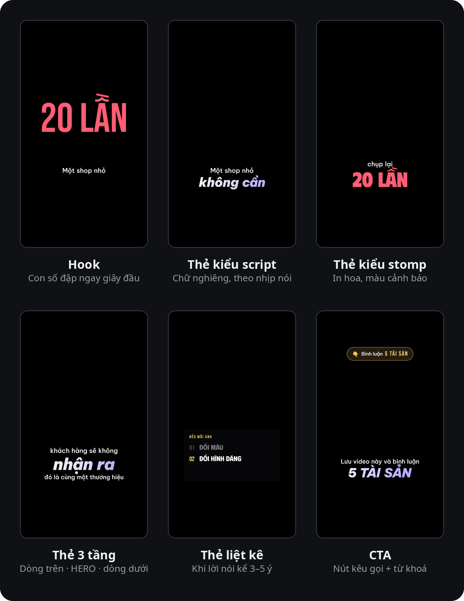
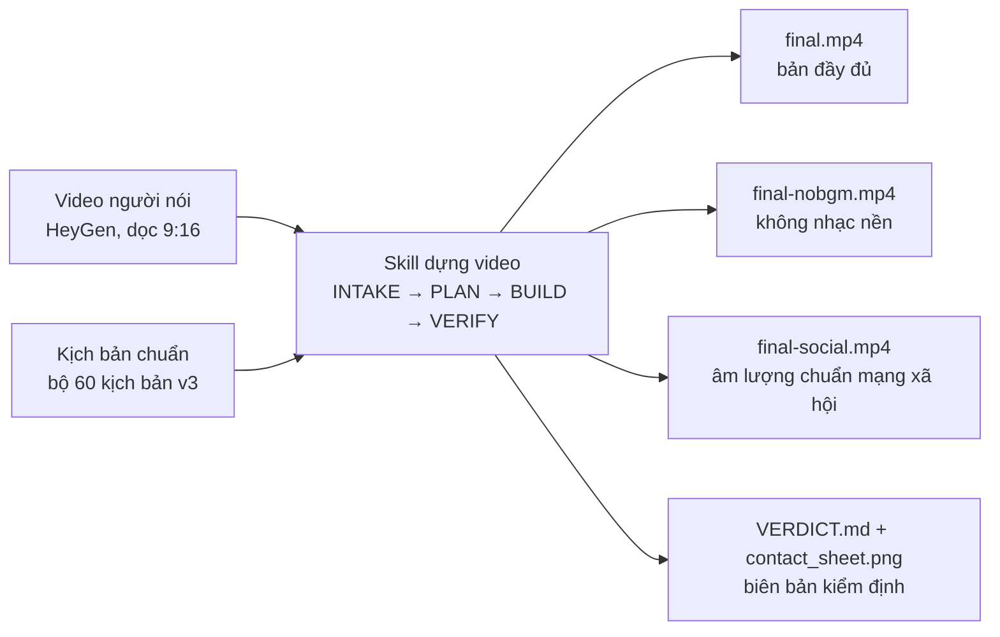
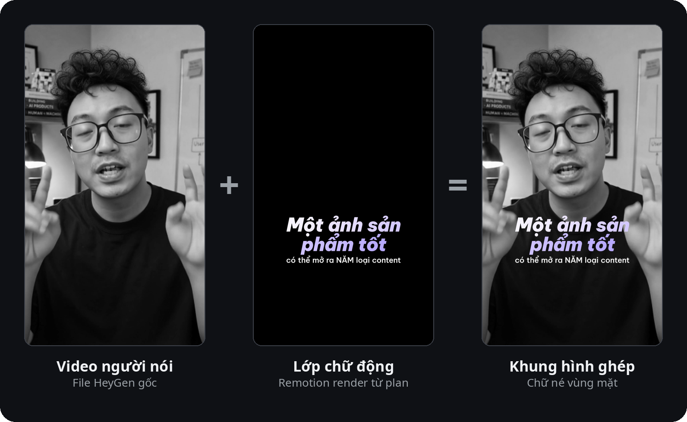
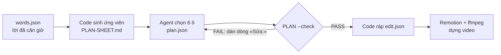
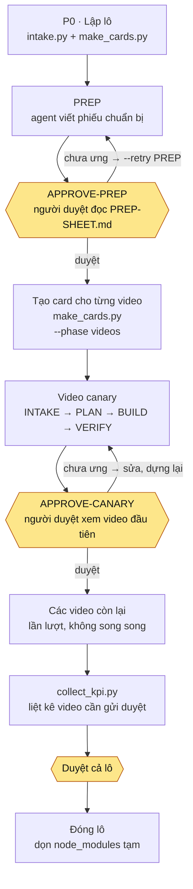
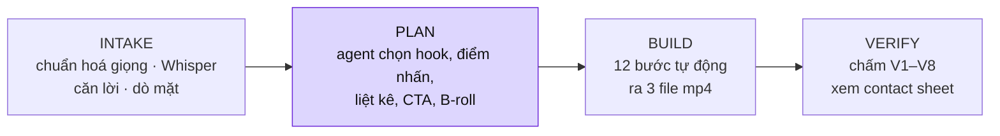
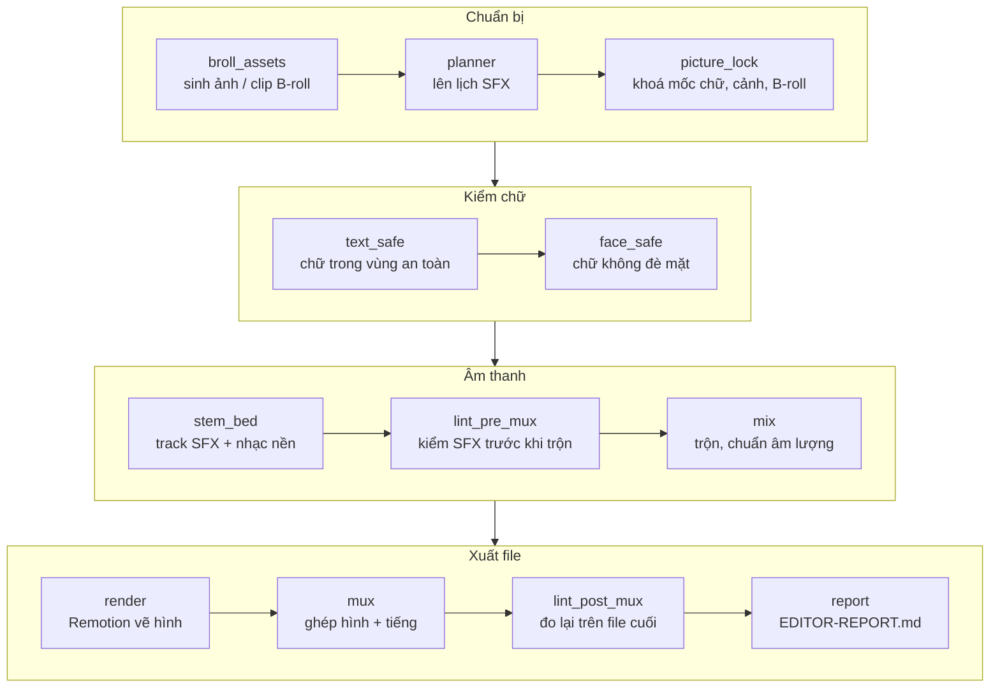

# Dựng video talking-head tự động

Skill cho **Hermes Agent**: nhận video người nói quay dọc 9:16 (HeyGen, avatar AI, quay điện thoại) và dựng thành video ngắn TikTok / Reels / Shorts hoàn chỉnh — phụ đề động tiếng Việt, B-roll AI, hiệu ứng âm thanh, nhạc nền — rồi **tự kiểm định chất lượng** trước khi giao.

| | |
|---|---|
| **Bản đang dùng** | `1.2.3` (2026-09-26) — thư mục `releases/1.2.3/` |
| **Chạy trên** | Hermes Agent + Hermes Kanban (Windows), Remotion, ffmpeg, Whisper |
| **Hướng dẫn vận hành chi tiết** | [`docs/HUONG-DAN-SU-DUNG.md`](docs/HUONG-DAN-SU-DUNG.md) |
| **Lịch sử thay đổi** | [`CHANGELOG.md`](CHANGELOG.md) |



<sub>Ảnh trên là lớp chữ render thật của video 2 (lấy từ `tests/fixtures/broll_v2_b13/out/safe/`). Bản kiểm này tắt glow/bóng chữ để đo vùng an toàn — trong video thành phẩm chữ có thêm hiệu ứng.</sub>

---

## Mục lục

1. [Skill này làm gì](#1-skill-này-làm-gì)
2. [Năm ý tưởng cốt lõi](#2-năm-ý-tưởng-cốt-lõi--đọc-phần-này-trước)
3. [Quy trình một lô video](#3-quy-trình-một-lô-video)
4. [Bên trong một video: 4 card](#4-bên-trong-một-video-4-card)
5. [Kết quả nhận được](#5-kết-quả-nhận-được)
6. [Chuẩn bị máy](#6-chuẩn-bị-máy)
7. [Bắt đầu nhanh](#7-bắt-đầu-nhanh)
8. [Cấu trúc repo](#8-cấu-trúc-repo)
9. [Phát triển và phát hành bản mới](#9-phát-triển-và-phát-hành-bản-mới)
10. [Lịch sử phiên bản](#10-lịch-sử-phiên-bản)
11. [Thuật ngữ](#11-thuật-ngữ)

---

## 1. Skill này làm gì



Mỗi video được dựng chồng **bốn lớp** lên video người nói:

| Lớp | Skill làm gì |
|---|---|
| **Phụ đề động** | Thẻ chữ 3 tầng (dòng nhỏ trên · chữ HERO ở giữa · dòng nhỏ dưới), hiện theo nhịp giọng; thêm hook mở đầu, thẻ liệt kê, nút CTA. Chữ tự né vùng mặt người nói. |
| **B-roll AI** | Ảnh tĩnh hoặc clip AI phủ toàn màn hình 2–4 giây ở các câu phù hợp, tổng 25–40 % thời lượng; giọng và phụ đề vẫn chạy liên tục. |
| **Hiệu ứng âm thanh (SFX)** | Whoosh, pop, click, impact đặt đúng khung hình chữ bật lên hoặc cắt cảnh. |
| **Nhạc nền (BGM)** | Tự chọn đoạn nhạc và dìm dưới giọng, không đè tiếng người nói. |



<sub>Minh hoạ ghép từ dữ liệu test của video 2 (khung 215 và lớp chữ khung 211). Ảnh người nói là bản xám dùng để dò mặt; video thành phẩm có màu, cỡ cảnh zoom và hiệu ứng chữ đầy đủ.</sub>

---

## 2. Năm ý tưởng cốt lõi — đọc phần này trước

Hiểu năm điều này thì đọc mọi tài liệu khác trong repo đều dễ.

### 2.1 Agent chỉ *chọn*, code làm phần còn lại

Ở bản 1.0.0 agent tự viết `edit.json` và tự build, nên dễ làm lệch luật và tự viết script nháp ngoài quy trình. Từ 1.1.1, agent **chỉ ghi một file `plan.json`** với 6 ô quyết định (hook, điểm nhấn, thẻ liệt kê, CTA, hero, B-roll), chọn trong danh sách ứng viên mà code đã sinh sẵn. Mọi mốc giây, khung hình, cắt cảnh đều do code tính.



Ai sửa tay `edit.json` sẽ bị bước VERIFY bắt lỗi `PLAN_DRIFT`.

### 2.2 Mọi con số nằm trong `rules.json`

Ngưỡng âm lượng, độ dài chữ, độ phủ B-roll, nhịp cắt… đều là dữ liệu trong `releases/<bản>/rules.json` (có schema `rules.schema.json`), không rải trong code. Muốn đổi luật là ra bản mới.

### 2.3 Bản phát hành đóng băng

Mỗi thư mục `releases/<bản>/` có `MANIFEST.sha256` băm từng file. Bản đã phát hành **không bao giờ sửa lại** (test `test_release_frozen.py` chặn), nên video dựng bằng bản nào cũng tái lập được đúng như cũ. Mỗi video ghi lại bản luật đã dùng (`rules.lock`); VERIFY từ chối (V1) nếu luật bị đổi giữa chừng.

### 2.4 Người duyệt ở ba mốc, lời duyệt chép nguyên văn

Máy làm, người chốt: **duyệt phiếu chuẩn bị (PREP)**, **duyệt video đầu tiên (canary)**, **duyệt cả lô**. Mọi lời duyệt được chép nguyên văn vào comment card và `_batches/<lô>/APPROVALS.md` trước khi đóng card.

### 2.5 Lỗi thì làm lần thử mới, không gỡ khoá card

Card bị block không bao giờ được unblock tay. Luôn dùng `make_cards.py --retry <video>:<STAGE>` để tạo lần thử mới (`a2`, `a3`…) và lưu trữ card cũ — lịch sử lỗi còn nguyên để truy lại.

---

## 3. Quy trình một lô video

Một **lô** (`b01`, `b02`…) gồm tối đa 10 video, chạy trên một board Kanban riêng `vm-heygen-<lô>`.



Ô màu vàng là chỗ **người duyệt** phải trả lời; còn lại máy tự chạy.

| Bước | Ai làm | Người duyệt cần làm |
|---|---|---|
| **P0 · Lập lô** | `opa-operator` chạy `intake.py`, `make_cards.py` | Đưa danh sách số video (≤ 10) |
| **PREP** | `opa-editor` viết `prep/prep-<k>.json` → script dựng `PREP-SHEET.md` | — |
| **APPROVE-PREP** | `opa-operator` gửi phiếu, chép lời duyệt | Xem trạng thái từng video (`ok` / `needs_rerender` / `needs_input`), gắn `claim_gate` nếu cần |
| **Canary** | `opa-editor` + `opa-verifier` dựng trọn 1 video | Chờ |
| **APPROVE-CANARY** | `opa-operator` gửi `final.mp4` + `VERDICT.md` | Xem, nghe kỹ; duyệt hoặc ghi lỗi kèm mốc `mm:ss` |
| **Các video còn lại** | Worker chạy từng card một; whisper/render xếp hàng qua khoá `_batches/.heavy.lock` | Không cần làm gì |
| **KPI + duyệt lô** | `collect_kpi.py` in các dòng `GỬI USER: …` | Xem các video được gửi, duyệt cả lô hoặc trừ video lỗi |
| **Đóng lô** | `collect_kpi.py --prune-node-modules` xoá `node_modules` tạm | Xác nhận đã nhận đủ |

Lệnh cụ thể từng bước, cách ghi lời duyệt và cách xử lý sự cố: xem [`docs/HUONG-DAN-SU-DUNG.md`](docs/HUONG-DAN-SU-DUNG.md) mục 4–6 và [`releases/1.2.3/stages/OPERATOR.md`](releases/1.2.3/stages/OPERATOR.md).

---

## 4. Bên trong một video: 4 card



Agent nhận card luôn chạy đúng một lệnh đầu tiên — `stage.py <STAGE> --task <id>` — rồi chỉ làm theo dòng `NEXT` mà script in ra. **Chỉ PREP và PLAN cần agent phán đoán** (ô tím); các bước khác là script tất định.

| Card | Ai chạy | Làm gì | Ghi ra |
|---|---|---|---|
| **INTAKE** | `opa-editor` | Chuẩn hoá giọng (−16 LUFS), Whisper large-v3 nghe lời, căn từng từ với kịch bản chuẩn, tìm khoảng ngắt, dò mặt người nói | `words.json`, `pauses.json`, `meta.json`, `face.json`, `public/vo-clean.wav` |
| **PLAN** | `opa-editor` | Đọc `PLAN-SHEET.md`, điền 6 ô trong `plan.json`, chạy `--check` (tối đa 3 vòng) | `plan.json` → code ráp `edit.json` |
| **BUILD** | `opa-editor` | 12 bước bên dưới | `out/final*.mp4`, `QA.json`, `EDITOR-REPORT.md` |
| **VERIFY** | `opa-verifier` | Chấm 8 mục V1–V8, xem contact sheet bằng mắt | `out/verify/VERDICT.md`, `contact_sheet.png`, `kpi.json` |

### 4.1 Mười hai bước của BUILD



Bước nào trượt thì BUILD dừng ở đó và in mã lỗi. Hay gặp nhất là `FACE_ROOM` (chữ chạm vùng mặt): từ bản 1.2.3, BUILD tự đổi sang hero một hàng (tối đa 2 vòng), ghi vào `STATE.md` rồi dừng sớm — agent chỉ cần chạy lại đúng lệnh BUILD.

### 4.2 Tám mục kiểm định của VERIFY

| Mã | Kiểm gì |
|---|---|
| **V1** | Luật dựng khớp đúng bản phát hành đã đóng băng và đúng bản ghi trên card |
| **V2** | Phụ đề, SFX, vùng an toàn chữ không lỗi kỹ thuật |
| **V3** | Đồng bộ: mỗi tiếng động lệch so với hình dưới ngưỡng cho phép |
| **V4** | Âm lượng: `final` và `final-nobgm` −16 LUFS, `final-social` −14 LUFS (±0,5), kèm trần True-Peak |
| **V5** | Mọi file trung gian khớp mã băm ghi trong `STATE.md` (truy được nguồn gốc) |
| **V6** | `EDITOR-REPORT.md` đủ mục, không có bản vá tạm ngoài luồng |
| **V7** | Ghép 12 khung (lưới 4×3) thành `contact_sheet.png` để người xem bằng mắt |
| **V8** | B-roll thực sự hiện trên video cuối, không bị phẳng hình, khớp danh mục |

Kết luận cuối là một trong ba trạng thái:

- **`VERIFIED`** — đạt hết, không có ghi chú.
- **`DONE_WITH_CONCERNS`** — đạt nhưng có điểm cần người xem (ví dụ clip B-roll rơi về ảnh tĩnh, từ cuối thẻ hiện hơi gấp).
- **`REJECTED`** — có mục FAIL; `VERDICT.md` chỉ rõ card nào phải làm lại.

---

## 5. Kết quả nhận được

Mỗi video có một thư mục dựng `D:/MMO/Van Minh AI/Vid Heygen/<n>/edit-r1.2.3/`:

```text
edit-r1.2.3/
├── STATE.md              nhật ký chỉ ghi thêm: mỗi bước + mã băm từng file
├── plan.json             quyết định của agent (file duy nhất agent viết)
├── edit.json             code ráp từ plan.json — không sửa tay
└── out/
    ├── final.mp4         thành phẩm đầy đủ (−16 LUFS)
    ├── final-nobgm.mp4   không nhạc nền, để tự chọn nhạc trên nền tảng
    ├── final-social.mp4  chuẩn âm lượng mạng xã hội (−14 LUFS)
    ├── QA.json           số đo kỹ thuật
    ├── EDITOR-REPORT.md  báo cáo biên tập
    └── verify/
        ├── VERDICT.md          biên bản kiểm định V1–V8
        └── contact_sheet.png   12 khung đại diện
```

Hồ sơ của cả lô nằm ở `D:/MMO/Van Minh AI/Vid Heygen/_batches/<lô>/`: `batch_manifest.json`, `mapping.csv` (ghép video ↔ kịch bản), `PREP-SHEET.md`, `APPROVALS.md` (lời duyệt nguyên văn), `cards.json` (id card Kanban), `kpi.jsonl`, `FEEDBACK.jsonl` (lời chê → căn cứ sửa luật bản sau).

---

## 6. Chuẩn bị máy

### Phần mềm

| Thứ cần có | Ghi chú |
|---|---|
| **Python 3.10+** | Gói dùng trong scripts: `faster-whisper`, `numpy`, `scipy`, `opencv-python`, `Pillow`, `jsonschema`, `PyYAML`. Chạy test cần thêm `pytest`. |
| **Node.js 18+** | Remotion `4.0.484`, React 19 — cài tự động trong thư mục dựng của từng video (`template/package.json`). |
| **ffmpeg** | Trộn âm, ghép hình, đo âm lượng. |
| **Bộ font** | Cinematic fonts pack tại `D:/MMO/Font/Cinematic fonts pack`. |

### Hermes Agent

- Ba profile: **`opa-operator`** (điều phối, nói chuyện với người duyệt), **`opa-editor`** (PREP, INTAKE, PLAN, BUILD), **`opa-verifier`** (VERIFY).
- **Đúng một gateway gốc** đang chạy. Kiểm bằng `hermes gateway list`: dòng `default` có `✓` kèm `PID`; không dòng `opa-*` nào có PID riêng. Bật gateway gốc bằng task Windows `Hermes_Gateway` — không gõ `hermes gateway run` trong terminal của agent.
- Skill đang chạy thật nằm ở `C:/Users/Minh PC/AppData/Local/hermes/shared-skills/video/dung-video-talking-head`.

### Biến môi trường

- **`NINEROUTER_API_KEY`** — khoá cổng 9router để sinh ảnh (`ag/nano-banana`) và clip (`xai/grok-imagine-video`) cho B-roll. Không in hay ghi giá trị khoá vào tài liệu, card, log.

---

## 7. Bắt đầu nhanh

Cách dễ nhất là để **Claude Code** điều phối và giao việc cho các agent OPA Hermes. Dán vào Claude Code:

```text
Mở lô sản xuất bNN của skill dung-video-talking-head bản 1.2.3 cho các video <danh sách số, tối đa 10>.
Giao việc cho các agent OPA Hermes qua hermes kanban (không dùng subagent Claude). Giám sát kĩ: xem đủ mọi ảnh B-roll
theo picture_lock, xem contact sheet từng video, ghi nguyên văn lời duyệt vào APPROVALS.md. Báo tôi khi cần duyệt PREP,
canary và cả lô.
```

Các câu duyệt mẫu:

```text
Tôi duyệt phiếu PREP lô bNN.
Duyệt canary video N của lô bNN.
Chưa duyệt canary video N: <lỗi thấy được + mốc giây>. Sửa rồi dựng lại.
Duyệt cả lô bNN.
Duyệt lô bNN trừ video X: <lỗi + mốc giây>. Làm lại riêng video đó.
```

Đủ bộ prompt mẫu (hỏi tiến độ, card bị khoá, ảnh B-roll có chữ, sửa skill sau một lô, đóng lô…) ở [`docs/HUONG-DAN-SU-DUNG.md` mục 10](docs/HUONG-DAN-SU-DUNG.md#10-prompt-mẫu).

---

## 8. Cấu trúc repo

```text
dung-video-talking-head/
├── SKILL.md            router ngắn (≤ 40 dòng) cho agent nhận card — Hermes đọc file này
├── README.md           tài liệu bạn đang đọc
├── CHANGELOG.md        thay đổi từng bản + các phán quyết (R…)
├── docs/
│   ├── HUONG-DAN-SU-DUNG.md   hướng dẫn vận hành cho chủ kênh / operator
│   ├── 2026-09-11-…-design.md thiết kế gốc của bản 1.1
│   └── images/                ảnh minh hoạ của README
├── releases/           mỗi bản một thư mục, đóng băng sau khi phát hành
│   └── 1.2.3/          ← bản đang dùng
│       ├── rules.json, rules.schema.json   toàn bộ luật dựng dạng dữ liệu
│       ├── MANIFEST.sha256                 mã băm mọi file của bản
│       ├── stages/     OPERATOR.md · PREP.md · PLAN.md — hướng dẫn cho từng vai
│       ├── scripts/    stage.py (cửa vào mọi card), intake.py, make_cards.py,
│       │               verify.py, collect_kpi.py… và thư viện thlib/
│       ├── template/   dự án Remotion: Subtitle, Hook, StepList, Cta, Broll, Footage…
│       ├── sfx/, bgm/  kho âm thanh + manifest
│       ├── data/       từ điển tiếng Việt, mô hình dò mặt
│       └── examples/   plan.json, edit.json mẫu
├── legacy/1.0.0/       quy trình cũ (agent tự viết edit.json) — chỉ để tham khảo
├── tests/              pytest + dữ liệu test thật (khung hình, mặt, B-roll)
└── tools/              công cụ dev: check_drift, make_manifest, lexicon, face_survey…
```

> **Vì sao `legacy/` tách riêng?** Hermes tự đưa các thư mục `references/`, `templates/`, `assets/`, `scripts/` ở gốc skill vào prompt của mọi worker. Để tài liệu 1.0.0 ở gốc sẽ khiến agent chép lại cách làm cũ, nên toàn bộ được dời vào `legacy/1.0.0/` (phán quyết R36).

---

## 9. Phát triển và phát hành bản mới

### Chạy test

```bash
pip install pytest numpy scipy opencv-python Pillow jsonschema PyYAML
pytest              # test nhanh (mặc định bỏ qua nhóm slow)
pytest -m slow      # test chậm: cần faster-whisper + ffmpeg, có render thật
```

`pytest.ini` đã trỏ `pythonpath` vào `releases/1.2.3/scripts` và `tools`.

### Quy ước đánh số bản

| Loại | Khi nào |
|---|---|
| **patch** (`1.2.x`) | Đổi số trong luật hoặc sửa lint |
| **minor** (`1.x.0`) | Thêm luật hoặc thêm bước |
| **major** (`x.0.0`) | Đổi schema hoặc thứ tự pipeline |

### Quy trình ra bản mới

1. Sau mỗi lô, gom lỗi lặp lại (từ `FEEDBACK.jsonl`, `VERDICT.md`) thành spec bản mới. Việc phát triển làm ở repo dev `D:/Vibe Coding/AI Video/th-skill-1.1`, nhánh `rulebook-x.y.z`.
2. Chép `releases/<bản cũ>/` thành `releases/<bản mới>/`, sửa trong bản mới; **không đụng bản cũ**.
3. Sinh lại `MANIFEST.sha256` bằng `tools/make_manifest.py`; đổi số bản trong `SKILL.md` (`metadata.version` và đường dẫn `releases/…`), `pytest.ini`, `tests/conftest.py` (`RELEASE`); ghi `CHANGELOG.md`.
4. Test nhanh và test chậm đều xanh.
5. Chỉ triển khai khi **không còn card nào đang chạy** — đổi bản giữa lô làm video đang dựng trượt V1.
6. Đưa vào thư mục skill thật, gắn tag `vX.Y.Z`, push lên GitHub, cập nhật dòng trỏ phiên bản trong `SOUL.md` của `opa-operator`.

Chi tiết ở [`docs/HUONG-DAN-SU-DUNG.md` mục 9](docs/HUONG-DAN-SU-DUNG.md#9-cập-nhật-skill-lên-bản-mới).

---

## 10. Lịch sử phiên bản

| Bản | Ngày | Điểm chính |
|---|---|---|
| **1.2.3** | 2026-09-26 | BUILD tự áp hero một hàng khi `FACE_ROOM` rồi dừng sớm; cấm thêm từ khiến ảnh B-roll sinh chữ (ghi chú, checklist, màn hình chat) |
| 1.2.2 | 2026-09-26 | Tự gộp gợi ý hero vào `plan.json`; cắt viền ảnh B-roll; gợi ý khi Remotion thiếu RAM |
| 1.2.1 | 2026-09-24 | Sửa dò mặt khi có hook; nâng độ phủ B-roll tối thiểu; ghi lý do clip rơi về ảnh |
| 1.2.0 | 2026-09-23 | **B-roll AI** phủ toàn màn hình, kiểm định V8, schema `plan/2` |
| 1.1.1 | 2026-09-16 | Hợp đồng `plan.json` (agent chỉ chọn), bước `face_safe`, sửa dấu tiếng Việt bị cắt |
| 1.1.0 | 2026-09-12 | Tái cấu trúc: luật thành dữ liệu, pipeline 4 card trên Hermes Kanban, `verify.py` V1–V7 |
| 1.0.0 | 2026-09-11 | Bản đầu: agent tự viết `edit.json` và tự render (nay ở `legacy/1.0.0/`) |

Đầy đủ lý do từng thay đổi: [`CHANGELOG.md`](CHANGELOG.md).

---

## 11. Thuật ngữ

| Từ | Nghĩa |
|---|---|
| **Lô** (`bNN`) | Một đợt dựng tối đa 10 video, có board Kanban và thư mục `_batches/bNN/` riêng |
| **Card** | Một việc trên bảng Hermes Kanban (PREP, INTAKE, PLAN, BUILD, VERIFY, APPROVE-…) |
| **Canary** | Video đầu tiên của lô, dựng trọn và duyệt trước khi chạy các video còn lại |
| **Hero** | Chữ to ở giữa thẻ phụ đề — cụm từ quan trọng nhất của câu |
| **Hook** | Chữ/số đập ở giây đầu để giữ người xem |
| **CTA** | Lời kêu gọi hành động cuối video (ví dụ «Bình luận 5 TÀI SẢN») |
| **B-roll** | Hình minh hoạ chèn phủ lên video người nói |
| **`claim_gate`** | Cờ đánh dấu video có nội dung cần kiểm chứng thật trước khi đăng (so sánh, số liệu, case study) |
| **`needs_rerender`** | HeyGen đọc sai kịch bản (đọc cả chữ giữ chỗ `[TIN MỚI]`…) — phải render lại trên HeyGen |
| **`FACE_ROOM`** | Lỗi chữ chạm vùng mặt người nói |
| **`PLAN_DRIFT`** | `edit.json` không còn khớp `plan.json` — có người sửa tay |
| **LUFS** | Đơn vị đo độ to cảm nhận của âm thanh; −14 LUFS là mức phổ biến của mạng xã hội |
| **`--retry`** | Cách duy nhất làm lại một card lỗi: tạo lần thử mới `a<k+1>`, lưu trữ card cũ |
